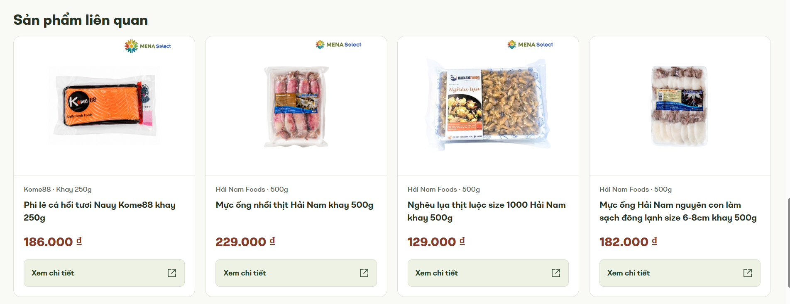

# AI Usage Log

## 1. Công cụ AI
Gemini: hỗ trợ phân tích website. ChatGPT: hỗ trợ thiết kế, tạo/sửa HTML/CSS, kiểm tra và biên tập báo cáo. Không ghi phiên bản mô hình khi chưa có xác nhận.

## 2. Mục đích sử dụng
Phân tích giao diện, đề xuất bố cục, giải thích HTML/CSS, sửa lỗi và kiểm tra bản mẫu.

## 3. Prompt đã sử dụng

### Phân tích website
```text
Bạn là chuyên gia phân tích nghiệp vụ và thiết kế trải nghiệm người dùng cho website thương mại điện tử.
Tôi đang khảo sát website Mena Select: https://menaselect.com/.
Hãy giúp tôi lập bảng phân tích các khu vực:
1. Trang chủ.
2. Danh mục sản phẩm.
3. Chi tiết sản phẩm.
4. Tìm kiếm.
5. Giỏ hàng.
Với mỗi khu vực, hãy nêu:
- Mục đích của chức năng.
- Thành phần giao diện cần có.
- Điểm thuận tiện đối với khách hàng.
- Một vấn đề có thể phát sinh.
- Một đề xuất cải tiến.
Không khẳng định những tính năng chưa được kiểm chứng.
Phân biệt rõ nhận xét dựa trên quan sát và đề xuất của AI.
```

### Đề xuất giao diện
```text
Tôi đang thực hiện bài tập phát triển giao diện website thương mại điện tử bằng HTML5 và CSS3.

Tôi muốn cải tiến khu vực: trang chi tiết sản phẩm của website Mena Select (https://menaselect.com/), tập trung tối ưu khung ảnh và tính thẩm mỹ, xử lý bố cục mất cân đối khi mô tả chi tiết kéo dài ở một cột; sắp xếp rõ mô tả ngắn, thông tin mua hàng, khuyến mãi/quà tặng, chính sách và sản phẩm liên quan.

Đối tượng sử dụng: khách hàng mua sắm trực tuyến tại Việt Nam.

Hãy đề xuất:
1. Bố cục giao diện.
2. Các thành phần HTML cần sử dụng.
3. Cách tổ chức CSS.
4. Cách hiển thị trên máy tính và điện thoại.
5. Những điểm cần kiểm tra về khả năng sử dụng.

Trước tiên, hãy giải thích phương án thiết kế.
Chưa tạo toàn bộ mã nguồn cho đến khi tôi yêu cầu.
```

### Tạo mã nguồn
```text
Tôi chọn phương án A: phía trên là hai cột ảnh và thông tin mua hàng; phía dưới là mô tả chi tiết hiển thị sẵn trên toàn chiều rộng, chia thành các mục dễ đọc.

Dùng “Cá phèn Hải Nam fillet còn da size 20–40 gói 500g” làm sản phẩm chính, kèm bốn sản phẩm liên quan. Giữ khu vực mô tả ngắn, khuyến mãi/quà tặng và liên kết chính sách; banner quảng bá được bố trí riêng.

Dựa trên phương án đã thống nhất, hãy tạo một trang giao diện thương mại điện tử bằng HTML5 và CSS3.

Yêu cầu:
- Giao diện có tiêu đề và khu vực sản phẩm.
- Có tối thiểu 4 sản phẩm mẫu.
- Mỗi sản phẩm có hình ảnh, tên, giá và nút thao tác.
- Bố cục phù hợp với màn hình máy tính và điện thoại.
- Mã HTML có cấu trúc rõ ràng.
- CSS được tách thành file riêng.
- Không sử dụng backend hoặc cơ sở dữ liệu.
- Không đưa thư viện hoặc thành phần không cần thiết vào dự án.

Giải thích cách chạy trang web và những phần tôi cần kiểm tra.

```

### Các yêu cầu điều chỉnh
Sinh viên yêu cầu giữ header/footer/danh mục, làm rõ VAT và phí vận chuyển, thêm ảnh, sửa hành vi xem ảnh, bỏ nhãn phụ và bổ sung Chia sẻ.

## 4. Kết quả AI đề xuất
Hai cột ảnh và mua hàng ở trên; mô tả mở toàn chiều rộng bên dưới; banner riêng và bốn sản phẩm liên quan.

## 5. Kiểm tra và điều chỉnh
Sinh viên phát hiện các vấn đề qua bản hiển thị và đưa yêu cầu điều chỉnh. AI hỗ trợ sửa mã. Kiểm tra trình duyệt trong phiên hỗ trợ phát hiện và sửa thêm tràn ngang của điều hướng. Kết quả và giới hạn ghi tại TESTING.md. Không ghi việc AI sửa mã thành thao tác tự viết của sinh viên.

## 6. Phần tôi hiểu và có thể giải thích
Nội dung cần nắm để giải thích: cấu trúc header/main/article/section/footer; Grid và media query; radio/label/:checked cho gallery; popover/popovertarget để xem ảnh; margin và padding; position: relative cho vùng điều hướng. Báo cáo có bảng giải thích vai trò từng phần; chưa dùng tài liệu này để xác nhận năng lực trả lời của sinh viên.

## Buổi 2 – Bước 1. Rà soát bài Buổi 1

### Công cụ và đầu vào
- Công cụ AI: ChatGPT.
- Đầu vào: mã index.html và styles.css của bài Buổi 1.
- Phạm vi cải tiến được chọn: khu vực “Sản phẩm liên quan”, id="san-pham-lien-quan".

### Lượt 1 – Prompt 1 của giảng viên

#### Prompt đã gửi
Tôi đang làm bài tập cá nhân môn Phát triển ứng dụng thương mại điện tử.

Trong Buổi 1, tôi đã khảo sát một website TMĐT và tạo một giao diện cải tiến bằng HTML/CSS.

Đây là mã HTML hiện tại:
<!DOCTYPE html>
<html lang="vi">
<head>
  <meta charset="UTF-8">
  <meta name="viewport" content="width=device-width, initial-scale=1.0">
  <meta name="description" content="Cá phèn Hải Nam fillet còn da gói 500g. Xem hình ảnh, thông tin sản phẩm, hướng dẫn sử dụng và bảo quản tại Mena Select.">
  <title>Cá phèn Hải Nam fillet còn da 500g | Mena Select</title>
  <link rel="icon" href="assets/mena-select-logo.png" type="image/png">
  <link rel="stylesheet" href="styles.css">
</head>
<body id="dau-trang">
  <a class="skip-link" href="#noi-dung">Đến nội dung chính</a>

  
  <svg class="svg-definitions" xmlns="http://www.w3.org/2000/svg" aria-hidden="true">
    <symbol id="icon-arrow" viewBox="0 0 24 24"><path d="M5 12h14m-6-6 6 6-6 6"/></symbol>
    <symbol id="icon-chevron" viewBox="0 0 24 24"><path d="m9 5 7 7-7 7"/></symbol>
    <symbol id="icon-bag" viewBox="0 0 24 24"><path d="M5 7h14l1 14H4L5 7Z"/><path d="M8 8V6a4 4 0 0 1 8 0v2"/></symbol>
    <symbol id="icon-leaf" viewBox="0 0 24 24"><path d="M20 3c-2 0-8 0-12 4S3 16 7 19s8 1 11-3 2-10 2-13Z"/><path d="m4 21 12-12M9 16v-5m0 5h5"/></symbol>
    <symbol id="icon-gift" viewBox="0 0 24 24"><path d="M3 8h18v4H3zM5 12v9h14v-9M12 8v13"/><path d="M12 8H8a3 3 0 1 1 3-3l1 3Zm0 0h4a3 3 0 1 0-3-3l-1 3Z"/></symbol>
    <symbol id="icon-shield" viewBox="0 0 24 24"><path d="M12 3 3 7v6c0 5 9 9 9 9s9-4 9-9V7l-9-4Z"/><path d="m8 12 3 3 5-6"/></symbol>
    <symbol id="icon-return" viewBox="0 0 24 24"><path d="M4 10a8 8 0 1 1 0 6M4 4v6h6"/></symbol>
    <symbol id="icon-expand" viewBox="0 0 24 24"><path d="M8 3H3v5m13-5h5v5M3 16v5h5m13-5v5h-5"/></symbol>
    <symbol id="icon-check" viewBox="0 0 24 24"><path d="m5 12 4 4L19 6"/></symbol>
    <symbol id="icon-snow" viewBox="0 0 24 24"><path d="M12 2v20M3.3 7l17.4 10M3.3 17 20.7 7M9 4l3 3 3-3M9 20l3-3 3 3M4 10l4-1-1-4m13 9-4 1 1 4M7 19l1-4-4-1m13-9-1 4 4 1"/></symbol>
    <symbol id="icon-fish" viewBox="0 0 24 24"><path d="M4 12s4-6 9-6c4 0 7 6 7 6s-3 6-7 6c-5 0-9-6-9-6Z"/><path d="m4 12-3-4v8l3-4Zm6-5 2-4 3 3m-5 11 2 4 3-3"/><circle cx="16" cy="11" r=".7"/></symbol>
    <symbol id="icon-external" viewBox="0 0 24 24"><path d="M14 3h7v7M21 3 11 13M10 3H3v18h18v-7"/></symbol>
    <symbol id="icon-search" viewBox="0 0 24 24"><circle cx="10.5" cy="10.5" r="7.5"/><path d="m16 16 5 5"/></symbol>
    <symbol id="icon-down" viewBox="0 0 24 24"><path d="m6 9 6 6 6-6"/></symbol>
    <symbol id="icon-user" viewBox="0 0 24 24"><circle cx="12" cy="8" r="4"/><path d="M4 22v-3a8 8 0 0 1 16 0v3"/></symbol>
    <symbol id="icon-receipt" viewBox="0 0 24 24"><path d="M6 3h12v19l-3-2-3 2-3-2-3 2V3ZM9 7h6M9 11h6M9 15h3"/></symbol>
    <symbol id="icon-cart" viewBox="0 0 24 24"><path d="M2 3h3l3 13h11l3-10H6M8 12h12"/><circle cx="9" cy="21" r="1"/><circle cx="18" cy="21" r="1"/></symbol>
    <symbol id="icon-close" viewBox="0 0 24 24"><path d="m6 6 12 12M6 18 18 6"/></symbol>
    <symbol id="icon-share" viewBox="0 0 24 24"><circle cx="18" cy="5" r="3"/><circle cx="6" cy="12" r="3"/><circle cx="18" cy="19" r="3"/><path d="m8.6 10.5 6.8-4M8.6 13.5l6.8 4"/></symbol>
  </svg>

  <header class="site-header">
    <div class="header-main">
      <div class="container header-main__inner">
        <a href="https://menaselect.com/" target="_blank" rel="noopener noreferrer" class="brand"><span class="sr-only"> (mở thẻ mới)</span></a>
        <a class="receiving-pill" href="https://menaselect.com/" target="_blank" rel="noopener noreferrer">
          <span><strong>Giao hàng hay tự nhận hàng?</strong><small>Bạn muốn nhận đơn hàng tại vị trí nào?</small></span><svg class="icon" aria-hidden="true"><use href="#icon-down"/></svg><span class="sr-only"> (chọn trên Mena Select, mở thẻ mới)</span>
        </a>
        <form class="header-search" role="search" action="https://menaselect.com/catalogsearch/result/" method="get" target="_blank" rel="noopener noreferrer">
          <label class="sr-only" for="tu-khoa">Tìm kiếm sản phẩm trên Mena Select</label>
          <input id="tu-khoa" name="q" type="search" placeholder="Xin chào! Bạn muốn tìm gì?" maxlength="128" required>
          <button type="submit" aria-label="Tìm kiếm trên Mena Select, mở thẻ mới"><svg class="icon" aria-hidden="true"><use href="#icon-search"/></svg></button>
        </form>
        <div class="header-tools">
          <a href="https://menaselect.com/sales/guest/form/" target="_blank" rel="noopener noreferrer" class="header-tool"><svg class="icon" aria-hidden="true"><use href="#icon-receipt"/></svg><span><small>Tra cứu</small><strong>Đơn hàng</strong></span><span class="sr-only"> (mở thẻ mới)</span></a>
          <a href="https://menaselect.com/customer/account/" target="_blank" rel="noopener noreferrer" class="header-tool"><svg class="icon" aria-hidden="true"><use href="#icon-user"/></svg><span><small>Đăng nhập</small><strong>Tài khoản</strong></span><span class="sr-only"> (mở thẻ mới)</span></a>
          <a href="https://menaselect.com/checkout/cart/" target="_blank" rel="noopener noreferrer" class="header-cart"><svg class="icon" aria-hidden="true"><use href="#icon-cart"/></svg><span class="sr-only">Giỏ hàng</span><span class="sr-only"> (mở thẻ mới)</span></a>
        </div>
      </div>
    </div>
    <nav class="site-navigation" aria-label="Điều hướng chính Mena Select">
      <div class="container navigation-inner">
        <details class="category-menu" id="danh-muc">
          <summary class="nav-pill nav-pill--category"><span>Danh Mục</span><svg class="icon" aria-hidden="true"><use href="#icon-down"/></svg></summary>
          <div class="category-menu__panel"><ul class="category-tree">
            <li><a href="https://menaselect.com/khuyen-mai-cua-tuan" target="_blank" rel="noopener noreferrer" class="category-direct"><span>Khuyến Mãi Của Tuần</span><span class="sr-only"> (mở thẻ mới)</span></a></li>
            <li><details class="category-group"><summary><span>Chương Trình Khuyến Mãi</span><svg class="icon" aria-hidden="true"><use href="#icon-chevron"/></svg></summary><div class="category-group__content"><a href="https://menaselect.com/ctkm" target="_blank" rel="noopener noreferrer" class="category-all">Xem tất cả Chương Trình Khuyến Mãi<span class="sr-only"> (mở thẻ mới)</span></a><ul><li><a href="https://menaselect.com/ctkm/mua-la-co-qua" target="_blank" rel="noopener noreferrer">Mua Là Có Quà<span class="sr-only"> (mở thẻ mới)</span></a></li><li><a href="https://menaselect.com/ctkm/deal-fresh" target="_blank" rel="noopener noreferrer">Deal Thực Phẩm Tươi Sống<span class="sr-only"> (mở thẻ mới)</span></a></li><li><a href="https://menaselect.com/ctkm/deal-thuc-pham-man" target="_blank" rel="noopener noreferrer">Deal Thực Phẩm Mặn<span class="sr-only"> (mở thẻ mới)</span></a></li><li><a href="https://menaselect.com/ctkm/deal-thuc-pham-ngot" target="_blank" rel="noopener noreferrer">Deal Thực Phẩm Ngọt<span class="sr-only"> (mở thẻ mới)</span></a></li><li><a href="https://menaselect.com/ctkm/deal-giai-khat" target="_blank" rel="noopener noreferrer">Deal Giải Khát<span class="sr-only"> (mở thẻ mới)</span></a></li><li><a href="https://menaselect.com/ctkm/deal-cham-soc-ca-nhan-nha-cua" target="_blank" rel="noopener noreferrer">Deal Chăm Sóc<span class="sr-only"> (mở thẻ mới)</span></a></li><li><a href="https://menaselect.com/ctkm/deal-me-be-dinh-duong" target="_blank" rel="noopener noreferrer">Deal Mẹ &amp; Bé - Dinh Dưỡng<span class="sr-only"> (mở thẻ mới)</span></a></li><li><a href="https://menaselect.com/ctkm/deal-gia-dung" target="_blank" rel="noopener noreferrer">Deal Gia Dụng<span class="sr-only"> (mở thẻ mới)</span></a></li></ul></div></details></li>
            <li><details class="category-group"><summary><span>Gourmet</span><svg class="icon" aria-hidden="true"><use href="#icon-chevron"/></svg></summary><div class="category-group__content"><a href="https://menaselect.com/gourmet-am-thuc-tinh-te" target="_blank" rel="noopener noreferrer" class="category-all">Xem tất cả Gourmet<span class="sr-only"> (mở thẻ mới)</span></a><ul><li><a href="https://menaselect.com/gourmet-am-thuc-tinh-te/wine-celebration-drinks" target="_blank" rel="noopener noreferrer">Rượu Vang Đặc Tuyển<span class="sr-only"> (mở thẻ mới)</span></a></li><li><a href="https://menaselect.com/gourmet-am-thuc-tinh-te/premium-fruit-fresh" target="_blank" rel="noopener noreferrer">Trái Cây &amp; Thực Phẩm Tươi<span class="sr-only"> (mở thẻ mới)</span></a></li><li><a href="https://menaselect.com/gourmet-am-thuc-tinh-te/premium-water-beverage" target="_blank" rel="noopener noreferrer">Đồ Uống Cao Cấp<span class="sr-only"> (mở thẻ mới)</span></a></li><li><a href="https://menaselect.com/gourmet-am-thuc-tinh-te/cheese-dairy-dessert" target="_blank" rel="noopener noreferrer">Phô Mai &amp; Tráng Miệng<span class="sr-only"> (mở thẻ mới)</span></a></li><li><a href="https://menaselect.com/gourmet-am-thuc-tinh-te/pasta-sauce-condiments" target="_blank" rel="noopener noreferrer">Sốt Pasta &amp; Gia Vị<span class="sr-only"> (mở thẻ mới)</span></a></li><li><a href="https://menaselect.com/gourmet-am-thuc-tinh-te/chocolate-fine-snacks" target="_blank" rel="noopener noreferrer">Chocolate &amp; Snack Thượng Hạng<span class="sr-only"> (mở thẻ mới)</span></a></li></ul></div></details></li>
            <li><details class="category-group"><summary><span>Rau Củ Quả</span><svg class="icon" aria-hidden="true"><use href="#icon-chevron"/></svg></summary><div class="category-group__content"><a href="https://menaselect.com/rau-cu-qua" target="_blank" rel="noopener noreferrer" class="category-all">Xem tất cả Rau Củ Quả<span class="sr-only"> (mở thẻ mới)</span></a><ul><li><a href="https://menaselect.com/rau-cu-qua/rau" target="_blank" rel="noopener noreferrer">Rau<span class="sr-only"> (mở thẻ mới)</span></a></li><li><a href="https://menaselect.com/rau-cu-qua/cu-qua" target="_blank" rel="noopener noreferrer">Củ - Quả<span class="sr-only"> (mở thẻ mới)</span></a></li><li><a href="https://menaselect.com/rau-cu-qua/nam-mang-rong" target="_blank" rel="noopener noreferrer">Nấm - Măng - Rong<span class="sr-only"> (mở thẻ mới)</span></a></li></ul></div></details></li>
            <li><details class="category-group"><summary><span>Trái Cây</span><svg class="icon" aria-hidden="true"><use href="#icon-chevron"/></svg></summary><div class="category-group__content"><a href="https://menaselect.com/trai-cay" target="_blank" rel="noopener noreferrer" class="category-all">Xem tất cả Trái Cây<span class="sr-only"> (mở thẻ mới)</span></a><ul><li><a href="https://menaselect.com/trai-cay/trai-cay-noi-dia" target="_blank" rel="noopener noreferrer">Trái Cây Nội Địa<span class="sr-only"> (mở thẻ mới)</span></a></li><li><a href="https://menaselect.com/trai-cay/trai-cay-nhap-khau" target="_blank" rel="noopener noreferrer">Trái Cây Nhập Khẩu<span class="sr-only"> (mở thẻ mới)</span></a></li></ul></div></details></li>
            <li><details class="category-group"><summary><span>Thịt Trứng Hải Sản</span><svg class="icon" aria-hidden="true"><use href="#icon-chevron"/></svg></summary><div class="category-group__content"><a href="https://menaselect.com/thit-trung-hai-san" target="_blank" rel="noopener noreferrer" class="category-all">Xem tất cả Thịt Trứng Hải Sản<span class="sr-only"> (mở thẻ mới)</span></a><ul><li><a href="https://menaselect.com/thit-trung-hai-san/trung-gia-cam" target="_blank" rel="noopener noreferrer">Trứng Gia Cầm<span class="sr-only"> (mở thẻ mới)</span></a></li><li><a href="https://menaselect.com/thit-trung-hai-san/tom-muc-ca-kho" target="_blank" rel="noopener noreferrer">Tôm - Mực - Cá Khô<span class="sr-only"> (mở thẻ mới)</span></a></li><li><a href="https://menaselect.com/thit-trung-hai-san/ca-thuy-hai-san-tuoi" target="_blank" rel="noopener noreferrer">Cá - Thủy Hải Sản Tươi<span class="sr-only"> (mở thẻ mới)</span></a></li><li><a href="https://menaselect.com/thit-trung-hai-san/thit-heo" target="_blank" rel="noopener noreferrer">Thịt Heo<span class="sr-only"> (mở thẻ mới)</span></a></li><li><a href="https://menaselect.com/thit-trung-hai-san/thit-bo" target="_blank" rel="noopener noreferrer">Thịt Bò<span class="sr-only"> (mở thẻ mới)</span></a></li><li><a href="https://menaselect.com/thit-trung-hai-san/thit-gia-cam" target="_blank" rel="noopener noreferrer">Thịt Gia Cầm<span class="sr-only"> (mở thẻ mới)</span></a></li></ul></div></details></li>
            <li><details class="category-group"><summary><span>Thực Phẩm Đông Mát</span><svg class="icon" aria-hidden="true"><use href="#icon-chevron"/></svg></summary><div class="category-group__content"><a href="https://menaselect.com/thuc-pham-dong-mat" target="_blank" rel="noopener noreferrer" class="category-all">Xem tất cả Thực Phẩm Đông Mát<span class="sr-only"> (mở thẻ mới)</span></a><ul><li><a href="https://menaselect.com/thuc-pham-dong-mat/hai-san-dong-lanh" target="_blank" rel="noopener noreferrer">Hải Sản Đông Lạnh<span class="sr-only"> (mở thẻ mới)</span></a></li><li><a href="https://menaselect.com/thuc-pham-dong-mat/lam-san-an-lien" target="_blank" rel="noopener noreferrer">Làm Sẵn - Ăn Liền<span class="sr-only"> (mở thẻ mới)</span></a></li><li><a href="https://menaselect.com/thuc-pham-dong-mat/banh-dong-ran" target="_blank" rel="noopener noreferrer">Bánh Đông Rán<span class="sr-only"> (mở thẻ mới)</span></a></li><li><a href="https://menaselect.com/thuc-pham-dong-mat/do-nguoi-thit-che-bien" target="_blank" rel="noopener noreferrer">Đồ Nguội - Thịt Chế Biến<span class="sr-only"> (mở thẻ mới)</span></a></li><li><a href="https://menaselect.com/thuc-pham-dong-mat/banh-bao-banh-mi-pizza" target="_blank" rel="noopener noreferrer">Bánh Bao - Bánh Mì - Pizza<span class="sr-only"> (mở thẻ mới)</span></a></li><li><a href="https://menaselect.com/thuc-pham-dong-mat/rau-cu-trai-cay-dong-lanh" target="_blank" rel="noopener noreferrer">Rau - Củ - Trái Cây Đông Lạnh<span class="sr-only"> (mở thẻ mới)</span></a></li><li><a href="https://menaselect.com/thuc-pham-dong-mat/bun-tuoi-dau-hu-dua-chua" target="_blank" rel="noopener noreferrer">Bún Tươi - Đậu Hũ - Dưa Chua<span class="sr-only"> (mở thẻ mới)</span></a></li></ul></div></details></li>
            <li><details class="category-group"><summary><span>Phô Mai Bơ Sữa</span><svg class="icon" aria-hidden="true"><use href="#icon-chevron"/></svg></summary><div class="category-group__content"><a href="https://menaselect.com/pho-mai-bo-sua" target="_blank" rel="noopener noreferrer" class="category-all">Xem tất cả Phô Mai Bơ Sữa<span class="sr-only"> (mở thẻ mới)</span></a><ul><li><a href="https://menaselect.com/pho-mai-bo-sua/bo-pho-mai-san-pham-tu-sua" target="_blank" rel="noopener noreferrer">Bơ - Phô Mai - Sản Phẩm Từ Sữa<span class="sr-only"> (mở thẻ mới)</span></a></li><li><a href="https://menaselect.com/pho-mai-bo-sua/sua-sua-dac" target="_blank" rel="noopener noreferrer">Sữa - Sữa Đặc<span class="sr-only"> (mở thẻ mới)</span></a></li><li><a href="https://menaselect.com/pho-mai-bo-sua/sua-hat-sua-dau" target="_blank" rel="noopener noreferrer">Sữa Hạt - Sữa Đậu<span class="sr-only"> (mở thẻ mới)</span></a></li><li><a href="https://menaselect.com/pho-mai-bo-sua/sua-chua" target="_blank" rel="noopener noreferrer">Sữa Chua<span class="sr-only"> (mở thẻ mới)</span></a></li></ul></div></details></li>
            <li><details class="category-group"><summary><span>Bánh mì &amp; Bánh ngọt</span><svg class="icon" aria-hidden="true"><use href="#icon-chevron"/></svg></summary><div class="category-group__content"><a href="https://menaselect.com/banh-mi-banh-ngot-tuoi" target="_blank" rel="noopener noreferrer" class="category-all">Xem tất cả Bánh mì &amp; Bánh ngọt<span class="sr-only"> (mở thẻ mới)</span></a><ul><li><a href="https://menaselect.com/banh-mi-banh-ngot-tuoi/banh-mi" target="_blank" rel="noopener noreferrer">Bánh mì<span class="sr-only"> (mở thẻ mới)</span></a></li><li><a href="https://menaselect.com/banh-mi-banh-ngot-tuoi/banh-ngot" target="_blank" rel="noopener noreferrer">Bánh ngọt<span class="sr-only"> (mở thẻ mới)</span></a></li></ul></div></details></li>
            <li><details class="category-group"><summary><span>Đồ Hộp Mì Xúc Xích</span><svg class="icon" aria-hidden="true"><use href="#icon-chevron"/></svg></summary><div class="category-group__content"><a href="https://menaselect.com/do-hop-mi-xuc-xich" target="_blank" rel="noopener noreferrer" class="category-all">Xem tất cả Đồ Hộp Mì Xúc Xích<span class="sr-only"> (mở thẻ mới)</span></a><ul><li><a href="https://menaselect.com/do-hop-mi-xuc-xich/mi-bun-pho-nui-banh-trang" target="_blank" rel="noopener noreferrer">Mì - Bún - Phở - Nui - Bánh Tráng<span class="sr-only"> (mở thẻ mới)</span></a></li><li><a href="https://menaselect.com/do-hop-mi-xuc-xich/mi-mien-chao-pho-canh-an-lien" target="_blank" rel="noopener noreferrer">Mì - Miến - Cháo - Phở - Canh Ăn Liền<span class="sr-only"> (mở thẻ mới)</span></a></li><li><a href="https://menaselect.com/do-hop-mi-xuc-xich/do-hop" target="_blank" rel="noopener noreferrer">Đồ Hộp<span class="sr-only"> (mở thẻ mới)</span></a></li><li><a href="https://menaselect.com/do-hop-mi-xuc-xich/xuc-xich-lap-xuong-cha-bong" target="_blank" rel="noopener noreferrer">Xúc Xích - Lạp Xưởng - Chà Bông<span class="sr-only"> (mở thẻ mới)</span></a></li></ul></div></details></li>
            <li><details class="category-group"><summary><span>Gia Vị Dầu Ăn</span><svg class="icon" aria-hidden="true"><use href="#icon-chevron"/></svg></summary><div class="category-group__content"><a href="https://menaselect.com/gia-vi-dau-an" target="_blank" rel="noopener noreferrer" class="category-all">Xem tất cả Gia Vị Dầu Ăn<span class="sr-only"> (mở thẻ mới)</span></a><ul><li><a href="https://menaselect.com/gia-vi-dau-an/gia-vi" target="_blank" rel="noopener noreferrer">Gia Vị<span class="sr-only"> (mở thẻ mới)</span></a></li><li><a href="https://menaselect.com/gia-vi-dau-an/muoi-duong-hat-nem-bot-ngot" target="_blank" rel="noopener noreferrer">Muối - Đường - Hạt Nêm - Bột Ngọt<span class="sr-only"> (mở thẻ mới)</span></a></li><li><a href="https://menaselect.com/gia-vi-dau-an/dau-an" target="_blank" rel="noopener noreferrer">Dầu Ăn<span class="sr-only"> (mở thẻ mới)</span></a></li><li><a href="https://menaselect.com/gia-vi-dau-an/dau-hao-giam-bo" target="_blank" rel="noopener noreferrer">Dầu Hào - Giấm - Bơ<span class="sr-only"> (mở thẻ mới)</span></a></li><li><a href="https://menaselect.com/gia-vi-dau-an/duong" target="_blank" rel="noopener noreferrer">Đường<span class="sr-only"> (mở thẻ mới)</span></a></li><li><a href="https://menaselect.com/gia-vi-dau-an/tuong-ot-tuong-ca-sot-tron-cham" target="_blank" rel="noopener noreferrer">Tương Ớt - Tương Cà - Sốt Trộn Chấm<span class="sr-only"> (mở thẻ mới)</span></a></li><li><a href="https://menaselect.com/gia-vi-dau-an/nuoc-mam" target="_blank" rel="noopener noreferrer">Nước Mắm<span class="sr-only"> (mở thẻ mới)</span></a></li><li><a href="https://menaselect.com/gia-vi-dau-an/nuoc-tuong" target="_blank" rel="noopener noreferrer">Nước Tương<span class="sr-only"> (mở thẻ mới)</span></a></li><li><a href="https://menaselect.com/gia-vi-dau-an/tieu-sa-te-ot-bot" target="_blank" rel="noopener noreferrer">Tiêu - Sa Tế - Ớt Bột<span class="sr-only"> (mở thẻ mới)</span></a></li></ul></div></details></li>
            <li><details class="category-group"><summary><span>Gạo Đậu Đồ Khô</span><svg class="icon" aria-hidden="true"><use href="#icon-chevron"/></svg></summary><div class="category-group__content"><a href="https://menaselect.com/gao-dau-do-kho" target="_blank" rel="noopener noreferrer" class="category-all">Xem tất cả Gạo Đậu Đồ Khô<span class="sr-only"> (mở thẻ mới)</span></a><ul><li><a href="https://menaselect.com/gao-dau-do-kho/bot" target="_blank" rel="noopener noreferrer">Bột<span class="sr-only"> (mở thẻ mới)</span></a></li><li><a href="https://menaselect.com/gao-dau-do-kho/dau-me" target="_blank" rel="noopener noreferrer">Đậu - Mè<span class="sr-only"> (mở thẻ mới)</span></a></li><li><a href="https://menaselect.com/gia-vi-dau-an/yen-mach" target="_blank" rel="noopener noreferrer">Yến Mạch<span class="sr-only"> (mở thẻ mới)</span></a></li><li><a href="https://menaselect.com/gao-dau-do-kho/gao-gao-nep" target="_blank" rel="noopener noreferrer">Gạo - Gạo nếp<span class="sr-only"> (mở thẻ mới)</span></a></li><li><a href="https://menaselect.com/gao-dau-do-kho/gao-tam" target="_blank" rel="noopener noreferrer">Gạo Tấm<span class="sr-only"> (mở thẻ mới)</span></a></li><li><a href="https://menaselect.com/gao-dau-do-kho/rong-bien-nam-mang-kho" target="_blank" rel="noopener noreferrer">Rong Biển - Nấm - Măng Khô<span class="sr-only"> (mở thẻ mới)</span></a></li></ul></div></details></li>
            <li><details class="category-group"><summary><span>Ngũ Cốc Bánh Kẹo</span><svg class="icon" aria-hidden="true"><use href="#icon-chevron"/></svg></summary><div class="category-group__content"><a href="https://menaselect.com/ngu-coc-banh-keo" target="_blank" rel="noopener noreferrer" class="category-all">Xem tất cả Ngũ Cốc Bánh Kẹo<span class="sr-only"> (mở thẻ mới)</span></a><ul><li><a href="https://menaselect.com/ngu-coc-banh-keo/banh-keo" target="_blank" rel="noopener noreferrer">Bánh - Kẹo<span class="sr-only"> (mở thẻ mới)</span></a></li><li><a href="https://menaselect.com/ngu-coc-banh-keo/keo-cac-loai" target="_blank" rel="noopener noreferrer">Kẹo Các Loại<span class="sr-only"> (mở thẻ mới)</span></a></li><li><a href="https://menaselect.com/ngu-coc-banh-keo/snacks-hat" target="_blank" rel="noopener noreferrer">Snacks - Hạt<span class="sr-only"> (mở thẻ mới)</span></a></li><li><a href="https://menaselect.com/ngu-coc-banh-keo/bo-mut" target="_blank" rel="noopener noreferrer">Bơ - Mứt<span class="sr-only"> (mở thẻ mới)</span></a></li><li><a href="https://menaselect.com/ngu-coc-banh-keo/banh-cac-loai" target="_blank" rel="noopener noreferrer">Bánh Các Loại<span class="sr-only"> (mở thẻ mới)</span></a></li><li><a href="https://menaselect.com/ngu-coc-banh-keo/ngu-coc-an-sang" target="_blank" rel="noopener noreferrer">Ngũ Cốc - Ăn Sáng<span class="sr-only"> (mở thẻ mới)</span></a></li></ul></div></details></li>
            <li><details class="category-group"><summary><span>Bia Rượu Giải Khát</span><svg class="icon" aria-hidden="true"><use href="#icon-chevron"/></svg></summary><div class="category-group__content"><a href="https://menaselect.com/bia-ruou-giai-khat" target="_blank" rel="noopener noreferrer" class="category-all">Xem tất cả Bia Rượu Giải Khát<span class="sr-only"> (mở thẻ mới)</span></a><ul><li><a href="https://menaselect.com/bia-ruou-giai-khat/bia" target="_blank" rel="noopener noreferrer">Bia<span class="sr-only"> (mở thẻ mới)</span></a></li><li><a href="https://menaselect.com/bia-ruou-giai-khat/nuoc-suoi-nuoc-tinh-khiet" target="_blank" rel="noopener noreferrer">Nước Suối - Nước Tinh Khiết<span class="sr-only"> (mở thẻ mới)</span></a></li><li><a href="https://menaselect.com/bia-ruou-giai-khat/nuoc-giai-khat" target="_blank" rel="noopener noreferrer">Nước Giải Khát<span class="sr-only"> (mở thẻ mới)</span></a></li><li><a href="https://menaselect.com/bia-ruou-giai-khat/nuoc-khong-ga" target="_blank" rel="noopener noreferrer">Nước Không Ga<span class="sr-only"> (mở thẻ mới)</span></a></li><li><a href="https://menaselect.com/bia-ruou-giai-khat/nuoc-co-ga" target="_blank" rel="noopener noreferrer">Nước Có Ga<span class="sr-only"> (mở thẻ mới)</span></a></li><li><a href="https://menaselect.com/bia-ruou-giai-khat/ruou" target="_blank" rel="noopener noreferrer">Rượu<span class="sr-only"> (mở thẻ mới)</span></a></li></ul></div></details></li>
            <li><details class="category-group"><summary><span>Trà Cà Phê</span><svg class="icon" aria-hidden="true"><use href="#icon-chevron"/></svg></summary><div class="category-group__content"><a href="https://menaselect.com/tra-ca-phe" target="_blank" rel="noopener noreferrer" class="category-all">Xem tất cả Trà Cà Phê<span class="sr-only"> (mở thẻ mới)</span></a><ul><li><a href="https://menaselect.com/tra-ca-phe/tra" target="_blank" rel="noopener noreferrer">Trà<span class="sr-only"> (mở thẻ mới)</span></a></li><li><a href="https://menaselect.com/tra-ca-phe/ca-phe" target="_blank" rel="noopener noreferrer">Cà Phê<span class="sr-only"> (mở thẻ mới)</span></a></li><li><a href="https://menaselect.com/tra-ca-phe/thuc-uong-dinh-duong" target="_blank" rel="noopener noreferrer">Thức Uống Dinh Dưỡng<span class="sr-only"> (mở thẻ mới)</span></a></li></ul></div></details></li>
            <li><details class="category-group"><summary><span>Chăm Sóc Cá Nhân &amp; Mỹ Phẩm</span><svg class="icon" aria-hidden="true"><use href="#icon-chevron"/></svg></summary><div class="category-group__content"><a href="https://menaselect.com/cosmetics-perfumes" target="_blank" rel="noopener noreferrer" class="category-all">Xem tất cả Chăm Sóc Cá Nhân &amp; Mỹ Phẩm<span class="sr-only"> (mở thẻ mới)</span></a><ul><li><a href="https://menaselect.com/cosmetics-perfumes/trang-diem" target="_blank" rel="noopener noreferrer">Trang Điểm<span class="sr-only"> (mở thẻ mới)</span></a></li><li><a href="https://menaselect.com/cosmetics-perfumes/cham-soc-toc" target="_blank" rel="noopener noreferrer">Chăm Sóc Tóc<span class="sr-only"> (mở thẻ mới)</span></a></li><li><a href="https://menaselect.com/cosmetics-perfumes/cham-soc-co-the" target="_blank" rel="noopener noreferrer">Chăm Sóc Cơ Thể<span class="sr-only"> (mở thẻ mới)</span></a></li><li><a href="https://menaselect.com/cosmetics-perfumes/cham-soc-rang-mieng" target="_blank" rel="noopener noreferrer">Chăm Sóc Răng Miệng<span class="sr-only"> (mở thẻ mới)</span></a></li></ul></div></details></li>
            <li><details class="category-group"><summary><span>Đồ Gia Dụng</span><svg class="icon" aria-hidden="true"><use href="#icon-chevron"/></svg></summary><div class="category-group__content"><a href="https://menaselect.com/do-gia-dung" target="_blank" rel="noopener noreferrer" class="category-all">Xem tất cả Đồ Gia Dụng<span class="sr-only"> (mở thẻ mới)</span></a><ul><li><a href="https://menaselect.com/do-gia-dung/gia-dung-nha-bep" target="_blank" rel="noopener noreferrer">Gia Dụng - Nhà Bếp<span class="sr-only"> (mở thẻ mới)</span></a></li><li><a href="https://menaselect.com/do-gia-dung/giat-xa" target="_blank" rel="noopener noreferrer">Giặt - Xả<span class="sr-only"> (mở thẻ mới)</span></a></li><li><a href="https://menaselect.com/do-gia-dung/ve-sinh-nha-cua" target="_blank" rel="noopener noreferrer">Vệ Sinh Nhà Cửa<span class="sr-only"> (mở thẻ mới)</span></a></li><li><a href="https://menaselect.com/do-gia-dung/khan-giay" target="_blank" rel="noopener noreferrer">Khăn Giấy<span class="sr-only"> (mở thẻ mới)</span></a></li></ul></div></details></li>
          </ul></div>
        </details>
        <div class="navigation-links"><a href="https://menaselect.com/uu-dai" target="_blank" rel="noopener noreferrer" class="nav-pill"><span>Ưu đãi</span><span class="sr-only"> (mở thẻ mới)</span></a>
          <a href="https://menaselect.com/fresh-edit" target="_blank" rel="noopener noreferrer" class="nav-pill"><span>Nấu gì hôm nay</span><span class="sr-only"> (mở thẻ mới)</span></a>
          <a href="https://menaselect.com/mena-bebe" target="_blank" rel="noopener noreferrer" class="nav-pill"><span>Mena Bébé</span><span class="sr-only"> (mở thẻ mới)</span></a>
          <a href="https://menaselect.com/cosmetics-perfumes" target="_blank" rel="noopener noreferrer" class="nav-pill"><span>Cosmetics &amp; Perfumes</span><span class="sr-only"> (mở thẻ mới)</span></a>
          <a href="https://menaselect.com/he-thong-sieu-thi" target="_blank" rel="noopener noreferrer" class="nav-pill"><span>Hệ thống siêu thị</span><span class="sr-only"> (mở thẻ mới)</span></a>
          <a href="https://menaselect.com/blog" target="_blank" rel="noopener noreferrer" class="nav-pill"><span>Blog</span><span class="sr-only"> (mở thẻ mới)</span></a></div>
      </div>
    </nav>
  </header>


  <main id="noi-dung" class="container">
    <nav class="breadcrumbs" aria-label="Đường dẫn danh mục">
      <ol>
        <li><a href="https://menaselect.com/" target="_blank" rel="noopener noreferrer">Trang chủ <span class="sr-only">(mở thẻ mới)</span></a></li>
        <li><a href="https://menaselect.com/thit-trung-hai-san" target="_blank" rel="noopener noreferrer">Thịt Trứng Hải Sản <span class="sr-only">(mở thẻ mới)</span></a></li>
        <li><a href="https://menaselect.com/thit-trung-hai-san/ca-thuy-hai-san-tuoi" target="_blank" rel="noopener noreferrer">Cá - Thủy Hải Sản Tươi <span class="sr-only">(mở thẻ mới)</span></a></li>
        <li aria-current="page">Cá phèn Hải Nam fillet còn da gói 500g</li>
      </ol>
    </nav>

    <article class="product" aria-labelledby="ten-san-pham">
      
      <div class="product-hero">
        <header class="product-heading">
          <h1 id="ten-san-pham">Cá phèn Hải Nam fillet còn da size 20-40 gói 500g</h1>
          <button class="product-share" type="button" popovertarget="chia-se-san-pham" aria-label="Chia sẻ sản phẩm">
            <svg class="icon" aria-hidden="true"><use href="#icon-share"/></svg><span>Chia sẻ</span>
          </button>
        </header>

        <div class="cart-popover share-popover" id="chia-se-san-pham" popover="auto" role="dialog" aria-labelledby="tieu-de-chia-se">
          <button class="popover-close" type="button" popovertarget="chia-se-san-pham" popovertargetaction="hide" aria-label="Đóng chia sẻ"><svg class="icon" aria-hidden="true"><use href="#icon-close"/></svg></button>
          <h2 id="tieu-de-chia-se">Chia sẻ sản phẩm</h2>
          <p>Sao chép liên kết để gửi cho bạn bè hoặc chia sẻ qua các kênh bên dưới.</p>
          <label for="lien-ket-san-pham">Liên kết sản phẩm</label>
          <input id="lien-ket-san-pham" type="url" readonly value="https://menaselect.com/ca-phen-hai-nam-fillet-con-da-size-20-40-goi-500g" spellcheck="false">
          <div class="share-popover__links">
            <a class="button button--primary" href="https://www.facebook.com/sharer/sharer.php?u=https%3A%2F%2Fmenaselect.com%2Fca-phen-hai-nam-fillet-con-da-size-20-40-goi-500g" target="_blank" rel="noopener noreferrer">Facebook<span class="sr-only"> (mở thẻ mới)</span></a>
            <a class="button share-popover__email" href="mailto:?subject=C%C3%A1%20ph%C3%A8n%20H%E1%BA%A3i%20Nam%20500g&amp;body=https%3A%2F%2Fmenaselect.com%2Fca-phen-hai-nam-fillet-con-da-size-20-40-goi-500g">Email</a>
          </div>
        </div>

        <div class="product-gallery">
          <figure class="gallery-slider">
            <input class="gallery-radio sr-only" id="anh-san-pham-1" name="anh-san-pham" type="radio" aria-controls="khung-anh-1" checked>
            <input class="gallery-radio sr-only" id="anh-san-pham-2" name="anh-san-pham" type="radio" aria-controls="khung-anh-2">
            <input class="gallery-radio sr-only" id="anh-san-pham-3" name="anh-san-pham" type="radio" aria-controls="khung-anh-3">
            <div class="gallery-frames">
              <button class="product-gallery__stage gallery-frame gallery-frame--1" id="khung-anh-1" type="button" popovertarget="xem-anh-1" popovertargetaction="show" aria-label="Xem lớn ảnh Bao bì sản phẩm 500g">
                <span class="product-gallery__badge">500g / gói</span>
                
                <span class="product-gallery__expand" aria-hidden="true"><svg class="icon"><use href="#icon-expand"/></svg></span>
              </button>
              <button class="product-gallery__stage gallery-frame gallery-frame--2" id="khung-anh-2" type="button" popovertarget="xem-anh-2" popovertargetaction="show" aria-label="Xem lớn ảnh Cá phèn xiên rau củ">
                <span class="product-gallery__badge">Cá phèn xiên rau củ</span>
                
                <span class="product-gallery__expand" aria-hidden="true"><svg class="icon"><use href="#icon-expand"/></svg></span>
              </button>
              <button class="product-gallery__stage gallery-frame gallery-frame--3" id="khung-anh-3" type="button" popovertarget="xem-anh-3" popovertargetaction="show" aria-label="Xem lớn ảnh Cá phèn nướng">
                <span class="product-gallery__badge">Cá phèn nướng</span>
                
                <span class="product-gallery__expand" aria-hidden="true"><svg class="icon"><use href="#icon-expand"/></svg></span>
              </button>
            </div>
            <div class="gallery-thumbnails" role="group" aria-label="Chọn ảnh sản phẩm hoặc món ăn">
              <label class="gallery-thumbnail" for="anh-san-pham-1" title="Bao bì sản phẩm 500g">
                
                <span class="sr-only">Ảnh 1: Bao bì sản phẩm 500g</span>
              </label>
              <label class="gallery-thumbnail" for="anh-san-pham-2" title="Cá phèn xiên rau củ">
                
                <span class="sr-only">Ảnh 2: Cá phèn xiên rau củ</span>
              </label>
              <label class="gallery-thumbnail" for="anh-san-pham-3" title="Cá phèn nướng">
                
                <span class="sr-only">Ảnh 3: Cá phèn nướng</span>
              </label>
            </div>
            <figcaption class="product-gallery__caption">
              <span class="gallery-caption gallery-caption--1">Ảnh <strong>1 / 3</strong>: Bao bì sản phẩm 500g</span>
              <span class="gallery-caption gallery-caption--2">Ảnh <strong>2 / 3</strong>: Cá phèn xiên rau củ</span>
              <span class="gallery-caption gallery-caption--3">Ảnh <strong>3 / 3</strong>: Cá phèn nướng</span>
              <span>Bấm ảnh để phóng lớn</span>
            </figcaption>
          </figure>
          <section class="image-viewer" id="xem-anh-1" popover="auto" role="dialog" aria-labelledby="tieu-de-xem-anh-1">
            <div class="image-viewer__toolbar">
              <h2 id="tieu-de-xem-anh-1">Bao bì sản phẩm 500g <span>1 / 3</span></h2>
              <button class="image-viewer__close" type="button" popovertarget="xem-anh-1" popovertargetaction="hide" aria-label="Đóng ảnh phóng lớn"><svg class="icon" aria-hidden="true"><use href="#icon-close"/></svg></button>
            </div>
            <figure class="image-viewer__photo">
              
            </figure>
          </section>
          <section class="image-viewer" id="xem-anh-2" popover="auto" role="dialog" aria-labelledby="tieu-de-xem-anh-2">
            <div class="image-viewer__toolbar">
              <h2 id="tieu-de-xem-anh-2">Cá phèn xiên rau củ <span>2 / 3</span></h2>
              <button class="image-viewer__close" type="button" popovertarget="xem-anh-2" popovertargetaction="hide" aria-label="Đóng ảnh phóng lớn"><svg class="icon" aria-hidden="true"><use href="#icon-close"/></svg></button>
            </div>
            <figure class="image-viewer__photo">
              
            </figure>
          </section>
          <section class="image-viewer" id="xem-anh-3" popover="auto" role="dialog" aria-labelledby="tieu-de-xem-anh-3">
            <div class="image-viewer__toolbar">
              <h2 id="tieu-de-xem-anh-3">Cá phèn nướng <span>3 / 3</span></h2>
              <button class="image-viewer__close" type="button" popovertarget="xem-anh-3" popovertargetaction="hide" aria-label="Đóng ảnh phóng lớn"><svg class="icon" aria-hidden="true"><use href="#icon-close"/></svg></button>
            </div>
            <figure class="image-viewer__photo">
              
            </figure>
          </section>
          <div class="product-highlights" aria-label="Thông tin nhanh">
            <span><svg class="icon" aria-hidden="true"><use href="#icon-fish"/></svg>Fillet còn da</span>
            <span><svg class="icon" aria-hidden="true"><use href="#icon-snow"/></svg>Bảo quản −18°C</span>
          </div>
        </div>


        <div class="product-summary">
          <dl class="quick-facts">
            <div><dt>Quy cách</dt><dd>Gói 500g</dd></div>
            <div><dt>Nguồn gốc</dt><dd>Việt Nam</dd></div>
          </dl>

          <div class="price-panel" id="mua-hang" tabindex="-1" aria-label="Khu vực mua hàng">
            <p class="price-panel__label">Giá bán</p>
            <div class="price-row">
              <strong class="current-price">225.000<span>₫</span></strong>
              <span class="discount-badge">Giảm 14%</span>
            </div>
            <p class="old-price"><span>Giá niêm yết</span> <del>262.000 ₫</del></p>
            <p class="tax-note"><strong>Lưu ý:</strong> Giá đã bao gồm VAT và chưa bao gồm phí vận chuyển.</p>
          </div>

          
          <p class="short-description">Cá phèn fillet giữ da, đóng gói 500g. Dễ kết hợp cho các món chiên giòn, kho tiêu hoặc kho nghệ trong bữa ăn gia đình.</p>

          <aside class="offer" aria-labelledby="tieu-de-uu-dai">
            <svg class="icon offer__icon" aria-hidden="true"><use href="#icon-gift"/></svg>
            <div>
              <h2 id="tieu-de-uu-dai">Ưu đãi &amp; quà tặng</h2>
              <p>Tiết kiệm <strong>37.000 ₫</strong> so với giá niêm yết.</p>
              <details class="offer__details">
                <summary>Xem chương trình ưu đãi</summary>
                <p>Xem điều kiện và các chương trình hiện có tại <a href="https://menaselect.com/uu-dai" target="_blank" rel="noopener noreferrer">Mena Select<span class="sr-only"> (mở thẻ mới)</span></a>.</p>
              </details>
            </div>
          </aside>

          <div class="purchase-form" role="group" aria-label="Chọn số lượng và thêm vào giỏ">
            <div class="quantity-field">
              <label for="so-luong">Số lượng</label>
              <input id="so-luong" name="so-luong" type="number" min="1" max="99" step="1" value="1" required inputmode="numeric">
            </div>
            <button class="button button--primary" type="button" popovertarget="thong-bao-gio-hang">
              <svg class="icon" aria-hidden="true"><use href="#icon-bag"/></svg>
              Thêm vào giỏ
            </button>
          </div>

          <div class="policy-links" aria-label="Chính sách liên quan">
            <a href="https://menaselect.com/chinh-sach-thanh-vien" target="_blank" rel="noopener noreferrer">
              <svg class="icon" aria-hidden="true"><use href="#icon-shield"/></svg>
              <span>Chính sách thành viên<span class="sr-only"> (mở thẻ mới)</span></span>
              <svg class="icon icon--small" aria-hidden="true"><use href="#icon-chevron"/></svg>
            </a>
            <a href="https://menaselect.com/return_and_xchange_policy" target="_blank" rel="noopener noreferrer">
              <svg class="icon" aria-hidden="true"><use href="#icon-return"/></svg>
              <span>Chính sách đổi trả<span class="sr-only"> (mở thẻ mới)</span></span>
              <svg class="icon icon--small" aria-hidden="true"><use href="#icon-chevron"/></svg>
            </a>
          </div>
        </div>
      </div>

      
      <section id="mo-ta" class="product-description section-space" aria-labelledby="tieu-de-mo-ta">
        <header class="section-heading">
          <h2 id="tieu-de-mo-ta">Mô tả sản phẩm</h2>
          <a class="text-link" href="#mua-hang">Quay lại mua hàng <svg class="icon" aria-hidden="true"><use href="#icon-arrow"/></svg></a>
        </header>

        <div class="description-card">
          <div class="description-intro">
            <p>Cá phèn Hải Nam fillet còn da được sơ chế và đóng thành gói 500g. Phần thịt cá giữ lại da, phù hợp cho nhiều cách chế biến như chiên giòn, chiên sả ớt, kho nghệ hoặc kho tiêu.</p>
            <p>Phần fillet giúp giảm bớt công sơ chế. Quy cách gói 500g thuận tiện để lựa chọn lượng nguyên liệu cần cho bữa ăn, kết hợp cùng gia vị và rau củ theo thực đơn của gia đình.</p>
          </div>

          <section class="specifications" aria-labelledby="tieu-de-thong-so">
            <h3 id="tieu-de-thong-so">Thông tin sản phẩm</h3>
            <dl class="spec-grid">
              <div><dt>Thương hiệu</dt><dd>HẢI NAM FOODS</dd></div>
              <div><dt>Nguồn gốc</dt><dd>VIỆT NAM</dd></div>
              <div><dt>Khối lượng</dt><dd>500g</dd></div>
              <div><dt>Đơn vị bán</dt><dd>Gói</dd></div>
              <div><dt>Dạng sản phẩm</dt><dd>Fillet còn da</dd></div>
              <div><dt>Size</dt><dd>20-40</dd></div>
            </dl>
          </section>

          <div class="care-grid">
            <section class="care-card" aria-labelledby="tieu-de-su-dung">
              <span class="care-card__icon"><svg class="icon" aria-hidden="true"><use href="#icon-check"/></svg></span>
              <div><h3 id="tieu-de-su-dung">Hướng dẫn sử dụng</h3><p>Làm rã đông, rửa lại cá và chế biến chín kỹ trước khi dùng.</p></div>
            </section>
            <section class="care-card" aria-labelledby="tieu-de-bao-quan">
              <span class="care-card__icon"><svg class="icon" aria-hidden="true"><use href="#icon-snow"/></svg></span>
              <div><h3 id="tieu-de-bao-quan">Bảo quản</h3><p>Giữ trong ngăn đông tủ lạnh ở nhiệt độ −18°C.</p></div>
            </section>
          </div>
          <p class="description-price-note"><strong>Lưu ý:</strong> Giá đã bao gồm VAT và chưa bao gồm phí vận chuyển.</p>
        </div>
      </section>
    </article>

    
    <aside class="inspiration-banner section-space" aria-labelledby="tieu-de-banner">
      <div class="inspiration-banner__copy">
        <h2 id="tieu-de-banner">Thêm cảm hứng<br>cho bữa cơm nhà.</h2>
        <p>Khám phá thêm các lựa chọn hải sản từ Mena Select.</p>
        <a class="button button--light" href="#san-pham-lien-quan">Xem thêm hải sản <svg class="icon" aria-hidden="true"><use href="#icon-arrow"/></svg></a>
      </div>
      <figure class="inspiration-banner__photo"></figure>
    </aside>

    <section id="san-pham-lien-quan" class="related-products section-space" aria-labelledby="tieu-de-lien-quan">
      <header class="section-heading">
        <h2 id="tieu-de-lien-quan">Sản phẩm liên quan</h2>
      </header>
      <div class="product-grid">
        <article class="product-card product-card--ca-hoi" aria-labelledby="ten-ca-hoi">
          <a class="product-card__photo" href="https://menaselect.com/phi-le-ca-hoi-tuoi-nauy-kome88-khay-250g" target="_blank" rel="noopener noreferrer" aria-label="Xem Phi Lê Cá Hồi Tươi Nauy Kome88 Khay 250g trên Mena Select, mở thẻ mới">
            
          </a>
          <div class="product-card__body">
            <p class="product-card__category">Kome88 · Khay 250g</p>
            <h3 id="ten-ca-hoi"><a href="https://menaselect.com/phi-le-ca-hoi-tuoi-nauy-kome88-khay-250g" target="_blank" rel="noopener noreferrer">Phi Lê Cá Hồi Tươi Nauy Kome88 Khay 250g<span class="sr-only"> (mở thẻ mới)</span></a></h3>
            <p class="product-card__price">186.000 ₫</p>
            <a class="product-card__action" href="https://menaselect.com/phi-le-ca-hoi-tuoi-nauy-kome88-khay-250g" target="_blank" rel="noopener noreferrer">Xem chi tiết<span class="sr-only"> Phi Lê Cá Hồi Tươi Nauy Kome88 Khay 250g (mở thẻ mới)</span><svg class="icon icon--small" aria-hidden="true"><use href="#icon-external"/></svg></a>
          </div>
        </article>
        <article class="product-card product-card--muc-ong" aria-labelledby="ten-muc-ong">
          <a class="product-card__photo" href="https://menaselect.com/muc-ong-nhoi-thit-hai-nam-khay-500g" target="_blank" rel="noopener noreferrer" aria-label="Xem Mực Ống Nhồi Thịt Hải Nam Khay 500g trên Mena Select, mở thẻ mới">
            
          </a>
          <div class="product-card__body">
            <p class="product-card__category">Hải Nam Foods · 500g</p>
            <h3 id="ten-muc-ong"><a href="https://menaselect.com/muc-ong-nhoi-thit-hai-nam-khay-500g" target="_blank" rel="noopener noreferrer">Mực Ống Nhồi Thịt Hải Nam Khay 500g<span class="sr-only"> (mở thẻ mới)</span></a></h3>
            <p class="product-card__price">229.000 ₫</p>
            <a class="product-card__action" href="https://menaselect.com/muc-ong-nhoi-thit-hai-nam-khay-500g" target="_blank" rel="noopener noreferrer">Xem chi tiết<span class="sr-only"> Mực Ống Nhồi Thịt Hải Nam Khay 500g (mở thẻ mới)</span><svg class="icon icon--small" aria-hidden="true"><use href="#icon-external"/></svg></a>
          </div>
        </article>
        <article class="product-card product-card--ngheu-lua" aria-labelledby="ten-ngheu-lua">
          <a class="product-card__photo" href="https://menaselect.com/ngheu-lua-thit-luoc-size-1000-hai-nam-khay-500g" target="_blank" rel="noopener noreferrer" aria-label="Xem Nghêu Lụa Thịt Luộc Size 1000 Hải Nam Khay 500g trên Mena Select, mở thẻ mới">
            
          </a>
          <div class="product-card__body">
            <p class="product-card__category">Hải Nam Foods · 500g</p>
            <h3 id="ten-ngheu-lua"><a href="https://menaselect.com/ngheu-lua-thit-luoc-size-1000-hai-nam-khay-500g" target="_blank" rel="noopener noreferrer">Nghêu Lụa Thịt Luộc Size 1000 Hải Nam Khay 500g<span class="sr-only"> (mở thẻ mới)</span></a></h3>
            <p class="product-card__price">129.000 ₫</p>
            <a class="product-card__action" href="https://menaselect.com/ngheu-lua-thit-luoc-size-1000-hai-nam-khay-500g" target="_blank" rel="noopener noreferrer">Xem chi tiết<span class="sr-only"> Nghêu Lụa Thịt Luộc Size 1000 Hải Nam Khay 500g (mở thẻ mới)</span><svg class="icon icon--small" aria-hidden="true"><use href="#icon-external"/></svg></a>
          </div>
        </article>
        <article class="product-card product-card--muc-lam-sach" aria-labelledby="ten-muc-lam-sach">
          <a class="product-card__photo" href="https://menaselect.com/muc-ong-hai-nam-nguyen-con-lam-sach-dong-lanh-size-6-8cm-khay-500g" target="_blank" rel="noopener noreferrer" aria-label="Xem Mực ống Hải Nam nguyên con làm sạch đông lạnh size 6-8cm khay 500g trên Mena Select, mở thẻ mới">
            
          </a>
          <div class="product-card__body">
            <p class="product-card__category">Hải Nam Foods · 500g</p>
            <h3 id="ten-muc-lam-sach"><a href="https://menaselect.com/muc-ong-hai-nam-nguyen-con-lam-sach-dong-lanh-size-6-8cm-khay-500g" target="_blank" rel="noopener noreferrer">Mực ống Hải Nam nguyên con làm sạch đông lạnh size 6-8cm khay 500g<span class="sr-only"> (mở thẻ mới)</span></a></h3>
            <p class="product-card__price">182.000 ₫</p>
            <a class="product-card__action" href="https://menaselect.com/muc-ong-hai-nam-nguyen-con-lam-sach-dong-lanh-size-6-8cm-khay-500g" target="_blank" rel="noopener noreferrer">Xem chi tiết<span class="sr-only"> Mực ống Hải Nam nguyên con làm sạch đông lạnh size 6-8cm khay 500g (mở thẻ mới)</span><svg class="icon icon--small" aria-hidden="true"><use href="#icon-external"/></svg></a>
          </div>
        </article>
      </div>
    </section>
  </main>

  <div id="thong-bao-gio-hang" class="cart-popover" popover="auto" role="dialog" aria-labelledby="tieu-de-gio-hang" aria-describedby="noi-dung-gio-hang">
    <button class="popover-close" type="button" popovertarget="thong-bao-gio-hang" popovertargetaction="hide" aria-label="Đóng thông báo"><svg class="icon" aria-hidden="true"><use href="#icon-close"/></svg></button>
    <h2 id="tieu-de-gio-hang">Tiếp tục mua sắm</h2>
    <p id="noi-dung-gio-hang">Sản phẩm chưa được thêm vào giỏ. Bạn có thể tiếp tục chọn mua trên Mena Select.</p>
    <a class="button button--primary" href="https://menaselect.com/ca-phen-hai-nam-fillet-con-da-size-20-40-goi-500g" target="_blank" rel="noopener noreferrer">Mua tại Mena Select<span class="sr-only"> (mở thẻ mới)</span><svg class="icon icon--small" aria-hidden="true"><use href="#icon-external"/></svg></a>
  </div>

  <footer class="site-footer section-space">
    <div class="container footer-grid">
      <section class="footer-company" aria-labelledby="ten-cong-ty">
        
        <h2 id="ten-cong-ty">CÔNG TY TNHH MENAS</h2>
        <p><strong>Địa chỉ:</strong> Tầng 7, số 25Bis Nguyễn Thị Minh Khai, Phường Sài Gòn, TP. HCM</p>
        <p><strong>Địa chỉ liên hệ:</strong> Tầng 11, Tòa nhà Abacus, 58 Nguyễn Đình Chiểu, Phường Tân Định, TP.HCM</p>
        <p><strong>Email:</strong> <a href="mailto:customercare@menasvietnam.com">customercare@menasvietnam.com</a><br><strong>Hotline:</strong> <a href="tel:1800255668">1800 255 668</a></p>
        <p class="company-registration">Số GCNĐKDN: 0316333076 do Sở KHĐT TP.HCM cấp ngày 16/06/2020</p>
      </section>
      <section class="footer-column"><h2>Về chúng tôi</h2><ul><li><a href="https://menaselect.com/ve-chung-toi" target="_blank" rel="noopener noreferrer">Giới thiệu<span class="sr-only"> (mở thẻ mới)</span></a></li><li><a href="https://menaselect.com/he-thong-sieu-thi" target="_blank" rel="noopener noreferrer">Hệ thống siêu thị<span class="sr-only"> (mở thẻ mới)</span></a></li><li><a href="https://menaselect.com/blog" target="_blank" rel="noopener noreferrer">Blog<span class="sr-only"> (mở thẻ mới)</span></a></li></ul></section>
      <section class="footer-column"><h2>Chính sách</h2><ul><li><a href="https://menaselect.com/privacy_policies_page" target="_blank" rel="noopener noreferrer">Chính sách bảo mật<span class="sr-only"> (mở thẻ mới)</span></a></li><li><a href="https://menaselect.com/terms-conditions-transaction-page" target="_blank" rel="noopener noreferrer">Điều khoản sử dụng<span class="sr-only"> (mở thẻ mới)</span></a></li><li><a href="https://menaselect.com/purchase_shipping_policy_page" target="_blank" rel="noopener noreferrer">Chính sách mua hàng<span class="sr-only"> (mở thẻ mới)</span></a></li><li><a href="https://menaselect.com/return_and_xchange_policy" target="_blank" rel="noopener noreferrer">Chính sách đổi trả<span class="sr-only"> (mở thẻ mới)</span></a></li><li><a href="https://menaselect.com/payment_policy_page" target="_blank" rel="noopener noreferrer">Chính sách thanh toán<span class="sr-only"> (mở thẻ mới)</span></a></li><li><a href="https://menaselect.com/chinh-sach-thanh-vien" target="_blank" rel="noopener noreferrer">Chính sách thành viên<span class="sr-only"> (mở thẻ mới)</span></a></li><li><a href="https://menaselect.com/dieu-khoan-dieu-kien-chuong-trinh-uu-dai-ra-mat-mena-select" target="_blank" rel="noopener noreferrer">Chính sách chương trình Ưu đãi ra mắt<span class="sr-only"> (mở thẻ mới)</span></a></li></ul></section>
      <section class="footer-column"><h2>Mua sắm</h2><ul><li><a href="https://menaselect.com/huong-dan-mua-hang-online" target="_blank" rel="noopener noreferrer">Hướng dẫn mua hàng<span class="sr-only"> (mở thẻ mới)</span></a></li><li><a href="https://menaselect.com/tai-app" target="_blank" rel="noopener noreferrer">Tải App Mena Select<span class="sr-only"> (mở thẻ mới)</span></a></li></ul></section>
      <section class="footer-connect" aria-labelledby="ket-noi">
        <h2 id="ket-noi">Kết nối với Mena Select</h2>
        <div class="social-links"><a href="https://www.facebook.com/menagourmetmarket" target="_blank" rel="noopener noreferrer"><span class="sr-only"> (mở thẻ mới)</span></a><span></span><span></span><span></span><a href="https://zalo.me/2597945797616688670" target="_blank" rel="noopener noreferrer"><span class="sr-only"> (mở thẻ mới)</span></a><a href="https://www.tiktok.com/@menagourmet" target="_blank" rel="noopener noreferrer"><span class="sr-only"> (mở thẻ mới)</span></a></div>
        <h2 class="payment-heading">Kênh thanh toán</h2>
        <div class="payment-logos"></div>
        <div class="app-badges"><a href="https://apps.apple.com/us/app/mena-select/id6756092888" target="_blank" rel="noopener noreferrer"><span class="sr-only"> (mở thẻ mới)</span></a><a href="https://play.google.com/store/apps/details?id=com.menas.market" target="_blank" rel="noopener noreferrer"><span class="sr-only"> (mở thẻ mới)</span></a></div>
        <div class="certification"><a href="http://online.gov.vn/Home/WebDetails/140649" target="_blank" rel="noopener noreferrer"><span class="sr-only"> (mở thẻ mới)</span></a></div>
      </section>
    </div>
    <div class="container footer-bottom">
      <p>© 2026 Menas Group</p>
      <a class="text-link" href="#dau-trang">Về đầu trang <svg class="icon" aria-hidden="true"><use href="#icon-arrow"/></svg></a>
    </div>
    <p class="author-credit">Thiết kế giao diện: Nguyễn Văn Trường</p>
  </footer>

</body>
</html>

Đây là mã CSS hiện tại nếu có:
@font-face { font-family: "SVN-Omny"; src: url("assets/fonts/SVN-Omny-Regular.otf") format("opentype"); font-weight: 400; font-style: normal; font-display: swap; }
@font-face { font-family: "SVN-Omny"; src: url("assets/fonts/SVN-Omny-SemiBold.otf") format("opentype"); font-weight: 600; font-style: normal; font-display: swap; }
@font-face { font-family: "SVN-Omny"; src: url("assets/fonts/SVN-Omny-Bold.otf") format("opentype"); font-weight: 700; font-style: normal; font-display: swap; }
:root {
  --color-page: #f9faf6;
  --color-surface: #fff;
  --color-ink: #293426;
  --color-muted: #5c685b;
  --color-brand: #47632f;
  --color-brand-dark: #2b452d;
  --color-brand-soft: #edf2e5;
  --color-header: #d3e49f;
  --color-nav: #60792e;
  --color-price: #873d2c;
  --color-border: #dce2d6;
  --radius-card: 14px;
  --content-width: 1320px;
}
*, *::before, *::after { box-sizing: border-box; }
html { scroll-padding-top: 20px; }
body { margin: 0; background: var(--color-page); color: var(--color-ink); font-family: "SVN-Omny", Arial, sans-serif; font-size: 15px; line-height: 1.6; }
img { display: block; max-width: 100%; height: auto; }
a { color: inherit; text-underline-offset: 3px; }
button, input { font: inherit; }
button, summary { cursor: pointer; }
button { border: 0; }
h1, h2, h3, p, figure, dl, dd { margin: 0; }
ul { margin: 0; padding: 0; list-style: none; }
h1, h2, h3 { line-height: 1.35; }
h1 { font-size: clamp(23px, 2.1vw, 28px); font-weight: 700; }
h2 { font-size: clamp(22px, 2vw, 26px); }
h3 { font-size: 18px; }
input { min-width: 0; }
:focus-visible { outline: 3px solid #236caf; outline-offset: 3px; }
[id] { scroll-margin-top: 20px; }
.container { width: min(var(--content-width), calc(100% - 48px)); margin-inline: auto; }
.section-space { margin-top: 34px; }
main .section-space { margin-top: 24px; }
.svg-definitions { position: absolute; width: 0; height: 0; overflow: hidden; }
.icon { width: 22px; height: 22px; flex: 0 0 auto; fill: none; stroke: currentColor; stroke-width: 1.7; stroke-linecap: round; stroke-linejoin: round; }
.icon--small { width: 16px; height: 16px; }
.sr-only { position: absolute; width: 1px; height: 1px; padding: 0; margin: -1px; overflow: hidden; clip-path: inset(50%); white-space: nowrap; border: 0; }
.skip-link { position: absolute; left: 16px; top: -100px; z-index: 50; padding: 12px 18px; background: var(--color-brand-dark); color: #fff; border-radius: 8px; }
.skip-link:focus { top: 12px; }
.eyebrow { margin-bottom: 6px; font-size: 12px; font-weight: 700; letter-spacing: .045em; color: var(--color-brand); text-transform: uppercase; }


.site-header { position: relative; z-index: 10; }
.header-main { background: var(--color-header); }
.header-main__inner { display: flex; align-items: center; gap: 12px; min-height: 80px; padding-block: 12px; }
.brand { flex: 0 0 194px; text-decoration: none; }
.brand img { width: 194px; }
.receiving-pill { display: flex; gap: 8px; align-items: center; flex: 0 0 auto; min-height: 48px; padding: 8px 14px; border-radius: 999px; background: var(--color-nav); color: #fff; text-decoration: none; }
.receiving-pill strong { display: block; font-size: 12px; }
.receiving-pill small { display: block; font-size: 10px; }
.receiving-pill > .icon { width: 14px; height: 14px; }
.header-search { display: flex; align-items: center; flex: 1; min-width: 140px; min-height: 48px; padding: 4px; border-radius: 999px; background: #fff; }
.header-search input { flex: 1; width: 100%; min-height: 40px; padding: 8px 14px; border: 0; background: transparent; border-radius: 999px; color: var(--color-ink); font-size: 13px; }
.header-search input::placeholder { color: #687264; opacity: 1; }
.header-search button { display: grid; place-items: center; flex: 0 0 40px; width: 40px; height: 40px; border-radius: 50%; background: #ffa30c; color: #23301f; }
.header-tools { display: flex; gap: 10px; flex: 0 0 auto; align-items: center; }
.header-tool { display: flex; align-items: center; gap: 9px; min-height: 48px; padding: 7px 12px; border-radius: 999px; background: var(--color-nav); color: #fff; text-decoration: none; }
.header-tool > .icon { width: 27px; height: 27px; color: #e4f1b8; }
.header-tool small { display: block; font-size: 10px; line-height: 1.35; }
.header-tool strong { display: block; font-size: 12px; line-height: 1.5; }
.header-cart { display: grid; place-items: center; flex: 0 0 48px; width: 48px; height: 48px; border-radius: 50%; color: #e7efbd; background: #7c3d2c; }
.site-navigation { background: #f2f5e8; border-bottom: 1px solid #e6eadc; }
.navigation-inner { display: flex; align-items: flex-start; gap: 12px; padding-block: 8px; }
.navigation-links { position: relative; display: flex; align-items: center; flex-wrap: wrap; gap: 9px; min-width: 0; }
.nav-pill { display: inline-flex; align-items: center; gap: 8px; min-height: 34px; padding: 4px 13px; border-radius: 999px; background: #fff; color: var(--color-nav); font-size: 14px; line-height: 1.35; font-weight: 700; text-decoration: none; white-space: nowrap; }
.nav-pill img { width: 21px; height: 21px; object-fit: contain; }
.nav-pill:hover { background: #e8eddb; }
.nav-pill--category { color: #fff; background: var(--color-nav); list-style: none; }
.nav-pill--category:hover { background: #506a27; }
.nav-pill--category::-webkit-details-marker { display: none; }
.nav-pill--category > .icon { width: 14px; height: 14px; }
.category-menu { position: relative; flex: 0 0 auto; }
.category-menu[open] > summary > .icon { transform: rotate(180deg); }
.category-menu__panel { position: absolute; left: 0; top: calc(100% + 8px); z-index: 20; width: min(370px, calc(100vw - 32px)); max-height: min(620px, 72vh); overflow-y: auto; overscroll-behavior: contain; padding: 5px; border: 1px solid #c5d2ab; border-radius: 10px; background: #fff; box-shadow: 0 8px 22px #2136121c; }
.category-group > summary, .category-direct { display: flex; align-items: center; gap: 10px; min-height: 44px; padding: 7px 10px; font-size: 13px; font-weight: 600; border-radius: 7px; text-decoration: none; list-style: none; }
.category-group > summary::-webkit-details-marker { display: none; }
.category-group > summary img, .category-direct img { width: 29px; height: 29px; object-fit: contain; }
.category-group > summary > span, .category-direct > span:not(.sr-only) { flex: 1; }
.category-group > summary > .icon { width: 14px; height: 14px; }
.category-group[open] > summary, .category-group > summary:hover, .category-direct:hover { color: var(--color-brand-dark); background: var(--color-brand-soft); }
.category-group[open] > summary > .icon { transform: rotate(90deg); }
.category-group__content { margin-left: 28px; padding: 2px 12px 8px; border-left: 1px solid var(--color-border); }
.category-group__content a { display: block; padding: 9px 7px; min-height: 40px; font-size: 12px; text-decoration: none; }
.category-group__content a:hover { text-decoration: underline; color: var(--color-brand); }
.category-all { font-weight: 700; color: var(--color-brand); }
.breadcrumbs { padding-block: 18px; font-size: 12px; color: var(--color-muted); }
.breadcrumbs ol { display: flex; flex-wrap: wrap; gap: 4px 9px; align-items: center; padding: 0; margin: 0; list-style: none; }
.breadcrumbs li { display: flex; align-items: center; gap: 9px; }
.breadcrumbs li + li::before { content: "/"; color: #84917c; }
.breadcrumbs a { text-decoration: none; }
.breadcrumbs a:hover { text-decoration: underline; }
.breadcrumbs [aria-current] { color: var(--color-ink); }


.product-hero { display: grid; grid-template-columns: minmax(0, 1fr); grid-template-areas: "heading" "gallery" "summary"; gap: 18px; align-items: start; }
.product-heading { grid-area: heading; min-width: 0; display: flex; align-items: flex-start; gap: 12px; }
.product-heading h1 { flex: 1; min-width: 0; }
.product-share { display: inline-flex; align-items: center; justify-content: center; gap: 7px; flex: 0 0 auto; min-height: 44px; padding: 6px 4px; background: transparent; color: var(--color-ink); font-size: 13px; font-weight: 600; }
.product-share .icon { width: 18px; height: 18px; }
.product-share:hover { color: var(--color-brand); }
.product-gallery { grid-area: gallery; min-width: 0; }
.product-summary { grid-area: summary; min-width: 0; }
.gallery-slider { position: relative; }

.gallery-radio { top: auto; bottom: 64px; left: 12px; }
#anh-san-pham-2 { left: 98px; }
#anh-san-pham-3 { left: 184px; }
.product-gallery__stage { position: relative; display: block; width: 100%; padding: 0; overflow: hidden; isolation: isolate; aspect-ratio: 1.12; border: 1px solid var(--color-border); border-radius: var(--radius-card); background: #fff; color: var(--color-ink); cursor: zoom-in; }

.gallery-photo { position: absolute; max-width: none; }
.gallery-photo--package { top: 50%; left: 50%; width: 135%; height: auto; transform: translate(-50%, -50%); }
.gallery-photo--skewers { inset: 0; width: 100%; height: 100%; object-fit: cover; object-position: center; }
.gallery-photo--grilled { top: -23%; left: 0; width: 100%; height: 123%; object-fit: cover; object-position: center bottom; }
.product-gallery__badge { position: absolute; z-index: 1; top: 14px; left: 14px; padding: 5px 11px; background: var(--color-brand-soft); color: var(--color-brand-dark); border-radius: 999px; font-size: 12px; font-weight: 600; }
.product-gallery__expand { position: absolute; right: 14px; bottom: 14px; display: grid; place-items: center; width: 44px; height: 44px; border: 1px solid var(--color-border); border-radius: 50%; background: #fff; }
.product-gallery__stage:hover .product-gallery__expand { color: var(--color-brand); background: var(--color-brand-soft); }
.gallery-frames > .gallery-frame { display: none; }
.gallery-thumbnails { display: flex; flex-wrap: wrap; gap: 10px; margin-top: 12px; }
.gallery-thumbnail { position: relative; display: block; width: 76px; height: 66px; overflow: hidden; border: 2px solid var(--color-border); border-radius: 8px; background: #fff; cursor: pointer; }
.gallery-thumbnail:hover { border-color: #8da568; }
.gallery-caption { display: none; }
#anh-san-pham-1:checked ~ .gallery-frames .gallery-frame--1,
#anh-san-pham-2:checked ~ .gallery-frames .gallery-frame--2,
#anh-san-pham-3:checked ~ .gallery-frames .gallery-frame--3 { display: block; }
#anh-san-pham-1:checked ~ .gallery-thumbnails label[for="anh-san-pham-1"],
#anh-san-pham-2:checked ~ .gallery-thumbnails label[for="anh-san-pham-2"],
#anh-san-pham-3:checked ~ .gallery-thumbnails label[for="anh-san-pham-3"] { border-color: var(--color-brand); box-shadow: 0 0 0 1px var(--color-brand); }
#anh-san-pham-1:focus-visible ~ .gallery-thumbnails label[for="anh-san-pham-1"],
#anh-san-pham-2:focus-visible ~ .gallery-thumbnails label[for="anh-san-pham-2"],
#anh-san-pham-3:focus-visible ~ .gallery-thumbnails label[for="anh-san-pham-3"] { outline: 3px solid #236caf; outline-offset: 3px; }
#anh-san-pham-1:checked ~ figcaption .gallery-caption--1,
#anh-san-pham-2:checked ~ figcaption .gallery-caption--2,
#anh-san-pham-3:checked ~ figcaption .gallery-caption--3 { display: inline; }
.image-viewer { position: fixed; inset: 0; width: min(1100px, calc(100vw - 24px)); max-height: calc(100dvh - 24px); margin: auto; padding: 14px; border: 1px solid var(--color-border); border-radius: 16px; background: #fff; color: var(--color-ink); box-shadow: 0 18px 80px #15210f42; }
.image-viewer::backdrop { background: #111d0bc4; }
.image-viewer__toolbar { display: flex; align-items: center; justify-content: space-between; gap: 12px; margin-bottom: 10px; }
.image-viewer__toolbar h2 { font-size: 16px; }
.image-viewer__toolbar h2 span { margin-left: 10px; color: var(--color-muted); font-size: 12px; font-weight: 400; }
.image-viewer__close { display: grid; place-items: center; flex: 0 0 44px; width: 44px; height: 44px; border-radius: 50%; background: var(--color-brand-soft); color: var(--color-brand-dark); }
.image-viewer__close:hover { background: #dce8ca; }
.image-viewer__photo { position: relative; width: min(100%, calc(112dvh - 134.4px)); aspect-ratio: 1.12; overflow: hidden; margin-inline: auto; border-radius: 10px; background: #fff; }
.product-gallery__caption { display: flex; justify-content: space-between; flex-wrap: wrap; gap: 4px 12px; padding: 10px 2px; font-size: 11px; color: var(--color-muted); }
.product-gallery__caption strong { color: var(--color-ink); margin-left: 6px; }
.product-highlights { display: flex; flex-wrap: wrap; align-items: center; justify-content: center; gap: 8px 28px; padding: 10px; border: 1px solid var(--color-border); border-radius: 10px; background: #f0f3e9; color: var(--color-brand-dark); font-size: 12px; font-weight: 600; }
.product-highlights span { display: inline-flex; align-items: center; gap: 8px; }
.product-highlights .icon { width: 19px; height: 19px; }
.quick-facts { display: flex; flex-wrap: wrap; gap: 10px 25px; margin-bottom: 12px; padding-bottom: 12px; border-bottom: 1px solid var(--color-border); }
.quick-facts div { display: flex; gap: 7px; font-size: 12px; }
.quick-facts dt { color: var(--color-muted); }
.quick-facts dd { font-weight: 700; }
.price-panel { margin-bottom: 12px; }
.price-panel__label { color: var(--color-muted); font-size: 12px; }
.price-row { display: flex; align-items: center; flex-wrap: wrap; gap: 12px; }
.current-price { font-size: clamp(30px, 2.7vw, 36px); line-height: 1.3; color: var(--color-price); }
.current-price span { margin-left: 4px; font-size: .65em; font-weight: 600; }
.discount-badge { display: inline-block; border-radius: 5px; padding: 4px 9px; color: #8b301e; background: #fbe6d9; font-size: 12px; font-weight: 700; }
.old-price { margin-top: 4px; font-size: 12px; color: var(--color-muted); }
.old-price span { margin-right: 5px; }
.tax-note { margin-top: 9px; padding: 8px 10px; border-left: 3px solid #b4c783; background: #f0f3e8; font-size: 12px; color: #46523e; }
.short-description { margin-bottom: 13px; color: #465341; font-size: 14px; line-height: 1.65; }
.offer { display: flex; gap: 11px; padding: 12px 15px; margin-bottom: 14px; border: 1px solid #d2dfc3; border-radius: 10px; background: var(--color-brand-soft); }
.offer__icon { color: var(--color-brand); margin-top: 1px; }
.offer h2 { font-size: 14px; }
.offer p { margin-top: 4px; font-size: 12px; }
.offer__details { margin-top: 2px; font-size: 12px; }
.offer__details summary { min-height: 36px; width: fit-content; padding-block: 8px; color: var(--color-brand-dark); text-decoration: underline; }
.offer__details p { max-width: 55ch; }
.purchase-form { display: grid; grid-template-columns: 88px minmax(0, 1fr); gap: 12px; align-items: end; }
.quantity-field label { display: block; margin-bottom: 5px; font-size: 12px; font-weight: 600; }
.quantity-field input { width: 100%; min-height: 48px; padding: 9px 12px; border: 1px solid #b8c5ae; border-radius: 8px; background: #fff; color: var(--color-ink); text-align: center; font-size: 16px; }
.button { display: inline-flex; align-items: center; justify-content: center; gap: 9px; min-height: 48px; padding: 12px 20px; border-radius: 8px; font-size: 14px; font-weight: 700; line-height: 1.4; text-align: center; text-decoration: none; }
.button--primary { color: #fff; background: var(--color-brand); }
.button--primary:hover { background: var(--color-brand-dark); }
.policy-links { display: grid; gap: 0; padding-top: 9px; margin-top: 14px; border-top: 1px solid var(--color-border); }
.policy-links a { display: flex; align-items: center; gap: 9px; min-height: 44px; color: var(--color-brand-dark); font-size: 12px; text-decoration: none; }
.policy-links a > span { flex: 1; }
.policy-links a:hover > span { text-decoration: underline; }
.cart-popover { position: fixed; inset: 0; width: min(420px, calc(100% - 32px)); margin: auto; padding: 28px 24px 24px; border: 1px solid var(--color-border); border-radius: 16px; color: var(--color-ink); background: #fff; box-shadow: 0 16px 70px #1d30142e; }
.cart-popover::backdrop { background: #15240d50; }
.cart-popover h2 { margin-right: 24px; font-size: 22px; }
.cart-popover p { margin-block: 12px 20px; font-size: 14px; }
.popover-close { position: absolute; top: 8px; right: 8px; display: grid; place-items: center; width: 40px; height: 40px; border-radius: 50%; background: #f2f5ed; color: var(--color-brand-dark); }
.share-popover { max-height: calc(100dvh - 32px); overflow-y: auto; }
.share-popover .popover-close { width: 44px; height: 44px; }
.share-popover label { display: block; margin-bottom: 6px; font-size: 13px; font-weight: 600; }
.share-popover input { display: block; width: 100%; min-height: 44px; padding: 10px; border: 1px solid var(--color-border); border-radius: 6px; color: var(--color-ink); background: #f8faf4; font-size: 16px; }
.share-popover__links { display: flex; flex-wrap: wrap; gap: 10px; margin-top: 16px; }
.share-popover__email { border: 1px solid var(--color-border); background: #fff; color: var(--color-brand-dark); }
@supports not selector(:popover-open) {
  .cart-popover, .image-viewer { display: none; }
}


.section-heading { display: flex; align-items: center; justify-content: space-between; flex-wrap: wrap; gap: 8px; margin-bottom: 10px; }
.section-heading h2 { font-size: clamp(20px, 1.8vw, 24px); }
.text-link { display: inline-flex; align-items: center; gap: 7px; min-height: 44px; color: var(--color-brand-dark); font-size: 12px; font-weight: 600; text-decoration: none; }
.text-link:hover { text-decoration: underline; }
.section-heading .text-link .icon { transform: rotate(-90deg); }
.description-card { width: 100%; padding: 20px; border: 1px solid var(--color-border); border-radius: var(--radius-card); background: #fff; }
.description-intro { max-width: 100ch; }
.description-intro p { margin-top: 8px; color: #465341; }
.description-intro p:first-child { margin-top: 0; }
.specifications { margin-top: 16px; padding-top: 14px; border-top: 1px solid var(--color-border); }
.specifications h3 { margin-bottom: 10px; }
.spec-grid { display: grid; grid-template-columns: repeat(2, minmax(0, 1fr)); gap: 1px; overflow: hidden; border: 1px solid var(--color-border); border-radius: 10px; background: var(--color-border); }
.spec-grid div { min-width: 0; padding: 10px 12px; background: #f8faf4; }
.spec-grid dt { font-size: 12px; color: var(--color-muted); }
.spec-grid dd { margin-top: 3px; font-size: 13px; font-weight: 600; overflow-wrap: anywhere; }
.care-grid { display: grid; grid-template-columns: minmax(0, 1fr); gap: 12px; margin-top: 14px; }
.care-card { display: flex; gap: 12px; padding: 14px; border: 1px solid var(--color-border); border-radius: 10px; }
.care-card__icon { display: grid; place-items: center; flex: 0 0 36px; width: 36px; height: 36px; border-radius: 50%; background: var(--color-brand-soft); color: var(--color-brand-dark); }
.care-card h3 { font-size: 15px; }
.care-card p { margin-top: 5px; font-size: 13px; color: #465341; }
.description-price-note { margin-top: 14px; padding-top: 12px; border-top: 1px solid var(--color-border); color: #46523e; font-size: 12px; }


.inspiration-banner { overflow: hidden; display: grid; grid-template-columns: minmax(0, 1fr); border-radius: var(--radius-card); background: var(--color-brand-dark); color: #fff; }
.inspiration-banner__copy { padding: 22px 24px; }
.inspiration-banner h2 { font-size: clamp(25px, 2.6vw, 32px); line-height: 1.2; }
.inspiration-banner__copy > p:not(.eyebrow) { margin-top: 10px; color: #e0e9d9; font-size: 13px; }
.button--light { margin-top: 14px; background: #edf2df; color: #293c23; font-size: 12px; min-height: 44px; }
.button--light:hover { background: #fff; }
.inspiration-banner__photo { min-width: 0; min-height: 200px; }
.inspiration-banner__photo img { width: 100%; height: 100%; min-height: 200px; max-height: 290px; object-fit: cover; object-position: center; }
.product-grid { display: grid; grid-template-columns: minmax(0, 1fr); gap: 16px; }
.product-card { display: flex; flex-direction: column; min-width: 0; overflow: hidden; border: 1px solid var(--color-border); border-radius: 12px; background: #fff; }
.product-card__photo { position: relative; display: block; overflow: hidden; aspect-ratio: 1.3; background: #fff; }
.product-card__photo img { width: 100%; height: 100%; object-fit: contain; }
.product-card__body { display: flex; flex: 1; flex-direction: column; padding: 14px 16px 16px; border-top: 1px solid #edf0e8; }
.product-card__category { margin-bottom: 6px; color: var(--color-muted); font-size: 11px; }
.product-card h3 { font-size: 14px; line-height: 1.5; font-weight: 600; overflow-wrap: break-word; }
.product-card h3 a { text-decoration: none; }
.product-card h3 a:hover { text-decoration: underline; }
.product-card__price { margin-top: auto; padding-top: 12px; color: var(--color-price); font-size: 20px; font-weight: 700; }
.product-card__action { display: flex; align-items: center; justify-content: space-between; gap: 8px; min-height: 44px; margin-top: 12px; padding: 9px 12px; background: var(--color-brand-soft); border: 1px solid #d9e2cf; border-radius: 7px; color: var(--color-brand-dark); font-size: 12px; font-weight: 600; text-decoration: none; }
.product-card__action:hover { background: #e0eacb; }


.site-footer { padding-top: 26px; border-top: 1px solid #e0e0d9; background: #fff; }
.footer-grid { display: grid; grid-template-columns: minmax(0, 1fr); gap: 24px; align-items: start; }
.footer-logo { width: 180px; margin-bottom: 12px; }
.site-footer h2 { margin-bottom: 10px; font-size: 13px; font-weight: 700; color: #283222; }
.footer-company p { margin-top: 6px; color: #4e5647; font-size: 11px; line-height: 1.65; overflow-wrap: anywhere; }
.footer-company p.company-registration { margin-top: 12px; }
.footer-company a { text-decoration: none; }
.footer-column li { margin-top: 6px; }
.footer-column a { display: inline-block; color: #4e5647; font-size: 11px; text-decoration: none; }
.footer-column a:hover, .footer-company a:hover { color: var(--color-brand); text-decoration: underline; }
.social-links { display: flex; flex-wrap: wrap; gap: 6px; }
.social-links img { width: 24px; height: 24px; object-fit: contain; }
.site-footer .payment-heading { margin-top: 19px; margin-bottom: 7px; }
.payment-logos { display: flex; gap: 6px; }
.payment-logos img { width: 34px; height: 24px; object-fit: contain; }
.app-badges { display: flex; flex-wrap: wrap; gap: 7px; margin-top: 17px; }
.app-badges img { width: 101px; height: 30px; object-fit: contain; }
.certification { margin-top: 14px; }
.certification img { width: 145px; }
.footer-bottom { display: flex; align-items: center; justify-content: space-between; flex-wrap: wrap; gap: 8px; margin-top: 22px; padding-block: 12px; border-top: 1px solid #ebeee5; color: #626b5b; font-size: 11px; }
.footer-bottom .text-link .icon { transform: rotate(-90deg); }
.author-credit { padding: 9px 16px; border-top: 1px solid #ebeee5; color: #626b5b; text-align: center; font-size: 10px; }


@media (min-width: 600px) {
  .product-grid { grid-template-columns: repeat(2, minmax(0, 1fr)); }
  .care-grid { grid-template-columns: repeat(2, minmax(0, 1fr)); }
  .spec-grid { grid-template-columns: repeat(3, minmax(0, 1fr)); }
  .footer-grid { grid-template-columns: repeat(2, minmax(0, 1fr)); }
  .footer-company { grid-column: 1 / -1; max-width: 620px; }
}
@media (min-width: 760px) {
  .inspiration-banner { grid-template-columns: 1fr 1.1fr; }
  .inspiration-banner__photo { position: relative; }
  .inspiration-banner__photo img { position: absolute; inset: 0; max-height: none; }
}
@media (min-width: 960px) {
  .product-hero { grid-template-columns: minmax(0, 1fr) minmax(0, 1fr); grid-template-areas: "gallery heading" "gallery summary"; column-gap: 28px; row-gap: 13px; grid-template-rows: auto 1fr; }
  .policy-links { grid-template-columns: repeat(2, minmax(0, 1fr)); gap: 14px; }
  .footer-grid { grid-template-columns: 1.65fr 1fr 1.25fr .95fr 1.4fr; gap: 24px; }
  .footer-company { grid-column: auto; }
}
@media (min-width: 1040px) {
  .product-grid { grid-template-columns: repeat(4, minmax(0, 1fr)); }
}
@media (max-width: 1099px) {
  .header-main__inner { flex-wrap: wrap; gap: 10px; }
  .brand { flex-basis: 174px; }
  .brand img { width: 174px; }
  .receiving-pill { margin-right: auto; }
  .header-tools { margin-left: auto; }
  .header-search { order: 4; flex-basis: 100%; }
  .navigation-inner { gap: 9px; }
  .navigation-links { gap: 7px; }
  .nav-pill { padding-inline: 11px; font-size: 12px; }
}
@media (max-width: 959px) {
  .product-gallery { width: 100%; max-width: 620px; margin-inline: auto; }
  .product-heading h1 { max-width: 45ch; }
  .footer-column a { min-height: 30px; }
}
@media (max-width: 699px) {
  .header-tool > span:not(.sr-only) { display: none; }
  .header-tool { width: 44px; min-height: 44px; padding: 9px; justify-content: center; }
  .header-tool > .icon { width: 24px; height: 24px; }
  .header-cart { width: 44px; height: 44px; flex-basis: 44px; }
  .receiving-pill { order: 3; flex: 1 1 100%; justify-content: space-between; padding: 7px 14px; min-height: 44px; }
  .receiving-pill > span:first-child { display: flex; flex-wrap: wrap; gap: 1px 12px; align-items: center; }
  .receiving-pill strong { font-size: 12px; }
  .header-main__inner { padding-block: 10px; }
  .navigation-links { flex-wrap: nowrap; overflow-x: auto; padding-bottom: 3px; }
  .navigation-links .nav-pill { min-height: 36px; flex-shrink: 0; }
  .nav-pill--category { min-height: 36px; }
}
@media (max-width: 599px) {
  body { font-size: 14px; }
  .container { width: calc(100% - 32px); }
  .brand { flex-basis: 154px; }
  .brand img { width: 154px; }
  .header-tools { gap: 6px; }
  .header-search input { font-size: 12px; }
  .breadcrumbs { padding-block: 14px; font-size: 10px; }
  .section-space { margin-top: 26px; }
  main .section-space { margin-top: 20px; }
  .product-hero { gap: 14px; }
  .product-gallery__caption { font-size: 10px; }
  .product-highlights { gap: 8px 16px; font-size: 11px; }
  .purchase-form { grid-template-columns: 80px minmax(0, 1fr); gap: 10px; }
  .button { padding-inline: 13px; font-size: 13px; }
  .section-heading { margin-bottom: 8px; }
  .description-card { padding: 16px; }
  .spec-grid div { padding: 10px; }
  .care-card { padding: 14px; }
  .inspiration-banner__copy { padding: 20px; }
  .inspiration-banner__photo img { max-height: 230px; }
  .footer-grid { grid-template-columns: repeat(2, minmax(0, 1fr)); gap: 22px 18px; }
  .footer-company, .footer-connect { grid-column: 1 / -1; }
  .site-footer h2 { font-size: 12px; }
}
@media (max-width: 359px) {
  .brand { flex-basis: 130px; }
  .brand img { width: 130px; }
  .header-tools { gap: 4px; }
  .header-tool, .header-cart { width: 38px; min-height: 38px; height: 38px; flex-basis: 38px; }
  .header-tool { padding: 7px; }
  .nav-pill { gap: 6px; padding-inline: 10px; }
  .purchase-form { grid-template-columns: minmax(0, 1fr); }
  .quantity-field input { max-width: 96px; }
  .spec-grid { grid-template-columns: minmax(0, 1fr); }
  .product-highlights { justify-content: flex-start; }
}

Hãy giúp tôi:
1. Xác định những thành phần HTML đã có.
2. Chỉ ra các thành phần HTML còn thiếu hoặc chưa hợp lý.
3. Nêu ba vấn đề về cấu trúc HTML hoặc trình bày.
4. Đề xuất cách cải thiện bằng kiến thức HTML5 và CSS3 cơ bản.
5. Giải thích thứ tự nên thực hiện các cải tiến.

Chưa viết lại toàn bộ mã nguồn.
Không tạo website mới.
Hãy giúp tôi hiểu mã hiện tại trước khi sửa.

#### Phản hồi của ChatGPT
Mã hiện tại đã có cấu trúc HTML5 tương đối đầy đủ, cần hiểu rõ các khối và cách hoạt động trước khi sửa từng phần.

Nhận xét dưới đây dựa trên hai tệp anh gửi. Em chưa kiểm tra trực quan ảnh và font trên trình duyệt.

**1. Các thành phần HTML đã có.** Đây là giao diện trang chi tiết sản phẩm cá phèn Hải Nam trên Mena Select.

| Thành phần | Mã đang sử dụng | Vai trò |
|---|---|---|
| Khai báo tài liệu | `<!DOCTYPE html>`, `<html lang="vi">` | Khai báo HTML và ngôn ngữ tiếng Việt |
| Thông tin trang | `<title>`, các thẻ `<meta>`, `<link>` | Đặt tiêu đề, mô tả, cấu hình viewport và liên kết CSS |
| Đầu trang | `<header class="site-header">` | Chứa logo, tìm kiếm, tài khoản, đơn hàng và giỏ hàng |
| Điều hướng | `<nav>`, `<ul>`, `<ol>`, `<details>`, `<summary>` | Tạo menu danh mục và đường dẫn danh mục |
| Nội dung chính | `<main>`, `<article class="product">` | Xác định vùng nội dung và sản phẩm đang xem |
| Tiêu đề nội dung | `<h1>`, `<h2>`, `<h3>` | Phân cấp tên sản phẩm, các phần chính và phần con |
| Thư viện ảnh | `<figure>`, ``, `<figcaption>`, radio và `<label>` | Hiển thị ảnh, chọn ảnh và chú thích |
| Thông tin sản phẩm | `<p>`, `<dl>`, `<dt>`, `<dd>`, `<del>` | Trình bày mô tả, thông số, giá và giá niêm yết |
| Các khối bổ sung | `<section>`, `<aside>`, các thẻ sản phẩm liên quan | Chia mô tả, ưu đãi, banner và gợi ý sản phẩm |
| Nhập liệu và thao tác | `<form>` tìm kiếm, `<input>`, `<button>` | Nhận từ khóa, số lượng và mở các bảng thông báo |
| Chân trang | `<footer>` | Chứa thông tin doanh nghiệp, chính sách và kênh liên hệ |

CSS cũng đã có **Flexbox, Grid, biến màu, media query và trạng thái focus**. Vì vậy, không cần bắt đầu bằng việc bổ sung lại toàn bộ bố cục hoặc responsive.

**2. Các thành phần còn thiếu hoặc chưa hợp lý.** Những điểm cần hoàn thiện chủ yếu nằm trong các khối đã có.

| Vị trí | Điểm cần làm rõ hoặc bổ sung |
|---|---|
| Khu vực mua hàng | `.purchase-form` thực chất là `<div>`, chưa phải biểu mẫu gửi số lượng |
| Liên kết trên đầu trang khi thu nhỏ màn hình | Chưa giữ được tên chức năng cho trình đọc màn hình sau khi ẩn chữ |
| Ảnh bao bì sản phẩm | Chưa có cách hiển thị bảo đảm toàn bộ ảnh nằm trong khung |

**3. Ba vấn đề cụ thể về cấu trúc hoặc trình bày.**

| Vấn đề | Bằng chứng trong mã | Ảnh hưởng |
|---|---|---|
| **Khu vực mua hàng chưa sử dụng dữ liệu nhập** | Ô số lượng nằm trong `<div class="purchase-form">`. Nút có `type="button"` và `popovertarget="thong-bao-gio-hang"` | Bấm nút chỉ mở thông báo. Số lượng không được gửi hoặc dùng để cập nhật giỏ hàng. Thao tác này cũng không kích hoạt kiểm tra biểu mẫu để chặn số lượng không hợp lệ |
| **Tên liên kết bị mất ý nghĩa trên màn hình nhỏ** | Trong media query `max-width: 699px`, `.header-tool > span:not(.sr-only)` bị đặt `display: none`. Biểu tượng lại có `aria-hidden="true"` | Hai liên kết “Đơn hàng” và “Tài khoản” chỉ còn phần chữ dành cho trình đọc màn hình là “(mở thẻ mới)”, không còn nêu rõ chức năng |
| **Ảnh chính phụ thuộc vào phóng và cắt ảnh** | `.gallery-photo--package` có `width: 135%`, còn khung ảnh có `overflow: hidden`. Khung phóng lớn cũng dùng lại lớp ảnh này | Phần ảnh ngoài khung bị che. Có thể mất chi tiết bao bì, nhưng cần xem ảnh gốc để xác định phần bị cắt là sản phẩm hay chỉ nền trắng |

Riêng nút mua hàng, thông báo hiện tại đã ghi đúng rằng **sản phẩm chưa được thêm vào giỏ**. Điểm chưa hợp lý là nhãn “Thêm vào giỏ” khiến người dùng kỳ vọng một thao tác mà bản giao diện này chưa thực hiện.

**4. Cách cải thiện bằng HTML5 và CSS3 cơ bản.**

| Hạng mục | Hướng cải thiện | Kiến thức áp dụng |
|---|---|---|
| Khu vực mua hàng | Với bản minh họa hiện tại, có thể dùng liên kết ghi rõ “Mua tại Mena Select” và bỏ ô số lượng nếu chưa sử dụng. Nếu phát triển thành biểu mẫu, cần tổ chức bằng `<form>` và chọn loại nút phù hợp | Phân biệt liên kết, nút thao tác và nút gửi biểu mẫu. Chỉ đổi sang `<form>` chưa tạo được giỏ hàng thật. [html.spec.whatwg.org](https://html.spec.whatwg.org/multipage/form-elements.html?utm_source=chatgpt.com) |
| Tên liên kết trên mobile | Bổ sung tên đầy đủ bằng `aria-label`, hoặc giữ chữ mô tả chức năng bằng lớp `.sr-only` đang có | Giữ liên kết dễ nhận biết khi chỉ hiển thị biểu tượng. [W3C](https://www.w3.org/WAI/ARIA/apg/practices/names-and-descriptions/?utm_source=chatgpt.com) |
| Ảnh bao bì | Bỏ cách phóng cố định và căn dịch hiện tại, đặt kích thước ảnh vừa khung rồi dùng `object-fit: contain` | Giữ tỉ lệ ảnh và hiển thị toàn bộ nội dung. Mã đã dùng cách này ở ảnh sản phẩm liên quan nên có thể áp dụng nhất quán. [w3.org](https://www.w3.org/TR/css-images-3/?utm_source=chatgpt.com) |

**5. Thứ tự nên thực hiện các cải tiến.**

| Thứ tự | Công việc | Lý do |
|---|---|---|
| Trước tiên | Làm rõ hành vi khu vực mua hàng và sửa nhãn hoặc cấu trúc tương ứng | Người dùng cần hiểu chính xác điều gì xảy ra khi bấm nút |
| Tiếp theo | Bổ sung tên cho các liên kết trên đầu trang | Thay đổi nhỏ, giúp chức năng vẫn được nhận biết khi chữ bị ẩn |
| Sau đó | Điều chỉnh CSS của ảnh chính và ảnh phóng lớn | Cần đối chiếu ảnh gốc để chọn cách hiển thị phù hợp |
| Cuối cùng | Kiểm tra lại trên desktop, mobile và bằng bàn phím | Xác nhận từng thay đổi có tác dụng và không ảnh hưởng các khối còn lại |

Phần này chỉ phân tích và đề xuất, chưa chỉnh sửa mã nguồn.

### Lượt 2 – Yêu cầu bổ sung để xác định đúng phạm vi

#### Prompt đã gửi
Tôi chọn khu vực “Sản phẩm liên quan”, có id="san-pham-lien-quan", làm phạm vi cải tiến trong Buổi 2.

Ba vấn đề bạn vừa nêu thuộc khu vực mua hàng, đầu trang và ảnh sản phẩm chính. Hãy giữ chúng làm nhận xét tham khảo cho toàn trang.

Dựa trên mã HTML và CSS tôi đã gửi, hãy phân tích riêng khu vực “Sản phẩm liên quan”:

1. Xác định những thành phần HTML và cách bố trí CSS đã có.
2. Nêu những vấn đề về cấu trúc hoặc trình bày có căn cứ từ mã.
3. Phân biệt lỗi cần sửa, đề xuất cải thiện và nhận xét cần kiểm tra trên trình duyệt. Nếu chưa tìm thấy đủ ba lỗi, hãy nói rõ, không coi một lựa chọn thiết kế là lỗi.
4. Lập bảng gồm: Vấn đề – Hướng cải thiện – Kết quả mong muốn.
5. Giải thích thứ tự thực hiện bằng kiến thức HTML5 và CSS3 cơ bản.

Chưa sửa mã nguồn.\
Không tạo website mới.\
Không mở rộng sang khu vực khác.

#### Phản hồi của ChatGPT
Phạm vi Buổi 2 là `#san-pham-lien-quan`; từ mã hiện có, em **chưa tìm thấy đủ ba lỗi cần sửa** và sẽ phân biệt rõ lỗi với đề xuất cải thiện.

**1. Các thành phần HTML và bố trí CSS đã có.**

| Thành phần | HTML hiện tại | Cách bố trí CSS |
|---|---|---|
| Toàn bộ khu vực | `<section>` có `id` và `aria-labelledby` | Có khoảng cách phía trên qua lớp `.section-space` |
| Tiêu đề khu vực | `<header>` chứa `<h2>` “Sản phẩm liên quan” | `.section-heading` dùng Flexbox, có khoảng cách với danh sách |
| Danh sách sản phẩm | `<div class="product-grid">` | Dùng CSS Grid, các cột có chiều rộng bằng nhau |
| Thẻ sản phẩm | `<article>` có `aria-labelledby` trỏ tới tên sản phẩm | Dùng Flexbox theo chiều dọc, có viền và bo góc |
| Ảnh sản phẩm | `<a>` bao quanh `` có `alt`, kích thước và `loading="lazy"` | Khung ảnh dùng `aspect-ratio`, ảnh dùng `object-fit: contain` |
| Thông tin sản phẩm | Thương hiệu/quy cách, `<h3>` chứa tên, đoạn văn chứa giá | Phần thân thẻ dùng Flexbox, giá có `margin-top: auto` để đẩy xuống dưới |
| Liên kết chi tiết | `<a>` có chữ “Xem chi tiết”, tên sản phẩm trong `.sr-only` | Có chiều cao tối thiểu, trạng thái hover và quy tắc focus chung |

Các giá trị bố trí đang áp dụng:

| Thuộc tính | Điều kiện | Giá trị trong mã |
|---|---|---|
| Số thẻ sản phẩm | Toàn bộ khu vực | 4 thẻ |
| Số cột | Chiều rộng viewport dưới `600px` | 1 cột |
| Số cột | Từ `600px` đến dưới `1040px` | 2 cột |
| Số cột | Từ `1040px` trở lên | 4 cột |
| Khoảng cách giữa thẻ | Mọi kích thước | `gap: 16px` |
| Khoảng cách phía trên khu vực | Mặc định | `margin-top: 24px` |
| Khoảng cách phía trên khu vực | Viewport không quá `599px` | `margin-top: 20px` |

Lưu ý khi đọc CSS: `main .section-space` có độ ưu tiên cao hơn `.section-space`, nên giá trị khoảng cách đang áp dụng là các giá trị trong bảng.

**2. Những điểm có căn cứ từ mã.**

| Điểm quan sát | Căn cứ | Đánh giá |
|---|---|---|
| Cách viết hoa tên sản phẩm chưa thống nhất | Có tên viết “Phi Lê Cá Hồi Tươi…”, có tên viết “Mực ống Hải Nam…” | Điểm chưa nhất quán về trình bày nội dung |
| Có nhiều liên kết cùng đích trong mỗi thẻ | Ảnh, tên và “Xem chi tiết” cùng trỏ tới trang của sản phẩm | Tạo nhiều điểm dừng khi dùng phím Tab, nhưng đây có thể là lựa chọn thiết kế |
| Viền focus có khả năng bị cắt | Thẻ và khung ảnh có `overflow: hidden`, trong khi focus dùng outline nằm ngoài phần tử | Cần kiểm tra bằng bàn phím trên trình duyệt |
| Tên sản phẩm có độ dài khác nhau | Tên sản phẩm mực nguyên con dài hơn các tên còn lại | Cần kiểm tra xuống dòng và độ dễ đọc. Mã đã có Flexbox và `overflow-wrap` hỗ trợ xử lý |

**3. Phân biệt lỗi, cải thiện và điểm cần kiểm tra.**

- **Lỗi cần sửa:** Chưa xác định được lỗi cấu trúc HTML bắt buộc phải sửa trong phạm vi này. Không phát hiện `id` trùng, các tham chiếu `aria-labelledby` đều có đích, các ảnh đều có thuộc tính `alt`.
- **Đề xuất cải thiện:** Thống nhất cách viết tên sản phẩm và cân nhắc giảm các liên kết trùng đích nếu thao tác bàn phím trở nên dài.
- **Cần kiểm tra trên trình duyệt:** Viền focus, cách xuống dòng của tên dài, kích thước ảnh thực tế và bố cục quanh các breakpoint.

Bố cục một cột trên điện thoại, khung ảnh ngang và việc dùng `<div>` chứa các `<article>` **chưa có căn cứ để coi là lỗi**. Ảnh đang dùng `object-fit: contain`, nên cũng không thể kết luận ảnh bị cắt chỉ vì khung ảnh có `overflow: hidden`.

**4. Bảng hướng cải thiện.**

| Vấn đề | Hướng cải thiện | Kết quả mong muốn |
|---|---|---|
| Cách viết hoa tên chưa thống nhất | Áp dụng cùng một quy tắc viết tên, giữ nguyên thông tin nhận diện sản phẩm | Danh sách có cách trình bày nhất quán |
| Liên kết trùng đích trong mỗi thẻ — đề xuất tùy chọn | Kiểm tra trải nghiệm phím Tab, cân nhắc giảm liên kết trùng nếu cần. Giữ `<a>` cho điều hướng và tránh lồng các thẻ `<a>` | Thao tác bàn phím gọn hơn, vùng bấm vẫn rõ ràng |
| Viền focus có thể bị cắt — chưa xác nhận | Nếu tái hiện được, điều chỉnh `outline-offset` hoặc cách xử lý `overflow` trong khối này | Người dùng luôn nhìn thấy liên kết đang được chọn |
| Tên dài hoặc thẻ khó đọc ở một số kích thước — cần kiểm tra | Giữ cơ chế Flexbox hiện có, chỉ điều chỉnh `line-height`, khoảng đệm hoặc breakpoint khi có bằng chứng | Tên dễ đọc, giá và liên kết chi tiết được bố trí hợp lý |
| Khoảng cách giữa các phần chưa được đánh giá trực quan | Kiểm tra trước, sau đó mới điều chỉnh `margin-top`, `gap` hoặc `padding` nếu cần | Các phần có khoảng cách phù hợp mà không ảnh hưởng khu vực khác |

**5. Thứ tự thực hiện bằng HTML5 và CSS3 cơ bản.**

| Thứ tự | Công việc | Lý do |
|---|---|---|
| Đầu tiên | Kiểm tra giao diện hiện tại trên trình duyệt, gồm thao tác Tab và các kích thước quanh breakpoint | Xác nhận vấn đề thực tế trước khi thay đổi |
| Tiếp theo | Thống nhất cách viết tên sản phẩm | Đây là điểm chưa nhất quán đã nhìn thấy từ mã |
| Sau đó | Sửa những vấn đề đã tái hiện, nếu có | Áp dụng đúng thuộc tính CSS cho từng nguyên nhân |
| Kế tiếp | Cân nhắc các cải thiện tùy chọn về liên kết và khoảng cách | Chỉ thay đổi khi giúp việc đọc hoặc thao tác tốt hơn |
| Cuối cùng | Kiểm tra lại cùng các tình huống ban đầu | Đối chiếu kết quả trước và sau |

Khi chỉnh CSS ở bước sau, nên giới hạn selector trong `#san-pham-lien-quan` để giữ đúng phạm vi. **Mã nguồn hiện vẫn được giữ nguyên.**

### Kiểm tra và đánh giá của sinh viên
- Phản hồi đầu tiên phân tích toàn trang, nên tôi bổ sung yêu cầu giới hạn phạm vi về khu vực “Sản phẩm liên quan”.
- Tôi dùng phím Tab trên Chrome để kiểm tra lần lượt liên kết ảnh, tên sản phẩm và “Xem chi tiết” của thẻ cá hồi.
- Khi focus vào liên kết ảnh, viền xanh chỉ hiển thị ở cạnh dưới.
- Khi focus vào tên sản phẩm và “Xem chi tiết”, viền xanh vẫn nhìn thấy quanh các liên kết.
- Nhận xét của AI về khả năng viền focus bị cắt đã được kiểm chứng. Nguyên nhân CSS và cách sửa sẽ được kiểm tra ở bước thực hiện.

## Buổi 2 – Bước 1 – Rà soát với Claude

### Công cụ và mục đích

- Công cụ: Claude.
- Phạm vi: khu vực “Sản phẩm liên quan”, id="san-pham-lien-quan".
- Mục đích: nhận diện thành phần đã có, phân biệt vấn đề và đề xuất cải thiện, lập bảng đầu ra theo đề.

### Prompt AI

```text
Tôi đang làm bài tập cá nhân môn Phát triển ứng dụng thương mại điện tử.

Trong Buổi 1, tôi đã khảo sát một website TMĐT và tạo một giao diện cải tiến bằng HTML/CSS.

Đây là mã HTML hiện tại:
Tệp index.html đính kèm. Khu vực được chọn để tiếp tục cải thiện là “Sản phẩm liên quan”, có id="san-pham-lien-quan".

Đây là mã CSS hiện tại nếu có:
Tệp styles.css đính kèm.

Hãy giúp tôi:
1. Xác định những thành phần HTML đã có.
2. Chỉ ra các thành phần HTML còn thiếu hoặc chưa hợp lý.
3. Nêu ba vấn đề về cấu trúc HTML hoặc trình bày.
4. Đề xuất cách cải thiện bằng kiến thức HTML5 và CSS3 cơ bản.
5. Giải thích thứ tự nên thực hiện các cải tiến.

Chưa viết lại toàn bộ mã nguồn.
Không tạo website mới.
Hãy giúp tôi hiểu mã hiện tại trước khi sửa.
```

### Mã nguồn dùng để đối chiếu

Bản mã trong các tệp đã được cung cấp trong phiên hỗ trợ.

<details>
<summary>index.html</summary>

```html
<!DOCTYPE html>
<html lang="vi">
<head>
  <meta charset="UTF-8">
  <meta name="viewport" content="width=device-width, initial-scale=1.0">
  <meta name="description" content="Cá phèn Hải Nam fillet còn da gói 500g. Xem hình ảnh, thông tin sản phẩm, hướng dẫn sử dụng và bảo quản tại Mena Select.">
  <title>Cá phèn Hải Nam fillet còn da 500g | Mena Select</title>
  <link rel="icon" href="assets/mena-select-logo.png" type="image/png">
  <link rel="stylesheet" href="styles.css">
</head>
<body id="dau-trang">
  <a class="skip-link" href="#noi-dung">Đến nội dung chính</a>

  
  <svg class="svg-definitions" xmlns="http://www.w3.org/2000/svg" aria-hidden="true">
    <symbol id="icon-arrow" viewBox="0 0 24 24"><path d="M5 12h14m-6-6 6 6-6 6"/></symbol>
    <symbol id="icon-chevron" viewBox="0 0 24 24"><path d="m9 5 7 7-7 7"/></symbol>
    <symbol id="icon-bag" viewBox="0 0 24 24"><path d="M5 7h14l1 14H4L5 7Z"/><path d="M8 8V6a4 4 0 0 1 8 0v2"/></symbol>
    <symbol id="icon-leaf" viewBox="0 0 24 24"><path d="M20 3c-2 0-8 0-12 4S3 16 7 19s8 1 11-3 2-10 2-13Z"/><path d="m4 21 12-12M9 16v-5m0 5h5"/></symbol>
    <symbol id="icon-gift" viewBox="0 0 24 24"><path d="M3 8h18v4H3zM5 12v9h14v-9M12 8v13"/><path d="M12 8H8a3 3 0 1 1 3-3l1 3Zm0 0h4a3 3 0 1 0-3-3l-1 3Z"/></symbol>
    <symbol id="icon-shield" viewBox="0 0 24 24"><path d="M12 3 3 7v6c0 5 9 9 9 9s9-4 9-9V7l-9-4Z"/><path d="m8 12 3 3 5-6"/></symbol>
    <symbol id="icon-return" viewBox="0 0 24 24"><path d="M4 10a8 8 0 1 1 0 6M4 4v6h6"/></symbol>
    <symbol id="icon-expand" viewBox="0 0 24 24"><path d="M8 3H3v5m13-5h5v5M3 16v5h5m13-5v5h-5"/></symbol>
    <symbol id="icon-check" viewBox="0 0 24 24"><path d="m5 12 4 4L19 6"/></symbol>
    <symbol id="icon-snow" viewBox="0 0 24 24"><path d="M12 2v20M3.3 7l17.4 10M3.3 17 20.7 7M9 4l3 3 3-3M9 20l3-3 3 3M4 10l4-1-1-4m13 9-4 1 1 4M7 19l1-4-4-1m13-9-1 4 4 1"/></symbol>
    <symbol id="icon-fish" viewBox="0 0 24 24"><path d="M4 12s4-6 9-6c4 0 7 6 7 6s-3 6-7 6c-5 0-9-6-9-6Z"/><path d="m4 12-3-4v8l3-4Zm6-5 2-4 3 3m-5 11 2 4 3-3"/><circle cx="16" cy="11" r=".7"/></symbol>
    <symbol id="icon-external" viewBox="0 0 24 24"><path d="M14 3h7v7M21 3 11 13M10 3H3v18h18v-7"/></symbol>
    <symbol id="icon-search" viewBox="0 0 24 24"><circle cx="10.5" cy="10.5" r="7.5"/><path d="m16 16 5 5"/></symbol>
    <symbol id="icon-down" viewBox="0 0 24 24"><path d="m6 9 6 6 6-6"/></symbol>
    <symbol id="icon-user" viewBox="0 0 24 24"><circle cx="12" cy="8" r="4"/><path d="M4 22v-3a8 8 0 0 1 16 0v3"/></symbol>
    <symbol id="icon-receipt" viewBox="0 0 24 24"><path d="M6 3h12v19l-3-2-3 2-3-2-3 2V3ZM9 7h6M9 11h6M9 15h3"/></symbol>
    <symbol id="icon-cart" viewBox="0 0 24 24"><path d="M2 3h3l3 13h11l3-10H6M8 12h12"/><circle cx="9" cy="21" r="1"/><circle cx="18" cy="21" r="1"/></symbol>
    <symbol id="icon-close" viewBox="0 0 24 24"><path d="m6 6 12 12M6 18 18 6"/></symbol>
    <symbol id="icon-share" viewBox="0 0 24 24"><circle cx="18" cy="5" r="3"/><circle cx="6" cy="12" r="3"/><circle cx="18" cy="19" r="3"/><path d="m8.6 10.5 6.8-4M8.6 13.5l6.8 4"/></symbol>
  </svg>

  <header class="site-header">
    <div class="header-main">
      <div class="container header-main__inner">
        <a href="https://menaselect.com/" target="_blank" rel="noopener noreferrer" class="brand"><span class="sr-only"> (mở thẻ mới)</span></a>
        <a class="receiving-pill" href="https://menaselect.com/" target="_blank" rel="noopener noreferrer">
          <span><strong>Giao hàng hay tự nhận hàng?</strong><small>Bạn muốn nhận đơn hàng tại vị trí nào?</small></span><svg class="icon" aria-hidden="true"><use href="#icon-down"/></svg><span class="sr-only"> (chọn trên Mena Select, mở thẻ mới)</span>
        </a>
        <form class="header-search" role="search" action="https://menaselect.com/catalogsearch/result/" method="get" target="_blank" rel="noopener noreferrer">
          <label class="sr-only" for="tu-khoa">Tìm kiếm sản phẩm trên Mena Select</label>
          <input id="tu-khoa" name="q" type="search" placeholder="Xin chào! Bạn muốn tìm gì?" maxlength="128" required>
          <button type="submit" aria-label="Tìm kiếm trên Mena Select, mở thẻ mới"><svg class="icon" aria-hidden="true"><use href="#icon-search"/></svg></button>
        </form>
        <div class="header-tools">
          <a href="https://menaselect.com/sales/guest/form/" target="_blank" rel="noopener noreferrer" class="header-tool"><svg class="icon" aria-hidden="true"><use href="#icon-receipt"/></svg><span><small>Tra cứu</small><strong>Đơn hàng</strong></span><span class="sr-only"> (mở thẻ mới)</span></a>
          <a href="https://menaselect.com/customer/account/" target="_blank" rel="noopener noreferrer" class="header-tool"><svg class="icon" aria-hidden="true"><use href="#icon-user"/></svg><span><small>Đăng nhập</small><strong>Tài khoản</strong></span><span class="sr-only"> (mở thẻ mới)</span></a>
          <a href="https://menaselect.com/checkout/cart/" target="_blank" rel="noopener noreferrer" class="header-cart"><svg class="icon" aria-hidden="true"><use href="#icon-cart"/></svg><span class="sr-only">Giỏ hàng</span><span class="sr-only"> (mở thẻ mới)</span></a>
        </div>
      </div>
    </div>
    <nav class="site-navigation" aria-label="Điều hướng chính Mena Select">
      <div class="container navigation-inner">
        <details class="category-menu" id="danh-muc">
          <summary class="nav-pill nav-pill--category"><span>Danh Mục</span><svg class="icon" aria-hidden="true"><use href="#icon-down"/></svg></summary>
          <div class="category-menu__panel"><ul class="category-tree">
            <li><a href="https://menaselect.com/khuyen-mai-cua-tuan" target="_blank" rel="noopener noreferrer" class="category-direct"><span>Khuyến Mãi Của Tuần</span><span class="sr-only"> (mở thẻ mới)</span></a></li>
            <li><details class="category-group"><summary><span>Chương Trình Khuyến Mãi</span><svg class="icon" aria-hidden="true"><use href="#icon-chevron"/></svg></summary><div class="category-group__content"><a href="https://menaselect.com/ctkm" target="_blank" rel="noopener noreferrer" class="category-all">Xem tất cả Chương Trình Khuyến Mãi<span class="sr-only"> (mở thẻ mới)</span></a><ul><li><a href="https://menaselect.com/ctkm/mua-la-co-qua" target="_blank" rel="noopener noreferrer">Mua Là Có Quà<span class="sr-only"> (mở thẻ mới)</span></a></li><li><a href="https://menaselect.com/ctkm/deal-fresh" target="_blank" rel="noopener noreferrer">Deal Thực Phẩm Tươi Sống<span class="sr-only"> (mở thẻ mới)</span></a></li><li><a href="https://menaselect.com/ctkm/deal-thuc-pham-man" target="_blank" rel="noopener noreferrer">Deal Thực Phẩm Mặn<span class="sr-only"> (mở thẻ mới)</span></a></li><li><a href="https://menaselect.com/ctkm/deal-thuc-pham-ngot" target="_blank" rel="noopener noreferrer">Deal Thực Phẩm Ngọt<span class="sr-only"> (mở thẻ mới)</span></a></li><li><a href="https://menaselect.com/ctkm/deal-giai-khat" target="_blank" rel="noopener noreferrer">Deal Giải Khát<span class="sr-only"> (mở thẻ mới)</span></a></li><li><a href="https://menaselect.com/ctkm/deal-cham-soc-ca-nhan-nha-cua" target="_blank" rel="noopener noreferrer">Deal Chăm Sóc<span class="sr-only"> (mở thẻ mới)</span></a></li><li><a href="https://menaselect.com/ctkm/deal-me-be-dinh-duong" target="_blank" rel="noopener noreferrer">Deal Mẹ &amp; Bé - Dinh Dưỡng<span class="sr-only"> (mở thẻ mới)</span></a></li><li><a href="https://menaselect.com/ctkm/deal-gia-dung" target="_blank" rel="noopener noreferrer">Deal Gia Dụng<span class="sr-only"> (mở thẻ mới)</span></a></li></ul></div></details></li>
            <li><details class="category-group"><summary><span>Gourmet</span><svg class="icon" aria-hidden="true"><use href="#icon-chevron"/></svg></summary><div class="category-group__content"><a href="https://menaselect.com/gourmet-am-thuc-tinh-te" target="_blank" rel="noopener noreferrer" class="category-all">Xem tất cả Gourmet<span class="sr-only"> (mở thẻ mới)</span></a><ul><li><a href="https://menaselect.com/gourmet-am-thuc-tinh-te/wine-celebration-drinks" target="_blank" rel="noopener noreferrer">Rượu Vang Đặc Tuyển<span class="sr-only"> (mở thẻ mới)</span></a></li><li><a href="https://menaselect.com/gourmet-am-thuc-tinh-te/premium-fruit-fresh" target="_blank" rel="noopener noreferrer">Trái Cây &amp; Thực Phẩm Tươi<span class="sr-only"> (mở thẻ mới)</span></a></li><li><a href="https://menaselect.com/gourmet-am-thuc-tinh-te/premium-water-beverage" target="_blank" rel="noopener noreferrer">Đồ Uống Cao Cấp<span class="sr-only"> (mở thẻ mới)</span></a></li><li><a href="https://menaselect.com/gourmet-am-thuc-tinh-te/cheese-dairy-dessert" target="_blank" rel="noopener noreferrer">Phô Mai &amp; Tráng Miệng<span class="sr-only"> (mở thẻ mới)</span></a></li><li><a href="https://menaselect.com/gourmet-am-thuc-tinh-te/pasta-sauce-condiments" target="_blank" rel="noopener noreferrer">Sốt Pasta &amp; Gia Vị<span class="sr-only"> (mở thẻ mới)</span></a></li><li><a href="https://menaselect.com/gourmet-am-thuc-tinh-te/chocolate-fine-snacks" target="_blank" rel="noopener noreferrer">Chocolate &amp; Snack Thượng Hạng<span class="sr-only"> (mở thẻ mới)</span></a></li></ul></div></details></li>
            <li><details class="category-group"><summary><span>Rau Củ Quả</span><svg class="icon" aria-hidden="true"><use href="#icon-chevron"/></svg></summary><div class="category-group__content"><a href="https://menaselect.com/rau-cu-qua" target="_blank" rel="noopener noreferrer" class="category-all">Xem tất cả Rau Củ Quả<span class="sr-only"> (mở thẻ mới)</span></a><ul><li><a href="https://menaselect.com/rau-cu-qua/rau" target="_blank" rel="noopener noreferrer">Rau<span class="sr-only"> (mở thẻ mới)</span></a></li><li><a href="https://menaselect.com/rau-cu-qua/cu-qua" target="_blank" rel="noopener noreferrer">Củ - Quả<span class="sr-only"> (mở thẻ mới)</span></a></li><li><a href="https://menaselect.com/rau-cu-qua/nam-mang-rong" target="_blank" rel="noopener noreferrer">Nấm - Măng - Rong<span class="sr-only"> (mở thẻ mới)</span></a></li></ul></div></details></li>
            <li><details class="category-group"><summary><span>Trái Cây</span><svg class="icon" aria-hidden="true"><use href="#icon-chevron"/></svg></summary><div class="category-group__content"><a href="https://menaselect.com/trai-cay" target="_blank" rel="noopener noreferrer" class="category-all">Xem tất cả Trái Cây<span class="sr-only"> (mở thẻ mới)</span></a><ul><li><a href="https://menaselect.com/trai-cay/trai-cay-noi-dia" target="_blank" rel="noopener noreferrer">Trái Cây Nội Địa<span class="sr-only"> (mở thẻ mới)</span></a></li><li><a href="https://menaselect.com/trai-cay/trai-cay-nhap-khau" target="_blank" rel="noopener noreferrer">Trái Cây Nhập Khẩu<span class="sr-only"> (mở thẻ mới)</span></a></li></ul></div></details></li>
            <li><details class="category-group"><summary><span>Thịt Trứng Hải Sản</span><svg class="icon" aria-hidden="true"><use href="#icon-chevron"/></svg></summary><div class="category-group__content"><a href="https://menaselect.com/thit-trung-hai-san" target="_blank" rel="noopener noreferrer" class="category-all">Xem tất cả Thịt Trứng Hải Sản<span class="sr-only"> (mở thẻ mới)</span></a><ul><li><a href="https://menaselect.com/thit-trung-hai-san/trung-gia-cam" target="_blank" rel="noopener noreferrer">Trứng Gia Cầm<span class="sr-only"> (mở thẻ mới)</span></a></li><li><a href="https://menaselect.com/thit-trung-hai-san/tom-muc-ca-kho" target="_blank" rel="noopener noreferrer">Tôm - Mực - Cá Khô<span class="sr-only"> (mở thẻ mới)</span></a></li><li><a href="https://menaselect.com/thit-trung-hai-san/ca-thuy-hai-san-tuoi" target="_blank" rel="noopener noreferrer">Cá - Thủy Hải Sản Tươi<span class="sr-only"> (mở thẻ mới)</span></a></li><li><a href="https://menaselect.com/thit-trung-hai-san/thit-heo" target="_blank" rel="noopener noreferrer">Thịt Heo<span class="sr-only"> (mở thẻ mới)</span></a></li><li><a href="https://menaselect.com/thit-trung-hai-san/thit-bo" target="_blank" rel="noopener noreferrer">Thịt Bò<span class="sr-only"> (mở thẻ mới)</span></a></li><li><a href="https://menaselect.com/thit-trung-hai-san/thit-gia-cam" target="_blank" rel="noopener noreferrer">Thịt Gia Cầm<span class="sr-only"> (mở thẻ mới)</span></a></li></ul></div></details></li>
            <li><details class="category-group"><summary><span>Thực Phẩm Đông Mát</span><svg class="icon" aria-hidden="true"><use href="#icon-chevron"/></svg></summary><div class="category-group__content"><a href="https://menaselect.com/thuc-pham-dong-mat" target="_blank" rel="noopener noreferrer" class="category-all">Xem tất cả Thực Phẩm Đông Mát<span class="sr-only"> (mở thẻ mới)</span></a><ul><li><a href="https://menaselect.com/thuc-pham-dong-mat/hai-san-dong-lanh" target="_blank" rel="noopener noreferrer">Hải Sản Đông Lạnh<span class="sr-only"> (mở thẻ mới)</span></a></li><li><a href="https://menaselect.com/thuc-pham-dong-mat/lam-san-an-lien" target="_blank" rel="noopener noreferrer">Làm Sẵn - Ăn Liền<span class="sr-only"> (mở thẻ mới)</span></a></li><li><a href="https://menaselect.com/thuc-pham-dong-mat/banh-dong-ran" target="_blank" rel="noopener noreferrer">Bánh Đông Rán<span class="sr-only"> (mở thẻ mới)</span></a></li><li><a href="https://menaselect.com/thuc-pham-dong-mat/do-nguoi-thit-che-bien" target="_blank" rel="noopener noreferrer">Đồ Nguội - Thịt Chế Biến<span class="sr-only"> (mở thẻ mới)</span></a></li><li><a href="https://menaselect.com/thuc-pham-dong-mat/banh-bao-banh-mi-pizza" target="_blank" rel="noopener noreferrer">Bánh Bao - Bánh Mì - Pizza<span class="sr-only"> (mở thẻ mới)</span></a></li><li><a href="https://menaselect.com/thuc-pham-dong-mat/rau-cu-trai-cay-dong-lanh" target="_blank" rel="noopener noreferrer">Rau - Củ - Trái Cây Đông Lạnh<span class="sr-only"> (mở thẻ mới)</span></a></li><li><a href="https://menaselect.com/thuc-pham-dong-mat/bun-tuoi-dau-hu-dua-chua" target="_blank" rel="noopener noreferrer">Bún Tươi - Đậu Hũ - Dưa Chua<span class="sr-only"> (mở thẻ mới)</span></a></li></ul></div></details></li>
            <li><details class="category-group"><summary><span>Phô Mai Bơ Sữa</span><svg class="icon" aria-hidden="true"><use href="#icon-chevron"/></svg></summary><div class="category-group__content"><a href="https://menaselect.com/pho-mai-bo-sua" target="_blank" rel="noopener noreferrer" class="category-all">Xem tất cả Phô Mai Bơ Sữa<span class="sr-only"> (mở thẻ mới)</span></a><ul><li><a href="https://menaselect.com/pho-mai-bo-sua/bo-pho-mai-san-pham-tu-sua" target="_blank" rel="noopener noreferrer">Bơ - Phô Mai - Sản Phẩm Từ Sữa<span class="sr-only"> (mở thẻ mới)</span></a></li><li><a href="https://menaselect.com/pho-mai-bo-sua/sua-sua-dac" target="_blank" rel="noopener noreferrer">Sữa - Sữa Đặc<span class="sr-only"> (mở thẻ mới)</span></a></li><li><a href="https://menaselect.com/pho-mai-bo-sua/sua-hat-sua-dau" target="_blank" rel="noopener noreferrer">Sữa Hạt - Sữa Đậu<span class="sr-only"> (mở thẻ mới)</span></a></li><li><a href="https://menaselect.com/pho-mai-bo-sua/sua-chua" target="_blank" rel="noopener noreferrer">Sữa Chua<span class="sr-only"> (mở thẻ mới)</span></a></li></ul></div></details></li>
            <li><details class="category-group"><summary><span>Bánh mì &amp; Bánh ngọt</span><svg class="icon" aria-hidden="true"><use href="#icon-chevron"/></svg></summary><div class="category-group__content"><a href="https://menaselect.com/banh-mi-banh-ngot-tuoi" target="_blank" rel="noopener noreferrer" class="category-all">Xem tất cả Bánh mì &amp; Bánh ngọt<span class="sr-only"> (mở thẻ mới)</span></a><ul><li><a href="https://menaselect.com/banh-mi-banh-ngot-tuoi/banh-mi" target="_blank" rel="noopener noreferrer">Bánh mì<span class="sr-only"> (mở thẻ mới)</span></a></li><li><a href="https://menaselect.com/banh-mi-banh-ngot-tuoi/banh-ngot" target="_blank" rel="noopener noreferrer">Bánh ngọt<span class="sr-only"> (mở thẻ mới)</span></a></li></ul></div></details></li>
            <li><details class="category-group"><summary><span>Đồ Hộp Mì Xúc Xích</span><svg class="icon" aria-hidden="true"><use href="#icon-chevron"/></svg></summary><div class="category-group__content"><a href="https://menaselect.com/do-hop-mi-xuc-xich" target="_blank" rel="noopener noreferrer" class="category-all">Xem tất cả Đồ Hộp Mì Xúc Xích<span class="sr-only"> (mở thẻ mới)</span></a><ul><li><a href="https://menaselect.com/do-hop-mi-xuc-xich/mi-bun-pho-nui-banh-trang" target="_blank" rel="noopener noreferrer">Mì - Bún - Phở - Nui - Bánh Tráng<span class="sr-only"> (mở thẻ mới)</span></a></li><li><a href="https://menaselect.com/do-hop-mi-xuc-xich/mi-mien-chao-pho-canh-an-lien" target="_blank" rel="noopener noreferrer">Mì - Miến - Cháo - Phở - Canh Ăn Liền<span class="sr-only"> (mở thẻ mới)</span></a></li><li><a href="https://menaselect.com/do-hop-mi-xuc-xich/do-hop" target="_blank" rel="noopener noreferrer">Đồ Hộp<span class="sr-only"> (mở thẻ mới)</span></a></li><li><a href="https://menaselect.com/do-hop-mi-xuc-xich/xuc-xich-lap-xuong-cha-bong" target="_blank" rel="noopener noreferrer">Xúc Xích - Lạp Xưởng - Chà Bông<span class="sr-only"> (mở thẻ mới)</span></a></li></ul></div></details></li>
            <li><details class="category-group"><summary><span>Gia Vị Dầu Ăn</span><svg class="icon" aria-hidden="true"><use href="#icon-chevron"/></svg></summary><div class="category-group__content"><a href="https://menaselect.com/gia-vi-dau-an" target="_blank" rel="noopener noreferrer" class="category-all">Xem tất cả Gia Vị Dầu Ăn<span class="sr-only"> (mở thẻ mới)</span></a><ul><li><a href="https://menaselect.com/gia-vi-dau-an/gia-vi" target="_blank" rel="noopener noreferrer">Gia Vị<span class="sr-only"> (mở thẻ mới)</span></a></li><li><a href="https://menaselect.com/gia-vi-dau-an/muoi-duong-hat-nem-bot-ngot" target="_blank" rel="noopener noreferrer">Muối - Đường - Hạt Nêm - Bột Ngọt<span class="sr-only"> (mở thẻ mới)</span></a></li><li><a href="https://menaselect.com/gia-vi-dau-an/dau-an" target="_blank" rel="noopener noreferrer">Dầu Ăn<span class="sr-only"> (mở thẻ mới)</span></a></li><li><a href="https://menaselect.com/gia-vi-dau-an/dau-hao-giam-bo" target="_blank" rel="noopener noreferrer">Dầu Hào - Giấm - Bơ<span class="sr-only"> (mở thẻ mới)</span></a></li><li><a href="https://menaselect.com/gia-vi-dau-an/duong" target="_blank" rel="noopener noreferrer">Đường<span class="sr-only"> (mở thẻ mới)</span></a></li><li><a href="https://menaselect.com/gia-vi-dau-an/tuong-ot-tuong-ca-sot-tron-cham" target="_blank" rel="noopener noreferrer">Tương Ớt - Tương Cà - Sốt Trộn Chấm<span class="sr-only"> (mở thẻ mới)</span></a></li><li><a href="https://menaselect.com/gia-vi-dau-an/nuoc-mam" target="_blank" rel="noopener noreferrer">Nước Mắm<span class="sr-only"> (mở thẻ mới)</span></a></li><li><a href="https://menaselect.com/gia-vi-dau-an/nuoc-tuong" target="_blank" rel="noopener noreferrer">Nước Tương<span class="sr-only"> (mở thẻ mới)</span></a></li><li><a href="https://menaselect.com/gia-vi-dau-an/tieu-sa-te-ot-bot" target="_blank" rel="noopener noreferrer">Tiêu - Sa Tế - Ớt Bột<span class="sr-only"> (mở thẻ mới)</span></a></li></ul></div></details></li>
            <li><details class="category-group"><summary><span>Gạo Đậu Đồ Khô</span><svg class="icon" aria-hidden="true"><use href="#icon-chevron"/></svg></summary><div class="category-group__content"><a href="https://menaselect.com/gao-dau-do-kho" target="_blank" rel="noopener noreferrer" class="category-all">Xem tất cả Gạo Đậu Đồ Khô<span class="sr-only"> (mở thẻ mới)</span></a><ul><li><a href="https://menaselect.com/gao-dau-do-kho/bot" target="_blank" rel="noopener noreferrer">Bột<span class="sr-only"> (mở thẻ mới)</span></a></li><li><a href="https://menaselect.com/gao-dau-do-kho/dau-me" target="_blank" rel="noopener noreferrer">Đậu - Mè<span class="sr-only"> (mở thẻ mới)</span></a></li><li><a href="https://menaselect.com/gia-vi-dau-an/yen-mach" target="_blank" rel="noopener noreferrer">Yến Mạch<span class="sr-only"> (mở thẻ mới)</span></a></li><li><a href="https://menaselect.com/gao-dau-do-kho/gao-gao-nep" target="_blank" rel="noopener noreferrer">Gạo - Gạo nếp<span class="sr-only"> (mở thẻ mới)</span></a></li><li><a href="https://menaselect.com/gao-dau-do-kho/gao-tam" target="_blank" rel="noopener noreferrer">Gạo Tấm<span class="sr-only"> (mở thẻ mới)</span></a></li><li><a href="https://menaselect.com/gao-dau-do-kho/rong-bien-nam-mang-kho" target="_blank" rel="noopener noreferrer">Rong Biển - Nấm - Măng Khô<span class="sr-only"> (mở thẻ mới)</span></a></li></ul></div></details></li>
            <li><details class="category-group"><summary><span>Ngũ Cốc Bánh Kẹo</span><svg class="icon" aria-hidden="true"><use href="#icon-chevron"/></svg></summary><div class="category-group__content"><a href="https://menaselect.com/ngu-coc-banh-keo" target="_blank" rel="noopener noreferrer" class="category-all">Xem tất cả Ngũ Cốc Bánh Kẹo<span class="sr-only"> (mở thẻ mới)</span></a><ul><li><a href="https://menaselect.com/ngu-coc-banh-keo/banh-keo" target="_blank" rel="noopener noreferrer">Bánh - Kẹo<span class="sr-only"> (mở thẻ mới)</span></a></li><li><a href="https://menaselect.com/ngu-coc-banh-keo/keo-cac-loai" target="_blank" rel="noopener noreferrer">Kẹo Các Loại<span class="sr-only"> (mở thẻ mới)</span></a></li><li><a href="https://menaselect.com/ngu-coc-banh-keo/snacks-hat" target="_blank" rel="noopener noreferrer">Snacks - Hạt<span class="sr-only"> (mở thẻ mới)</span></a></li><li><a href="https://menaselect.com/ngu-coc-banh-keo/bo-mut" target="_blank" rel="noopener noreferrer">Bơ - Mứt<span class="sr-only"> (mở thẻ mới)</span></a></li><li><a href="https://menaselect.com/ngu-coc-banh-keo/banh-cac-loai" target="_blank" rel="noopener noreferrer">Bánh Các Loại<span class="sr-only"> (mở thẻ mới)</span></a></li><li><a href="https://menaselect.com/ngu-coc-banh-keo/ngu-coc-an-sang" target="_blank" rel="noopener noreferrer">Ngũ Cốc - Ăn Sáng<span class="sr-only"> (mở thẻ mới)</span></a></li></ul></div></details></li>
            <li><details class="category-group"><summary><span>Bia Rượu Giải Khát</span><svg class="icon" aria-hidden="true"><use href="#icon-chevron"/></svg></summary><div class="category-group__content"><a href="https://menaselect.com/bia-ruou-giai-khat" target="_blank" rel="noopener noreferrer" class="category-all">Xem tất cả Bia Rượu Giải Khát<span class="sr-only"> (mở thẻ mới)</span></a><ul><li><a href="https://menaselect.com/bia-ruou-giai-khat/bia" target="_blank" rel="noopener noreferrer">Bia<span class="sr-only"> (mở thẻ mới)</span></a></li><li><a href="https://menaselect.com/bia-ruou-giai-khat/nuoc-suoi-nuoc-tinh-khiet" target="_blank" rel="noopener noreferrer">Nước Suối - Nước Tinh Khiết<span class="sr-only"> (mở thẻ mới)</span></a></li><li><a href="https://menaselect.com/bia-ruou-giai-khat/nuoc-giai-khat" target="_blank" rel="noopener noreferrer">Nước Giải Khát<span class="sr-only"> (mở thẻ mới)</span></a></li><li><a href="https://menaselect.com/bia-ruou-giai-khat/nuoc-khong-ga" target="_blank" rel="noopener noreferrer">Nước Không Ga<span class="sr-only"> (mở thẻ mới)</span></a></li><li><a href="https://menaselect.com/bia-ruou-giai-khat/nuoc-co-ga" target="_blank" rel="noopener noreferrer">Nước Có Ga<span class="sr-only"> (mở thẻ mới)</span></a></li><li><a href="https://menaselect.com/bia-ruou-giai-khat/ruou" target="_blank" rel="noopener noreferrer">Rượu<span class="sr-only"> (mở thẻ mới)</span></a></li></ul></div></details></li>
            <li><details class="category-group"><summary><span>Trà Cà Phê</span><svg class="icon" aria-hidden="true"><use href="#icon-chevron"/></svg></summary><div class="category-group__content"><a href="https://menaselect.com/tra-ca-phe" target="_blank" rel="noopener noreferrer" class="category-all">Xem tất cả Trà Cà Phê<span class="sr-only"> (mở thẻ mới)</span></a><ul><li><a href="https://menaselect.com/tra-ca-phe/tra" target="_blank" rel="noopener noreferrer">Trà<span class="sr-only"> (mở thẻ mới)</span></a></li><li><a href="https://menaselect.com/tra-ca-phe/ca-phe" target="_blank" rel="noopener noreferrer">Cà Phê<span class="sr-only"> (mở thẻ mới)</span></a></li><li><a href="https://menaselect.com/tra-ca-phe/thuc-uong-dinh-duong" target="_blank" rel="noopener noreferrer">Thức Uống Dinh Dưỡng<span class="sr-only"> (mở thẻ mới)</span></a></li></ul></div></details></li>
            <li><details class="category-group"><summary><span>Chăm Sóc Cá Nhân &amp; Mỹ Phẩm</span><svg class="icon" aria-hidden="true"><use href="#icon-chevron"/></svg></summary><div class="category-group__content"><a href="https://menaselect.com/cosmetics-perfumes" target="_blank" rel="noopener noreferrer" class="category-all">Xem tất cả Chăm Sóc Cá Nhân &amp; Mỹ Phẩm<span class="sr-only"> (mở thẻ mới)</span></a><ul><li><a href="https://menaselect.com/cosmetics-perfumes/trang-diem" target="_blank" rel="noopener noreferrer">Trang Điểm<span class="sr-only"> (mở thẻ mới)</span></a></li><li><a href="https://menaselect.com/cosmetics-perfumes/cham-soc-toc" target="_blank" rel="noopener noreferrer">Chăm Sóc Tóc<span class="sr-only"> (mở thẻ mới)</span></a></li><li><a href="https://menaselect.com/cosmetics-perfumes/cham-soc-co-the" target="_blank" rel="noopener noreferrer">Chăm Sóc Cơ Thể<span class="sr-only"> (mở thẻ mới)</span></a></li><li><a href="https://menaselect.com/cosmetics-perfumes/cham-soc-rang-mieng" target="_blank" rel="noopener noreferrer">Chăm Sóc Răng Miệng<span class="sr-only"> (mở thẻ mới)</span></a></li></ul></div></details></li>
            <li><details class="category-group"><summary><span>Đồ Gia Dụng</span><svg class="icon" aria-hidden="true"><use href="#icon-chevron"/></svg></summary><div class="category-group__content"><a href="https://menaselect.com/do-gia-dung" target="_blank" rel="noopener noreferrer" class="category-all">Xem tất cả Đồ Gia Dụng<span class="sr-only"> (mở thẻ mới)</span></a><ul><li><a href="https://menaselect.com/do-gia-dung/gia-dung-nha-bep" target="_blank" rel="noopener noreferrer">Gia Dụng - Nhà Bếp<span class="sr-only"> (mở thẻ mới)</span></a></li><li><a href="https://menaselect.com/do-gia-dung/giat-xa" target="_blank" rel="noopener noreferrer">Giặt - Xả<span class="sr-only"> (mở thẻ mới)</span></a></li><li><a href="https://menaselect.com/do-gia-dung/ve-sinh-nha-cua" target="_blank" rel="noopener noreferrer">Vệ Sinh Nhà Cửa<span class="sr-only"> (mở thẻ mới)</span></a></li><li><a href="https://menaselect.com/do-gia-dung/khan-giay" target="_blank" rel="noopener noreferrer">Khăn Giấy<span class="sr-only"> (mở thẻ mới)</span></a></li></ul></div></details></li>
          </ul></div>
        </details>
        <div class="navigation-links"><a href="https://menaselect.com/uu-dai" target="_blank" rel="noopener noreferrer" class="nav-pill"><span>Ưu đãi</span><span class="sr-only"> (mở thẻ mới)</span></a>
          <a href="https://menaselect.com/fresh-edit" target="_blank" rel="noopener noreferrer" class="nav-pill"><span>Nấu gì hôm nay</span><span class="sr-only"> (mở thẻ mới)</span></a>
          <a href="https://menaselect.com/mena-bebe" target="_blank" rel="noopener noreferrer" class="nav-pill"><span>Mena Bébé</span><span class="sr-only"> (mở thẻ mới)</span></a>
          <a href="https://menaselect.com/cosmetics-perfumes" target="_blank" rel="noopener noreferrer" class="nav-pill"><span>Cosmetics &amp; Perfumes</span><span class="sr-only"> (mở thẻ mới)</span></a>
          <a href="https://menaselect.com/he-thong-sieu-thi" target="_blank" rel="noopener noreferrer" class="nav-pill"><span>Hệ thống siêu thị</span><span class="sr-only"> (mở thẻ mới)</span></a>
          <a href="https://menaselect.com/blog" target="_blank" rel="noopener noreferrer" class="nav-pill"><span>Blog</span><span class="sr-only"> (mở thẻ mới)</span></a></div>
      </div>
    </nav>
  </header>


  <main id="noi-dung" class="container">
    <nav class="breadcrumbs" aria-label="Đường dẫn danh mục">
      <ol>
        <li><a href="https://menaselect.com/" target="_blank" rel="noopener noreferrer">Trang chủ <span class="sr-only">(mở thẻ mới)</span></a></li>
        <li><a href="https://menaselect.com/thit-trung-hai-san" target="_blank" rel="noopener noreferrer">Thịt Trứng Hải Sản <span class="sr-only">(mở thẻ mới)</span></a></li>
        <li><a href="https://menaselect.com/thit-trung-hai-san/ca-thuy-hai-san-tuoi" target="_blank" rel="noopener noreferrer">Cá - Thủy Hải Sản Tươi <span class="sr-only">(mở thẻ mới)</span></a></li>
        <li aria-current="page">Cá phèn Hải Nam fillet còn da gói 500g</li>
      </ol>
    </nav>

    <article class="product" aria-labelledby="ten-san-pham">
      
      <div class="product-hero">
        <header class="product-heading">
          <h1 id="ten-san-pham">Cá phèn Hải Nam fillet còn da size 20-40 gói 500g</h1>
          <button class="product-share" type="button" popovertarget="chia-se-san-pham" aria-label="Chia sẻ sản phẩm">
            <svg class="icon" aria-hidden="true"><use href="#icon-share"/></svg><span>Chia sẻ</span>
          </button>
        </header>

        <div class="cart-popover share-popover" id="chia-se-san-pham" popover="auto" role="dialog" aria-labelledby="tieu-de-chia-se">
          <button class="popover-close" type="button" popovertarget="chia-se-san-pham" popovertargetaction="hide" aria-label="Đóng chia sẻ"><svg class="icon" aria-hidden="true"><use href="#icon-close"/></svg></button>
          <h2 id="tieu-de-chia-se">Chia sẻ sản phẩm</h2>
          <p>Sao chép liên kết để gửi cho bạn bè hoặc chia sẻ qua các kênh bên dưới.</p>
          <label for="lien-ket-san-pham">Liên kết sản phẩm</label>
          <input id="lien-ket-san-pham" type="url" readonly value="https://menaselect.com/ca-phen-hai-nam-fillet-con-da-size-20-40-goi-500g" spellcheck="false">
          <div class="share-popover__links">
            <a class="button button--primary" href="https://www.facebook.com/sharer/sharer.php?u=https%3A%2F%2Fmenaselect.com%2Fca-phen-hai-nam-fillet-con-da-size-20-40-goi-500g" target="_blank" rel="noopener noreferrer">Facebook<span class="sr-only"> (mở thẻ mới)</span></a>
            <a class="button share-popover__email" href="mailto:?subject=C%C3%A1%20ph%C3%A8n%20H%E1%BA%A3i%20Nam%20500g&amp;body=https%3A%2F%2Fmenaselect.com%2Fca-phen-hai-nam-fillet-con-da-size-20-40-goi-500g">Email</a>
          </div>
        </div>

        <div class="product-gallery">
          <figure class="gallery-slider">
            <input class="gallery-radio sr-only" id="anh-san-pham-1" name="anh-san-pham" type="radio" aria-controls="khung-anh-1" checked>
            <input class="gallery-radio sr-only" id="anh-san-pham-2" name="anh-san-pham" type="radio" aria-controls="khung-anh-2">
            <input class="gallery-radio sr-only" id="anh-san-pham-3" name="anh-san-pham" type="radio" aria-controls="khung-anh-3">
            <div class="gallery-frames">
              <button class="product-gallery__stage gallery-frame gallery-frame--1" id="khung-anh-1" type="button" popovertarget="xem-anh-1" popovertargetaction="show" aria-label="Xem lớn ảnh Bao bì sản phẩm 500g">
                <span class="product-gallery__badge">500g / gói</span>
                
                <span class="product-gallery__expand" aria-hidden="true"><svg class="icon"><use href="#icon-expand"/></svg></span>
              </button>
              <button class="product-gallery__stage gallery-frame gallery-frame--2" id="khung-anh-2" type="button" popovertarget="xem-anh-2" popovertargetaction="show" aria-label="Xem lớn ảnh Cá phèn xiên rau củ">
                <span class="product-gallery__badge">Cá phèn xiên rau củ</span>
                
                <span class="product-gallery__expand" aria-hidden="true"><svg class="icon"><use href="#icon-expand"/></svg></span>
              </button>
              <button class="product-gallery__stage gallery-frame gallery-frame--3" id="khung-anh-3" type="button" popovertarget="xem-anh-3" popovertargetaction="show" aria-label="Xem lớn ảnh Cá phèn nướng">
                <span class="product-gallery__badge">Cá phèn nướng</span>
                
                <span class="product-gallery__expand" aria-hidden="true"><svg class="icon"><use href="#icon-expand"/></svg></span>
              </button>
            </div>
            <div class="gallery-thumbnails" role="group" aria-label="Chọn ảnh sản phẩm hoặc món ăn">
              <label class="gallery-thumbnail" for="anh-san-pham-1" title="Bao bì sản phẩm 500g">
                
                <span class="sr-only">Ảnh 1: Bao bì sản phẩm 500g</span>
              </label>
              <label class="gallery-thumbnail" for="anh-san-pham-2" title="Cá phèn xiên rau củ">
                
                <span class="sr-only">Ảnh 2: Cá phèn xiên rau củ</span>
              </label>
              <label class="gallery-thumbnail" for="anh-san-pham-3" title="Cá phèn nướng">
                
                <span class="sr-only">Ảnh 3: Cá phèn nướng</span>
              </label>
            </div>
            <figcaption class="product-gallery__caption">
              <span class="gallery-caption gallery-caption--1">Ảnh <strong>1 / 3</strong>: Bao bì sản phẩm 500g</span>
              <span class="gallery-caption gallery-caption--2">Ảnh <strong>2 / 3</strong>: Cá phèn xiên rau củ</span>
              <span class="gallery-caption gallery-caption--3">Ảnh <strong>3 / 3</strong>: Cá phèn nướng</span>
              <span>Bấm ảnh để phóng lớn</span>
            </figcaption>
          </figure>
          <section class="image-viewer" id="xem-anh-1" popover="auto" role="dialog" aria-labelledby="tieu-de-xem-anh-1">
            <div class="image-viewer__toolbar">
              <h2 id="tieu-de-xem-anh-1">Bao bì sản phẩm 500g <span>1 / 3</span></h2>
              <button class="image-viewer__close" type="button" popovertarget="xem-anh-1" popovertargetaction="hide" aria-label="Đóng ảnh phóng lớn"><svg class="icon" aria-hidden="true"><use href="#icon-close"/></svg></button>
            </div>
            <figure class="image-viewer__photo">
              
            </figure>
          </section>
          <section class="image-viewer" id="xem-anh-2" popover="auto" role="dialog" aria-labelledby="tieu-de-xem-anh-2">
            <div class="image-viewer__toolbar">
              <h2 id="tieu-de-xem-anh-2">Cá phèn xiên rau củ <span>2 / 3</span></h2>
              <button class="image-viewer__close" type="button" popovertarget="xem-anh-2" popovertargetaction="hide" aria-label="Đóng ảnh phóng lớn"><svg class="icon" aria-hidden="true"><use href="#icon-close"/></svg></button>
            </div>
            <figure class="image-viewer__photo">
              
            </figure>
          </section>
          <section class="image-viewer" id="xem-anh-3" popover="auto" role="dialog" aria-labelledby="tieu-de-xem-anh-3">
            <div class="image-viewer__toolbar">
              <h2 id="tieu-de-xem-anh-3">Cá phèn nướng <span>3 / 3</span></h2>
              <button class="image-viewer__close" type="button" popovertarget="xem-anh-3" popovertargetaction="hide" aria-label="Đóng ảnh phóng lớn"><svg class="icon" aria-hidden="true"><use href="#icon-close"/></svg></button>
            </div>
            <figure class="image-viewer__photo">
              
            </figure>
          </section>
          <div class="product-highlights" aria-label="Thông tin nhanh">
            <span><svg class="icon" aria-hidden="true"><use href="#icon-fish"/></svg>Fillet còn da</span>
            <span><svg class="icon" aria-hidden="true"><use href="#icon-snow"/></svg>Bảo quản −18°C</span>
          </div>
        </div>


        <div class="product-summary">
          <dl class="quick-facts">
            <div><dt>Quy cách</dt><dd>Gói 500g</dd></div>
            <div><dt>Nguồn gốc</dt><dd>Việt Nam</dd></div>
          </dl>

          <div class="price-panel" id="mua-hang" tabindex="-1" aria-label="Khu vực mua hàng">
            <p class="price-panel__label">Giá bán</p>
            <div class="price-row">
              <strong class="current-price">225.000<span>₫</span></strong>
              <span class="discount-badge">Giảm 14%</span>
            </div>
            <p class="old-price"><span>Giá niêm yết</span> <del>262.000 ₫</del></p>
            <p class="tax-note"><strong>Lưu ý:</strong> Giá đã bao gồm VAT và chưa bao gồm phí vận chuyển.</p>
          </div>

          
          <p class="short-description">Cá phèn fillet giữ da, đóng gói 500g. Dễ kết hợp cho các món chiên giòn, kho tiêu hoặc kho nghệ trong bữa ăn gia đình.</p>

          <aside class="offer" aria-labelledby="tieu-de-uu-dai">
            <svg class="icon offer__icon" aria-hidden="true"><use href="#icon-gift"/></svg>
            <div>
              <h2 id="tieu-de-uu-dai">Ưu đãi &amp; quà tặng</h2>
              <p>Tiết kiệm <strong>37.000 ₫</strong> so với giá niêm yết.</p>
              <details class="offer__details">
                <summary>Xem chương trình ưu đãi</summary>
                <p>Xem điều kiện và các chương trình hiện có tại <a href="https://menaselect.com/uu-dai" target="_blank" rel="noopener noreferrer">Mena Select<span class="sr-only"> (mở thẻ mới)</span></a>.</p>
              </details>
            </div>
          </aside>

          <div class="purchase-form" role="group" aria-label="Chọn số lượng và thêm vào giỏ">
            <div class="quantity-field">
              <label for="so-luong">Số lượng</label>
              <input id="so-luong" name="so-luong" type="number" min="1" max="99" step="1" value="1" required inputmode="numeric">
            </div>
            <button class="button button--primary" type="button" popovertarget="thong-bao-gio-hang">
              <svg class="icon" aria-hidden="true"><use href="#icon-bag"/></svg>
              Thêm vào giỏ
            </button>
          </div>

          <div class="policy-links" aria-label="Chính sách liên quan">
            <a href="https://menaselect.com/chinh-sach-thanh-vien" target="_blank" rel="noopener noreferrer">
              <svg class="icon" aria-hidden="true"><use href="#icon-shield"/></svg>
              <span>Chính sách thành viên<span class="sr-only"> (mở thẻ mới)</span></span>
              <svg class="icon icon--small" aria-hidden="true"><use href="#icon-chevron"/></svg>
            </a>
            <a href="https://menaselect.com/return_and_xchange_policy" target="_blank" rel="noopener noreferrer">
              <svg class="icon" aria-hidden="true"><use href="#icon-return"/></svg>
              <span>Chính sách đổi trả<span class="sr-only"> (mở thẻ mới)</span></span>
              <svg class="icon icon--small" aria-hidden="true"><use href="#icon-chevron"/></svg>
            </a>
          </div>
        </div>
      </div>

      
      <section id="mo-ta" class="product-description section-space" aria-labelledby="tieu-de-mo-ta">
        <header class="section-heading">
          <h2 id="tieu-de-mo-ta">Mô tả sản phẩm</h2>
          <a class="text-link" href="#mua-hang">Quay lại mua hàng <svg class="icon" aria-hidden="true"><use href="#icon-arrow"/></svg></a>
        </header>

        <div class="description-card">
          <div class="description-intro">
            <p>Cá phèn Hải Nam fillet còn da được sơ chế và đóng thành gói 500g. Phần thịt cá giữ lại da, phù hợp cho nhiều cách chế biến như chiên giòn, chiên sả ớt, kho nghệ hoặc kho tiêu.</p>
            <p>Phần fillet giúp giảm bớt công sơ chế. Quy cách gói 500g thuận tiện để lựa chọn lượng nguyên liệu cần cho bữa ăn, kết hợp cùng gia vị và rau củ theo thực đơn của gia đình.</p>
          </div>

          <section class="specifications" aria-labelledby="tieu-de-thong-so">
            <h3 id="tieu-de-thong-so">Thông tin sản phẩm</h3>
            <dl class="spec-grid">
              <div><dt>Thương hiệu</dt><dd>HẢI NAM FOODS</dd></div>
              <div><dt>Nguồn gốc</dt><dd>VIỆT NAM</dd></div>
              <div><dt>Khối lượng</dt><dd>500g</dd></div>
              <div><dt>Đơn vị bán</dt><dd>Gói</dd></div>
              <div><dt>Dạng sản phẩm</dt><dd>Fillet còn da</dd></div>
              <div><dt>Size</dt><dd>20-40</dd></div>
            </dl>
          </section>

          <div class="care-grid">
            <section class="care-card" aria-labelledby="tieu-de-su-dung">
              <span class="care-card__icon"><svg class="icon" aria-hidden="true"><use href="#icon-check"/></svg></span>
              <div><h3 id="tieu-de-su-dung">Hướng dẫn sử dụng</h3><p>Làm rã đông, rửa lại cá và chế biến chín kỹ trước khi dùng.</p></div>
            </section>
            <section class="care-card" aria-labelledby="tieu-de-bao-quan">
              <span class="care-card__icon"><svg class="icon" aria-hidden="true"><use href="#icon-snow"/></svg></span>
              <div><h3 id="tieu-de-bao-quan">Bảo quản</h3><p>Giữ trong ngăn đông tủ lạnh ở nhiệt độ −18°C.</p></div>
            </section>
          </div>
          <p class="description-price-note"><strong>Lưu ý:</strong> Giá đã bao gồm VAT và chưa bao gồm phí vận chuyển.</p>
        </div>
      </section>
    </article>

    
    <aside class="inspiration-banner section-space" aria-labelledby="tieu-de-banner">
      <div class="inspiration-banner__copy">
        <h2 id="tieu-de-banner">Thêm cảm hứng<br>cho bữa cơm nhà.</h2>
        <p>Khám phá thêm các lựa chọn hải sản từ Mena Select.</p>
        <a class="button button--light" href="#san-pham-lien-quan">Xem thêm hải sản <svg class="icon" aria-hidden="true"><use href="#icon-arrow"/></svg></a>
      </div>
      <figure class="inspiration-banner__photo"></figure>
    </aside>

    <section id="san-pham-lien-quan" class="related-products section-space" aria-labelledby="tieu-de-lien-quan">
      <header class="section-heading">
        <h2 id="tieu-de-lien-quan">Sản phẩm liên quan</h2>
      </header>
      <div class="product-grid">
        <article class="product-card product-card--ca-hoi" aria-labelledby="ten-ca-hoi">
          <a class="product-card__photo" href="https://menaselect.com/phi-le-ca-hoi-tuoi-nauy-kome88-khay-250g" target="_blank" rel="noopener noreferrer" aria-label="Xem Phi lê cá hồi tươi Nauy Kome88 khay 250g trên Mena Select, mở thẻ mới">
            
          </a>
          <div class="product-card__body">
            <p class="product-card__category">Kome88 · Khay 250g</p>
            <h3 id="ten-ca-hoi"><a href="https://menaselect.com/phi-le-ca-hoi-tuoi-nauy-kome88-khay-250g" target="_blank" rel="noopener noreferrer">Phi lê cá hồi tươi Nauy Kome88 khay 250g<span class="sr-only"> (mở thẻ mới)</span></a></h3>
            <p class="product-card__price">186.000 ₫</p>
            <a class="product-card__action" href="https://menaselect.com/phi-le-ca-hoi-tuoi-nauy-kome88-khay-250g" target="_blank" rel="noopener noreferrer">Xem chi tiết<span class="sr-only"> Phi lê cá hồi tươi Nauy Kome88 khay 250g (mở thẻ mới)</span><svg class="icon icon--small" aria-hidden="true"><use href="#icon-external"/></svg></a>
          </div>
        </article>
        <article class="product-card product-card--muc-ong" aria-labelledby="ten-muc-ong">
          <a class="product-card__photo" href="https://menaselect.com/muc-ong-nhoi-thit-hai-nam-khay-500g" target="_blank" rel="noopener noreferrer" aria-label="Xem Mực ống nhồi thịt Hải Nam khay 500g trên Mena Select, mở thẻ mới">
            
          </a>
          <div class="product-card__body">
            <p class="product-card__category">Hải Nam Foods · 500g</p>
            <h3 id="ten-muc-ong"><a href="https://menaselect.com/muc-ong-nhoi-thit-hai-nam-khay-500g" target="_blank" rel="noopener noreferrer">Mực ống nhồi thịt Hải Nam khay 500g<span class="sr-only"> (mở thẻ mới)</span></a></h3>
            <p class="product-card__price">229.000 ₫</p>
            <a class="product-card__action" href="https://menaselect.com/muc-ong-nhoi-thit-hai-nam-khay-500g" target="_blank" rel="noopener noreferrer">Xem chi tiết<span class="sr-only"> Mực ống nhồi thịt Hải Nam khay 500g (mở thẻ mới)</span><svg class="icon icon--small" aria-hidden="true"><use href="#icon-external"/></svg></a>
          </div>
        </article>
        <article class="product-card product-card--ngheu-lua" aria-labelledby="ten-ngheu-lua">
          <a class="product-card__photo" href="https://menaselect.com/ngheu-lua-thit-luoc-size-1000-hai-nam-khay-500g" target="_blank" rel="noopener noreferrer" aria-label="Xem Nghêu lụa thịt luộc size 1000 Hải Nam khay 500g trên Mena Select, mở thẻ mới">
            
          </a>
          <div class="product-card__body">
            <p class="product-card__category">Hải Nam Foods · 500g</p>
            <h3 id="ten-ngheu-lua"><a href="https://menaselect.com/ngheu-lua-thit-luoc-size-1000-hai-nam-khay-500g" target="_blank" rel="noopener noreferrer">Nghêu lụa thịt luộc size 1000 Hải Nam khay 500g<span class="sr-only"> (mở thẻ mới)</span></a></h3>
            <p class="product-card__price">129.000 ₫</p>
            <a class="product-card__action" href="https://menaselect.com/ngheu-lua-thit-luoc-size-1000-hai-nam-khay-500g" target="_blank" rel="noopener noreferrer">Xem chi tiết<span class="sr-only"> Nghêu lụa thịt luộc size 1000 Hải Nam khay 500g (mở thẻ mới)</span><svg class="icon icon--small" aria-hidden="true"><use href="#icon-external"/></svg></a>
          </div>
        </article>
        <article class="product-card product-card--muc-lam-sach" aria-labelledby="ten-muc-lam-sach">
          <a class="product-card__photo" href="https://menaselect.com/muc-ong-hai-nam-nguyen-con-lam-sach-dong-lanh-size-6-8cm-khay-500g" target="_blank" rel="noopener noreferrer" aria-label="Xem Mực ống Hải Nam nguyên con làm sạch đông lạnh size 6-8cm khay 500g trên Mena Select, mở thẻ mới">
            
          </a>
          <div class="product-card__body">
            <p class="product-card__category">Hải Nam Foods · 500g</p>
            <h3 id="ten-muc-lam-sach"><a href="https://menaselect.com/muc-ong-hai-nam-nguyen-con-lam-sach-dong-lanh-size-6-8cm-khay-500g" target="_blank" rel="noopener noreferrer">Mực ống Hải Nam nguyên con làm sạch đông lạnh size 6-8cm khay 500g<span class="sr-only"> (mở thẻ mới)</span></a></h3>
            <p class="product-card__price">182.000 ₫</p>
            <a class="product-card__action" href="https://menaselect.com/muc-ong-hai-nam-nguyen-con-lam-sach-dong-lanh-size-6-8cm-khay-500g" target="_blank" rel="noopener noreferrer">Xem chi tiết<span class="sr-only"> Mực ống Hải Nam nguyên con làm sạch đông lạnh size 6-8cm khay 500g (mở thẻ mới)</span><svg class="icon icon--small" aria-hidden="true"><use href="#icon-external"/></svg></a>
          </div>
        </article>
      </div>
    </section>
  </main>

  <div id="thong-bao-gio-hang" class="cart-popover" popover="auto" role="dialog" aria-labelledby="tieu-de-gio-hang" aria-describedby="noi-dung-gio-hang">
    <button class="popover-close" type="button" popovertarget="thong-bao-gio-hang" popovertargetaction="hide" aria-label="Đóng thông báo"><svg class="icon" aria-hidden="true"><use href="#icon-close"/></svg></button>
    <h2 id="tieu-de-gio-hang">Tiếp tục mua sắm</h2>
    <p id="noi-dung-gio-hang">Sản phẩm chưa được thêm vào giỏ. Bạn có thể tiếp tục chọn mua trên Mena Select.</p>
    <a class="button button--primary" href="https://menaselect.com/ca-phen-hai-nam-fillet-con-da-size-20-40-goi-500g" target="_blank" rel="noopener noreferrer">Mua tại Mena Select<span class="sr-only"> (mở thẻ mới)</span><svg class="icon icon--small" aria-hidden="true"><use href="#icon-external"/></svg></a>
  </div>

  <footer class="site-footer section-space">
    <div class="container footer-grid">
      <section class="footer-company" aria-labelledby="ten-cong-ty">
        
        <h2 id="ten-cong-ty">CÔNG TY TNHH MENAS</h2>
        <p><strong>Địa chỉ:</strong> Tầng 7, số 25Bis Nguyễn Thị Minh Khai, Phường Sài Gòn, TP. HCM</p>
        <p><strong>Địa chỉ liên hệ:</strong> Tầng 11, Tòa nhà Abacus, 58 Nguyễn Đình Chiểu, Phường Tân Định, TP.HCM</p>
        <p><strong>Email:</strong> <a href="mailto:customercare@menasvietnam.com">customercare@menasvietnam.com</a><br><strong>Hotline:</strong> <a href="tel:1800255668">1800 255 668</a></p>
        <p class="company-registration">Số GCNĐKDN: 0316333076 do Sở KHĐT TP.HCM cấp ngày 16/06/2020</p>
      </section>
      <section class="footer-column"><h2>Về chúng tôi</h2><ul><li><a href="https://menaselect.com/ve-chung-toi" target="_blank" rel="noopener noreferrer">Giới thiệu<span class="sr-only"> (mở thẻ mới)</span></a></li><li><a href="https://menaselect.com/he-thong-sieu-thi" target="_blank" rel="noopener noreferrer">Hệ thống siêu thị<span class="sr-only"> (mở thẻ mới)</span></a></li><li><a href="https://menaselect.com/blog" target="_blank" rel="noopener noreferrer">Blog<span class="sr-only"> (mở thẻ mới)</span></a></li></ul></section>
      <section class="footer-column"><h2>Chính sách</h2><ul><li><a href="https://menaselect.com/privacy_policies_page" target="_blank" rel="noopener noreferrer">Chính sách bảo mật<span class="sr-only"> (mở thẻ mới)</span></a></li><li><a href="https://menaselect.com/terms-conditions-transaction-page" target="_blank" rel="noopener noreferrer">Điều khoản sử dụng<span class="sr-only"> (mở thẻ mới)</span></a></li><li><a href="https://menaselect.com/purchase_shipping_policy_page" target="_blank" rel="noopener noreferrer">Chính sách mua hàng<span class="sr-only"> (mở thẻ mới)</span></a></li><li><a href="https://menaselect.com/return_and_xchange_policy" target="_blank" rel="noopener noreferrer">Chính sách đổi trả<span class="sr-only"> (mở thẻ mới)</span></a></li><li><a href="https://menaselect.com/payment_policy_page" target="_blank" rel="noopener noreferrer">Chính sách thanh toán<span class="sr-only"> (mở thẻ mới)</span></a></li><li><a href="https://menaselect.com/chinh-sach-thanh-vien" target="_blank" rel="noopener noreferrer">Chính sách thành viên<span class="sr-only"> (mở thẻ mới)</span></a></li><li><a href="https://menaselect.com/dieu-khoan-dieu-kien-chuong-trinh-uu-dai-ra-mat-mena-select" target="_blank" rel="noopener noreferrer">Chính sách chương trình Ưu đãi ra mắt<span class="sr-only"> (mở thẻ mới)</span></a></li></ul></section>
      <section class="footer-column"><h2>Mua sắm</h2><ul><li><a href="https://menaselect.com/huong-dan-mua-hang-online" target="_blank" rel="noopener noreferrer">Hướng dẫn mua hàng<span class="sr-only"> (mở thẻ mới)</span></a></li><li><a href="https://menaselect.com/tai-app" target="_blank" rel="noopener noreferrer">Tải App Mena Select<span class="sr-only"> (mở thẻ mới)</span></a></li></ul></section>
      <section class="footer-connect" aria-labelledby="ket-noi">
        <h2 id="ket-noi">Kết nối với Mena Select</h2>
        <div class="social-links"><a href="https://www.facebook.com/menagourmetmarket" target="_blank" rel="noopener noreferrer"><span class="sr-only"> (mở thẻ mới)</span></a><span></span><span></span><span></span><a href="https://zalo.me/2597945797616688670" target="_blank" rel="noopener noreferrer"><span class="sr-only"> (mở thẻ mới)</span></a><a href="https://www.tiktok.com/@menagourmet" target="_blank" rel="noopener noreferrer"><span class="sr-only"> (mở thẻ mới)</span></a></div>
        <h2 class="payment-heading">Kênh thanh toán</h2>
        <div class="payment-logos"></div>
        <div class="app-badges"><a href="https://apps.apple.com/us/app/mena-select/id6756092888" target="_blank" rel="noopener noreferrer"><span class="sr-only"> (mở thẻ mới)</span></a><a href="https://play.google.com/store/apps/details?id=com.menas.market" target="_blank" rel="noopener noreferrer"><span class="sr-only"> (mở thẻ mới)</span></a></div>
        <div class="certification"><a href="http://online.gov.vn/Home/WebDetails/140649" target="_blank" rel="noopener noreferrer"><span class="sr-only"> (mở thẻ mới)</span></a></div>
      </section>
    </div>
    <div class="container footer-bottom">
      <p>© 2026 Menas Group</p>
      <a class="text-link" href="#dau-trang">Về đầu trang <svg class="icon" aria-hidden="true"><use href="#icon-arrow"/></svg></a>
    </div>
    <p class="author-credit">Thiết kế giao diện: Nguyễn Văn Trường</p>
  </footer>

</body>
</html>
```

</details>

<details>
<summary>styles.css</summary>

```css

@font-face { font-family: "SVN-Omny"; src: url("assets/fonts/SVN-Omny-Regular.otf") format("opentype"); font-weight: 400; font-style: normal; font-display: swap; }
@font-face { font-family: "SVN-Omny"; src: url("assets/fonts/SVN-Omny-SemiBold.otf") format("opentype"); font-weight: 600; font-style: normal; font-display: swap; }
@font-face { font-family: "SVN-Omny"; src: url("assets/fonts/SVN-Omny-Bold.otf") format("opentype"); font-weight: 700; font-style: normal; font-display: swap; }
:root {
  --color-page: #f9faf6;
  --color-surface: #fff;
  --color-ink: #293426;
  --color-muted: #5c685b;
  --color-brand: #47632f;
  --color-brand-dark: #2b452d;
  --color-brand-soft: #edf2e5;
  --color-header: #d3e49f;
  --color-nav: #60792e;
  --color-price: #873d2c;
  --color-border: #dce2d6;
  --radius-card: 14px;
  --content-width: 1320px;
}
*, *::before, *::after { box-sizing: border-box; }
html { scroll-padding-top: 20px; }
body { margin: 0; background: var(--color-page); color: var(--color-ink); font-family: "SVN-Omny", Arial, sans-serif; font-size: 15px; line-height: 1.6; }
img { display: block; max-width: 100%; height: auto; }
a { color: inherit; text-underline-offset: 3px; }
button, input { font: inherit; }
button, summary { cursor: pointer; }
button { border: 0; }
h1, h2, h3, p, figure, dl, dd { margin: 0; }
ul { margin: 0; padding: 0; list-style: none; }
h1, h2, h3 { line-height: 1.35; }
h1 { font-size: clamp(23px, 2.1vw, 28px); font-weight: 700; }
h2 { font-size: clamp(22px, 2vw, 26px); }
h3 { font-size: 18px; }
input { min-width: 0; }
:focus-visible { outline: 3px solid #236caf; outline-offset: 3px; }
[id] { scroll-margin-top: 20px; }
.container { width: min(var(--content-width), calc(100% - 48px)); margin-inline: auto; }
.section-space { margin-top: 34px; }
main .section-space { margin-top: 24px; }
.svg-definitions { position: absolute; width: 0; height: 0; overflow: hidden; }
.icon { width: 22px; height: 22px; flex: 0 0 auto; fill: none; stroke: currentColor; stroke-width: 1.7; stroke-linecap: round; stroke-linejoin: round; }
.icon--small { width: 16px; height: 16px; }
.sr-only { position: absolute; width: 1px; height: 1px; padding: 0; margin: -1px; overflow: hidden; clip-path: inset(50%); white-space: nowrap; border: 0; }
.skip-link { position: absolute; left: 16px; top: -100px; z-index: 50; padding: 12px 18px; background: var(--color-brand-dark); color: #fff; border-radius: 8px; }
.skip-link:focus { top: 12px; }
.eyebrow { margin-bottom: 6px; font-size: 12px; font-weight: 700; letter-spacing: .045em; color: var(--color-brand); text-transform: uppercase; }


.site-header { position: relative; z-index: 10; }
.header-main { background: var(--color-header); }
.header-main__inner { display: flex; align-items: center; gap: 12px; min-height: 80px; padding-block: 12px; }
.brand { flex: 0 0 194px; text-decoration: none; }
.brand img { width: 194px; }
.receiving-pill { display: flex; gap: 8px; align-items: center; flex: 0 0 auto; min-height: 48px; padding: 8px 14px; border-radius: 999px; background: var(--color-nav); color: #fff; text-decoration: none; }
.receiving-pill strong { display: block; font-size: 12px; }
.receiving-pill small { display: block; font-size: 10px; }
.receiving-pill > .icon { width: 14px; height: 14px; }
.header-search { display: flex; align-items: center; flex: 1; min-width: 140px; min-height: 48px; padding: 4px; border-radius: 999px; background: #fff; }
.header-search input { flex: 1; width: 100%; min-height: 40px; padding: 8px 14px; border: 0; background: transparent; border-radius: 999px; color: var(--color-ink); font-size: 13px; }
.header-search input::placeholder { color: #687264; opacity: 1; }
.header-search button { display: grid; place-items: center; flex: 0 0 40px; width: 40px; height: 40px; border-radius: 50%; background: #ffa30c; color: #23301f; }
.header-tools { display: flex; gap: 10px; flex: 0 0 auto; align-items: center; }
.header-tool { display: flex; align-items: center; gap: 9px; min-height: 48px; padding: 7px 12px; border-radius: 999px; background: var(--color-nav); color: #fff; text-decoration: none; }
.header-tool > .icon { width: 27px; height: 27px; color: #e4f1b8; }
.header-tool small { display: block; font-size: 10px; line-height: 1.35; }
.header-tool strong { display: block; font-size: 12px; line-height: 1.5; }
.header-cart { display: grid; place-items: center; flex: 0 0 48px; width: 48px; height: 48px; border-radius: 50%; color: #e7efbd; background: #7c3d2c; }
.site-navigation { background: #f2f5e8; border-bottom: 1px solid #e6eadc; }
.navigation-inner { display: flex; align-items: flex-start; gap: 12px; padding-block: 8px; }
.navigation-links { position: relative; display: flex; align-items: center; flex-wrap: wrap; gap: 9px; min-width: 0; }
.nav-pill { display: inline-flex; align-items: center; gap: 8px; min-height: 34px; padding: 4px 13px; border-radius: 999px; background: #fff; color: var(--color-nav); font-size: 14px; line-height: 1.35; font-weight: 700; text-decoration: none; white-space: nowrap; }
.nav-pill img { width: 21px; height: 21px; object-fit: contain; }
.nav-pill:hover { background: #e8eddb; }
.nav-pill--category { color: #fff; background: var(--color-nav); list-style: none; }
.nav-pill--category:hover { background: #506a27; }
.nav-pill--category::-webkit-details-marker { display: none; }
.nav-pill--category > .icon { width: 14px; height: 14px; }
.category-menu { position: relative; flex: 0 0 auto; }
.category-menu[open] > summary > .icon { transform: rotate(180deg); }
.category-menu__panel { position: absolute; left: 0; top: calc(100% + 8px); z-index: 20; width: min(370px, calc(100vw - 32px)); max-height: min(620px, 72vh); overflow-y: auto; overscroll-behavior: contain; padding: 5px; border: 1px solid #c5d2ab; border-radius: 10px; background: #fff; box-shadow: 0 8px 22px #2136121c; }
.category-group > summary, .category-direct { display: flex; align-items: center; gap: 10px; min-height: 44px; padding: 7px 10px; font-size: 13px; font-weight: 600; border-radius: 7px; text-decoration: none; list-style: none; }
.category-group > summary::-webkit-details-marker { display: none; }
.category-group > summary img, .category-direct img { width: 29px; height: 29px; object-fit: contain; }
.category-group > summary > span, .category-direct > span:not(.sr-only) { flex: 1; }
.category-group > summary > .icon { width: 14px; height: 14px; }
.category-group[open] > summary, .category-group > summary:hover, .category-direct:hover { color: var(--color-brand-dark); background: var(--color-brand-soft); }
.category-group[open] > summary > .icon { transform: rotate(90deg); }
.category-group__content { margin-left: 28px; padding: 2px 12px 8px; border-left: 1px solid var(--color-border); }
.category-group__content a { display: block; padding: 9px 7px; min-height: 40px; font-size: 12px; text-decoration: none; }
.category-group__content a:hover { text-decoration: underline; color: var(--color-brand); }
.category-all { font-weight: 700; color: var(--color-brand); }
.breadcrumbs { padding-block: 18px; font-size: 12px; color: var(--color-muted); }
.breadcrumbs ol { display: flex; flex-wrap: wrap; gap: 4px 9px; align-items: center; padding: 0; margin: 0; list-style: none; }
.breadcrumbs li { display: flex; align-items: center; gap: 9px; }
.breadcrumbs li + li::before { content: "/"; color: #84917c; }
.breadcrumbs a { text-decoration: none; }
.breadcrumbs a:hover { text-decoration: underline; }
.breadcrumbs [aria-current] { color: var(--color-ink); }


.product-hero { display: grid; grid-template-columns: minmax(0, 1fr); grid-template-areas: "heading" "gallery" "summary"; gap: 18px; align-items: start; }
.product-heading { grid-area: heading; min-width: 0; display: flex; align-items: flex-start; gap: 12px; }
.product-heading h1 { flex: 1; min-width: 0; }
.product-share { display: inline-flex; align-items: center; justify-content: center; gap: 7px; flex: 0 0 auto; min-height: 44px; padding: 6px 4px; background: transparent; color: var(--color-ink); font-size: 13px; font-weight: 600; }
.product-share .icon { width: 18px; height: 18px; }
.product-share:hover { color: var(--color-brand); }
.product-gallery { grid-area: gallery; min-width: 0; }
.product-summary { grid-area: summary; min-width: 0; }
.gallery-slider { position: relative; }

.gallery-radio { top: auto; bottom: 64px; left: 12px; }
#anh-san-pham-2 { left: 98px; }
#anh-san-pham-3 { left: 184px; }
.product-gallery__stage { position: relative; display: block; width: 100%; padding: 0; overflow: hidden; isolation: isolate; aspect-ratio: 1.12; border: 1px solid var(--color-border); border-radius: var(--radius-card); background: #fff; color: var(--color-ink); cursor: zoom-in; }

.gallery-photo { position: absolute; max-width: none; }
.gallery-photo--package { top: 50%; left: 50%; width: 135%; height: auto; transform: translate(-50%, -50%); }
.gallery-photo--skewers { inset: 0; width: 100%; height: 100%; object-fit: cover; object-position: center; }
.gallery-photo--grilled { top: -23%; left: 0; width: 100%; height: 123%; object-fit: cover; object-position: center bottom; }
.product-gallery__badge { position: absolute; z-index: 1; top: 14px; left: 14px; padding: 5px 11px; background: var(--color-brand-soft); color: var(--color-brand-dark); border-radius: 999px; font-size: 12px; font-weight: 600; }
.product-gallery__expand { position: absolute; right: 14px; bottom: 14px; display: grid; place-items: center; width: 44px; height: 44px; border: 1px solid var(--color-border); border-radius: 50%; background: #fff; }
.product-gallery__stage:hover .product-gallery__expand { color: var(--color-brand); background: var(--color-brand-soft); }
.gallery-frames > .gallery-frame { display: none; }
.gallery-thumbnails { display: flex; flex-wrap: wrap; gap: 10px; margin-top: 12px; }
.gallery-thumbnail { position: relative; display: block; width: 76px; height: 66px; overflow: hidden; border: 2px solid var(--color-border); border-radius: 8px; background: #fff; cursor: pointer; }
.gallery-thumbnail:hover { border-color: #8da568; }
.gallery-caption { display: none; }
#anh-san-pham-1:checked ~ .gallery-frames .gallery-frame--1,
#anh-san-pham-2:checked ~ .gallery-frames .gallery-frame--2,
#anh-san-pham-3:checked ~ .gallery-frames .gallery-frame--3 { display: block; }
#anh-san-pham-1:checked ~ .gallery-thumbnails label[for="anh-san-pham-1"],
#anh-san-pham-2:checked ~ .gallery-thumbnails label[for="anh-san-pham-2"],
#anh-san-pham-3:checked ~ .gallery-thumbnails label[for="anh-san-pham-3"] { border-color: var(--color-brand); box-shadow: 0 0 0 1px var(--color-brand); }
#anh-san-pham-1:focus-visible ~ .gallery-thumbnails label[for="anh-san-pham-1"],
#anh-san-pham-2:focus-visible ~ .gallery-thumbnails label[for="anh-san-pham-2"],
#anh-san-pham-3:focus-visible ~ .gallery-thumbnails label[for="anh-san-pham-3"] { outline: 3px solid #236caf; outline-offset: 3px; }
#anh-san-pham-1:checked ~ figcaption .gallery-caption--1,
#anh-san-pham-2:checked ~ figcaption .gallery-caption--2,
#anh-san-pham-3:checked ~ figcaption .gallery-caption--3 { display: inline; }
.image-viewer { position: fixed; inset: 0; width: min(1100px, calc(100vw - 24px)); max-height: calc(100dvh - 24px); margin: auto; padding: 14px; border: 1px solid var(--color-border); border-radius: 16px; background: #fff; color: var(--color-ink); box-shadow: 0 18px 80px #15210f42; }
.image-viewer::backdrop { background: #111d0bc4; }
.image-viewer__toolbar { display: flex; align-items: center; justify-content: space-between; gap: 12px; margin-bottom: 10px; }
.image-viewer__toolbar h2 { font-size: 16px; }
.image-viewer__toolbar h2 span { margin-left: 10px; color: var(--color-muted); font-size: 12px; font-weight: 400; }
.image-viewer__close { display: grid; place-items: center; flex: 0 0 44px; width: 44px; height: 44px; border-radius: 50%; background: var(--color-brand-soft); color: var(--color-brand-dark); }
.image-viewer__close:hover { background: #dce8ca; }
.image-viewer__photo { position: relative; width: min(100%, calc(112dvh - 134.4px)); aspect-ratio: 1.12; overflow: hidden; margin-inline: auto; border-radius: 10px; background: #fff; }
.product-gallery__caption { display: flex; justify-content: space-between; flex-wrap: wrap; gap: 4px 12px; padding: 10px 2px; font-size: 11px; color: var(--color-muted); }
.product-gallery__caption strong { color: var(--color-ink); margin-left: 6px; }
.product-highlights { display: flex; flex-wrap: wrap; align-items: center; justify-content: center; gap: 8px 28px; padding: 10px; border: 1px solid var(--color-border); border-radius: 10px; background: #f0f3e9; color: var(--color-brand-dark); font-size: 12px; font-weight: 600; }
.product-highlights span { display: inline-flex; align-items: center; gap: 8px; }
.product-highlights .icon { width: 19px; height: 19px; }
.quick-facts { display: flex; flex-wrap: wrap; gap: 10px 25px; margin-bottom: 12px; padding-bottom: 12px; border-bottom: 1px solid var(--color-border); }
.quick-facts div { display: flex; gap: 7px; font-size: 12px; }
.quick-facts dt { color: var(--color-muted); }
.quick-facts dd { font-weight: 700; }
.price-panel { margin-bottom: 12px; }
.price-panel__label { color: var(--color-muted); font-size: 12px; }
.price-row { display: flex; align-items: center; flex-wrap: wrap; gap: 12px; }
.current-price { font-size: clamp(30px, 2.7vw, 36px); line-height: 1.3; color: var(--color-price); }
.current-price span { margin-left: 4px; font-size: .65em; font-weight: 600; }
.discount-badge { display: inline-block; border-radius: 5px; padding: 4px 9px; color: #8b301e; background: #fbe6d9; font-size: 12px; font-weight: 700; }
.old-price { margin-top: 4px; font-size: 12px; color: var(--color-muted); }
.old-price span { margin-right: 5px; }
.tax-note { margin-top: 9px; padding: 8px 10px; border-left: 3px solid #b4c783; background: #f0f3e8; font-size: 12px; color: #46523e; }
.short-description { margin-bottom: 13px; color: #465341; font-size: 14px; line-height: 1.65; }
.offer { display: flex; gap: 11px; padding: 12px 15px; margin-bottom: 14px; border: 1px solid #d2dfc3; border-radius: 10px; background: var(--color-brand-soft); }
.offer__icon { color: var(--color-brand); margin-top: 1px; }
.offer h2 { font-size: 14px; }
.offer p { margin-top: 4px; font-size: 12px; }
.offer__details { margin-top: 2px; font-size: 12px; }
.offer__details summary { min-height: 36px; width: fit-content; padding-block: 8px; color: var(--color-brand-dark); text-decoration: underline; }
.offer__details p { max-width: 55ch; }
.purchase-form { display: grid; grid-template-columns: 88px minmax(0, 1fr); gap: 12px; align-items: end; }
.quantity-field label { display: block; margin-bottom: 5px; font-size: 12px; font-weight: 600; }
.quantity-field input { width: 100%; min-height: 48px; padding: 9px 12px; border: 1px solid #b8c5ae; border-radius: 8px; background: #fff; color: var(--color-ink); text-align: center; font-size: 16px; }
.button { display: inline-flex; align-items: center; justify-content: center; gap: 9px; min-height: 48px; padding: 12px 20px; border-radius: 8px; font-size: 14px; font-weight: 700; line-height: 1.4; text-align: center; text-decoration: none; }
.button--primary { color: #fff; background: var(--color-brand); }
.button--primary:hover { background: var(--color-brand-dark); }
.policy-links { display: grid; gap: 0; padding-top: 9px; margin-top: 14px; border-top: 1px solid var(--color-border); }
.policy-links a { display: flex; align-items: center; gap: 9px; min-height: 44px; color: var(--color-brand-dark); font-size: 12px; text-decoration: none; }
.policy-links a > span { flex: 1; }
.policy-links a:hover > span { text-decoration: underline; }
.cart-popover { position: fixed; inset: 0; width: min(420px, calc(100% - 32px)); margin: auto; padding: 28px 24px 24px; border: 1px solid var(--color-border); border-radius: 16px; color: var(--color-ink); background: #fff; box-shadow: 0 16px 70px #1d30142e; }
.cart-popover::backdrop { background: #15240d50; }
.cart-popover h2 { margin-right: 24px; font-size: 22px; }
.cart-popover p { margin-block: 12px 20px; font-size: 14px; }
.popover-close { position: absolute; top: 8px; right: 8px; display: grid; place-items: center; width: 40px; height: 40px; border-radius: 50%; background: #f2f5ed; color: var(--color-brand-dark); }
.share-popover { max-height: calc(100dvh - 32px); overflow-y: auto; }
.share-popover .popover-close { width: 44px; height: 44px; }
.share-popover label { display: block; margin-bottom: 6px; font-size: 13px; font-weight: 600; }
.share-popover input { display: block; width: 100%; min-height: 44px; padding: 10px; border: 1px solid var(--color-border); border-radius: 6px; color: var(--color-ink); background: #f8faf4; font-size: 16px; }
.share-popover__links { display: flex; flex-wrap: wrap; gap: 10px; margin-top: 16px; }
.share-popover__email { border: 1px solid var(--color-border); background: #fff; color: var(--color-brand-dark); }
@supports not selector(:popover-open) {
  .cart-popover, .image-viewer { display: none; }
}


.section-heading { display: flex; align-items: center; justify-content: space-between; flex-wrap: wrap; gap: 8px; margin-bottom: 10px; }
.section-heading h2 { font-size: clamp(20px, 1.8vw, 24px); }
.text-link { display: inline-flex; align-items: center; gap: 7px; min-height: 44px; color: var(--color-brand-dark); font-size: 12px; font-weight: 600; text-decoration: none; }
.text-link:hover { text-decoration: underline; }
.section-heading .text-link .icon { transform: rotate(-90deg); }
.description-card { width: 100%; padding: 20px; border: 1px solid var(--color-border); border-radius: var(--radius-card); background: #fff; }
.description-intro { max-width: 100ch; }
.description-intro p { margin-top: 8px; color: #465341; }
.description-intro p:first-child { margin-top: 0; }
.specifications { margin-top: 16px; padding-top: 14px; border-top: 1px solid var(--color-border); }
.specifications h3 { margin-bottom: 10px; }
.spec-grid { display: grid; grid-template-columns: repeat(2, minmax(0, 1fr)); gap: 1px; overflow: hidden; border: 1px solid var(--color-border); border-radius: 10px; background: var(--color-border); }
.spec-grid div { min-width: 0; padding: 10px 12px; background: #f8faf4; }
.spec-grid dt { font-size: 12px; color: var(--color-muted); }
.spec-grid dd { margin-top: 3px; font-size: 13px; font-weight: 600; overflow-wrap: anywhere; }
.care-grid { display: grid; grid-template-columns: minmax(0, 1fr); gap: 12px; margin-top: 14px; }
.care-card { display: flex; gap: 12px; padding: 14px; border: 1px solid var(--color-border); border-radius: 10px; }
.care-card__icon { display: grid; place-items: center; flex: 0 0 36px; width: 36px; height: 36px; border-radius: 50%; background: var(--color-brand-soft); color: var(--color-brand-dark); }
.care-card h3 { font-size: 15px; }
.care-card p { margin-top: 5px; font-size: 13px; color: #465341; }
.description-price-note { margin-top: 14px; padding-top: 12px; border-top: 1px solid var(--color-border); color: #46523e; font-size: 12px; }


.inspiration-banner { overflow: hidden; display: grid; grid-template-columns: minmax(0, 1fr); border-radius: var(--radius-card); background: var(--color-brand-dark); color: #fff; }
.inspiration-banner__copy { padding: 22px 24px; }
.inspiration-banner h2 { font-size: clamp(25px, 2.6vw, 32px); line-height: 1.2; }
.inspiration-banner__copy > p:not(.eyebrow) { margin-top: 10px; color: #e0e9d9; font-size: 13px; }
.button--light { margin-top: 14px; background: #edf2df; color: #293c23; font-size: 12px; min-height: 44px; }
.button--light:hover { background: #fff; }
.inspiration-banner__photo { min-width: 0; min-height: 200px; }
.inspiration-banner__photo img { width: 100%; height: 100%; min-height: 200px; max-height: 290px; object-fit: cover; object-position: center; }
.product-grid { display: grid; grid-template-columns: minmax(0, 1fr); gap: 16px; }
.product-card { display: flex; flex-direction: column; min-width: 0; overflow: hidden; border: 1px solid var(--color-border); border-radius: 12px; background: #fff; }
.product-card__photo { position: relative; display: block; overflow: hidden; aspect-ratio: 1.3; background: #fff; }
.product-card__photo img { width: 100%; height: 100%; object-fit: contain; }
.product-card__body { display: flex; flex: 1; flex-direction: column; padding: 14px 16px 16px; border-top: 1px solid #edf0e8; }
.product-card__category { margin-bottom: 6px; color: var(--color-muted); font-size: 11px; }
.product-card h3 { font-size: 14px; line-height: 1.5; font-weight: 600; overflow-wrap: break-word; }
.product-card h3 a { text-decoration: none; }
.product-card h3 a:hover { text-decoration: underline; }
.product-card__price { margin-top: auto; padding-top: 12px; color: var(--color-price); font-size: 20px; font-weight: 700; }
.product-card__action { display: flex; align-items: center; justify-content: space-between; gap: 8px; min-height: 44px; margin-top: 12px; padding: 9px 12px; background: var(--color-brand-soft); border: 1px solid #d9e2cf; border-radius: 7px; color: var(--color-brand-dark); font-size: 12px; font-weight: 600; text-decoration: none; }
.product-card__action:hover { background: #e0eacb; }


.site-footer { padding-top: 26px; border-top: 1px solid #e0e0d9; background: #fff; }
.footer-grid { display: grid; grid-template-columns: minmax(0, 1fr); gap: 24px; align-items: start; }
.footer-logo { width: 180px; margin-bottom: 12px; }
.site-footer h2 { margin-bottom: 10px; font-size: 13px; font-weight: 700; color: #283222; }
.footer-company p { margin-top: 6px; color: #4e5647; font-size: 11px; line-height: 1.65; overflow-wrap: anywhere; }
.footer-company p.company-registration { margin-top: 12px; }
.footer-company a { text-decoration: none; }
.footer-column li { margin-top: 6px; }
.footer-column a { display: inline-block; color: #4e5647; font-size: 11px; text-decoration: none; }
.footer-column a:hover, .footer-company a:hover { color: var(--color-brand); text-decoration: underline; }
.social-links { display: flex; flex-wrap: wrap; gap: 6px; }
.social-links img { width: 24px; height: 24px; object-fit: contain; }
.site-footer .payment-heading { margin-top: 19px; margin-bottom: 7px; }
.payment-logos { display: flex; gap: 6px; }
.payment-logos img { width: 34px; height: 24px; object-fit: contain; }
.app-badges { display: flex; flex-wrap: wrap; gap: 7px; margin-top: 17px; }
.app-badges img { width: 101px; height: 30px; object-fit: contain; }
.certification { margin-top: 14px; }
.certification img { width: 145px; }
.footer-bottom { display: flex; align-items: center; justify-content: space-between; flex-wrap: wrap; gap: 8px; margin-top: 22px; padding-block: 12px; border-top: 1px solid #ebeee5; color: #626b5b; font-size: 11px; }
.footer-bottom .text-link .icon { transform: rotate(-90deg); }
.author-credit { padding: 9px 16px; border-top: 1px solid #ebeee5; color: #626b5b; text-align: center; font-size: 10px; }


@media (min-width: 600px) {
  .product-grid { grid-template-columns: repeat(2, minmax(0, 1fr)); }
  .care-grid { grid-template-columns: repeat(2, minmax(0, 1fr)); }
  .spec-grid { grid-template-columns: repeat(3, minmax(0, 1fr)); }
  .footer-grid { grid-template-columns: repeat(2, minmax(0, 1fr)); }
  .footer-company { grid-column: 1 / -1; max-width: 620px; }
}
@media (min-width: 760px) {
  .inspiration-banner { grid-template-columns: 1fr 1.1fr; }
  .inspiration-banner__photo { position: relative; }
  .inspiration-banner__photo img { position: absolute; inset: 0; max-height: none; }
}
@media (min-width: 960px) {
  .product-hero { grid-template-columns: minmax(0, 1fr) minmax(0, 1fr); grid-template-areas: "gallery heading" "gallery summary"; column-gap: 28px; row-gap: 13px; grid-template-rows: auto 1fr; }
  .policy-links { grid-template-columns: repeat(2, minmax(0, 1fr)); gap: 14px; }
  .footer-grid { grid-template-columns: 1.65fr 1fr 1.25fr .95fr 1.4fr; gap: 24px; }
  .footer-company { grid-column: auto; }
}
@media (min-width: 1040px) {
  .product-grid { grid-template-columns: repeat(4, minmax(0, 1fr)); }
}
@media (max-width: 1099px) {
  .header-main__inner { flex-wrap: wrap; gap: 10px; }
  .brand { flex-basis: 174px; }
  .brand img { width: 174px; }
  .receiving-pill { margin-right: auto; }
  .header-tools { margin-left: auto; }
  .header-search { order: 4; flex-basis: 100%; }
  .navigation-inner { gap: 9px; }
  .navigation-links { gap: 7px; }
  .nav-pill { padding-inline: 11px; font-size: 12px; }
}
@media (max-width: 959px) {
  .product-gallery { width: 100%; max-width: 620px; margin-inline: auto; }
  .product-heading h1 { max-width: 45ch; }
  .footer-column a { min-height: 30px; }
}
@media (max-width: 699px) {
  .header-tool > span:not(.sr-only) { display: none; }
  .header-tool { width: 44px; min-height: 44px; padding: 9px; justify-content: center; }
  .header-tool > .icon { width: 24px; height: 24px; }
  .header-cart { width: 44px; height: 44px; flex-basis: 44px; }
  .receiving-pill { order: 3; flex: 1 1 100%; justify-content: space-between; padding: 7px 14px; min-height: 44px; }
  .receiving-pill > span:first-child { display: flex; flex-wrap: wrap; gap: 1px 12px; align-items: center; }
  .receiving-pill strong { font-size: 12px; }
  .header-main__inner { padding-block: 10px; }
  .navigation-links { flex-wrap: nowrap; overflow-x: auto; padding-bottom: 3px; }
  .navigation-links .nav-pill { min-height: 36px; flex-shrink: 0; }
  .nav-pill--category { min-height: 36px; }
}
@media (max-width: 599px) {
  body { font-size: 14px; }
  .container { width: calc(100% - 32px); }
  .brand { flex-basis: 154px; }
  .brand img { width: 154px; }
  .header-tools { gap: 6px; }
  .header-search input { font-size: 12px; }
  .breadcrumbs { padding-block: 14px; font-size: 10px; }
  .section-space { margin-top: 26px; }
  main .section-space { margin-top: 20px; }
  .product-hero { gap: 14px; }
  .product-gallery__caption { font-size: 10px; }
  .product-highlights { gap: 8px 16px; font-size: 11px; }
  .purchase-form { grid-template-columns: 80px minmax(0, 1fr); gap: 10px; }
  .button { padding-inline: 13px; font-size: 13px; }
  .section-heading { margin-bottom: 8px; }
  .description-card { padding: 16px; }
  .spec-grid div { padding: 10px; }
  .care-card { padding: 14px; }
  .inspiration-banner__copy { padding: 20px; }
  .inspiration-banner__photo img { max-height: 230px; }
  .footer-grid { grid-template-columns: repeat(2, minmax(0, 1fr)); gap: 22px 18px; }
  .footer-company, .footer-connect { grid-column: 1 / -1; }
  .site-footer h2 { font-size: 12px; }
}
@media (max-width: 359px) {
  .brand { flex-basis: 130px; }
  .brand img { width: 130px; }
  .header-tools { gap: 4px; }
  .header-tool, .header-cart { width: 38px; min-height: 38px; height: 38px; flex-basis: 38px; }
  .header-tool { padding: 7px; }
  .nav-pill { gap: 6px; padding-inline: 10px; }
  .purchase-form { grid-template-columns: minmax(0, 1fr); }
  .quantity-field input { max-width: 96px; }
  .spec-grid { grid-template-columns: minmax(0, 1fr); }
  .product-highlights { justify-content: flex-start; }
}
```

</details>

### Phản hồi Claude

<details>
<summary>Toàn bộ phản hồi được cung cấp</summary>

# Mục tiêu: Hiểu cấu trúc HTML/CSS của mục "Sản phẩm liên quan" (`#san-pham-lien-quan`) và lập thứ tự cải tiến, chưa sửa mã.

*Lưu ý: tôi chỉ đọc mã, chưa chạy thử trên trình duyệt hay công cụ kiểm tra trợ năng. Hãy xác minh các nhận định về hành vi (tab, trình đọc màn hình) bằng DevTools.*

---

## 1. Thành phần HTML đã có

### Toàn trang

| Thành phần                                                       | Vai trò                  |
| ---------------------------------------------------------------- | ------------------------ |
| `header`, `nav`, `main`, `article`, `section`, `aside`, `footer` | Khung ngữ nghĩa chính    |
| `h1` → `h2` → `h3`                                               | Phân cấp tiêu đề         |
| `nav.breadcrumbs` với `ol/li`                                    | Đường dẫn danh mục       |
| `form[role=search]`, `label`, `input`                            | Tìm kiếm                 |
| `dl/dt/dd`                                                       | Thông số, quick facts    |
| `figure/figcaption`, `img` có `alt`, `width`, `height`           | Hình ảnh                 |
| `popover`, `details/summary`                                     | Cửa sổ nổi, menu, ưu đãi |
| Skip link, `sr-only`, `aria-*`                                   | Trợ năng                 |

### Riêng mục "Sản phẩm liên quan"

- `section` có `aria-labelledby` trỏ tới `h2`
- `header.section-heading` chứa `h2`
- `div.product-grid` bọc 4 `article.product-card`
- Mỗi thẻ gồm: `a.product-card__photo` > `img`, `p` (nhãn), `h3 > a`, `p` (giá), `a` (hành động)
- `img` có `alt` mô tả và `loading="lazy"`

---

## 2. Thành phần còn thiếu hoặc chưa hợp lý

| Vấn đề                        | Chi tiết                                                                                                    |
| ----------------------------- | ----------------------------------------------------------------------------------------------------------- |
| Thiếu `ul/li`                 | 4 thẻ cùng loại nhưng bọc bằng `div`, nên trình đọc màn hình không báo "danh sách 4 mục"                    |
| Thiếu liên kết "Xem tất cả"   | `.section-heading` đã có `flex` và `space-between` nhưng chỉ chứa `h2` (mục "Mô tả" có link, mục này không) |
| Thiếu giá gốc/giảm giá        | Sản phẩm chính có `del` và nhãn giảm giá, thẻ liên quan chỉ có một mức giá                                  |
| Thiếu nút mua nhanh           | Chỉ có "Xem chi tiết"                                                                                       |
| Giá chưa có ngữ nghĩa máy đọc | Có thể dùng `<data value="...">`                                                                            |
| Ảnh chưa có `srcset`/`sizes`  | Ảnh 1200×1200 được dùng cho thẻ nhỏ (chưa xác minh dung lượng thực tế của tệp)                              |

---

## 3. Ba vấn đề chính

### Vấn đề 1: Cấu trúc danh sách chưa đúng ngữ nghĩa

- `.product-grid` là `div`, các `article` nằm trực tiếp bên trong.
- CSS đã có sẵn `ul { list-style: none; padding: 0; margin: 0 }`, nên đổi sang `ul/li` ít rủi ro về hiển thị.

### Vấn đề 2: Ba liên kết trùng đích trong mỗi thẻ

- Ảnh, tên sản phẩm và nút "Xem chi tiết" cùng trỏ một URL.
- Hệ quả: 4 thẻ × 3 link = 12 điểm dừng khi bấm Tab. Trình đọc màn hình đọc lặp lại.
- `aria-label` của link ảnh dài và trùng với `alt` cộng tên sản phẩm.

### Vấn đề 3: Đặt tên và nội dung thẻ chưa nhất quán

- Class `product-card__category` thực chất chứa **thương hiệu và quy cách** ("Kome88 · Khay 250g"), không phải danh mục.
- Các class `product-card--ca-hoi`, `--muc-ong`, `--ngheu-lua`, `--muc-lam-sach` **không có quy tắc CSS nào** trong `styles.css` mà tôi đọc được, và `.related-products` cũng vậy. Đây là class thừa hoặc chưa dùng.
- Thông tin giá không cùng mức chi tiết với sản phẩm chính.

---

## 4. Đề xuất cải thiện (HTML5/CSS3 cơ bản)

| #  | Vấn đề                       | Cách cải thiện                                                                                                                                       | Kiến thức áp dụng              |
| -- | ---------------------------- | ---------------------------------------------------------------------------------------------------------------------------------------------------- | ------------------------------ |
| 1  | `div` làm danh sách          | Đổi `.product-grid` thành `ul`, mỗi `article` nằm trong `li`; giữ nguyên `display: grid`                                                             | `ul/li`, CSS Grid              |
| 2  | 3 link trùng                 | Giữ link ở tên sản phẩm; ảnh để `alt` và bỏ link riêng, hoặc dùng "stretched link" (`::after` phủ cả thẻ với `.product-card { position: relative }`) | `position`, `::after`, `inset` |
| 3a | Tên class sai nghĩa          | Đổi thành `product-card__meta` hoặc `__brand`; xóa class modifier không dùng                                                                         | Quy ước BEM                    |
| 3b | Giá thiếu ngữ cảnh           | Thêm `del` giá gốc (nếu có dữ liệu thật) và `<data value>`                                                                                           | `del`, `data`                  |
| 4  | Thiếu "Xem tất cả"           | Thêm link vào `.section-heading`, tái dùng `.text-link`                                                                                              | Tái sử dụng class              |
| 5  | Thiếu phản hồi khi tương tác | Thêm `:hover`, `:focus-within` cho `.product-card` (đổ bóng, đổi viền)                                                                               | Pseudo-class, `transition`     |
| 6  | Ảnh nặng                     | Thêm `srcset` và `sizes` khi đã có ảnh nhiều kích thước                                                                                              | `srcset`, `sizes`              |

**Cần bạn xác nhận:** giá gốc, giảm giá và đường dẫn "Xem tất cả" chỉ nên thêm khi có dữ liệu thật. Tôi không có nguồn nào để tự điền.

---

## 5. Thứ tự thực hiện

1. **Ngữ nghĩa HTML (đề xuất 1):** nền tảng, CSS hiện tại gần như không bị ảnh hưởng.
2. **Giảm liên kết trùng (đề xuất 2):** sửa HTML trước, sau đó chỉnh CSS vùng nhấp.
3. **Dọn tên class (3a):** làm sau khi cấu trúc ổn định để đổi tên một lần.
4. **Bổ sung nội dung (3b, 4):** thêm thành phần mới trên khung đã sạch.
5. **Trạng thái tương tác (5):** thuần CSS, làm sau khi khung đã chốt.
6. **Tối ưu ảnh (6):** làm cuối vì cần chuẩn bị tệp ảnh.
7. **Kiểm tra:** thao tác bằng bàn phím (Tab), thu nhỏ trình duyệt ở 360px, 768px, 1200px, và chạy Lighthouse.

Lý do: sửa cấu trúc trước, trình bày sau, vì selector CSS phụ thuộc vào cấu trúc HTML. Làm ngược lại sẽ phải viết lại CSS.

---

Bạn muốn bắt đầu từ bước 1 (chuyển `div` sang `ul/li`)? Tôi có thể chỉ ra từng dòng cần đổi và giải thích vì sao, để bạn tự sửa.

</details>

### Kiểm tra và phản biện

- div bọc article hợp lệ. Không khẳng định thiếu ul/li là lỗi HTML.
- Có sẵn hover cho tên và CTA, cùng focus-visible toàn trang. Không chép nhận định hoàn toàn thiếu tương tác.
- Không tự thêm giá gốc, giảm giá, mua nhanh hay Xem tất cả.
- Class chưa có quy tắc CSS không tự động là lỗi.
- Không kết luận ảnh nặng từ kích thước width/height mà chưa đo tệp.
- Không khẳng định trình đọc màn hình đã được kiểm tra.
- Chưa áp dụng bất kỳ thay đổi cấu trúc hoặc CSS nào của lượt Prompt 1 này.

### Bảng rà soát được chọn

| Vấn đề | Hướng cải thiện | Kết quả mong muốn |
|---|---|---|
| Nhóm bốn sản phẩm dùng div để bao các article, chưa được biểu diễn bằng cấu trúc danh sách. Đây là đề xuất cải thiện ngữ nghĩa, không phải lỗi cú pháp. | Cân nhắc ul/li và giữ article cho từng sản phẩm. Kiểm tra CSS để duy trì kích thước thẻ khi thêm li. | Cấu trúc nhóm sản phẩm rõ hơn. |
| Mỗi thẻ có ba liên kết cùng đích, tổng cộng 12 liên kết trong khu vực. | Kiểm tra đường đi Tab và giảm liên kết trùng khi phù hợp, vẫn giữ liên kết xem chi tiết. | Thao tác bàn phím gọn hơn. |
| Tên class product-card__category chưa phản ánh nội dung thương hiệu và quy cách. | Đổi tên thành product-card__meta và đồng bộ selector trong CSS nếu áp dụng. | Mã dễ đọc và dễ bảo trì hơn. |

### Minh chứng và kết quả

- Đã xác định phạm vi và các phần tử đang có.
- Đã lập bảng ba điểm cải thiện. Các đề xuất tùy chọn được phân biệt với lỗi HTML.
- Ảnh được cung cấp cho thấy CSS hiển thị trở lại tại khu vực đã chọn. Chưa xác định nguyên nhân chính xác của lần mất CSS trước đó.
- Bước này ghi nhận hiện trạng, chưa xác nhận đã áp dụng các cải thiện trong bảng.
- Không có câu hỏi tự kiểm tra riêng ở Bước 1 trong phần đề tương ứng.




## Buổi 2 – Bước 2 – Củng cố cấu trúc HTML5 có ngữ nghĩa

Công cụ: Claude. Phản hồi do người dùng cung cấp trong lượt hiện tại. Phạm vi áp dụng: #san-pham-lien-quan.

### Prompt AI

```text
Tôi đang học HTML5 và muốn cải thiện cấu trúc HTML của bài tập Buổi 1.

Đây là mã HTML hiện tại:
[Dán mã HTML]

Hãy hướng dẫn tôi:
1. Xác định các phần tử HTML đang được sử dụng.
2. Kiểm tra cách sử dụng header, nav, main, section,
article và footer nếu có.
3. Kiểm tra thứ bậc tiêu đề h1, h2, h3.
4. Kiểm tra cách sử dụng img, alt và a.
5. Phát hiện các thẻ chưa đóng hoặc lồng nhau chưa hợp lý.
6. Đề xuất cách sửa phù hợp với nội dung hiện tại.

Hãy phân biệt lỗi cần sửa và đề xuất cải thiện.
Không thêm phần tử HTML chỉ để làm mã nguồn dài hơn.
Không viết lại toàn bộ website.
Giải thích lý do của từng thay đổi.
```

### Mã đầu vào

<details>
<summary>index.html được dùng để đối chiếu</summary>

```html
<!DOCTYPE html>
<html lang="vi">
<head>
  <meta charset="UTF-8">
  <meta name="viewport" content="width=device-width, initial-scale=1.0">
  <meta name="description" content="Cá phèn Hải Nam fillet còn da gói 500g. Xem hình ảnh, thông tin sản phẩm, hướng dẫn sử dụng và bảo quản tại Mena Select.">
  <title>Cá phèn Hải Nam fillet còn da 500g | Mena Select</title>
  <link rel="icon" href="assets/mena-select-logo.png" type="image/png">
  <link rel="stylesheet" href="styles.css">
</head>
<body id="dau-trang">
  <a class="skip-link" href="#noi-dung">Đến nội dung chính</a>

  
  <svg class="svg-definitions" xmlns="http://www.w3.org/2000/svg" aria-hidden="true">
    <symbol id="icon-arrow" viewBox="0 0 24 24"><path d="M5 12h14m-6-6 6 6-6 6"/></symbol>
    <symbol id="icon-chevron" viewBox="0 0 24 24"><path d="m9 5 7 7-7 7"/></symbol>
    <symbol id="icon-bag" viewBox="0 0 24 24"><path d="M5 7h14l1 14H4L5 7Z"/><path d="M8 8V6a4 4 0 0 1 8 0v2"/></symbol>
    <symbol id="icon-leaf" viewBox="0 0 24 24"><path d="M20 3c-2 0-8 0-12 4S3 16 7 19s8 1 11-3 2-10 2-13Z"/><path d="m4 21 12-12M9 16v-5m0 5h5"/></symbol>
    <symbol id="icon-gift" viewBox="0 0 24 24"><path d="M3 8h18v4H3zM5 12v9h14v-9M12 8v13"/><path d="M12 8H8a3 3 0 1 1 3-3l1 3Zm0 0h4a3 3 0 1 0-3-3l-1 3Z"/></symbol>
    <symbol id="icon-shield" viewBox="0 0 24 24"><path d="M12 3 3 7v6c0 5 9 9 9 9s9-4 9-9V7l-9-4Z"/><path d="m8 12 3 3 5-6"/></symbol>
    <symbol id="icon-return" viewBox="0 0 24 24"><path d="M4 10a8 8 0 1 1 0 6M4 4v6h6"/></symbol>
    <symbol id="icon-expand" viewBox="0 0 24 24"><path d="M8 3H3v5m13-5h5v5M3 16v5h5m13-5v5h-5"/></symbol>
    <symbol id="icon-check" viewBox="0 0 24 24"><path d="m5 12 4 4L19 6"/></symbol>
    <symbol id="icon-snow" viewBox="0 0 24 24"><path d="M12 2v20M3.3 7l17.4 10M3.3 17 20.7 7M9 4l3 3 3-3M9 20l3-3 3 3M4 10l4-1-1-4m13 9-4 1 1 4M7 19l1-4-4-1m13-9-1 4 4 1"/></symbol>
    <symbol id="icon-fish" viewBox="0 0 24 24"><path d="M4 12s4-6 9-6c4 0 7 6 7 6s-3 6-7 6c-5 0-9-6-9-6Z"/><path d="m4 12-3-4v8l3-4Zm6-5 2-4 3 3m-5 11 2 4 3-3"/><circle cx="16" cy="11" r=".7"/></symbol>
    <symbol id="icon-external" viewBox="0 0 24 24"><path d="M14 3h7v7M21 3 11 13M10 3H3v18h18v-7"/></symbol>
    <symbol id="icon-search" viewBox="0 0 24 24"><circle cx="10.5" cy="10.5" r="7.5"/><path d="m16 16 5 5"/></symbol>
    <symbol id="icon-down" viewBox="0 0 24 24"><path d="m6 9 6 6 6-6"/></symbol>
    <symbol id="icon-user" viewBox="0 0 24 24"><circle cx="12" cy="8" r="4"/><path d="M4 22v-3a8 8 0 0 1 16 0v3"/></symbol>
    <symbol id="icon-receipt" viewBox="0 0 24 24"><path d="M6 3h12v19l-3-2-3 2-3-2-3 2V3ZM9 7h6M9 11h6M9 15h3"/></symbol>
    <symbol id="icon-cart" viewBox="0 0 24 24"><path d="M2 3h3l3 13h11l3-10H6M8 12h12"/><circle cx="9" cy="21" r="1"/><circle cx="18" cy="21" r="1"/></symbol>
    <symbol id="icon-close" viewBox="0 0 24 24"><path d="m6 6 12 12M6 18 18 6"/></symbol>
    <symbol id="icon-share" viewBox="0 0 24 24"><circle cx="18" cy="5" r="3"/><circle cx="6" cy="12" r="3"/><circle cx="18" cy="19" r="3"/><path d="m8.6 10.5 6.8-4M8.6 13.5l6.8 4"/></symbol>
  </svg>

  <header class="site-header">
    <div class="header-main">
      <div class="container header-main__inner">
        <a href="https://menaselect.com/" target="_blank" rel="noopener noreferrer" class="brand"><span class="sr-only"> (mở thẻ mới)</span></a>
        <a class="receiving-pill" href="https://menaselect.com/" target="_blank" rel="noopener noreferrer">
          <span><strong>Giao hàng hay tự nhận hàng?</strong><small>Bạn muốn nhận đơn hàng tại vị trí nào?</small></span><svg class="icon" aria-hidden="true"><use href="#icon-down"/></svg><span class="sr-only"> (chọn trên Mena Select, mở thẻ mới)</span>
        </a>
        <form class="header-search" role="search" action="https://menaselect.com/catalogsearch/result/" method="get" target="_blank" rel="noopener noreferrer">
          <label class="sr-only" for="tu-khoa">Tìm kiếm sản phẩm trên Mena Select</label>
          <input id="tu-khoa" name="q" type="search" placeholder="Xin chào! Bạn muốn tìm gì?" maxlength="128" required>
          <button type="submit" aria-label="Tìm kiếm trên Mena Select, mở thẻ mới"><svg class="icon" aria-hidden="true"><use href="#icon-search"/></svg></button>
        </form>
        <div class="header-tools">
          <a href="https://menaselect.com/sales/guest/form/" target="_blank" rel="noopener noreferrer" class="header-tool"><svg class="icon" aria-hidden="true"><use href="#icon-receipt"/></svg><span><small>Tra cứu</small><strong>Đơn hàng</strong></span><span class="sr-only"> (mở thẻ mới)</span></a>
          <a href="https://menaselect.com/customer/account/" target="_blank" rel="noopener noreferrer" class="header-tool"><svg class="icon" aria-hidden="true"><use href="#icon-user"/></svg><span><small>Đăng nhập</small><strong>Tài khoản</strong></span><span class="sr-only"> (mở thẻ mới)</span></a>
          <a href="https://menaselect.com/checkout/cart/" target="_blank" rel="noopener noreferrer" class="header-cart"><svg class="icon" aria-hidden="true"><use href="#icon-cart"/></svg><span class="sr-only">Giỏ hàng</span><span class="sr-only"> (mở thẻ mới)</span></a>
        </div>
      </div>
    </div>
    <nav class="site-navigation" aria-label="Điều hướng chính Mena Select">
      <div class="container navigation-inner">
        <details class="category-menu" id="danh-muc">
          <summary class="nav-pill nav-pill--category"><span>Danh Mục</span><svg class="icon" aria-hidden="true"><use href="#icon-down"/></svg></summary>
          <div class="category-menu__panel"><ul class="category-tree">
            <li><a href="https://menaselect.com/khuyen-mai-cua-tuan" target="_blank" rel="noopener noreferrer" class="category-direct"><span>Khuyến Mãi Của Tuần</span><span class="sr-only"> (mở thẻ mới)</span></a></li>
            <li><details class="category-group"><summary><span>Chương Trình Khuyến Mãi</span><svg class="icon" aria-hidden="true"><use href="#icon-chevron"/></svg></summary><div class="category-group__content"><a href="https://menaselect.com/ctkm" target="_blank" rel="noopener noreferrer" class="category-all">Xem tất cả Chương Trình Khuyến Mãi<span class="sr-only"> (mở thẻ mới)</span></a><ul><li><a href="https://menaselect.com/ctkm/mua-la-co-qua" target="_blank" rel="noopener noreferrer">Mua Là Có Quà<span class="sr-only"> (mở thẻ mới)</span></a></li><li><a href="https://menaselect.com/ctkm/deal-fresh" target="_blank" rel="noopener noreferrer">Deal Thực Phẩm Tươi Sống<span class="sr-only"> (mở thẻ mới)</span></a></li><li><a href="https://menaselect.com/ctkm/deal-thuc-pham-man" target="_blank" rel="noopener noreferrer">Deal Thực Phẩm Mặn<span class="sr-only"> (mở thẻ mới)</span></a></li><li><a href="https://menaselect.com/ctkm/deal-thuc-pham-ngot" target="_blank" rel="noopener noreferrer">Deal Thực Phẩm Ngọt<span class="sr-only"> (mở thẻ mới)</span></a></li><li><a href="https://menaselect.com/ctkm/deal-giai-khat" target="_blank" rel="noopener noreferrer">Deal Giải Khát<span class="sr-only"> (mở thẻ mới)</span></a></li><li><a href="https://menaselect.com/ctkm/deal-cham-soc-ca-nhan-nha-cua" target="_blank" rel="noopener noreferrer">Deal Chăm Sóc<span class="sr-only"> (mở thẻ mới)</span></a></li><li><a href="https://menaselect.com/ctkm/deal-me-be-dinh-duong" target="_blank" rel="noopener noreferrer">Deal Mẹ &amp; Bé - Dinh Dưỡng<span class="sr-only"> (mở thẻ mới)</span></a></li><li><a href="https://menaselect.com/ctkm/deal-gia-dung" target="_blank" rel="noopener noreferrer">Deal Gia Dụng<span class="sr-only"> (mở thẻ mới)</span></a></li></ul></div></details></li>
            <li><details class="category-group"><summary><span>Gourmet</span><svg class="icon" aria-hidden="true"><use href="#icon-chevron"/></svg></summary><div class="category-group__content"><a href="https://menaselect.com/gourmet-am-thuc-tinh-te" target="_blank" rel="noopener noreferrer" class="category-all">Xem tất cả Gourmet<span class="sr-only"> (mở thẻ mới)</span></a><ul><li><a href="https://menaselect.com/gourmet-am-thuc-tinh-te/wine-celebration-drinks" target="_blank" rel="noopener noreferrer">Rượu Vang Đặc Tuyển<span class="sr-only"> (mở thẻ mới)</span></a></li><li><a href="https://menaselect.com/gourmet-am-thuc-tinh-te/premium-fruit-fresh" target="_blank" rel="noopener noreferrer">Trái Cây &amp; Thực Phẩm Tươi<span class="sr-only"> (mở thẻ mới)</span></a></li><li><a href="https://menaselect.com/gourmet-am-thuc-tinh-te/premium-water-beverage" target="_blank" rel="noopener noreferrer">Đồ Uống Cao Cấp<span class="sr-only"> (mở thẻ mới)</span></a></li><li><a href="https://menaselect.com/gourmet-am-thuc-tinh-te/cheese-dairy-dessert" target="_blank" rel="noopener noreferrer">Phô Mai &amp; Tráng Miệng<span class="sr-only"> (mở thẻ mới)</span></a></li><li><a href="https://menaselect.com/gourmet-am-thuc-tinh-te/pasta-sauce-condiments" target="_blank" rel="noopener noreferrer">Sốt Pasta &amp; Gia Vị<span class="sr-only"> (mở thẻ mới)</span></a></li><li><a href="https://menaselect.com/gourmet-am-thuc-tinh-te/chocolate-fine-snacks" target="_blank" rel="noopener noreferrer">Chocolate &amp; Snack Thượng Hạng<span class="sr-only"> (mở thẻ mới)</span></a></li></ul></div></details></li>
            <li><details class="category-group"><summary><span>Rau Củ Quả</span><svg class="icon" aria-hidden="true"><use href="#icon-chevron"/></svg></summary><div class="category-group__content"><a href="https://menaselect.com/rau-cu-qua" target="_blank" rel="noopener noreferrer" class="category-all">Xem tất cả Rau Củ Quả<span class="sr-only"> (mở thẻ mới)</span></a><ul><li><a href="https://menaselect.com/rau-cu-qua/rau" target="_blank" rel="noopener noreferrer">Rau<span class="sr-only"> (mở thẻ mới)</span></a></li><li><a href="https://menaselect.com/rau-cu-qua/cu-qua" target="_blank" rel="noopener noreferrer">Củ - Quả<span class="sr-only"> (mở thẻ mới)</span></a></li><li><a href="https://menaselect.com/rau-cu-qua/nam-mang-rong" target="_blank" rel="noopener noreferrer">Nấm - Măng - Rong<span class="sr-only"> (mở thẻ mới)</span></a></li></ul></div></details></li>
            <li><details class="category-group"><summary><span>Trái Cây</span><svg class="icon" aria-hidden="true"><use href="#icon-chevron"/></svg></summary><div class="category-group__content"><a href="https://menaselect.com/trai-cay" target="_blank" rel="noopener noreferrer" class="category-all">Xem tất cả Trái Cây<span class="sr-only"> (mở thẻ mới)</span></a><ul><li><a href="https://menaselect.com/trai-cay/trai-cay-noi-dia" target="_blank" rel="noopener noreferrer">Trái Cây Nội Địa<span class="sr-only"> (mở thẻ mới)</span></a></li><li><a href="https://menaselect.com/trai-cay/trai-cay-nhap-khau" target="_blank" rel="noopener noreferrer">Trái Cây Nhập Khẩu<span class="sr-only"> (mở thẻ mới)</span></a></li></ul></div></details></li>
            <li><details class="category-group"><summary><span>Thịt Trứng Hải Sản</span><svg class="icon" aria-hidden="true"><use href="#icon-chevron"/></svg></summary><div class="category-group__content"><a href="https://menaselect.com/thit-trung-hai-san" target="_blank" rel="noopener noreferrer" class="category-all">Xem tất cả Thịt Trứng Hải Sản<span class="sr-only"> (mở thẻ mới)</span></a><ul><li><a href="https://menaselect.com/thit-trung-hai-san/trung-gia-cam" target="_blank" rel="noopener noreferrer">Trứng Gia Cầm<span class="sr-only"> (mở thẻ mới)</span></a></li><li><a href="https://menaselect.com/thit-trung-hai-san/tom-muc-ca-kho" target="_blank" rel="noopener noreferrer">Tôm - Mực - Cá Khô<span class="sr-only"> (mở thẻ mới)</span></a></li><li><a href="https://menaselect.com/thit-trung-hai-san/ca-thuy-hai-san-tuoi" target="_blank" rel="noopener noreferrer">Cá - Thủy Hải Sản Tươi<span class="sr-only"> (mở thẻ mới)</span></a></li><li><a href="https://menaselect.com/thit-trung-hai-san/thit-heo" target="_blank" rel="noopener noreferrer">Thịt Heo<span class="sr-only"> (mở thẻ mới)</span></a></li><li><a href="https://menaselect.com/thit-trung-hai-san/thit-bo" target="_blank" rel="noopener noreferrer">Thịt Bò<span class="sr-only"> (mở thẻ mới)</span></a></li><li><a href="https://menaselect.com/thit-trung-hai-san/thit-gia-cam" target="_blank" rel="noopener noreferrer">Thịt Gia Cầm<span class="sr-only"> (mở thẻ mới)</span></a></li></ul></div></details></li>
            <li><details class="category-group"><summary><span>Thực Phẩm Đông Mát</span><svg class="icon" aria-hidden="true"><use href="#icon-chevron"/></svg></summary><div class="category-group__content"><a href="https://menaselect.com/thuc-pham-dong-mat" target="_blank" rel="noopener noreferrer" class="category-all">Xem tất cả Thực Phẩm Đông Mát<span class="sr-only"> (mở thẻ mới)</span></a><ul><li><a href="https://menaselect.com/thuc-pham-dong-mat/hai-san-dong-lanh" target="_blank" rel="noopener noreferrer">Hải Sản Đông Lạnh<span class="sr-only"> (mở thẻ mới)</span></a></li><li><a href="https://menaselect.com/thuc-pham-dong-mat/lam-san-an-lien" target="_blank" rel="noopener noreferrer">Làm Sẵn - Ăn Liền<span class="sr-only"> (mở thẻ mới)</span></a></li><li><a href="https://menaselect.com/thuc-pham-dong-mat/banh-dong-ran" target="_blank" rel="noopener noreferrer">Bánh Đông Rán<span class="sr-only"> (mở thẻ mới)</span></a></li><li><a href="https://menaselect.com/thuc-pham-dong-mat/do-nguoi-thit-che-bien" target="_blank" rel="noopener noreferrer">Đồ Nguội - Thịt Chế Biến<span class="sr-only"> (mở thẻ mới)</span></a></li><li><a href="https://menaselect.com/thuc-pham-dong-mat/banh-bao-banh-mi-pizza" target="_blank" rel="noopener noreferrer">Bánh Bao - Bánh Mì - Pizza<span class="sr-only"> (mở thẻ mới)</span></a></li><li><a href="https://menaselect.com/thuc-pham-dong-mat/rau-cu-trai-cay-dong-lanh" target="_blank" rel="noopener noreferrer">Rau - Củ - Trái Cây Đông Lạnh<span class="sr-only"> (mở thẻ mới)</span></a></li><li><a href="https://menaselect.com/thuc-pham-dong-mat/bun-tuoi-dau-hu-dua-chua" target="_blank" rel="noopener noreferrer">Bún Tươi - Đậu Hũ - Dưa Chua<span class="sr-only"> (mở thẻ mới)</span></a></li></ul></div></details></li>
            <li><details class="category-group"><summary><span>Phô Mai Bơ Sữa</span><svg class="icon" aria-hidden="true"><use href="#icon-chevron"/></svg></summary><div class="category-group__content"><a href="https://menaselect.com/pho-mai-bo-sua" target="_blank" rel="noopener noreferrer" class="category-all">Xem tất cả Phô Mai Bơ Sữa<span class="sr-only"> (mở thẻ mới)</span></a><ul><li><a href="https://menaselect.com/pho-mai-bo-sua/bo-pho-mai-san-pham-tu-sua" target="_blank" rel="noopener noreferrer">Bơ - Phô Mai - Sản Phẩm Từ Sữa<span class="sr-only"> (mở thẻ mới)</span></a></li><li><a href="https://menaselect.com/pho-mai-bo-sua/sua-sua-dac" target="_blank" rel="noopener noreferrer">Sữa - Sữa Đặc<span class="sr-only"> (mở thẻ mới)</span></a></li><li><a href="https://menaselect.com/pho-mai-bo-sua/sua-hat-sua-dau" target="_blank" rel="noopener noreferrer">Sữa Hạt - Sữa Đậu<span class="sr-only"> (mở thẻ mới)</span></a></li><li><a href="https://menaselect.com/pho-mai-bo-sua/sua-chua" target="_blank" rel="noopener noreferrer">Sữa Chua<span class="sr-only"> (mở thẻ mới)</span></a></li></ul></div></details></li>
            <li><details class="category-group"><summary><span>Bánh mì &amp; Bánh ngọt</span><svg class="icon" aria-hidden="true"><use href="#icon-chevron"/></svg></summary><div class="category-group__content"><a href="https://menaselect.com/banh-mi-banh-ngot-tuoi" target="_blank" rel="noopener noreferrer" class="category-all">Xem tất cả Bánh mì &amp; Bánh ngọt<span class="sr-only"> (mở thẻ mới)</span></a><ul><li><a href="https://menaselect.com/banh-mi-banh-ngot-tuoi/banh-mi" target="_blank" rel="noopener noreferrer">Bánh mì<span class="sr-only"> (mở thẻ mới)</span></a></li><li><a href="https://menaselect.com/banh-mi-banh-ngot-tuoi/banh-ngot" target="_blank" rel="noopener noreferrer">Bánh ngọt<span class="sr-only"> (mở thẻ mới)</span></a></li></ul></div></details></li>
            <li><details class="category-group"><summary><span>Đồ Hộp Mì Xúc Xích</span><svg class="icon" aria-hidden="true"><use href="#icon-chevron"/></svg></summary><div class="category-group__content"><a href="https://menaselect.com/do-hop-mi-xuc-xich" target="_blank" rel="noopener noreferrer" class="category-all">Xem tất cả Đồ Hộp Mì Xúc Xích<span class="sr-only"> (mở thẻ mới)</span></a><ul><li><a href="https://menaselect.com/do-hop-mi-xuc-xich/mi-bun-pho-nui-banh-trang" target="_blank" rel="noopener noreferrer">Mì - Bún - Phở - Nui - Bánh Tráng<span class="sr-only"> (mở thẻ mới)</span></a></li><li><a href="https://menaselect.com/do-hop-mi-xuc-xich/mi-mien-chao-pho-canh-an-lien" target="_blank" rel="noopener noreferrer">Mì - Miến - Cháo - Phở - Canh Ăn Liền<span class="sr-only"> (mở thẻ mới)</span></a></li><li><a href="https://menaselect.com/do-hop-mi-xuc-xich/do-hop" target="_blank" rel="noopener noreferrer">Đồ Hộp<span class="sr-only"> (mở thẻ mới)</span></a></li><li><a href="https://menaselect.com/do-hop-mi-xuc-xich/xuc-xich-lap-xuong-cha-bong" target="_blank" rel="noopener noreferrer">Xúc Xích - Lạp Xưởng - Chà Bông<span class="sr-only"> (mở thẻ mới)</span></a></li></ul></div></details></li>
            <li><details class="category-group"><summary><span>Gia Vị Dầu Ăn</span><svg class="icon" aria-hidden="true"><use href="#icon-chevron"/></svg></summary><div class="category-group__content"><a href="https://menaselect.com/gia-vi-dau-an" target="_blank" rel="noopener noreferrer" class="category-all">Xem tất cả Gia Vị Dầu Ăn<span class="sr-only"> (mở thẻ mới)</span></a><ul><li><a href="https://menaselect.com/gia-vi-dau-an/gia-vi" target="_blank" rel="noopener noreferrer">Gia Vị<span class="sr-only"> (mở thẻ mới)</span></a></li><li><a href="https://menaselect.com/gia-vi-dau-an/muoi-duong-hat-nem-bot-ngot" target="_blank" rel="noopener noreferrer">Muối - Đường - Hạt Nêm - Bột Ngọt<span class="sr-only"> (mở thẻ mới)</span></a></li><li><a href="https://menaselect.com/gia-vi-dau-an/dau-an" target="_blank" rel="noopener noreferrer">Dầu Ăn<span class="sr-only"> (mở thẻ mới)</span></a></li><li><a href="https://menaselect.com/gia-vi-dau-an/dau-hao-giam-bo" target="_blank" rel="noopener noreferrer">Dầu Hào - Giấm - Bơ<span class="sr-only"> (mở thẻ mới)</span></a></li><li><a href="https://menaselect.com/gia-vi-dau-an/duong" target="_blank" rel="noopener noreferrer">Đường<span class="sr-only"> (mở thẻ mới)</span></a></li><li><a href="https://menaselect.com/gia-vi-dau-an/tuong-ot-tuong-ca-sot-tron-cham" target="_blank" rel="noopener noreferrer">Tương Ớt - Tương Cà - Sốt Trộn Chấm<span class="sr-only"> (mở thẻ mới)</span></a></li><li><a href="https://menaselect.com/gia-vi-dau-an/nuoc-mam" target="_blank" rel="noopener noreferrer">Nước Mắm<span class="sr-only"> (mở thẻ mới)</span></a></li><li><a href="https://menaselect.com/gia-vi-dau-an/nuoc-tuong" target="_blank" rel="noopener noreferrer">Nước Tương<span class="sr-only"> (mở thẻ mới)</span></a></li><li><a href="https://menaselect.com/gia-vi-dau-an/tieu-sa-te-ot-bot" target="_blank" rel="noopener noreferrer">Tiêu - Sa Tế - Ớt Bột<span class="sr-only"> (mở thẻ mới)</span></a></li></ul></div></details></li>
            <li><details class="category-group"><summary><span>Gạo Đậu Đồ Khô</span><svg class="icon" aria-hidden="true"><use href="#icon-chevron"/></svg></summary><div class="category-group__content"><a href="https://menaselect.com/gao-dau-do-kho" target="_blank" rel="noopener noreferrer" class="category-all">Xem tất cả Gạo Đậu Đồ Khô<span class="sr-only"> (mở thẻ mới)</span></a><ul><li><a href="https://menaselect.com/gao-dau-do-kho/bot" target="_blank" rel="noopener noreferrer">Bột<span class="sr-only"> (mở thẻ mới)</span></a></li><li><a href="https://menaselect.com/gao-dau-do-kho/dau-me" target="_blank" rel="noopener noreferrer">Đậu - Mè<span class="sr-only"> (mở thẻ mới)</span></a></li><li><a href="https://menaselect.com/gia-vi-dau-an/yen-mach" target="_blank" rel="noopener noreferrer">Yến Mạch<span class="sr-only"> (mở thẻ mới)</span></a></li><li><a href="https://menaselect.com/gao-dau-do-kho/gao-gao-nep" target="_blank" rel="noopener noreferrer">Gạo - Gạo nếp<span class="sr-only"> (mở thẻ mới)</span></a></li><li><a href="https://menaselect.com/gao-dau-do-kho/gao-tam" target="_blank" rel="noopener noreferrer">Gạo Tấm<span class="sr-only"> (mở thẻ mới)</span></a></li><li><a href="https://menaselect.com/gao-dau-do-kho/rong-bien-nam-mang-kho" target="_blank" rel="noopener noreferrer">Rong Biển - Nấm - Măng Khô<span class="sr-only"> (mở thẻ mới)</span></a></li></ul></div></details></li>
            <li><details class="category-group"><summary><span>Ngũ Cốc Bánh Kẹo</span><svg class="icon" aria-hidden="true"><use href="#icon-chevron"/></svg></summary><div class="category-group__content"><a href="https://menaselect.com/ngu-coc-banh-keo" target="_blank" rel="noopener noreferrer" class="category-all">Xem tất cả Ngũ Cốc Bánh Kẹo<span class="sr-only"> (mở thẻ mới)</span></a><ul><li><a href="https://menaselect.com/ngu-coc-banh-keo/banh-keo" target="_blank" rel="noopener noreferrer">Bánh - Kẹo<span class="sr-only"> (mở thẻ mới)</span></a></li><li><a href="https://menaselect.com/ngu-coc-banh-keo/keo-cac-loai" target="_blank" rel="noopener noreferrer">Kẹo Các Loại<span class="sr-only"> (mở thẻ mới)</span></a></li><li><a href="https://menaselect.com/ngu-coc-banh-keo/snacks-hat" target="_blank" rel="noopener noreferrer">Snacks - Hạt<span class="sr-only"> (mở thẻ mới)</span></a></li><li><a href="https://menaselect.com/ngu-coc-banh-keo/bo-mut" target="_blank" rel="noopener noreferrer">Bơ - Mứt<span class="sr-only"> (mở thẻ mới)</span></a></li><li><a href="https://menaselect.com/ngu-coc-banh-keo/banh-cac-loai" target="_blank" rel="noopener noreferrer">Bánh Các Loại<span class="sr-only"> (mở thẻ mới)</span></a></li><li><a href="https://menaselect.com/ngu-coc-banh-keo/ngu-coc-an-sang" target="_blank" rel="noopener noreferrer">Ngũ Cốc - Ăn Sáng<span class="sr-only"> (mở thẻ mới)</span></a></li></ul></div></details></li>
            <li><details class="category-group"><summary><span>Bia Rượu Giải Khát</span><svg class="icon" aria-hidden="true"><use href="#icon-chevron"/></svg></summary><div class="category-group__content"><a href="https://menaselect.com/bia-ruou-giai-khat" target="_blank" rel="noopener noreferrer" class="category-all">Xem tất cả Bia Rượu Giải Khát<span class="sr-only"> (mở thẻ mới)</span></a><ul><li><a href="https://menaselect.com/bia-ruou-giai-khat/bia" target="_blank" rel="noopener noreferrer">Bia<span class="sr-only"> (mở thẻ mới)</span></a></li><li><a href="https://menaselect.com/bia-ruou-giai-khat/nuoc-suoi-nuoc-tinh-khiet" target="_blank" rel="noopener noreferrer">Nước Suối - Nước Tinh Khiết<span class="sr-only"> (mở thẻ mới)</span></a></li><li><a href="https://menaselect.com/bia-ruou-giai-khat/nuoc-giai-khat" target="_blank" rel="noopener noreferrer">Nước Giải Khát<span class="sr-only"> (mở thẻ mới)</span></a></li><li><a href="https://menaselect.com/bia-ruou-giai-khat/nuoc-khong-ga" target="_blank" rel="noopener noreferrer">Nước Không Ga<span class="sr-only"> (mở thẻ mới)</span></a></li><li><a href="https://menaselect.com/bia-ruou-giai-khat/nuoc-co-ga" target="_blank" rel="noopener noreferrer">Nước Có Ga<span class="sr-only"> (mở thẻ mới)</span></a></li><li><a href="https://menaselect.com/bia-ruou-giai-khat/ruou" target="_blank" rel="noopener noreferrer">Rượu<span class="sr-only"> (mở thẻ mới)</span></a></li></ul></div></details></li>
            <li><details class="category-group"><summary><span>Trà Cà Phê</span><svg class="icon" aria-hidden="true"><use href="#icon-chevron"/></svg></summary><div class="category-group__content"><a href="https://menaselect.com/tra-ca-phe" target="_blank" rel="noopener noreferrer" class="category-all">Xem tất cả Trà Cà Phê<span class="sr-only"> (mở thẻ mới)</span></a><ul><li><a href="https://menaselect.com/tra-ca-phe/tra" target="_blank" rel="noopener noreferrer">Trà<span class="sr-only"> (mở thẻ mới)</span></a></li><li><a href="https://menaselect.com/tra-ca-phe/ca-phe" target="_blank" rel="noopener noreferrer">Cà Phê<span class="sr-only"> (mở thẻ mới)</span></a></li><li><a href="https://menaselect.com/tra-ca-phe/thuc-uong-dinh-duong" target="_blank" rel="noopener noreferrer">Thức Uống Dinh Dưỡng<span class="sr-only"> (mở thẻ mới)</span></a></li></ul></div></details></li>
            <li><details class="category-group"><summary><span>Chăm Sóc Cá Nhân &amp; Mỹ Phẩm</span><svg class="icon" aria-hidden="true"><use href="#icon-chevron"/></svg></summary><div class="category-group__content"><a href="https://menaselect.com/cosmetics-perfumes" target="_blank" rel="noopener noreferrer" class="category-all">Xem tất cả Chăm Sóc Cá Nhân &amp; Mỹ Phẩm<span class="sr-only"> (mở thẻ mới)</span></a><ul><li><a href="https://menaselect.com/cosmetics-perfumes/trang-diem" target="_blank" rel="noopener noreferrer">Trang Điểm<span class="sr-only"> (mở thẻ mới)</span></a></li><li><a href="https://menaselect.com/cosmetics-perfumes/cham-soc-toc" target="_blank" rel="noopener noreferrer">Chăm Sóc Tóc<span class="sr-only"> (mở thẻ mới)</span></a></li><li><a href="https://menaselect.com/cosmetics-perfumes/cham-soc-co-the" target="_blank" rel="noopener noreferrer">Chăm Sóc Cơ Thể<span class="sr-only"> (mở thẻ mới)</span></a></li><li><a href="https://menaselect.com/cosmetics-perfumes/cham-soc-rang-mieng" target="_blank" rel="noopener noreferrer">Chăm Sóc Răng Miệng<span class="sr-only"> (mở thẻ mới)</span></a></li></ul></div></details></li>
            <li><details class="category-group"><summary><span>Đồ Gia Dụng</span><svg class="icon" aria-hidden="true"><use href="#icon-chevron"/></svg></summary><div class="category-group__content"><a href="https://menaselect.com/do-gia-dung" target="_blank" rel="noopener noreferrer" class="category-all">Xem tất cả Đồ Gia Dụng<span class="sr-only"> (mở thẻ mới)</span></a><ul><li><a href="https://menaselect.com/do-gia-dung/gia-dung-nha-bep" target="_blank" rel="noopener noreferrer">Gia Dụng - Nhà Bếp<span class="sr-only"> (mở thẻ mới)</span></a></li><li><a href="https://menaselect.com/do-gia-dung/giat-xa" target="_blank" rel="noopener noreferrer">Giặt - Xả<span class="sr-only"> (mở thẻ mới)</span></a></li><li><a href="https://menaselect.com/do-gia-dung/ve-sinh-nha-cua" target="_blank" rel="noopener noreferrer">Vệ Sinh Nhà Cửa<span class="sr-only"> (mở thẻ mới)</span></a></li><li><a href="https://menaselect.com/do-gia-dung/khan-giay" target="_blank" rel="noopener noreferrer">Khăn Giấy<span class="sr-only"> (mở thẻ mới)</span></a></li></ul></div></details></li>
          </ul></div>
        </details>
        <div class="navigation-links"><a href="https://menaselect.com/uu-dai" target="_blank" rel="noopener noreferrer" class="nav-pill"><span>Ưu đãi</span><span class="sr-only"> (mở thẻ mới)</span></a>
          <a href="https://menaselect.com/fresh-edit" target="_blank" rel="noopener noreferrer" class="nav-pill"><span>Nấu gì hôm nay</span><span class="sr-only"> (mở thẻ mới)</span></a>
          <a href="https://menaselect.com/mena-bebe" target="_blank" rel="noopener noreferrer" class="nav-pill"><span>Mena Bébé</span><span class="sr-only"> (mở thẻ mới)</span></a>
          <a href="https://menaselect.com/cosmetics-perfumes" target="_blank" rel="noopener noreferrer" class="nav-pill"><span>Cosmetics &amp; Perfumes</span><span class="sr-only"> (mở thẻ mới)</span></a>
          <a href="https://menaselect.com/he-thong-sieu-thi" target="_blank" rel="noopener noreferrer" class="nav-pill"><span>Hệ thống siêu thị</span><span class="sr-only"> (mở thẻ mới)</span></a>
          <a href="https://menaselect.com/blog" target="_blank" rel="noopener noreferrer" class="nav-pill"><span>Blog</span><span class="sr-only"> (mở thẻ mới)</span></a></div>
      </div>
    </nav>
  </header>


  <main id="noi-dung" class="container">
    <nav class="breadcrumbs" aria-label="Đường dẫn danh mục">
      <ol>
        <li><a href="https://menaselect.com/" target="_blank" rel="noopener noreferrer">Trang chủ <span class="sr-only">(mở thẻ mới)</span></a></li>
        <li><a href="https://menaselect.com/thit-trung-hai-san" target="_blank" rel="noopener noreferrer">Thịt Trứng Hải Sản <span class="sr-only">(mở thẻ mới)</span></a></li>
        <li><a href="https://menaselect.com/thit-trung-hai-san/ca-thuy-hai-san-tuoi" target="_blank" rel="noopener noreferrer">Cá - Thủy Hải Sản Tươi <span class="sr-only">(mở thẻ mới)</span></a></li>
        <li aria-current="page">Cá phèn Hải Nam fillet còn da gói 500g</li>
      </ol>
    </nav>

    <article class="product" aria-labelledby="ten-san-pham">
      
      <div class="product-hero">
        <header class="product-heading">
          <h1 id="ten-san-pham">Cá phèn Hải Nam fillet còn da size 20-40 gói 500g</h1>
          <button class="product-share" type="button" popovertarget="chia-se-san-pham" aria-label="Chia sẻ sản phẩm">
            <svg class="icon" aria-hidden="true"><use href="#icon-share"/></svg><span>Chia sẻ</span>
          </button>
        </header>

        <div class="cart-popover share-popover" id="chia-se-san-pham" popover="auto" role="dialog" aria-labelledby="tieu-de-chia-se">
          <button class="popover-close" type="button" popovertarget="chia-se-san-pham" popovertargetaction="hide" aria-label="Đóng chia sẻ"><svg class="icon" aria-hidden="true"><use href="#icon-close"/></svg></button>
          <h2 id="tieu-de-chia-se">Chia sẻ sản phẩm</h2>
          <p>Sao chép liên kết để gửi cho bạn bè hoặc chia sẻ qua các kênh bên dưới.</p>
          <label for="lien-ket-san-pham">Liên kết sản phẩm</label>
          <input id="lien-ket-san-pham" type="url" readonly value="https://menaselect.com/ca-phen-hai-nam-fillet-con-da-size-20-40-goi-500g" spellcheck="false">
          <div class="share-popover__links">
            <a class="button button--primary" href="https://www.facebook.com/sharer/sharer.php?u=https%3A%2F%2Fmenaselect.com%2Fca-phen-hai-nam-fillet-con-da-size-20-40-goi-500g" target="_blank" rel="noopener noreferrer">Facebook<span class="sr-only"> (mở thẻ mới)</span></a>
            <a class="button share-popover__email" href="mailto:?subject=C%C3%A1%20ph%C3%A8n%20H%E1%BA%A3i%20Nam%20500g&amp;body=https%3A%2F%2Fmenaselect.com%2Fca-phen-hai-nam-fillet-con-da-size-20-40-goi-500g">Email</a>
          </div>
        </div>

        <div class="product-gallery">
          <figure class="gallery-slider">
            <input class="gallery-radio sr-only" id="anh-san-pham-1" name="anh-san-pham" type="radio" aria-controls="khung-anh-1" checked>
            <input class="gallery-radio sr-only" id="anh-san-pham-2" name="anh-san-pham" type="radio" aria-controls="khung-anh-2">
            <input class="gallery-radio sr-only" id="anh-san-pham-3" name="anh-san-pham" type="radio" aria-controls="khung-anh-3">
            <div class="gallery-frames">
              <button class="product-gallery__stage gallery-frame gallery-frame--1" id="khung-anh-1" type="button" popovertarget="xem-anh-1" popovertargetaction="show" aria-label="Xem lớn ảnh Bao bì sản phẩm 500g">
                <span class="product-gallery__badge">500g / gói</span>
                
                <span class="product-gallery__expand" aria-hidden="true"><svg class="icon"><use href="#icon-expand"/></svg></span>
              </button>
              <button class="product-gallery__stage gallery-frame gallery-frame--2" id="khung-anh-2" type="button" popovertarget="xem-anh-2" popovertargetaction="show" aria-label="Xem lớn ảnh Cá phèn xiên rau củ">
                <span class="product-gallery__badge">Cá phèn xiên rau củ</span>
                
                <span class="product-gallery__expand" aria-hidden="true"><svg class="icon"><use href="#icon-expand"/></svg></span>
              </button>
              <button class="product-gallery__stage gallery-frame gallery-frame--3" id="khung-anh-3" type="button" popovertarget="xem-anh-3" popovertargetaction="show" aria-label="Xem lớn ảnh Cá phèn nướng">
                <span class="product-gallery__badge">Cá phèn nướng</span>
                
                <span class="product-gallery__expand" aria-hidden="true"><svg class="icon"><use href="#icon-expand"/></svg></span>
              </button>
            </div>
            <div class="gallery-thumbnails" role="group" aria-label="Chọn ảnh sản phẩm hoặc món ăn">
              <label class="gallery-thumbnail" for="anh-san-pham-1" title="Bao bì sản phẩm 500g">
                
                <span class="sr-only">Ảnh 1: Bao bì sản phẩm 500g</span>
              </label>
              <label class="gallery-thumbnail" for="anh-san-pham-2" title="Cá phèn xiên rau củ">
                
                <span class="sr-only">Ảnh 2: Cá phèn xiên rau củ</span>
              </label>
              <label class="gallery-thumbnail" for="anh-san-pham-3" title="Cá phèn nướng">
                
                <span class="sr-only">Ảnh 3: Cá phèn nướng</span>
              </label>
            </div>
            <figcaption class="product-gallery__caption">
              <span class="gallery-caption gallery-caption--1">Ảnh <strong>1 / 3</strong>: Bao bì sản phẩm 500g</span>
              <span class="gallery-caption gallery-caption--2">Ảnh <strong>2 / 3</strong>: Cá phèn xiên rau củ</span>
              <span class="gallery-caption gallery-caption--3">Ảnh <strong>3 / 3</strong>: Cá phèn nướng</span>
              <span>Bấm ảnh để phóng lớn</span>
            </figcaption>
          </figure>
          <section class="image-viewer" id="xem-anh-1" popover="auto" role="dialog" aria-labelledby="tieu-de-xem-anh-1">
            <div class="image-viewer__toolbar">
              <h2 id="tieu-de-xem-anh-1">Bao bì sản phẩm 500g <span>1 / 3</span></h2>
              <button class="image-viewer__close" type="button" popovertarget="xem-anh-1" popovertargetaction="hide" aria-label="Đóng ảnh phóng lớn"><svg class="icon" aria-hidden="true"><use href="#icon-close"/></svg></button>
            </div>
            <figure class="image-viewer__photo">
              
            </figure>
          </section>
          <section class="image-viewer" id="xem-anh-2" popover="auto" role="dialog" aria-labelledby="tieu-de-xem-anh-2">
            <div class="image-viewer__toolbar">
              <h2 id="tieu-de-xem-anh-2">Cá phèn xiên rau củ <span>2 / 3</span></h2>
              <button class="image-viewer__close" type="button" popovertarget="xem-anh-2" popovertargetaction="hide" aria-label="Đóng ảnh phóng lớn"><svg class="icon" aria-hidden="true"><use href="#icon-close"/></svg></button>
            </div>
            <figure class="image-viewer__photo">
              
            </figure>
          </section>
          <section class="image-viewer" id="xem-anh-3" popover="auto" role="dialog" aria-labelledby="tieu-de-xem-anh-3">
            <div class="image-viewer__toolbar">
              <h2 id="tieu-de-xem-anh-3">Cá phèn nướng <span>3 / 3</span></h2>
              <button class="image-viewer__close" type="button" popovertarget="xem-anh-3" popovertargetaction="hide" aria-label="Đóng ảnh phóng lớn"><svg class="icon" aria-hidden="true"><use href="#icon-close"/></svg></button>
            </div>
            <figure class="image-viewer__photo">
              
            </figure>
          </section>
          <div class="product-highlights" aria-label="Thông tin nhanh">
            <span><svg class="icon" aria-hidden="true"><use href="#icon-fish"/></svg>Fillet còn da</span>
            <span><svg class="icon" aria-hidden="true"><use href="#icon-snow"/></svg>Bảo quản −18°C</span>
          </div>
        </div>


        <div class="product-summary">
          <dl class="quick-facts">
            <div><dt>Quy cách</dt><dd>Gói 500g</dd></div>
            <div><dt>Nguồn gốc</dt><dd>Việt Nam</dd></div>
          </dl>

          <div class="price-panel" id="mua-hang" tabindex="-1" aria-label="Khu vực mua hàng">
            <p class="price-panel__label">Giá bán</p>
            <div class="price-row">
              <strong class="current-price">225.000<span>₫</span></strong>
              <span class="discount-badge">Giảm 14%</span>
            </div>
            <p class="old-price"><span>Giá niêm yết</span> <del>262.000 ₫</del></p>
            <p class="tax-note"><strong>Lưu ý:</strong> Giá đã bao gồm VAT và chưa bao gồm phí vận chuyển.</p>
          </div>

          
          <p class="short-description">Cá phèn fillet giữ da, đóng gói 500g. Dễ kết hợp cho các món chiên giòn, kho tiêu hoặc kho nghệ trong bữa ăn gia đình.</p>

          <aside class="offer" aria-labelledby="tieu-de-uu-dai">
            <svg class="icon offer__icon" aria-hidden="true"><use href="#icon-gift"/></svg>
            <div>
              <h2 id="tieu-de-uu-dai">Ưu đãi &amp; quà tặng</h2>
              <p>Tiết kiệm <strong>37.000 ₫</strong> so với giá niêm yết.</p>
              <details class="offer__details">
                <summary>Xem chương trình ưu đãi</summary>
                <p>Xem điều kiện và các chương trình hiện có tại <a href="https://menaselect.com/uu-dai" target="_blank" rel="noopener noreferrer">Mena Select<span class="sr-only"> (mở thẻ mới)</span></a>.</p>
              </details>
            </div>
          </aside>

          <div class="purchase-form" role="group" aria-label="Chọn số lượng và thêm vào giỏ">
            <div class="quantity-field">
              <label for="so-luong">Số lượng</label>
              <input id="so-luong" name="so-luong" type="number" min="1" max="99" step="1" value="1" required inputmode="numeric">
            </div>
            <button class="button button--primary" type="button" popovertarget="thong-bao-gio-hang">
              <svg class="icon" aria-hidden="true"><use href="#icon-bag"/></svg>
              Thêm vào giỏ
            </button>
          </div>

          <div class="policy-links" aria-label="Chính sách liên quan">
            <a href="https://menaselect.com/chinh-sach-thanh-vien" target="_blank" rel="noopener noreferrer">
              <svg class="icon" aria-hidden="true"><use href="#icon-shield"/></svg>
              <span>Chính sách thành viên<span class="sr-only"> (mở thẻ mới)</span></span>
              <svg class="icon icon--small" aria-hidden="true"><use href="#icon-chevron"/></svg>
            </a>
            <a href="https://menaselect.com/return_and_xchange_policy" target="_blank" rel="noopener noreferrer">
              <svg class="icon" aria-hidden="true"><use href="#icon-return"/></svg>
              <span>Chính sách đổi trả<span class="sr-only"> (mở thẻ mới)</span></span>
              <svg class="icon icon--small" aria-hidden="true"><use href="#icon-chevron"/></svg>
            </a>
          </div>
        </div>
      </div>

      
      <section id="mo-ta" class="product-description section-space" aria-labelledby="tieu-de-mo-ta">
        <header class="section-heading">
          <h2 id="tieu-de-mo-ta">Mô tả sản phẩm</h2>
          <a class="text-link" href="#mua-hang">Quay lại mua hàng <svg class="icon" aria-hidden="true"><use href="#icon-arrow"/></svg></a>
        </header>

        <div class="description-card">
          <div class="description-intro">
            <p>Cá phèn Hải Nam fillet còn da được sơ chế và đóng thành gói 500g. Phần thịt cá giữ lại da, phù hợp cho nhiều cách chế biến như chiên giòn, chiên sả ớt, kho nghệ hoặc kho tiêu.</p>
            <p>Phần fillet giúp giảm bớt công sơ chế. Quy cách gói 500g thuận tiện để lựa chọn lượng nguyên liệu cần cho bữa ăn, kết hợp cùng gia vị và rau củ theo thực đơn của gia đình.</p>
          </div>

          <section class="specifications" aria-labelledby="tieu-de-thong-so">
            <h3 id="tieu-de-thong-so">Thông tin sản phẩm</h3>
            <dl class="spec-grid">
              <div><dt>Thương hiệu</dt><dd>HẢI NAM FOODS</dd></div>
              <div><dt>Nguồn gốc</dt><dd>VIỆT NAM</dd></div>
              <div><dt>Khối lượng</dt><dd>500g</dd></div>
              <div><dt>Đơn vị bán</dt><dd>Gói</dd></div>
              <div><dt>Dạng sản phẩm</dt><dd>Fillet còn da</dd></div>
              <div><dt>Size</dt><dd>20-40</dd></div>
            </dl>
          </section>

          <div class="care-grid">
            <section class="care-card" aria-labelledby="tieu-de-su-dung">
              <span class="care-card__icon"><svg class="icon" aria-hidden="true"><use href="#icon-check"/></svg></span>
              <div><h3 id="tieu-de-su-dung">Hướng dẫn sử dụng</h3><p>Làm rã đông, rửa lại cá và chế biến chín kỹ trước khi dùng.</p></div>
            </section>
            <section class="care-card" aria-labelledby="tieu-de-bao-quan">
              <span class="care-card__icon"><svg class="icon" aria-hidden="true"><use href="#icon-snow"/></svg></span>
              <div><h3 id="tieu-de-bao-quan">Bảo quản</h3><p>Giữ trong ngăn đông tủ lạnh ở nhiệt độ −18°C.</p></div>
            </section>
          </div>
          <p class="description-price-note"><strong>Lưu ý:</strong> Giá đã bao gồm VAT và chưa bao gồm phí vận chuyển.</p>
        </div>
      </section>
    </article>

    
    <aside class="inspiration-banner section-space" aria-labelledby="tieu-de-banner">
      <div class="inspiration-banner__copy">
        <h2 id="tieu-de-banner">Thêm cảm hứng<br>cho bữa cơm nhà.</h2>
        <p>Khám phá thêm các lựa chọn hải sản từ Mena Select.</p>
        <a class="button button--light" href="#san-pham-lien-quan">Xem thêm hải sản <svg class="icon" aria-hidden="true"><use href="#icon-arrow"/></svg></a>
      </div>
      <figure class="inspiration-banner__photo"></figure>
    </aside>

    <section id="san-pham-lien-quan" class="related-products section-space" aria-labelledby="tieu-de-lien-quan">
      <header class="section-heading">
        <h2 id="tieu-de-lien-quan">Sản phẩm liên quan</h2>
      </header>
      <div class="product-grid">
        <article class="product-card product-card--ca-hoi" aria-labelledby="ten-ca-hoi">
          <a class="product-card__photo" href="https://menaselect.com/phi-le-ca-hoi-tuoi-nauy-kome88-khay-250g" target="_blank" rel="noopener noreferrer" aria-label="Xem Phi lê cá hồi tươi Nauy Kome88 khay 250g trên Mena Select, mở thẻ mới">
            
          </a>
          <div class="product-card__body">
            <p class="product-card__category">Kome88 · Khay 250g</p>
            <h3 id="ten-ca-hoi"><a href="https://menaselect.com/phi-le-ca-hoi-tuoi-nauy-kome88-khay-250g" target="_blank" rel="noopener noreferrer">Phi lê cá hồi tươi Nauy Kome88 khay 250g<span class="sr-only"> (mở thẻ mới)</span></a></h3>
            <p class="product-card__price">186.000 ₫</p>
            <a class="product-card__action" href="https://menaselect.com/phi-le-ca-hoi-tuoi-nauy-kome88-khay-250g" target="_blank" rel="noopener noreferrer">Xem chi tiết<span class="sr-only"> Phi lê cá hồi tươi Nauy Kome88 khay 250g (mở thẻ mới)</span><svg class="icon icon--small" aria-hidden="true"><use href="#icon-external"/></svg></a>
          </div>
        </article>
        <article class="product-card product-card--muc-ong" aria-labelledby="ten-muc-ong">
          <a class="product-card__photo" href="https://menaselect.com/muc-ong-nhoi-thit-hai-nam-khay-500g" target="_blank" rel="noopener noreferrer" aria-label="Xem Mực ống nhồi thịt Hải Nam khay 500g trên Mena Select, mở thẻ mới">
            
          </a>
          <div class="product-card__body">
            <p class="product-card__category">Hải Nam Foods · 500g</p>
            <h3 id="ten-muc-ong"><a href="https://menaselect.com/muc-ong-nhoi-thit-hai-nam-khay-500g" target="_blank" rel="noopener noreferrer">Mực ống nhồi thịt Hải Nam khay 500g<span class="sr-only"> (mở thẻ mới)</span></a></h3>
            <p class="product-card__price">229.000 ₫</p>
            <a class="product-card__action" href="https://menaselect.com/muc-ong-nhoi-thit-hai-nam-khay-500g" target="_blank" rel="noopener noreferrer">Xem chi tiết<span class="sr-only"> Mực ống nhồi thịt Hải Nam khay 500g (mở thẻ mới)</span><svg class="icon icon--small" aria-hidden="true"><use href="#icon-external"/></svg></a>
          </div>
        </article>
        <article class="product-card product-card--ngheu-lua" aria-labelledby="ten-ngheu-lua">
          <a class="product-card__photo" href="https://menaselect.com/ngheu-lua-thit-luoc-size-1000-hai-nam-khay-500g" target="_blank" rel="noopener noreferrer" aria-label="Xem Nghêu lụa thịt luộc size 1000 Hải Nam khay 500g trên Mena Select, mở thẻ mới">
            
          </a>
          <div class="product-card__body">
            <p class="product-card__category">Hải Nam Foods · 500g</p>
            <h3 id="ten-ngheu-lua"><a href="https://menaselect.com/ngheu-lua-thit-luoc-size-1000-hai-nam-khay-500g" target="_blank" rel="noopener noreferrer">Nghêu lụa thịt luộc size 1000 Hải Nam khay 500g<span class="sr-only"> (mở thẻ mới)</span></a></h3>
            <p class="product-card__price">129.000 ₫</p>
            <a class="product-card__action" href="https://menaselect.com/ngheu-lua-thit-luoc-size-1000-hai-nam-khay-500g" target="_blank" rel="noopener noreferrer">Xem chi tiết<span class="sr-only"> Nghêu lụa thịt luộc size 1000 Hải Nam khay 500g (mở thẻ mới)</span><svg class="icon icon--small" aria-hidden="true"><use href="#icon-external"/></svg></a>
          </div>
        </article>
        <article class="product-card product-card--muc-lam-sach" aria-labelledby="ten-muc-lam-sach">
          <a class="product-card__photo" href="https://menaselect.com/muc-ong-hai-nam-nguyen-con-lam-sach-dong-lanh-size-6-8cm-khay-500g" target="_blank" rel="noopener noreferrer" aria-label="Xem Mực ống Hải Nam nguyên con làm sạch đông lạnh size 6-8cm khay 500g trên Mena Select, mở thẻ mới">
            
          </a>
          <div class="product-card__body">
            <p class="product-card__category">Hải Nam Foods · 500g</p>
            <h3 id="ten-muc-lam-sach"><a href="https://menaselect.com/muc-ong-hai-nam-nguyen-con-lam-sach-dong-lanh-size-6-8cm-khay-500g" target="_blank" rel="noopener noreferrer">Mực ống Hải Nam nguyên con làm sạch đông lạnh size 6-8cm khay 500g<span class="sr-only"> (mở thẻ mới)</span></a></h3>
            <p class="product-card__price">182.000 ₫</p>
            <a class="product-card__action" href="https://menaselect.com/muc-ong-hai-nam-nguyen-con-lam-sach-dong-lanh-size-6-8cm-khay-500g" target="_blank" rel="noopener noreferrer">Xem chi tiết<span class="sr-only"> Mực ống Hải Nam nguyên con làm sạch đông lạnh size 6-8cm khay 500g (mở thẻ mới)</span><svg class="icon icon--small" aria-hidden="true"><use href="#icon-external"/></svg></a>
          </div>
        </article>
      </div>
    </section>
  </main>

  <div id="thong-bao-gio-hang" class="cart-popover" popover="auto" role="dialog" aria-labelledby="tieu-de-gio-hang" aria-describedby="noi-dung-gio-hang">
    <button class="popover-close" type="button" popovertarget="thong-bao-gio-hang" popovertargetaction="hide" aria-label="Đóng thông báo"><svg class="icon" aria-hidden="true"><use href="#icon-close"/></svg></button>
    <h2 id="tieu-de-gio-hang">Tiếp tục mua sắm</h2>
    <p id="noi-dung-gio-hang">Sản phẩm chưa được thêm vào giỏ. Bạn có thể tiếp tục chọn mua trên Mena Select.</p>
    <a class="button button--primary" href="https://menaselect.com/ca-phen-hai-nam-fillet-con-da-size-20-40-goi-500g" target="_blank" rel="noopener noreferrer">Mua tại Mena Select<span class="sr-only"> (mở thẻ mới)</span><svg class="icon icon--small" aria-hidden="true"><use href="#icon-external"/></svg></a>
  </div>

  <footer class="site-footer section-space">
    <div class="container footer-grid">
      <section class="footer-company" aria-labelledby="ten-cong-ty">
        
        <h2 id="ten-cong-ty">CÔNG TY TNHH MENAS</h2>
        <p><strong>Địa chỉ:</strong> Tầng 7, số 25Bis Nguyễn Thị Minh Khai, Phường Sài Gòn, TP. HCM</p>
        <p><strong>Địa chỉ liên hệ:</strong> Tầng 11, Tòa nhà Abacus, 58 Nguyễn Đình Chiểu, Phường Tân Định, TP.HCM</p>
        <p><strong>Email:</strong> <a href="mailto:customercare@menasvietnam.com">customercare@menasvietnam.com</a><br><strong>Hotline:</strong> <a href="tel:1800255668">1800 255 668</a></p>
        <p class="company-registration">Số GCNĐKDN: 0316333076 do Sở KHĐT TP.HCM cấp ngày 16/06/2020</p>
      </section>
      <section class="footer-column"><h2>Về chúng tôi</h2><ul><li><a href="https://menaselect.com/ve-chung-toi" target="_blank" rel="noopener noreferrer">Giới thiệu<span class="sr-only"> (mở thẻ mới)</span></a></li><li><a href="https://menaselect.com/he-thong-sieu-thi" target="_blank" rel="noopener noreferrer">Hệ thống siêu thị<span class="sr-only"> (mở thẻ mới)</span></a></li><li><a href="https://menaselect.com/blog" target="_blank" rel="noopener noreferrer">Blog<span class="sr-only"> (mở thẻ mới)</span></a></li></ul></section>
      <section class="footer-column"><h2>Chính sách</h2><ul><li><a href="https://menaselect.com/privacy_policies_page" target="_blank" rel="noopener noreferrer">Chính sách bảo mật<span class="sr-only"> (mở thẻ mới)</span></a></li><li><a href="https://menaselect.com/terms-conditions-transaction-page" target="_blank" rel="noopener noreferrer">Điều khoản sử dụng<span class="sr-only"> (mở thẻ mới)</span></a></li><li><a href="https://menaselect.com/purchase_shipping_policy_page" target="_blank" rel="noopener noreferrer">Chính sách mua hàng<span class="sr-only"> (mở thẻ mới)</span></a></li><li><a href="https://menaselect.com/return_and_xchange_policy" target="_blank" rel="noopener noreferrer">Chính sách đổi trả<span class="sr-only"> (mở thẻ mới)</span></a></li><li><a href="https://menaselect.com/payment_policy_page" target="_blank" rel="noopener noreferrer">Chính sách thanh toán<span class="sr-only"> (mở thẻ mới)</span></a></li><li><a href="https://menaselect.com/chinh-sach-thanh-vien" target="_blank" rel="noopener noreferrer">Chính sách thành viên<span class="sr-only"> (mở thẻ mới)</span></a></li><li><a href="https://menaselect.com/dieu-khoan-dieu-kien-chuong-trinh-uu-dai-ra-mat-mena-select" target="_blank" rel="noopener noreferrer">Chính sách chương trình Ưu đãi ra mắt<span class="sr-only"> (mở thẻ mới)</span></a></li></ul></section>
      <section class="footer-column"><h2>Mua sắm</h2><ul><li><a href="https://menaselect.com/huong-dan-mua-hang-online" target="_blank" rel="noopener noreferrer">Hướng dẫn mua hàng<span class="sr-only"> (mở thẻ mới)</span></a></li><li><a href="https://menaselect.com/tai-app" target="_blank" rel="noopener noreferrer">Tải App Mena Select<span class="sr-only"> (mở thẻ mới)</span></a></li></ul></section>
      <section class="footer-connect" aria-labelledby="ket-noi">
        <h2 id="ket-noi">Kết nối với Mena Select</h2>
        <div class="social-links"><a href="https://www.facebook.com/menagourmetmarket" target="_blank" rel="noopener noreferrer"><span class="sr-only"> (mở thẻ mới)</span></a><span></span><span></span><span></span><a href="https://zalo.me/2597945797616688670" target="_blank" rel="noopener noreferrer"><span class="sr-only"> (mở thẻ mới)</span></a><a href="https://www.tiktok.com/@menagourmet" target="_blank" rel="noopener noreferrer"><span class="sr-only"> (mở thẻ mới)</span></a></div>
        <h2 class="payment-heading">Kênh thanh toán</h2>
        <div class="payment-logos"></div>
        <div class="app-badges"><a href="https://apps.apple.com/us/app/mena-select/id6756092888" target="_blank" rel="noopener noreferrer"><span class="sr-only"> (mở thẻ mới)</span></a><a href="https://play.google.com/store/apps/details?id=com.menas.market" target="_blank" rel="noopener noreferrer"><span class="sr-only"> (mở thẻ mới)</span></a></div>
        <div class="certification"><a href="http://online.gov.vn/Home/WebDetails/140649" target="_blank" rel="noopener noreferrer"><span class="sr-only"> (mở thẻ mới)</span></a></div>
      </section>
    </div>
    <div class="container footer-bottom">
      <p>© 2026 Menas Group</p>
      <a class="text-link" href="#dau-trang">Về đầu trang <svg class="icon" aria-hidden="true"><use href="#icon-arrow"/></svg></a>
    </div>
    <p class="author-credit">Thiết kế giao diện: Nguyễn Văn Trường</p>
  </footer>

</body>
</html>
```

</details>

<details>
<summary>styles.css được dùng để đối chiếu</summary>

```css

@font-face { font-family: "SVN-Omny"; src: url("assets/fonts/SVN-Omny-Regular.otf") format("opentype"); font-weight: 400; font-style: normal; font-display: swap; }
@font-face { font-family: "SVN-Omny"; src: url("assets/fonts/SVN-Omny-SemiBold.otf") format("opentype"); font-weight: 600; font-style: normal; font-display: swap; }
@font-face { font-family: "SVN-Omny"; src: url("assets/fonts/SVN-Omny-Bold.otf") format("opentype"); font-weight: 700; font-style: normal; font-display: swap; }
:root {
  --color-page: #f9faf6;
  --color-surface: #fff;
  --color-ink: #293426;
  --color-muted: #5c685b;
  --color-brand: #47632f;
  --color-brand-dark: #2b452d;
  --color-brand-soft: #edf2e5;
  --color-header: #d3e49f;
  --color-nav: #60792e;
  --color-price: #873d2c;
  --color-border: #dce2d6;
  --radius-card: 14px;
  --content-width: 1320px;
}
*, *::before, *::after { box-sizing: border-box; }
html { scroll-padding-top: 20px; }
body { margin: 0; background: var(--color-page); color: var(--color-ink); font-family: "SVN-Omny", Arial, sans-serif; font-size: 15px; line-height: 1.6; }
img { display: block; max-width: 100%; height: auto; }
a { color: inherit; text-underline-offset: 3px; }
button, input { font: inherit; }
button, summary { cursor: pointer; }
button { border: 0; }
h1, h2, h3, p, figure, dl, dd { margin: 0; }
ul { margin: 0; padding: 0; list-style: none; }
h1, h2, h3 { line-height: 1.35; }
h1 { font-size: clamp(23px, 2.1vw, 28px); font-weight: 700; }
h2 { font-size: clamp(22px, 2vw, 26px); }
h3 { font-size: 18px; }
input { min-width: 0; }
:focus-visible { outline: 3px solid #236caf; outline-offset: 3px; }
[id] { scroll-margin-top: 20px; }
.container { width: min(var(--content-width), calc(100% - 48px)); margin-inline: auto; }
.section-space { margin-top: 34px; }
main .section-space { margin-top: 24px; }
.svg-definitions { position: absolute; width: 0; height: 0; overflow: hidden; }
.icon { width: 22px; height: 22px; flex: 0 0 auto; fill: none; stroke: currentColor; stroke-width: 1.7; stroke-linecap: round; stroke-linejoin: round; }
.icon--small { width: 16px; height: 16px; }
.sr-only { position: absolute; width: 1px; height: 1px; padding: 0; margin: -1px; overflow: hidden; clip-path: inset(50%); white-space: nowrap; border: 0; }
.skip-link { position: absolute; left: 16px; top: -100px; z-index: 50; padding: 12px 18px; background: var(--color-brand-dark); color: #fff; border-radius: 8px; }
.skip-link:focus { top: 12px; }
.eyebrow { margin-bottom: 6px; font-size: 12px; font-weight: 700; letter-spacing: .045em; color: var(--color-brand); text-transform: uppercase; }


.site-header { position: relative; z-index: 10; }
.header-main { background: var(--color-header); }
.header-main__inner { display: flex; align-items: center; gap: 12px; min-height: 80px; padding-block: 12px; }
.brand { flex: 0 0 194px; text-decoration: none; }
.brand img { width: 194px; }
.receiving-pill { display: flex; gap: 8px; align-items: center; flex: 0 0 auto; min-height: 48px; padding: 8px 14px; border-radius: 999px; background: var(--color-nav); color: #fff; text-decoration: none; }
.receiving-pill strong { display: block; font-size: 12px; }
.receiving-pill small { display: block; font-size: 10px; }
.receiving-pill > .icon { width: 14px; height: 14px; }
.header-search { display: flex; align-items: center; flex: 1; min-width: 140px; min-height: 48px; padding: 4px; border-radius: 999px; background: #fff; }
.header-search input { flex: 1; width: 100%; min-height: 40px; padding: 8px 14px; border: 0; background: transparent; border-radius: 999px; color: var(--color-ink); font-size: 13px; }
.header-search input::placeholder { color: #687264; opacity: 1; }
.header-search button { display: grid; place-items: center; flex: 0 0 40px; width: 40px; height: 40px; border-radius: 50%; background: #ffa30c; color: #23301f; }
.header-tools { display: flex; gap: 10px; flex: 0 0 auto; align-items: center; }
.header-tool { display: flex; align-items: center; gap: 9px; min-height: 48px; padding: 7px 12px; border-radius: 999px; background: var(--color-nav); color: #fff; text-decoration: none; }
.header-tool > .icon { width: 27px; height: 27px; color: #e4f1b8; }
.header-tool small { display: block; font-size: 10px; line-height: 1.35; }
.header-tool strong { display: block; font-size: 12px; line-height: 1.5; }
.header-cart { display: grid; place-items: center; flex: 0 0 48px; width: 48px; height: 48px; border-radius: 50%; color: #e7efbd; background: #7c3d2c; }
.site-navigation { background: #f2f5e8; border-bottom: 1px solid #e6eadc; }
.navigation-inner { display: flex; align-items: flex-start; gap: 12px; padding-block: 8px; }
.navigation-links { position: relative; display: flex; align-items: center; flex-wrap: wrap; gap: 9px; min-width: 0; }
.nav-pill { display: inline-flex; align-items: center; gap: 8px; min-height: 34px; padding: 4px 13px; border-radius: 999px; background: #fff; color: var(--color-nav); font-size: 14px; line-height: 1.35; font-weight: 700; text-decoration: none; white-space: nowrap; }
.nav-pill img { width: 21px; height: 21px; object-fit: contain; }
.nav-pill:hover { background: #e8eddb; }
.nav-pill--category { color: #fff; background: var(--color-nav); list-style: none; }
.nav-pill--category:hover { background: #506a27; }
.nav-pill--category::-webkit-details-marker { display: none; }
.nav-pill--category > .icon { width: 14px; height: 14px; }
.category-menu { position: relative; flex: 0 0 auto; }
.category-menu[open] > summary > .icon { transform: rotate(180deg); }
.category-menu__panel { position: absolute; left: 0; top: calc(100% + 8px); z-index: 20; width: min(370px, calc(100vw - 32px)); max-height: min(620px, 72vh); overflow-y: auto; overscroll-behavior: contain; padding: 5px; border: 1px solid #c5d2ab; border-radius: 10px; background: #fff; box-shadow: 0 8px 22px #2136121c; }
.category-group > summary, .category-direct { display: flex; align-items: center; gap: 10px; min-height: 44px; padding: 7px 10px; font-size: 13px; font-weight: 600; border-radius: 7px; text-decoration: none; list-style: none; }
.category-group > summary::-webkit-details-marker { display: none; }
.category-group > summary img, .category-direct img { width: 29px; height: 29px; object-fit: contain; }
.category-group > summary > span, .category-direct > span:not(.sr-only) { flex: 1; }
.category-group > summary > .icon { width: 14px; height: 14px; }
.category-group[open] > summary, .category-group > summary:hover, .category-direct:hover { color: var(--color-brand-dark); background: var(--color-brand-soft); }
.category-group[open] > summary > .icon { transform: rotate(90deg); }
.category-group__content { margin-left: 28px; padding: 2px 12px 8px; border-left: 1px solid var(--color-border); }
.category-group__content a { display: block; padding: 9px 7px; min-height: 40px; font-size: 12px; text-decoration: none; }
.category-group__content a:hover { text-decoration: underline; color: var(--color-brand); }
.category-all { font-weight: 700; color: var(--color-brand); }
.breadcrumbs { padding-block: 18px; font-size: 12px; color: var(--color-muted); }
.breadcrumbs ol { display: flex; flex-wrap: wrap; gap: 4px 9px; align-items: center; padding: 0; margin: 0; list-style: none; }
.breadcrumbs li { display: flex; align-items: center; gap: 9px; }
.breadcrumbs li + li::before { content: "/"; color: #84917c; }
.breadcrumbs a { text-decoration: none; }
.breadcrumbs a:hover { text-decoration: underline; }
.breadcrumbs [aria-current] { color: var(--color-ink); }


.product-hero { display: grid; grid-template-columns: minmax(0, 1fr); grid-template-areas: "heading" "gallery" "summary"; gap: 18px; align-items: start; }
.product-heading { grid-area: heading; min-width: 0; display: flex; align-items: flex-start; gap: 12px; }
.product-heading h1 { flex: 1; min-width: 0; }
.product-share { display: inline-flex; align-items: center; justify-content: center; gap: 7px; flex: 0 0 auto; min-height: 44px; padding: 6px 4px; background: transparent; color: var(--color-ink); font-size: 13px; font-weight: 600; }
.product-share .icon { width: 18px; height: 18px; }
.product-share:hover { color: var(--color-brand); }
.product-gallery { grid-area: gallery; min-width: 0; }
.product-summary { grid-area: summary; min-width: 0; }
.gallery-slider { position: relative; }

.gallery-radio { top: auto; bottom: 64px; left: 12px; }
#anh-san-pham-2 { left: 98px; }
#anh-san-pham-3 { left: 184px; }
.product-gallery__stage { position: relative; display: block; width: 100%; padding: 0; overflow: hidden; isolation: isolate; aspect-ratio: 1.12; border: 1px solid var(--color-border); border-radius: var(--radius-card); background: #fff; color: var(--color-ink); cursor: zoom-in; }

.gallery-photo { position: absolute; max-width: none; }
.gallery-photo--package { top: 50%; left: 50%; width: 135%; height: auto; transform: translate(-50%, -50%); }
.gallery-photo--skewers { inset: 0; width: 100%; height: 100%; object-fit: cover; object-position: center; }
.gallery-photo--grilled { top: -23%; left: 0; width: 100%; height: 123%; object-fit: cover; object-position: center bottom; }
.product-gallery__badge { position: absolute; z-index: 1; top: 14px; left: 14px; padding: 5px 11px; background: var(--color-brand-soft); color: var(--color-brand-dark); border-radius: 999px; font-size: 12px; font-weight: 600; }
.product-gallery__expand { position: absolute; right: 14px; bottom: 14px; display: grid; place-items: center; width: 44px; height: 44px; border: 1px solid var(--color-border); border-radius: 50%; background: #fff; }
.product-gallery__stage:hover .product-gallery__expand { color: var(--color-brand); background: var(--color-brand-soft); }
.gallery-frames > .gallery-frame { display: none; }
.gallery-thumbnails { display: flex; flex-wrap: wrap; gap: 10px; margin-top: 12px; }
.gallery-thumbnail { position: relative; display: block; width: 76px; height: 66px; overflow: hidden; border: 2px solid var(--color-border); border-radius: 8px; background: #fff; cursor: pointer; }
.gallery-thumbnail:hover { border-color: #8da568; }
.gallery-caption { display: none; }
#anh-san-pham-1:checked ~ .gallery-frames .gallery-frame--1,
#anh-san-pham-2:checked ~ .gallery-frames .gallery-frame--2,
#anh-san-pham-3:checked ~ .gallery-frames .gallery-frame--3 { display: block; }
#anh-san-pham-1:checked ~ .gallery-thumbnails label[for="anh-san-pham-1"],
#anh-san-pham-2:checked ~ .gallery-thumbnails label[for="anh-san-pham-2"],
#anh-san-pham-3:checked ~ .gallery-thumbnails label[for="anh-san-pham-3"] { border-color: var(--color-brand); box-shadow: 0 0 0 1px var(--color-brand); }
#anh-san-pham-1:focus-visible ~ .gallery-thumbnails label[for="anh-san-pham-1"],
#anh-san-pham-2:focus-visible ~ .gallery-thumbnails label[for="anh-san-pham-2"],
#anh-san-pham-3:focus-visible ~ .gallery-thumbnails label[for="anh-san-pham-3"] { outline: 3px solid #236caf; outline-offset: 3px; }
#anh-san-pham-1:checked ~ figcaption .gallery-caption--1,
#anh-san-pham-2:checked ~ figcaption .gallery-caption--2,
#anh-san-pham-3:checked ~ figcaption .gallery-caption--3 { display: inline; }
.image-viewer { position: fixed; inset: 0; width: min(1100px, calc(100vw - 24px)); max-height: calc(100dvh - 24px); margin: auto; padding: 14px; border: 1px solid var(--color-border); border-radius: 16px; background: #fff; color: var(--color-ink); box-shadow: 0 18px 80px #15210f42; }
.image-viewer::backdrop { background: #111d0bc4; }
.image-viewer__toolbar { display: flex; align-items: center; justify-content: space-between; gap: 12px; margin-bottom: 10px; }
.image-viewer__toolbar h2 { font-size: 16px; }
.image-viewer__toolbar h2 span { margin-left: 10px; color: var(--color-muted); font-size: 12px; font-weight: 400; }
.image-viewer__close { display: grid; place-items: center; flex: 0 0 44px; width: 44px; height: 44px; border-radius: 50%; background: var(--color-brand-soft); color: var(--color-brand-dark); }
.image-viewer__close:hover { background: #dce8ca; }
.image-viewer__photo { position: relative; width: min(100%, calc(112dvh - 134.4px)); aspect-ratio: 1.12; overflow: hidden; margin-inline: auto; border-radius: 10px; background: #fff; }
.product-gallery__caption { display: flex; justify-content: space-between; flex-wrap: wrap; gap: 4px 12px; padding: 10px 2px; font-size: 11px; color: var(--color-muted); }
.product-gallery__caption strong { color: var(--color-ink); margin-left: 6px; }
.product-highlights { display: flex; flex-wrap: wrap; align-items: center; justify-content: center; gap: 8px 28px; padding: 10px; border: 1px solid var(--color-border); border-radius: 10px; background: #f0f3e9; color: var(--color-brand-dark); font-size: 12px; font-weight: 600; }
.product-highlights span { display: inline-flex; align-items: center; gap: 8px; }
.product-highlights .icon { width: 19px; height: 19px; }
.quick-facts { display: flex; flex-wrap: wrap; gap: 10px 25px; margin-bottom: 12px; padding-bottom: 12px; border-bottom: 1px solid var(--color-border); }
.quick-facts div { display: flex; gap: 7px; font-size: 12px; }
.quick-facts dt { color: var(--color-muted); }
.quick-facts dd { font-weight: 700; }
.price-panel { margin-bottom: 12px; }
.price-panel__label { color: var(--color-muted); font-size: 12px; }
.price-row { display: flex; align-items: center; flex-wrap: wrap; gap: 12px; }
.current-price { font-size: clamp(30px, 2.7vw, 36px); line-height: 1.3; color: var(--color-price); }
.current-price span { margin-left: 4px; font-size: .65em; font-weight: 600; }
.discount-badge { display: inline-block; border-radius: 5px; padding: 4px 9px; color: #8b301e; background: #fbe6d9; font-size: 12px; font-weight: 700; }
.old-price { margin-top: 4px; font-size: 12px; color: var(--color-muted); }
.old-price span { margin-right: 5px; }
.tax-note { margin-top: 9px; padding: 8px 10px; border-left: 3px solid #b4c783; background: #f0f3e8; font-size: 12px; color: #46523e; }
.short-description { margin-bottom: 13px; color: #465341; font-size: 14px; line-height: 1.65; }
.offer { display: flex; gap: 11px; padding: 12px 15px; margin-bottom: 14px; border: 1px solid #d2dfc3; border-radius: 10px; background: var(--color-brand-soft); }
.offer__icon { color: var(--color-brand); margin-top: 1px; }
.offer h2 { font-size: 14px; }
.offer p { margin-top: 4px; font-size: 12px; }
.offer__details { margin-top: 2px; font-size: 12px; }
.offer__details summary { min-height: 36px; width: fit-content; padding-block: 8px; color: var(--color-brand-dark); text-decoration: underline; }
.offer__details p { max-width: 55ch; }
.purchase-form { display: grid; grid-template-columns: 88px minmax(0, 1fr); gap: 12px; align-items: end; }
.quantity-field label { display: block; margin-bottom: 5px; font-size: 12px; font-weight: 600; }
.quantity-field input { width: 100%; min-height: 48px; padding: 9px 12px; border: 1px solid #b8c5ae; border-radius: 8px; background: #fff; color: var(--color-ink); text-align: center; font-size: 16px; }
.button { display: inline-flex; align-items: center; justify-content: center; gap: 9px; min-height: 48px; padding: 12px 20px; border-radius: 8px; font-size: 14px; font-weight: 700; line-height: 1.4; text-align: center; text-decoration: none; }
.button--primary { color: #fff; background: var(--color-brand); }
.button--primary:hover { background: var(--color-brand-dark); }
.policy-links { display: grid; gap: 0; padding-top: 9px; margin-top: 14px; border-top: 1px solid var(--color-border); }
.policy-links a { display: flex; align-items: center; gap: 9px; min-height: 44px; color: var(--color-brand-dark); font-size: 12px; text-decoration: none; }
.policy-links a > span { flex: 1; }
.policy-links a:hover > span { text-decoration: underline; }
.cart-popover { position: fixed; inset: 0; width: min(420px, calc(100% - 32px)); margin: auto; padding: 28px 24px 24px; border: 1px solid var(--color-border); border-radius: 16px; color: var(--color-ink); background: #fff; box-shadow: 0 16px 70px #1d30142e; }
.cart-popover::backdrop { background: #15240d50; }
.cart-popover h2 { margin-right: 24px; font-size: 22px; }
.cart-popover p { margin-block: 12px 20px; font-size: 14px; }
.popover-close { position: absolute; top: 8px; right: 8px; display: grid; place-items: center; width: 40px; height: 40px; border-radius: 50%; background: #f2f5ed; color: var(--color-brand-dark); }
.share-popover { max-height: calc(100dvh - 32px); overflow-y: auto; }
.share-popover .popover-close { width: 44px; height: 44px; }
.share-popover label { display: block; margin-bottom: 6px; font-size: 13px; font-weight: 600; }
.share-popover input { display: block; width: 100%; min-height: 44px; padding: 10px; border: 1px solid var(--color-border); border-radius: 6px; color: var(--color-ink); background: #f8faf4; font-size: 16px; }
.share-popover__links { display: flex; flex-wrap: wrap; gap: 10px; margin-top: 16px; }
.share-popover__email { border: 1px solid var(--color-border); background: #fff; color: var(--color-brand-dark); }
@supports not selector(:popover-open) {
  .cart-popover, .image-viewer { display: none; }
}


.section-heading { display: flex; align-items: center; justify-content: space-between; flex-wrap: wrap; gap: 8px; margin-bottom: 10px; }
.section-heading h2 { font-size: clamp(20px, 1.8vw, 24px); }
.text-link { display: inline-flex; align-items: center; gap: 7px; min-height: 44px; color: var(--color-brand-dark); font-size: 12px; font-weight: 600; text-decoration: none; }
.text-link:hover { text-decoration: underline; }
.section-heading .text-link .icon { transform: rotate(-90deg); }
.description-card { width: 100%; padding: 20px; border: 1px solid var(--color-border); border-radius: var(--radius-card); background: #fff; }
.description-intro { max-width: 100ch; }
.description-intro p { margin-top: 8px; color: #465341; }
.description-intro p:first-child { margin-top: 0; }
.specifications { margin-top: 16px; padding-top: 14px; border-top: 1px solid var(--color-border); }
.specifications h3 { margin-bottom: 10px; }
.spec-grid { display: grid; grid-template-columns: repeat(2, minmax(0, 1fr)); gap: 1px; overflow: hidden; border: 1px solid var(--color-border); border-radius: 10px; background: var(--color-border); }
.spec-grid div { min-width: 0; padding: 10px 12px; background: #f8faf4; }
.spec-grid dt { font-size: 12px; color: var(--color-muted); }
.spec-grid dd { margin-top: 3px; font-size: 13px; font-weight: 600; overflow-wrap: anywhere; }
.care-grid { display: grid; grid-template-columns: minmax(0, 1fr); gap: 12px; margin-top: 14px; }
.care-card { display: flex; gap: 12px; padding: 14px; border: 1px solid var(--color-border); border-radius: 10px; }
.care-card__icon { display: grid; place-items: center; flex: 0 0 36px; width: 36px; height: 36px; border-radius: 50%; background: var(--color-brand-soft); color: var(--color-brand-dark); }
.care-card h3 { font-size: 15px; }
.care-card p { margin-top: 5px; font-size: 13px; color: #465341; }
.description-price-note { margin-top: 14px; padding-top: 12px; border-top: 1px solid var(--color-border); color: #46523e; font-size: 12px; }


.inspiration-banner { overflow: hidden; display: grid; grid-template-columns: minmax(0, 1fr); border-radius: var(--radius-card); background: var(--color-brand-dark); color: #fff; }
.inspiration-banner__copy { padding: 22px 24px; }
.inspiration-banner h2 { font-size: clamp(25px, 2.6vw, 32px); line-height: 1.2; }
.inspiration-banner__copy > p:not(.eyebrow) { margin-top: 10px; color: #e0e9d9; font-size: 13px; }
.button--light { margin-top: 14px; background: #edf2df; color: #293c23; font-size: 12px; min-height: 44px; }
.button--light:hover { background: #fff; }
.inspiration-banner__photo { min-width: 0; min-height: 200px; }
.inspiration-banner__photo img { width: 100%; height: 100%; min-height: 200px; max-height: 290px; object-fit: cover; object-position: center; }
.product-grid { display: grid; grid-template-columns: minmax(0, 1fr); gap: 16px; }
.product-card { display: flex; flex-direction: column; min-width: 0; overflow: hidden; border: 1px solid var(--color-border); border-radius: 12px; background: #fff; }
.product-card__photo { position: relative; display: block; overflow: hidden; aspect-ratio: 1.3; background: #fff; }
.product-card__photo img { width: 100%; height: 100%; object-fit: contain; }
.product-card__body { display: flex; flex: 1; flex-direction: column; padding: 14px 16px 16px; border-top: 1px solid #edf0e8; }
.product-card__category { margin-bottom: 6px; color: var(--color-muted); font-size: 11px; }
.product-card h3 { font-size: 14px; line-height: 1.5; font-weight: 600; overflow-wrap: break-word; }
.product-card h3 a { text-decoration: none; }
.product-card h3 a:hover { text-decoration: underline; }
.product-card__price { margin-top: auto; padding-top: 12px; color: var(--color-price); font-size: 20px; font-weight: 700; }
.product-card__action { display: flex; align-items: center; justify-content: space-between; gap: 8px; min-height: 44px; margin-top: 12px; padding: 9px 12px; background: var(--color-brand-soft); border: 1px solid #d9e2cf; border-radius: 7px; color: var(--color-brand-dark); font-size: 12px; font-weight: 600; text-decoration: none; }
.product-card__action:hover { background: #e0eacb; }


.site-footer { padding-top: 26px; border-top: 1px solid #e0e0d9; background: #fff; }
.footer-grid { display: grid; grid-template-columns: minmax(0, 1fr); gap: 24px; align-items: start; }
.footer-logo { width: 180px; margin-bottom: 12px; }
.site-footer h2 { margin-bottom: 10px; font-size: 13px; font-weight: 700; color: #283222; }
.footer-company p { margin-top: 6px; color: #4e5647; font-size: 11px; line-height: 1.65; overflow-wrap: anywhere; }
.footer-company p.company-registration { margin-top: 12px; }
.footer-company a { text-decoration: none; }
.footer-column li { margin-top: 6px; }
.footer-column a { display: inline-block; color: #4e5647; font-size: 11px; text-decoration: none; }
.footer-column a:hover, .footer-company a:hover { color: var(--color-brand); text-decoration: underline; }
.social-links { display: flex; flex-wrap: wrap; gap: 6px; }
.social-links img { width: 24px; height: 24px; object-fit: contain; }
.site-footer .payment-heading { margin-top: 19px; margin-bottom: 7px; }
.payment-logos { display: flex; gap: 6px; }
.payment-logos img { width: 34px; height: 24px; object-fit: contain; }
.app-badges { display: flex; flex-wrap: wrap; gap: 7px; margin-top: 17px; }
.app-badges img { width: 101px; height: 30px; object-fit: contain; }
.certification { margin-top: 14px; }
.certification img { width: 145px; }
.footer-bottom { display: flex; align-items: center; justify-content: space-between; flex-wrap: wrap; gap: 8px; margin-top: 22px; padding-block: 12px; border-top: 1px solid #ebeee5; color: #626b5b; font-size: 11px; }
.footer-bottom .text-link .icon { transform: rotate(-90deg); }
.author-credit { padding: 9px 16px; border-top: 1px solid #ebeee5; color: #626b5b; text-align: center; font-size: 10px; }


@media (min-width: 600px) {
  .product-grid { grid-template-columns: repeat(2, minmax(0, 1fr)); }
  .care-grid { grid-template-columns: repeat(2, minmax(0, 1fr)); }
  .spec-grid { grid-template-columns: repeat(3, minmax(0, 1fr)); }
  .footer-grid { grid-template-columns: repeat(2, minmax(0, 1fr)); }
  .footer-company { grid-column: 1 / -1; max-width: 620px; }
}
@media (min-width: 760px) {
  .inspiration-banner { grid-template-columns: 1fr 1.1fr; }
  .inspiration-banner__photo { position: relative; }
  .inspiration-banner__photo img { position: absolute; inset: 0; max-height: none; }
}
@media (min-width: 960px) {
  .product-hero { grid-template-columns: minmax(0, 1fr) minmax(0, 1fr); grid-template-areas: "gallery heading" "gallery summary"; column-gap: 28px; row-gap: 13px; grid-template-rows: auto 1fr; }
  .policy-links { grid-template-columns: repeat(2, minmax(0, 1fr)); gap: 14px; }
  .footer-grid { grid-template-columns: 1.65fr 1fr 1.25fr .95fr 1.4fr; gap: 24px; }
  .footer-company { grid-column: auto; }
}
@media (min-width: 1040px) {
  .product-grid { grid-template-columns: repeat(4, minmax(0, 1fr)); }
}
@media (max-width: 1099px) {
  .header-main__inner { flex-wrap: wrap; gap: 10px; }
  .brand { flex-basis: 174px; }
  .brand img { width: 174px; }
  .receiving-pill { margin-right: auto; }
  .header-tools { margin-left: auto; }
  .header-search { order: 4; flex-basis: 100%; }
  .navigation-inner { gap: 9px; }
  .navigation-links { gap: 7px; }
  .nav-pill { padding-inline: 11px; font-size: 12px; }
}
@media (max-width: 959px) {
  .product-gallery { width: 100%; max-width: 620px; margin-inline: auto; }
  .product-heading h1 { max-width: 45ch; }
  .footer-column a { min-height: 30px; }
}
@media (max-width: 699px) {
  .header-tool > span:not(.sr-only) { display: none; }
  .header-tool { width: 44px; min-height: 44px; padding: 9px; justify-content: center; }
  .header-tool > .icon { width: 24px; height: 24px; }
  .header-cart { width: 44px; height: 44px; flex-basis: 44px; }
  .receiving-pill { order: 3; flex: 1 1 100%; justify-content: space-between; padding: 7px 14px; min-height: 44px; }
  .receiving-pill > span:first-child { display: flex; flex-wrap: wrap; gap: 1px 12px; align-items: center; }
  .receiving-pill strong { font-size: 12px; }
  .header-main__inner { padding-block: 10px; }
  .navigation-links { flex-wrap: nowrap; overflow-x: auto; padding-bottom: 3px; }
  .navigation-links .nav-pill { min-height: 36px; flex-shrink: 0; }
  .nav-pill--category { min-height: 36px; }
}
@media (max-width: 599px) {
  body { font-size: 14px; }
  .container { width: calc(100% - 32px); }
  .brand { flex-basis: 154px; }
  .brand img { width: 154px; }
  .header-tools { gap: 6px; }
  .header-search input { font-size: 12px; }
  .breadcrumbs { padding-block: 14px; font-size: 10px; }
  .section-space { margin-top: 26px; }
  main .section-space { margin-top: 20px; }
  .product-hero { gap: 14px; }
  .product-gallery__caption { font-size: 10px; }
  .product-highlights { gap: 8px 16px; font-size: 11px; }
  .purchase-form { grid-template-columns: 80px minmax(0, 1fr); gap: 10px; }
  .button { padding-inline: 13px; font-size: 13px; }
  .section-heading { margin-bottom: 8px; }
  .description-card { padding: 16px; }
  .spec-grid div { padding: 10px; }
  .care-card { padding: 14px; }
  .inspiration-banner__copy { padding: 20px; }
  .inspiration-banner__photo img { max-height: 230px; }
  .footer-grid { grid-template-columns: repeat(2, minmax(0, 1fr)); gap: 22px 18px; }
  .footer-company, .footer-connect { grid-column: 1 / -1; }
  .site-footer h2 { font-size: 12px; }
}
@media (max-width: 359px) {
  .brand { flex-basis: 130px; }
  .brand img { width: 130px; }
  .header-tools { gap: 4px; }
  .header-tool, .header-cart { width: 38px; min-height: 38px; height: 38px; flex-basis: 38px; }
  .header-tool { padding: 7px; }
  .nav-pill { gap: 6px; padding-inline: 10px; }
  .purchase-form { grid-template-columns: minmax(0, 1fr); }
  .quantity-field input { max-width: 96px; }
  .spec-grid { grid-template-columns: minmax(0, 1fr); }
  .product-highlights { justify-content: flex-start; }
}
```

</details>

### Toàn bộ phản hồi Claude

<details>
<summary>Phản hồi Prompt 2</summary>

Tôi đã đọc toàn bộ `index.html` và đối chiếu với `styles.css`, nhưng chưa chạy validator hay trình đọc màn hình. Phần kiểm tra thẻ đóng/mở dựa trên việc đọc cấu trúc bằng mắt. Các nhận định về ARIA dựa trên kiến thức chung về đặc tả, tôi chưa đối chiếu lại tài liệu gốc, nên bạn hãy xác minh bằng công cụ ở cuối bài.

---

# Mục tiêu: Kiểm tra cấu trúc HTML5 của trang (ưu tiên khu "Sản phẩm liên quan"), tách rõ lỗi cần sửa và đề xuất cải thiện, chưa viết lại mã.

## 1. Phần tử HTML đang dùng

| Nhóm             | Phần tử                                                                          | Dùng ở                              |
| ---------------- | -------------------------------------------------------------------------------- | ----------------------------------- |
| Tài liệu         | `html[lang]`, `head`, `meta`, `title`, `link`                                    | Đầu trang                           |
| Bố cục ngữ nghĩa | `header`, `nav`, `main`, `article`, `section`, `aside`, `footer`                 | Toàn trang                          |
| Nội dung chữ     | `h1`–`h3`, `p`, `strong`, `small`, `del`, `span`, `br`                           | Toàn trang                          |
| Danh sách        | `ul/li`, `ol/li`, `dl/dt/dd`                                                     | Menu danh mục, breadcrumb, thông số |
| Tương tác        | `a`, `button`, `form`, `label`, `input`, `details/summary`, thuộc tính `popover` | Header, gallery, mua hàng           |
| Hình ảnh         | `img`, `figure/figcaption`, `svg/symbol/use`                                     | Gallery, banner, icon               |

Chưa dùng `ul` cho lưới sản phẩm. Các phần tử khác chưa dùng (`address`, `picture`, `dialog`) không nhất thiết phải thêm, xem mục 6.3.

## 2. Phần tử ngữ nghĩa

| Phần tử   | Cách dùng                                                     | Đánh giá                                                                      |
| --------- | ------------------------------------------------------------- | ----------------------------------------------------------------------------- |
| `header`  | 1 đầu trang, 1 trong `article`, 2 trong `section`             | Đúng                                                                          |
| `nav`     | Menu chính và breadcrumb, đều có `aria-label`                 | Đúng                                                                          |
| `main`    | 1 phần tử, `footer` nằm ngoài                                 | Đúng                                                                          |
| `article` | Sản phẩm chính và 4 thẻ liên quan                             | Hợp lý, mỗi thẻ độc lập                                                       |
| `section` | Mô tả, thông số, thẻ chăm sóc, sản phẩm liên quan, cột footer | Đúng, nhưng quá nhiều `section` có tên (xem C5)                               |
| `aside`   | `.offer` và `.inspiration-banner`                             | `.offer` chưa hợp lý vì là một phần thông tin mua hàng; banner chấp nhận được |
| `footer`  | Chứa các `section` có `h2`                                    | Đúng                                                                          |

## 3. Thứ bậc tiêu đề

- Cấu trúc: 1 `h1` (tên sản phẩm) → `h2` (Ưu đãi, Mô tả, Banner, Sản phẩm liên quan) → `h3` (Thông tin, Hướng dẫn, Bảo quản, 4 tên sản phẩm liên quan). Không nhảy cấp.
- Khu "Sản phẩm liên quan" đúng cấp: `h2` → 4 `h3`.
- Footer dùng `h2` cho từng cột, chấp nhận được.
- Các `h2` trong popover chỉ hiện khi mở nên không làm rối cây tiêu đề. Hãy xác nhận trong tab Accessibility của DevTools.

## 4. `img`, `alt`, `a`

| Hạng mục | Đang làm đúng                                                                                              | Vấn đề                                                                                              |
| -------- | ---------------------------------------------------------------------------------------------------------- | --------------------------------------------------------------------------------------------------- |
| `img`    | Có `width`/`height`; `lazy` trừ ảnh đầu; `fetchpriority="high"` cho ảnh chính                              | Ảnh 1200×1200 dùng cho thẻ nhỏ (chưa biết dung lượng thực)                                          |
| `alt`    | Ảnh nội dung có mô tả; icon trang trí dùng `alt=""`                                                        | Icon Instagram lặp 2 lần; `aria-label` trên link ảnh sản phẩm ghi đè `alt`                          |
| `a`      | Mọi `target="_blank"` có `rel="noopener noreferrer"` và chữ ẩn "(mở thẻ mới)"; anchor nội bộ trỏ đúng `id` | 3 link trùng đích mỗi thẻ; "Xem thêm hải sản" chỉ cuộn nội bộ; Instagram và YouTube không phải link |

## 5. Thẻ chưa đóng và lồng chưa hợp lý

- Tôi không thấy thẻ chưa đóng hay lồng sai trong header, menu `details` lồng nhau, gallery, popover và footer. Tôi cũng không thấy `id` trùng.
- Các kiểu lồng đáng chú ý nhưng hợp lệ: `button` chứa `span` + `img`; `div` bọc `dt/dd` trong `dl`; `summary` chứa `img`/`svg`.
- Lồng chưa hợp lý, không phải lỗi cú pháp: `article` nằm thẳng trong `div.product-grid`. Ba popover cũng đặt rải ở ba vị trí (trong `.product-hero`, `.product-gallery`, sau `</main>`).
- Kết luận này chỉ chắc chắn sau khi bạn chạy W3C Nu HTML Checker.

## 6. Đề xuất sửa

### 6.1 Lỗi cần sửa

| #  | Vị trí                                                 | Vấn đề                                                                                                       | Cách sửa                                                          | Lý do                                                         |
| -- | ------------------------------------------------------ | ------------------------------------------------------------------------------------------------------------ | ----------------------------------------------------------------- | ------------------------------------------------------------- |
| L1 | `.price-panel`, `.product-highlights`, `.policy-links` | `aria-label` đặt trên `div` không có role                                                                    | Thêm `role="group"`, hoặc xóa nhãn nếu nội dung đã tự rõ          | ARIA không cho đặt tên cho phần tử generic, nhãn dễ bị bỏ qua |
| L2 | Footer `.social-links`                                 | Instagram xuất hiện 2 lần (nhiều khả năng chép nhầm); Instagram và YouTube là `span` + `img`, không bấm được | Bọc `a` với URL thật; nếu chưa có URL, bỏ icon hoặc dùng `alt=""` | Ảnh có `alt` như nút nhưng không bấm được gây hiểu nhầm       |

Với L1, tôi khá chắc nhưng không tuyệt đối. Hãy xác nhận bằng axe hoặc Lighthouse. Với L2, tôi không biết URL mạng xã hội thật, nên đừng điền URL đoán.

### 6.2 Đề xuất cải thiện (theo ưu tiên)

| #  | Vị trí                                                          | Thay đổi                                                                                                                                                                                                                | Lý do                                                                                                                                                                                   |
| -- | --------------------------------------------------------------- | ----------------------------------------------------------------------------------------------------------------------------------------------------------------------------------------------------------------------- | --------------------------------------------------------------------------------------------------------------------------------------------------------------------------------------- |
| C1 | `.product-grid`                                                 | Đổi `div` → `ul`, bọc mỗi `article` trong `li`; thêm `height: 100%` cho `.product-card`                                                                                                                                 | Trình đọc màn hình báo "danh sách 4 mục". Lượt trước tôi nói CSS "gần như không đổi"; chính xác hơn là cần `height: 100%` để các thẻ vẫn cao bằng nhau, vì `li` mới trở thành grid item |
| C2 | Mỗi `.product-card`                                             | Giữ link ở `h3 > a`, bỏ link bọc ảnh. Dùng "stretched link": `.product-card { position: relative }` và `h3 a::after { content: ""; position: absolute; inset: 0 }`. Bỏ nút "Xem chi tiết" hoặc biến thành chữ trang trí | Điểm dừng Tab giảm từ 12 xuống 4, không đọc lặp, vùng bấm vẫn là cả thẻ. Việc giữ hay bỏ nút là quyết định của bạn                                                                      |
| C3 | Tên class                                                       | Đổi `product-card__category` → `product-card__meta`; xóa 4 class modifier và `.related-products` nếu không có CSS đi kèm                                                                                                | Class đang chứa thương hiệu/quy cách, không phải danh mục; class không dùng gây nhầm khi bảo trì                                                                                        |
| C4 | `.section-heading` của mục liên quan                            | Thêm link "Xem tất cả" dùng lại `.text-link`, trỏ tới URL danh mục đã có trong breadcrumb                                                                                                                               | Đồng nhất với mục "Mô tả"; không cần bịa URL mới                                                                                                                                        |
| C5 | `section.specifications`, `section.care-card` ×2, `aside.offer` | Bỏ `aria-labelledby` ở khối nhỏ; đổi `aside.offer` thành `div`                                                                                                                                                          | `section` có tên thành landmark "region"; tôi đếm được 7, quá nhiều. Tiêu đề bên trong đã đủ tạo cấu trúc. Đây là thực hành tốt, không phải quy tắc bắt buộc                            |
| C6 | Banner `a.button--light`                                        | Đổi chữ "Xem thêm hải sản" thành "Xem sản phẩm liên quan", hoặc trỏ tới danh mục                                                                                                                                        | Chữ liên kết cần khớp đích đến                                                                                                                                                          |
| C7 | `div.purchase-form`                                             | Nếu chỉ cần giao diện, giữ nguyên. Nếu muốn kiểm tra thật, cần `<form>` và nút `type="submit"`                                                                                                                          | `required`, `min`, `max` hiện không có tác dụng vì nút là `type="button"` và không có `form`                                                                                            |

### 6.3 Không nên làm (giá trị thấp so với ràng buộc của bạn)

- `<data>` cho giá: lượt trước tôi có gợi ý, nhưng khi chưa có JS hay công cụ dùng giá trị đó thì lợi ích thực tế thấp, nên bỏ.
- Đổi `del` → `s` cho giá cũ: về lý thuyết đúng nghĩa hơn, tác động thực tế rất nhỏ.
- Thêm `address`, đổi popover sang `dialog`, thêm `picture`: không có lợi ích rõ với nội dung hiện tại.

**Thứ tự gợi ý:** L1 và L2 độc lập nên làm trước, rồi C1 → C2 → C3 → C4. Selector CSS phụ thuộc vào cấu trúc HTML, nên sửa cấu trúc trước.

## Cách kiểm chứng

- W3C Nu HTML Checker: kiểm tra thẻ đóng/mở và thuộc tính.
- DevTools → Lighthouse (axe): kiểm tra L1 và landmark.
- Bàn phím: Tab qua khu "Sản phẩm liên quan" trước và sau C2, kỳ vọng từ 12 xuống 4 điểm dừng.

---

Bạn muốn bắt đầu với nhóm lỗi L1–L2, hay với khu "Sản phẩm liên quan" (C1–C2)? Tôi sẽ chỉ từng dòng cần đổi và giải thích để bạn tự sửa.

</details>

### Kiểm tra, phản biện và nội dung báo cáo

# Bước 2. Củng cố cấu trúc HTML5 có ngữ nghĩa

## Yêu cầu và trạng thái

| Hạng mục theo đề | Nội dung chuẩn bị | Trạng thái |
|---|---|---|
| Chỉnh HTML khu vực đã chọn | Dùng ul.product-grid, mỗi li chứa một article.product-card | Đã chuẩn bị mã, chờ áp dụng tại máy người dùng |
| Kiểm tra phần tử phù hợp | Giữ section, header, h2, article, h3, img/alt, p và a | Đã đọc mã đầu vào |
| Giải thích ít nhất ba phần tử | Có bảng giải thích bên dưới | Đã chuẩn bị |
| Bốn câu hỏi tự kiểm tra | Có câu trả lời bên dưới | Đã chuẩn bị |
| Thẻ đóng/mở và lồng nhau | Kiểm tra tĩnh đoạn mã được chuẩn bị | Chưa chạy Nu HTML Checker toàn trang |
| Ảnh sau sửa | Giao diện khu vực và Elements hiển thị ul > li > article | Chờ người dùng áp dụng và gửi ảnh |

## Phản biện phản hồi Claude

- article là flow content và được phép nằm trong div. Không coi cấu trúc cũ là lỗi cú pháp hay lồng sai. ul/li là lựa chọn cải thiện ngữ nghĩa cho nhóm sản phẩm.
- Việc thêm li làm thay đổi phần tử trực tiếp tham gia Grid. Chuẩn bị height: 100% cho thẻ sản phẩm để duy trì việc lấp đầy chiều cao ô. Cần xem lại ảnh sau áp dụng trước khi kết luận giao diện.
- Nội dung, tên, giá, đường dẫn ảnh, alt và href của cả bốn sản phẩm được giữ nguyên trong đoạn mã chuẩn bị.
- Giữ h2 cho tiêu đề khu vực và h3 cho từng tên sản phẩm.
- Chưa áp dụng stretched link, chưa bỏ liên kết ảnh, tên hoặc Xem chi tiết. Không ghi kết quả Tab giảm.
- L1 về aria-label trên div generic có cơ sở trong WAI-ARIA. Các vị trí được nêu nằm ngoài khu vực đã chọn, ghi nhận riêng.
- Biểu tượng mạng xã hội không có liên kết là hiện trạng footer, không tự động là lỗi cú pháp HTML. Không đoán URL và không sửa ngoài phạm vi.
- aria-label trên liên kết có thể cung cấp tên truy cập cho liên kết thay cho tên lấy từ nội dung. Không diễn giải thành thuộc tính alt của ảnh bị xóa hay luôn vô tác dụng.
- Không có ngưỡng cố định rằng bảy region là lỗi. Việc bỏ nhãn section phụ thuộc cấu trúc và cách điều hướng thực tế.
- Không suy ra ảnh tải nặng từ width/height, không coi class chưa có CSS là lỗi HTML.
- Nhận định min/max không có tác dụng cần diễn đạt chính xác: thuộc tính vẫn có thể ảnh hưởng trạng thái validity của input, nhưng nút type=button ngoài form không tự kích hoạt kiểm tra khi submit.
- Chưa chạy validator, Lighthouse, axe hoặc trình đọc màn hình. Kiểm tra tĩnh không thay thế các kiểm tra này.

## Giải thích phần tử trong mã

| Phần tử | Vai trò trong khu vực |
|---|---|
| section | Gom nội dung cùng chủ đề Sản phẩm liên quan, có tiêu đề h2 và aria-labelledby trỏ tới tiêu đề |
| ul | Biểu diễn danh sách các sản phẩm, không có ý nghĩa thứ tự bắt buộc |
| li | Chứa một mục của danh sách sản phẩm |
| article | Đại diện cho một đơn vị nội dung sản phẩm có tên, ảnh, giá và liên kết riêng |
| h2 và h3 | h2 đặt tên khu vực, h3 đặt tên từng sản phẩm thuộc khu vực |
| img và alt | Hiển thị hình sản phẩm và cung cấp nội dung thay thế mô tả hình |
| a | Điều hướng tới trang chi tiết bằng href |

## Câu hỏi tự kiểm tra

1. **Vì sao nên sử dụng nav cho khu vực điều hướng?** nav biểu thị một khối liên kết điều hướng, giúp trình duyệt và công nghệ hỗ trợ nhận diện chức năng của khối. Không cần bọc mọi liên kết riêng lẻ trong nav. Khu vực sản phẩm liên quan được giữ là section.
2. **article khác div ở điểm nào về ngữ nghĩa?** article biểu thị một đơn vị nội dung tương đối độc lập và có thể tái sử dụng. div là phần tử chứa chung, không tự mang ngữ nghĩa đó. Mỗi thẻ sản phẩm sử dụng article để gom ảnh, tên, giá và liên kết của một sản phẩm.
3. **Vì sao hình ảnh cần thuộc tính alt?** alt cung cấp văn bản thay thế để truyền đạt nội dung hoặc mục đích của hình khi người dùng không xem được hình, gồm người sử dụng trình đọc màn hình. Ảnh sản phẩm cần mô tả có ý nghĩa. Ảnh chỉ trang trí thường dùng alt="".
4. **Khi nào nên dùng danh sách ul và li?** Dùng khi nội dung gồm nhiều mục có cùng tính chất và thứ tự không làm thay đổi ý nghĩa. Trong mã này, ul chứa các sản phẩm liên quan và mỗi li chứa một sản phẩm. Dùng ol khi thứ tự có ý nghĩa.

## Minh chứng đặt trong báo cáo

- Ảnh trước sửa: buoi2_buoc1_before_desktop.png, đặt tại Bước 1 đã có.
- Ảnh sau áp dụng: buoi2_buoc2_after_desktop.png, thấy đủ tiêu đề và các thẻ tại cùng cửa sổ/mức zoom như ảnh trước.
- Ảnh cấu trúc: buoi2_buoc2_html_structure.png, DevTools Elements hiển thị section, ul.product-grid, li và article.
- Đặt ảnh sau đoạn mô tả thay đổi ở Bước 2, không gom xuống cuối báo cáo.
- Mã trình bày bằng văn bản có nền xám nhạt, nhãn ngôn ngữ, tô màu cú pháp và giữ thụt lề.

## Nguồn đối chiếu kỹ thuật

- HTML Standard, ul/li: https://html.spec.whatwg.org/multipage/grouping-content.html#the-ul-element
- HTML Standard, article và nav: https://html.spec.whatwg.org/multipage/sections.html#the-article-element
- WAI-ARIA 1.2, generic và quy tắc đặt tên: https://www.w3.org/TR/wai-aria-1.2/#generic

## Phạm vi bàn giao

Chuẩn bị mã để người dùng tự copy tại máy. Chưa sửa trực tiếp tệp trong repo bài tập, chưa commit, chưa push và chưa xác nhận giao diện sau sửa.


### Mã điều chỉnh đã chuẩn bị sau khi rà phản hồi

Đây là mã được chuẩn bị để tự áp dụng, không gán cho phản hồi Claude vốn chưa trả mã hoàn chỉnh. Chưa xác nhận đã copy vào repo tại máy người dùng.

```html
<section id="san-pham-lien-quan" class="related-products section-space" aria-labelledby="tieu-de-lien-quan">
      <header class="section-heading">
        <h2 id="tieu-de-lien-quan">Sản phẩm liên quan</h2>
      </header>
      <ul class="product-grid">
        <li>
          <article class="product-card product-card--ca-hoi" aria-labelledby="ten-ca-hoi">
            <a class="product-card__photo" href="https://menaselect.com/phi-le-ca-hoi-tuoi-nauy-kome88-khay-250g" target="_blank" rel="noopener noreferrer" aria-label="Xem Phi lê cá hồi tươi Nauy Kome88 khay 250g trên Mena Select, mở thẻ mới">
              
            </a>
            <div class="product-card__body">
              <p class="product-card__category">Kome88 · Khay 250g</p>
              <h3 id="ten-ca-hoi"><a href="https://menaselect.com/phi-le-ca-hoi-tuoi-nauy-kome88-khay-250g" target="_blank" rel="noopener noreferrer">Phi lê cá hồi tươi Nauy Kome88 khay 250g<span class="sr-only"> (mở thẻ mới)</span></a></h3>
              <p class="product-card__price">186.000 ₫</p>
              <a class="product-card__action" href="https://menaselect.com/phi-le-ca-hoi-tuoi-nauy-kome88-khay-250g" target="_blank" rel="noopener noreferrer">Xem chi tiết<span class="sr-only"> Phi lê cá hồi tươi Nauy Kome88 khay 250g (mở thẻ mới)</span><svg class="icon icon--small" aria-hidden="true"><use href="#icon-external"/></svg></a>
            </div>
          </article>
        </li>
        <li>
          <article class="product-card product-card--muc-ong" aria-labelledby="ten-muc-ong">
            <a class="product-card__photo" href="https://menaselect.com/muc-ong-nhoi-thit-hai-nam-khay-500g" target="_blank" rel="noopener noreferrer" aria-label="Xem Mực ống nhồi thịt Hải Nam khay 500g trên Mena Select, mở thẻ mới">
              
            </a>
            <div class="product-card__body">
              <p class="product-card__category">Hải Nam Foods · 500g</p>
              <h3 id="ten-muc-ong"><a href="https://menaselect.com/muc-ong-nhoi-thit-hai-nam-khay-500g" target="_blank" rel="noopener noreferrer">Mực ống nhồi thịt Hải Nam khay 500g<span class="sr-only"> (mở thẻ mới)</span></a></h3>
              <p class="product-card__price">229.000 ₫</p>
              <a class="product-card__action" href="https://menaselect.com/muc-ong-nhoi-thit-hai-nam-khay-500g" target="_blank" rel="noopener noreferrer">Xem chi tiết<span class="sr-only"> Mực ống nhồi thịt Hải Nam khay 500g (mở thẻ mới)</span><svg class="icon icon--small" aria-hidden="true"><use href="#icon-external"/></svg></a>
            </div>
          </article>
        </li>
        <li>
          <article class="product-card product-card--ngheu-lua" aria-labelledby="ten-ngheu-lua">
            <a class="product-card__photo" href="https://menaselect.com/ngheu-lua-thit-luoc-size-1000-hai-nam-khay-500g" target="_blank" rel="noopener noreferrer" aria-label="Xem Nghêu lụa thịt luộc size 1000 Hải Nam khay 500g trên Mena Select, mở thẻ mới">
              
            </a>
            <div class="product-card__body">
              <p class="product-card__category">Hải Nam Foods · 500g</p>
              <h3 id="ten-ngheu-lua"><a href="https://menaselect.com/ngheu-lua-thit-luoc-size-1000-hai-nam-khay-500g" target="_blank" rel="noopener noreferrer">Nghêu lụa thịt luộc size 1000 Hải Nam khay 500g<span class="sr-only"> (mở thẻ mới)</span></a></h3>
              <p class="product-card__price">129.000 ₫</p>
              <a class="product-card__action" href="https://menaselect.com/ngheu-lua-thit-luoc-size-1000-hai-nam-khay-500g" target="_blank" rel="noopener noreferrer">Xem chi tiết<span class="sr-only"> Nghêu lụa thịt luộc size 1000 Hải Nam khay 500g (mở thẻ mới)</span><svg class="icon icon--small" aria-hidden="true"><use href="#icon-external"/></svg></a>
            </div>
          </article>
        </li>
        <li>
          <article class="product-card product-card--muc-lam-sach" aria-labelledby="ten-muc-lam-sach">
            <a class="product-card__photo" href="https://menaselect.com/muc-ong-hai-nam-nguyen-con-lam-sach-dong-lanh-size-6-8cm-khay-500g" target="_blank" rel="noopener noreferrer" aria-label="Xem Mực ống Hải Nam nguyên con làm sạch đông lạnh size 6-8cm khay 500g trên Mena Select, mở thẻ mới">
              
            </a>
            <div class="product-card__body">
              <p class="product-card__category">Hải Nam Foods · 500g</p>
              <h3 id="ten-muc-lam-sach"><a href="https://menaselect.com/muc-ong-hai-nam-nguyen-con-lam-sach-dong-lanh-size-6-8cm-khay-500g" target="_blank" rel="noopener noreferrer">Mực ống Hải Nam nguyên con làm sạch đông lạnh size 6-8cm khay 500g<span class="sr-only"> (mở thẻ mới)</span></a></h3>
              <p class="product-card__price">182.000 ₫</p>
              <a class="product-card__action" href="https://menaselect.com/muc-ong-hai-nam-nguyen-con-lam-sach-dong-lanh-size-6-8cm-khay-500g" target="_blank" rel="noopener noreferrer">Xem chi tiết<span class="sr-only"> Mực ống Hải Nam nguyên con làm sạch đông lạnh size 6-8cm khay 500g (mở thẻ mới)</span><svg class="icon icon--small" aria-hidden="true"><use href="#icon-external"/></svg></a>
            </div>
          </article>
        </li>
      </ul>
    </section>
```

Quy tắc CSS thay cho quy tắc .product-card hiện có, chỉ thêm height: 100%:

```css
.product-card { display: flex; flex-direction: column; min-width: 0; height: 100%; overflow: hidden; border: 1px solid var(--color-border); border-radius: 12px; background: #fff; }
```


### Đối chiếu ảnh Bước 2 vừa cung cấp

- Ảnh Elements hiển thị div.product-grid chứa trực tiếp bốn article. Chưa có bằng chứng trang đang mở đã dùng ul/li.
- DevTools trong ảnh hiển thị thiết lập viewport 1366 × 768. Không suy ra mức zoom từ kích thước ảnh.
- Ảnh giao diện riêng cho thấy đủ bốn sản phẩm, ảnh bao bì, tên, giá và liên kết Xem chi tiết. Chưa xác nhận việc đổi cấu trúc HTML đã được áp dụng.
- Hai ảnh được giữ tại evidence/buoi2_buoc2_dom_hien_trang_div.png và evidence/buoi2_buoc2_giao_dien_da_gui.png để bố trí đúng phần trong báo cáo.
- Không dùng ảnh DOM này để khẳng định đã hoàn tất đổi div thành ul/li.


### Xác nhận Bước 2 bằng hai ảnh mới

- Ảnh image(20261103-153201).png cho thấy ul.product-grid chứa bốn li, mỗi mục có article. Phần thay đổi cấu trúc đã được xác nhận trên trình duyệt.
- Ảnh Screenshot 2026-11-03 223118.png cho thấy đủ bốn thẻ, ảnh, tên, giá và liên kết.
- Hai ảnh dùng cho Bước 2: screenshots/buoi2_buoc2_html_structure.png và screenshots/buoi2_buoc2_after_desktop.png.
- Không ghi nhận đã chạy validator hoặc trình đọc màn hình.

## Buổi 2 – Bước 3 – Tạo và liên kết tệp CSS

Công cụ: Claude. Phản hồi do người dùng cung cấp.

### Prompt AI

Tôi có website HTML5 từ bài tập Buổi 1.

Cấu trúc thư mục:
Các đường dẫn liên quan đến khu vực thực hành:

```text
index.html
styles.css
assets/mena-select-logo.png
assets/ca-hoi.png
assets/muc-ong.png
assets/ngheu-lua.png
assets/muc-lam-sach.png
assets/fonts/SVN-Omny-Regular.otf
assets/fonts/SVN-Omny-SemiBold.otf
assets/fonts/SVN-Omny-Bold.otf
```

Đoạn HTML:

```html
<head>
  <meta charset="UTF-8">
  <meta name="viewport" content="width=device-width, initial-scale=1.0">
  <meta name="description" content="Cá phèn Hải Nam fillet còn da gói 500g. Xem hình ảnh, thông tin sản phẩm, hướng dẫn sử dụng và bảo quản tại Mena Select.">
  <title>Cá phèn Hải Nam fillet còn da 500g | Mena Select</title>
  <link rel="icon" href="assets/mena-select-logo.png" type="image/png">
  <link rel="stylesheet" href="styles.css">
</head>

<section id="san-pham-lien-quan" class="related-products section-space" aria-labelledby="tieu-de-lien-quan">
      <header class="section-heading">
        <h2 id="tieu-de-lien-quan">Sản phẩm liên quan</h2>
      </header>
      <ul class="product-grid">
        <li>
          <article class="product-card product-card--ca-hoi" aria-labelledby="ten-ca-hoi">
            <a class="product-card__photo" href="https://menaselect.com/phi-le-ca-hoi-tuoi-nauy-kome88-khay-250g" target="_blank" rel="noopener noreferrer" aria-label="Xem Phi lê cá hồi tươi Nauy Kome88 khay 250g trên Mena Select, mở thẻ mới">
              
            </a>
            <div class="product-card__body">
              <p class="product-card__category">Kome88 · Khay 250g</p>
              <h3 id="ten-ca-hoi"><a href="https://menaselect.com/phi-le-ca-hoi-tuoi-nauy-kome88-khay-250g" target="_blank" rel="noopener noreferrer">Phi lê cá hồi tươi Nauy Kome88 khay 250g<span class="sr-only"> (mở thẻ mới)</span></a></h3>
              <p class="product-card__price">186.000 ₫</p>
              <a class="product-card__action" href="https://menaselect.com/phi-le-ca-hoi-tuoi-nauy-kome88-khay-250g" target="_blank" rel="noopener noreferrer">Xem chi tiết<span class="sr-only"> Phi lê cá hồi tươi Nauy Kome88 khay 250g (mở thẻ mới)</span><svg class="icon icon--small" aria-hidden="true"><use href="#icon-external"/></svg></a>
            </div>
          </article>
        </li>
        <li>
          <article class="product-card product-card--muc-ong" aria-labelledby="ten-muc-ong">
            <a class="product-card__photo" href="https://menaselect.com/muc-ong-nhoi-thit-hai-nam-khay-500g" target="_blank" rel="noopener noreferrer" aria-label="Xem Mực ống nhồi thịt Hải Nam khay 500g trên Mena Select, mở thẻ mới">
              
            </a>
            <div class="product-card__body">
              <p class="product-card__category">Hải Nam Foods · 500g</p>
              <h3 id="ten-muc-ong"><a href="https://menaselect.com/muc-ong-nhoi-thit-hai-nam-khay-500g" target="_blank" rel="noopener noreferrer">Mực ống nhồi thịt Hải Nam khay 500g<span class="sr-only"> (mở thẻ mới)</span></a></h3>
              <p class="product-card__price">229.000 ₫</p>
              <a class="product-card__action" href="https://menaselect.com/muc-ong-nhoi-thit-hai-nam-khay-500g" target="_blank" rel="noopener noreferrer">Xem chi tiết<span class="sr-only"> Mực ống nhồi thịt Hải Nam khay 500g (mở thẻ mới)</span><svg class="icon icon--small" aria-hidden="true"><use href="#icon-external"/></svg></a>
            </div>
          </article>
        </li>
        <li>
          <article class="product-card product-card--ngheu-lua" aria-labelledby="ten-ngheu-lua">
            <a class="product-card__photo" href="https://menaselect.com/ngheu-lua-thit-luoc-size-1000-hai-nam-khay-500g" target="_blank" rel="noopener noreferrer" aria-label="Xem Nghêu lụa thịt luộc size 1000 Hải Nam khay 500g trên Mena Select, mở thẻ mới">
              
            </a>
            <div class="product-card__body">
              <p class="product-card__category">Hải Nam Foods · 500g</p>
              <h3 id="ten-ngheu-lua"><a href="https://menaselect.com/ngheu-lua-thit-luoc-size-1000-hai-nam-khay-500g" target="_blank" rel="noopener noreferrer">Nghêu lụa thịt luộc size 1000 Hải Nam khay 500g<span class="sr-only"> (mở thẻ mới)</span></a></h3>
              <p class="product-card__price">129.000 ₫</p>
              <a class="product-card__action" href="https://menaselect.com/ngheu-lua-thit-luoc-size-1000-hai-nam-khay-500g" target="_blank" rel="noopener noreferrer">Xem chi tiết<span class="sr-only"> Nghêu lụa thịt luộc size 1000 Hải Nam khay 500g (mở thẻ mới)</span><svg class="icon icon--small" aria-hidden="true"><use href="#icon-external"/></svg></a>
            </div>
          </article>
        </li>
        <li>
          <article class="product-card product-card--muc-lam-sach" aria-labelledby="ten-muc-lam-sach">
            <a class="product-card__photo" href="https://menaselect.com/muc-ong-hai-nam-nguyen-con-lam-sach-dong-lanh-size-6-8cm-khay-500g" target="_blank" rel="noopener noreferrer" aria-label="Xem Mực ống Hải Nam nguyên con làm sạch đông lạnh size 6-8cm khay 500g trên Mena Select, mở thẻ mới">
              
            </a>
            <div class="product-card__body">
              <p class="product-card__category">Hải Nam Foods · 500g</p>
              <h3 id="ten-muc-lam-sach"><a href="https://menaselect.com/muc-ong-hai-nam-nguyen-con-lam-sach-dong-lanh-size-6-8cm-khay-500g" target="_blank" rel="noopener noreferrer">Mực ống Hải Nam nguyên con làm sạch đông lạnh size 6-8cm khay 500g<span class="sr-only"> (mở thẻ mới)</span></a></h3>
              <p class="product-card__price">182.000 ₫</p>
              <a class="product-card__action" href="https://menaselect.com/muc-ong-hai-nam-nguyen-con-lam-sach-dong-lanh-size-6-8cm-khay-500g" target="_blank" rel="noopener noreferrer">Xem chi tiết<span class="sr-only"> Mực ống Hải Nam nguyên con làm sạch đông lạnh size 6-8cm khay 500g (mở thẻ mới)</span><svg class="icon icon--small" aria-hidden="true"><use href="#icon-external"/></svg></a>
            </div>
          </article>
        </li>
      </ul>
    </section>
```

Hãy hướng dẫn tôi:
1. Tạo và liên kết file css/style.css.
2. Định dạng font chữ, màu chữ và màu nền.
3. Thiết lập margin và các quy tắc cơ bản cho body.
4. Đảm bảo hình ảnh không vượt quá chiều rộng phần tử chứa.
5. Kiểm tra đường dẫn CSS có chính xác không.

Chỉ tạo CSS cần thiết cho bài tập.
Không sử dụng Bootstrap hoặc Tailwind CSS.
Giải thích từng nhóm thuộc tính và hướng dẫn tôi cách kiểm tra bằng trình duyệt.


### Toàn bộ phản hồi Claude

<details>
<summary>Phản hồi Prompt 3</summary>

# Mục tiêu: Thiết lập và kiểm tra tệp CSS cho bài tập, dựa trên cấu trúc thư mục thực tế của bạn.

Tôi đã xem ảnh Explorer và `styles.css` đã đính kèm. Tôi chưa chạy trang trên trình duyệt, nên các bước kiểm tra bên dưới bạn cần tự xác nhận.

## 1. Phát hiện quan trọng: đường dẫn bạn hỏi khác với thực tế

| Hạng mục       | Đề bài ghi      | Thực tế trong dự án                         |
| -------------- | --------------- | ------------------------------------------- |
| Vị trí CSS     | `css/style.css` | `styles.css` nằm ở thư mục gốc              |
| Thư mục `css/` | Có              | Không có trong ảnh Explorer                 |
| Dòng liên kết  | Chưa rõ         | `<link rel="stylesheet" href="styles.css">` |

- Liên kết hiện tại **đã đúng** với cấu trúc hiện tại: `index.html` và `styles.css` cùng cấp.
- Tôi không biết giảng viên có bắt buộc đúng tên `css/style.css` hay không. Bạn nên xem lại đề bài. Nếu không bắt buộc, giữ nguyên `styles.css` là lựa chọn ít rủi ro nhất.

## 2. Hai cách làm

### Cách A: Giữ `styles.css` (khuyến nghị)

- Không đổi gì ở đường dẫn.
- Chỉ cần kiểm tra theo mục 5.

### Cách B: Chuyển sang `css/style.css` (nếu đề bắt buộc)

1. Tạo thư mục `css` ở thư mục gốc.
2. Chuyển `styles.css` vào đó và đổi tên thành `style.css`.
3. Sửa dòng liên kết trong `<head>` thành `href="css/style.css"`.
4. **Sửa đường dẫn font** trong 3 dòng `@font-face`: đổi `assets/fonts/...` thành `../assets/fonts/...`.

Lý do bước 4: đường dẫn trong `url()` của CSS được tính **từ vị trí tệp CSS**, không phải từ `index.html`. Khi CSS nằm trong `css/`, muốn tới `assets/` phải đi lên một cấp bằng `../`. Đây là lỗi thường gặp: trang vẫn có style nhưng font tự rơi về Arial.

## 3. Các nhóm thuộc tính cần có

`styles.css` hiện tại đã có đủ các nhóm này. Bản rút gọn dưới đây để bạn hiểu ý nghĩa (không cần dán thêm nếu đã có):
```css
:root {
  --color-page: #f9faf6;   /* màu nền trang */
  --color-ink: #293426;    /* màu chữ chính */
}
*, *::before, *::after { box-sizing: border-box; }
body {
  margin: 0;
  background: var(--color-page);
  color: var(--color-ink);
  font-family: "SVN-Omny", Arial, sans-serif;
  font-size: 15px;
  line-height: 1.6;
}
img { display: block; max-width: 100%; height: auto; }

```

| Nhóm        | Thuộc tính                                  | Tác dụng                                                       |
| ----------- | ------------------------------------------- | -------------------------------------------------------------- |
| Biến màu    | `--color-page`, `--color-ink` trong `:root` | Khai báo màu một lần, dùng lại bằng `var()`                    |
| Font        | `font-family`, `font-size`, `line-height`   | Có font dự phòng (`Arial, sans-serif`) nếu font tùy chỉnh lỗi  |
| Màu         | `color`, `background`                       | Chữ và nền; cần đủ tương phản để dễ đọc                        |
| Margin body | `margin: 0`                                 | Xóa lề mặc định \~8px của trình duyệt                          |
| Box model   | `box-sizing: border-box`                    | `padding` và `border` nằm trong `width`, tránh phần tử bị tràn |
| Ảnh         | `max-width: 100%; height: auto`             | Ảnh không vượt khung chứa và giữ đúng tỉ lệ                    |

**Lưu ý về ảnh:** trong tệp của bạn, `.gallery-photo` có `max-width: none` có chủ ý để căn ảnh trong khung gallery. Quy tắc này chỉ áp dụng cho gallery, không ảnh hưởng 4 thẻ "Sản phẩm liên quan".

## 4. Về font tùy chỉnh

- Ba tệp `.otf` được khai báo trong `@font-face` với `font-weight` 400, 600, 700.
- Ảnh Explorer chỉ hiện thư mục `fonts` đang thu gọn. Tôi **chưa xác nhận** được tên tệp bên trong khớp với `SVN-Omny-Regular.otf`, `-SemiBold.otf`, `-Bold.otf`. Hãy mở thư mục ra để so tên (kể cả chữ hoa/thường).

## 5. Cách kiểm tra bằng trình duyệt

| Việc cần kiểm      | Cách làm                                                  | Kết quả đúng                                               |
| ------------------ | --------------------------------------------------------- | ---------------------------------------------------------- |
| CSS có được tải    | F12 → tab **Network** → lọc **CSS** → tải lại (Ctrl+R)    | `styles.css` (hoặc `style.css`) có Status **200**          |
| Đường dẫn sai      | Tab **Console**                                           | Không có lỗi đỏ "Failed to load resource … 404"            |
| Quy tắc có áp dụng | Tab **Elements** → chọn `<body>` → panel **Styles**       | Thấy `margin: 0`, `font-family` kèm tên tệp CSS và số dòng |
| Font có nạp        | Network → lọc **Font**                                    | 3 tệp `.otf` hiện status 200                               |
| Font đang dùng     | Elements → tab **Computed** → cuộn đến **Rendered Fonts** | Hiện `SVN-Omny`, không phải Arial                          |
| Ảnh không tràn     | F12 → bật **Device Toolbar** (Ctrl+Shift+M), chọn 360px   | Không có thanh cuộn ngang; ảnh nằm gọn trong thẻ           |
| Màu nền/chữ        | Elements → `<body>` → Computed                            | `background-color` và `color` khớp biến đã khai báo        |

Cách thử lỗi để hiểu rõ: tạm đổi `href="styles.css"` thành `href="style.css"`, tải lại. Trang sẽ mất style, Network báo 404. Sau đó sửa lại.

---

Bạn chọn Cách A hay Cách B? Nếu chọn B, hãy cho tôi biết sau khi chuyển xong, tôi sẽ giúp bạn đối chiếu từng đường dẫn trong `@font-face`.

</details>

### Phản biện và quyết định áp dụng

- Đề Bước 3 yêu cầu tạo và liên kết css/style.css, vì vậy chọn Cách B.
- Điều chỉnh đề xuất chuyển tệp thành sao chép, giữ styles.css ở thư mục gốc để bảo toàn tệp đã có. Bản HTML mới chỉ liên kết css/style.css.
- Sao chép toàn bộ CSS đã có sang css/style.css và sửa đúng ba URL font thành ../assets/fonts/...
- Giữ màu, font, bố cục, nội dung và ảnh đã có. Bước này không thiết kế lại giao diện.
- Đã đối chiếu tĩnh: HTML chỉ đổi href stylesheet, CSS chỉ đổi ba URL font so với bản Bước 2 đã chuẩn bị.
- Các mục kiểm tra Network, Rendered Fonts và giao diện vẫn cần người dùng xác nhận sau khi lưu tệp tại máy. Không ghi đã kiểm thử khi chưa có ảnh.

### Mã nguồn chuẩn bị

<details>
<summary>index.html đầy đủ</summary>

```html
<!DOCTYPE html>
<html lang="vi">
<head>
  <meta charset="UTF-8">
  <meta name="viewport" content="width=device-width, initial-scale=1.0">
  <meta name="description" content="Cá phèn Hải Nam fillet còn da gói 500g. Xem hình ảnh, thông tin sản phẩm, hướng dẫn sử dụng và bảo quản tại Mena Select.">
  <title>Cá phèn Hải Nam fillet còn da 500g | Mena Select</title>
  <link rel="icon" href="assets/mena-select-logo.png" type="image/png">
  <link rel="stylesheet" href="css/style.css">
</head>
<body id="dau-trang">
  <a class="skip-link" href="#noi-dung">Đến nội dung chính</a>

  
  <svg class="svg-definitions" xmlns="http://www.w3.org/2000/svg" aria-hidden="true">
    <symbol id="icon-arrow" viewBox="0 0 24 24"><path d="M5 12h14m-6-6 6 6-6 6"/></symbol>
    <symbol id="icon-chevron" viewBox="0 0 24 24"><path d="m9 5 7 7-7 7"/></symbol>
    <symbol id="icon-bag" viewBox="0 0 24 24"><path d="M5 7h14l1 14H4L5 7Z"/><path d="M8 8V6a4 4 0 0 1 8 0v2"/></symbol>
    <symbol id="icon-leaf" viewBox="0 0 24 24"><path d="M20 3c-2 0-8 0-12 4S3 16 7 19s8 1 11-3 2-10 2-13Z"/><path d="m4 21 12-12M9 16v-5m0 5h5"/></symbol>
    <symbol id="icon-gift" viewBox="0 0 24 24"><path d="M3 8h18v4H3zM5 12v9h14v-9M12 8v13"/><path d="M12 8H8a3 3 0 1 1 3-3l1 3Zm0 0h4a3 3 0 1 0-3-3l-1 3Z"/></symbol>
    <symbol id="icon-shield" viewBox="0 0 24 24"><path d="M12 3 3 7v6c0 5 9 9 9 9s9-4 9-9V7l-9-4Z"/><path d="m8 12 3 3 5-6"/></symbol>
    <symbol id="icon-return" viewBox="0 0 24 24"><path d="M4 10a8 8 0 1 1 0 6M4 4v6h6"/></symbol>
    <symbol id="icon-expand" viewBox="0 0 24 24"><path d="M8 3H3v5m13-5h5v5M3 16v5h5m13-5v5h-5"/></symbol>
    <symbol id="icon-check" viewBox="0 0 24 24"><path d="m5 12 4 4L19 6"/></symbol>
    <symbol id="icon-snow" viewBox="0 0 24 24"><path d="M12 2v20M3.3 7l17.4 10M3.3 17 20.7 7M9 4l3 3 3-3M9 20l3-3 3 3M4 10l4-1-1-4m13 9-4 1 1 4M7 19l1-4-4-1m13-9-1 4 4 1"/></symbol>
    <symbol id="icon-fish" viewBox="0 0 24 24"><path d="M4 12s4-6 9-6c4 0 7 6 7 6s-3 6-7 6c-5 0-9-6-9-6Z"/><path d="m4 12-3-4v8l3-4Zm6-5 2-4 3 3m-5 11 2 4 3-3"/><circle cx="16" cy="11" r=".7"/></symbol>
    <symbol id="icon-external" viewBox="0 0 24 24"><path d="M14 3h7v7M21 3 11 13M10 3H3v18h18v-7"/></symbol>
    <symbol id="icon-search" viewBox="0 0 24 24"><circle cx="10.5" cy="10.5" r="7.5"/><path d="m16 16 5 5"/></symbol>
    <symbol id="icon-down" viewBox="0 0 24 24"><path d="m6 9 6 6 6-6"/></symbol>
    <symbol id="icon-user" viewBox="0 0 24 24"><circle cx="12" cy="8" r="4"/><path d="M4 22v-3a8 8 0 0 1 16 0v3"/></symbol>
    <symbol id="icon-receipt" viewBox="0 0 24 24"><path d="M6 3h12v19l-3-2-3 2-3-2-3 2V3ZM9 7h6M9 11h6M9 15h3"/></symbol>
    <symbol id="icon-cart" viewBox="0 0 24 24"><path d="M2 3h3l3 13h11l3-10H6M8 12h12"/><circle cx="9" cy="21" r="1"/><circle cx="18" cy="21" r="1"/></symbol>
    <symbol id="icon-close" viewBox="0 0 24 24"><path d="m6 6 12 12M6 18 18 6"/></symbol>
    <symbol id="icon-share" viewBox="0 0 24 24"><circle cx="18" cy="5" r="3"/><circle cx="6" cy="12" r="3"/><circle cx="18" cy="19" r="3"/><path d="m8.6 10.5 6.8-4M8.6 13.5l6.8 4"/></symbol>
  </svg>

  <header class="site-header">
    <div class="header-main">
      <div class="container header-main__inner">
        <a href="https://menaselect.com/" target="_blank" rel="noopener noreferrer" class="brand"><span class="sr-only"> (mở thẻ mới)</span></a>
        <a class="receiving-pill" href="https://menaselect.com/" target="_blank" rel="noopener noreferrer">
          <span><strong>Giao hàng hay tự nhận hàng?</strong><small>Bạn muốn nhận đơn hàng tại vị trí nào?</small></span><svg class="icon" aria-hidden="true"><use href="#icon-down"/></svg><span class="sr-only"> (chọn trên Mena Select, mở thẻ mới)</span>
        </a>
        <form class="header-search" role="search" action="https://menaselect.com/catalogsearch/result/" method="get" target="_blank" rel="noopener noreferrer">
          <label class="sr-only" for="tu-khoa">Tìm kiếm sản phẩm trên Mena Select</label>
          <input id="tu-khoa" name="q" type="search" placeholder="Xin chào! Bạn muốn tìm gì?" maxlength="128" required>
          <button type="submit" aria-label="Tìm kiếm trên Mena Select, mở thẻ mới"><svg class="icon" aria-hidden="true"><use href="#icon-search"/></svg></button>
        </form>
        <div class="header-tools">
          <a href="https://menaselect.com/sales/guest/form/" target="_blank" rel="noopener noreferrer" class="header-tool"><svg class="icon" aria-hidden="true"><use href="#icon-receipt"/></svg><span><small>Tra cứu</small><strong>Đơn hàng</strong></span><span class="sr-only"> (mở thẻ mới)</span></a>
          <a href="https://menaselect.com/customer/account/" target="_blank" rel="noopener noreferrer" class="header-tool"><svg class="icon" aria-hidden="true"><use href="#icon-user"/></svg><span><small>Đăng nhập</small><strong>Tài khoản</strong></span><span class="sr-only"> (mở thẻ mới)</span></a>
          <a href="https://menaselect.com/checkout/cart/" target="_blank" rel="noopener noreferrer" class="header-cart"><svg class="icon" aria-hidden="true"><use href="#icon-cart"/></svg><span class="sr-only">Giỏ hàng</span><span class="sr-only"> (mở thẻ mới)</span></a>
        </div>
      </div>
    </div>
    <nav class="site-navigation" aria-label="Điều hướng chính Mena Select">
      <div class="container navigation-inner">
        <details class="category-menu" id="danh-muc">
          <summary class="nav-pill nav-pill--category"><span>Danh Mục</span><svg class="icon" aria-hidden="true"><use href="#icon-down"/></svg></summary>
          <div class="category-menu__panel"><ul class="category-tree">
            <li><a href="https://menaselect.com/khuyen-mai-cua-tuan" target="_blank" rel="noopener noreferrer" class="category-direct"><span>Khuyến Mãi Của Tuần</span><span class="sr-only"> (mở thẻ mới)</span></a></li>
            <li><details class="category-group"><summary><span>Chương Trình Khuyến Mãi</span><svg class="icon" aria-hidden="true"><use href="#icon-chevron"/></svg></summary><div class="category-group__content"><a href="https://menaselect.com/ctkm" target="_blank" rel="noopener noreferrer" class="category-all">Xem tất cả Chương Trình Khuyến Mãi<span class="sr-only"> (mở thẻ mới)</span></a><ul><li><a href="https://menaselect.com/ctkm/mua-la-co-qua" target="_blank" rel="noopener noreferrer">Mua Là Có Quà<span class="sr-only"> (mở thẻ mới)</span></a></li><li><a href="https://menaselect.com/ctkm/deal-fresh" target="_blank" rel="noopener noreferrer">Deal Thực Phẩm Tươi Sống<span class="sr-only"> (mở thẻ mới)</span></a></li><li><a href="https://menaselect.com/ctkm/deal-thuc-pham-man" target="_blank" rel="noopener noreferrer">Deal Thực Phẩm Mặn<span class="sr-only"> (mở thẻ mới)</span></a></li><li><a href="https://menaselect.com/ctkm/deal-thuc-pham-ngot" target="_blank" rel="noopener noreferrer">Deal Thực Phẩm Ngọt<span class="sr-only"> (mở thẻ mới)</span></a></li><li><a href="https://menaselect.com/ctkm/deal-giai-khat" target="_blank" rel="noopener noreferrer">Deal Giải Khát<span class="sr-only"> (mở thẻ mới)</span></a></li><li><a href="https://menaselect.com/ctkm/deal-cham-soc-ca-nhan-nha-cua" target="_blank" rel="noopener noreferrer">Deal Chăm Sóc<span class="sr-only"> (mở thẻ mới)</span></a></li><li><a href="https://menaselect.com/ctkm/deal-me-be-dinh-duong" target="_blank" rel="noopener noreferrer">Deal Mẹ &amp; Bé - Dinh Dưỡng<span class="sr-only"> (mở thẻ mới)</span></a></li><li><a href="https://menaselect.com/ctkm/deal-gia-dung" target="_blank" rel="noopener noreferrer">Deal Gia Dụng<span class="sr-only"> (mở thẻ mới)</span></a></li></ul></div></details></li>
            <li><details class="category-group"><summary><span>Gourmet</span><svg class="icon" aria-hidden="true"><use href="#icon-chevron"/></svg></summary><div class="category-group__content"><a href="https://menaselect.com/gourmet-am-thuc-tinh-te" target="_blank" rel="noopener noreferrer" class="category-all">Xem tất cả Gourmet<span class="sr-only"> (mở thẻ mới)</span></a><ul><li><a href="https://menaselect.com/gourmet-am-thuc-tinh-te/wine-celebration-drinks" target="_blank" rel="noopener noreferrer">Rượu Vang Đặc Tuyển<span class="sr-only"> (mở thẻ mới)</span></a></li><li><a href="https://menaselect.com/gourmet-am-thuc-tinh-te/premium-fruit-fresh" target="_blank" rel="noopener noreferrer">Trái Cây &amp; Thực Phẩm Tươi<span class="sr-only"> (mở thẻ mới)</span></a></li><li><a href="https://menaselect.com/gourmet-am-thuc-tinh-te/premium-water-beverage" target="_blank" rel="noopener noreferrer">Đồ Uống Cao Cấp<span class="sr-only"> (mở thẻ mới)</span></a></li><li><a href="https://menaselect.com/gourmet-am-thuc-tinh-te/cheese-dairy-dessert" target="_blank" rel="noopener noreferrer">Phô Mai &amp; Tráng Miệng<span class="sr-only"> (mở thẻ mới)</span></a></li><li><a href="https://menaselect.com/gourmet-am-thuc-tinh-te/pasta-sauce-condiments" target="_blank" rel="noopener noreferrer">Sốt Pasta &amp; Gia Vị<span class="sr-only"> (mở thẻ mới)</span></a></li><li><a href="https://menaselect.com/gourmet-am-thuc-tinh-te/chocolate-fine-snacks" target="_blank" rel="noopener noreferrer">Chocolate &amp; Snack Thượng Hạng<span class="sr-only"> (mở thẻ mới)</span></a></li></ul></div></details></li>
            <li><details class="category-group"><summary><span>Rau Củ Quả</span><svg class="icon" aria-hidden="true"><use href="#icon-chevron"/></svg></summary><div class="category-group__content"><a href="https://menaselect.com/rau-cu-qua" target="_blank" rel="noopener noreferrer" class="category-all">Xem tất cả Rau Củ Quả<span class="sr-only"> (mở thẻ mới)</span></a><ul><li><a href="https://menaselect.com/rau-cu-qua/rau" target="_blank" rel="noopener noreferrer">Rau<span class="sr-only"> (mở thẻ mới)</span></a></li><li><a href="https://menaselect.com/rau-cu-qua/cu-qua" target="_blank" rel="noopener noreferrer">Củ - Quả<span class="sr-only"> (mở thẻ mới)</span></a></li><li><a href="https://menaselect.com/rau-cu-qua/nam-mang-rong" target="_blank" rel="noopener noreferrer">Nấm - Măng - Rong<span class="sr-only"> (mở thẻ mới)</span></a></li></ul></div></details></li>
            <li><details class="category-group"><summary><span>Trái Cây</span><svg class="icon" aria-hidden="true"><use href="#icon-chevron"/></svg></summary><div class="category-group__content"><a href="https://menaselect.com/trai-cay" target="_blank" rel="noopener noreferrer" class="category-all">Xem tất cả Trái Cây<span class="sr-only"> (mở thẻ mới)</span></a><ul><li><a href="https://menaselect.com/trai-cay/trai-cay-noi-dia" target="_blank" rel="noopener noreferrer">Trái Cây Nội Địa<span class="sr-only"> (mở thẻ mới)</span></a></li><li><a href="https://menaselect.com/trai-cay/trai-cay-nhap-khau" target="_blank" rel="noopener noreferrer">Trái Cây Nhập Khẩu<span class="sr-only"> (mở thẻ mới)</span></a></li></ul></div></details></li>
            <li><details class="category-group"><summary><span>Thịt Trứng Hải Sản</span><svg class="icon" aria-hidden="true"><use href="#icon-chevron"/></svg></summary><div class="category-group__content"><a href="https://menaselect.com/thit-trung-hai-san" target="_blank" rel="noopener noreferrer" class="category-all">Xem tất cả Thịt Trứng Hải Sản<span class="sr-only"> (mở thẻ mới)</span></a><ul><li><a href="https://menaselect.com/thit-trung-hai-san/trung-gia-cam" target="_blank" rel="noopener noreferrer">Trứng Gia Cầm<span class="sr-only"> (mở thẻ mới)</span></a></li><li><a href="https://menaselect.com/thit-trung-hai-san/tom-muc-ca-kho" target="_blank" rel="noopener noreferrer">Tôm - Mực - Cá Khô<span class="sr-only"> (mở thẻ mới)</span></a></li><li><a href="https://menaselect.com/thit-trung-hai-san/ca-thuy-hai-san-tuoi" target="_blank" rel="noopener noreferrer">Cá - Thủy Hải Sản Tươi<span class="sr-only"> (mở thẻ mới)</span></a></li><li><a href="https://menaselect.com/thit-trung-hai-san/thit-heo" target="_blank" rel="noopener noreferrer">Thịt Heo<span class="sr-only"> (mở thẻ mới)</span></a></li><li><a href="https://menaselect.com/thit-trung-hai-san/thit-bo" target="_blank" rel="noopener noreferrer">Thịt Bò<span class="sr-only"> (mở thẻ mới)</span></a></li><li><a href="https://menaselect.com/thit-trung-hai-san/thit-gia-cam" target="_blank" rel="noopener noreferrer">Thịt Gia Cầm<span class="sr-only"> (mở thẻ mới)</span></a></li></ul></div></details></li>
            <li><details class="category-group"><summary><span>Thực Phẩm Đông Mát</span><svg class="icon" aria-hidden="true"><use href="#icon-chevron"/></svg></summary><div class="category-group__content"><a href="https://menaselect.com/thuc-pham-dong-mat" target="_blank" rel="noopener noreferrer" class="category-all">Xem tất cả Thực Phẩm Đông Mát<span class="sr-only"> (mở thẻ mới)</span></a><ul><li><a href="https://menaselect.com/thuc-pham-dong-mat/hai-san-dong-lanh" target="_blank" rel="noopener noreferrer">Hải Sản Đông Lạnh<span class="sr-only"> (mở thẻ mới)</span></a></li><li><a href="https://menaselect.com/thuc-pham-dong-mat/lam-san-an-lien" target="_blank" rel="noopener noreferrer">Làm Sẵn - Ăn Liền<span class="sr-only"> (mở thẻ mới)</span></a></li><li><a href="https://menaselect.com/thuc-pham-dong-mat/banh-dong-ran" target="_blank" rel="noopener noreferrer">Bánh Đông Rán<span class="sr-only"> (mở thẻ mới)</span></a></li><li><a href="https://menaselect.com/thuc-pham-dong-mat/do-nguoi-thit-che-bien" target="_blank" rel="noopener noreferrer">Đồ Nguội - Thịt Chế Biến<span class="sr-only"> (mở thẻ mới)</span></a></li><li><a href="https://menaselect.com/thuc-pham-dong-mat/banh-bao-banh-mi-pizza" target="_blank" rel="noopener noreferrer">Bánh Bao - Bánh Mì - Pizza<span class="sr-only"> (mở thẻ mới)</span></a></li><li><a href="https://menaselect.com/thuc-pham-dong-mat/rau-cu-trai-cay-dong-lanh" target="_blank" rel="noopener noreferrer">Rau - Củ - Trái Cây Đông Lạnh<span class="sr-only"> (mở thẻ mới)</span></a></li><li><a href="https://menaselect.com/thuc-pham-dong-mat/bun-tuoi-dau-hu-dua-chua" target="_blank" rel="noopener noreferrer">Bún Tươi - Đậu Hũ - Dưa Chua<span class="sr-only"> (mở thẻ mới)</span></a></li></ul></div></details></li>
            <li><details class="category-group"><summary><span>Phô Mai Bơ Sữa</span><svg class="icon" aria-hidden="true"><use href="#icon-chevron"/></svg></summary><div class="category-group__content"><a href="https://menaselect.com/pho-mai-bo-sua" target="_blank" rel="noopener noreferrer" class="category-all">Xem tất cả Phô Mai Bơ Sữa<span class="sr-only"> (mở thẻ mới)</span></a><ul><li><a href="https://menaselect.com/pho-mai-bo-sua/bo-pho-mai-san-pham-tu-sua" target="_blank" rel="noopener noreferrer">Bơ - Phô Mai - Sản Phẩm Từ Sữa<span class="sr-only"> (mở thẻ mới)</span></a></li><li><a href="https://menaselect.com/pho-mai-bo-sua/sua-sua-dac" target="_blank" rel="noopener noreferrer">Sữa - Sữa Đặc<span class="sr-only"> (mở thẻ mới)</span></a></li><li><a href="https://menaselect.com/pho-mai-bo-sua/sua-hat-sua-dau" target="_blank" rel="noopener noreferrer">Sữa Hạt - Sữa Đậu<span class="sr-only"> (mở thẻ mới)</span></a></li><li><a href="https://menaselect.com/pho-mai-bo-sua/sua-chua" target="_blank" rel="noopener noreferrer">Sữa Chua<span class="sr-only"> (mở thẻ mới)</span></a></li></ul></div></details></li>
            <li><details class="category-group"><summary><span>Bánh mì &amp; Bánh ngọt</span><svg class="icon" aria-hidden="true"><use href="#icon-chevron"/></svg></summary><div class="category-group__content"><a href="https://menaselect.com/banh-mi-banh-ngot-tuoi" target="_blank" rel="noopener noreferrer" class="category-all">Xem tất cả Bánh mì &amp; Bánh ngọt<span class="sr-only"> (mở thẻ mới)</span></a><ul><li><a href="https://menaselect.com/banh-mi-banh-ngot-tuoi/banh-mi" target="_blank" rel="noopener noreferrer">Bánh mì<span class="sr-only"> (mở thẻ mới)</span></a></li><li><a href="https://menaselect.com/banh-mi-banh-ngot-tuoi/banh-ngot" target="_blank" rel="noopener noreferrer">Bánh ngọt<span class="sr-only"> (mở thẻ mới)</span></a></li></ul></div></details></li>
            <li><details class="category-group"><summary><span>Đồ Hộp Mì Xúc Xích</span><svg class="icon" aria-hidden="true"><use href="#icon-chevron"/></svg></summary><div class="category-group__content"><a href="https://menaselect.com/do-hop-mi-xuc-xich" target="_blank" rel="noopener noreferrer" class="category-all">Xem tất cả Đồ Hộp Mì Xúc Xích<span class="sr-only"> (mở thẻ mới)</span></a><ul><li><a href="https://menaselect.com/do-hop-mi-xuc-xich/mi-bun-pho-nui-banh-trang" target="_blank" rel="noopener noreferrer">Mì - Bún - Phở - Nui - Bánh Tráng<span class="sr-only"> (mở thẻ mới)</span></a></li><li><a href="https://menaselect.com/do-hop-mi-xuc-xich/mi-mien-chao-pho-canh-an-lien" target="_blank" rel="noopener noreferrer">Mì - Miến - Cháo - Phở - Canh Ăn Liền<span class="sr-only"> (mở thẻ mới)</span></a></li><li><a href="https://menaselect.com/do-hop-mi-xuc-xich/do-hop" target="_blank" rel="noopener noreferrer">Đồ Hộp<span class="sr-only"> (mở thẻ mới)</span></a></li><li><a href="https://menaselect.com/do-hop-mi-xuc-xich/xuc-xich-lap-xuong-cha-bong" target="_blank" rel="noopener noreferrer">Xúc Xích - Lạp Xưởng - Chà Bông<span class="sr-only"> (mở thẻ mới)</span></a></li></ul></div></details></li>
            <li><details class="category-group"><summary><span>Gia Vị Dầu Ăn</span><svg class="icon" aria-hidden="true"><use href="#icon-chevron"/></svg></summary><div class="category-group__content"><a href="https://menaselect.com/gia-vi-dau-an" target="_blank" rel="noopener noreferrer" class="category-all">Xem tất cả Gia Vị Dầu Ăn<span class="sr-only"> (mở thẻ mới)</span></a><ul><li><a href="https://menaselect.com/gia-vi-dau-an/gia-vi" target="_blank" rel="noopener noreferrer">Gia Vị<span class="sr-only"> (mở thẻ mới)</span></a></li><li><a href="https://menaselect.com/gia-vi-dau-an/muoi-duong-hat-nem-bot-ngot" target="_blank" rel="noopener noreferrer">Muối - Đường - Hạt Nêm - Bột Ngọt<span class="sr-only"> (mở thẻ mới)</span></a></li><li><a href="https://menaselect.com/gia-vi-dau-an/dau-an" target="_blank" rel="noopener noreferrer">Dầu Ăn<span class="sr-only"> (mở thẻ mới)</span></a></li><li><a href="https://menaselect.com/gia-vi-dau-an/dau-hao-giam-bo" target="_blank" rel="noopener noreferrer">Dầu Hào - Giấm - Bơ<span class="sr-only"> (mở thẻ mới)</span></a></li><li><a href="https://menaselect.com/gia-vi-dau-an/duong" target="_blank" rel="noopener noreferrer">Đường<span class="sr-only"> (mở thẻ mới)</span></a></li><li><a href="https://menaselect.com/gia-vi-dau-an/tuong-ot-tuong-ca-sot-tron-cham" target="_blank" rel="noopener noreferrer">Tương Ớt - Tương Cà - Sốt Trộn Chấm<span class="sr-only"> (mở thẻ mới)</span></a></li><li><a href="https://menaselect.com/gia-vi-dau-an/nuoc-mam" target="_blank" rel="noopener noreferrer">Nước Mắm<span class="sr-only"> (mở thẻ mới)</span></a></li><li><a href="https://menaselect.com/gia-vi-dau-an/nuoc-tuong" target="_blank" rel="noopener noreferrer">Nước Tương<span class="sr-only"> (mở thẻ mới)</span></a></li><li><a href="https://menaselect.com/gia-vi-dau-an/tieu-sa-te-ot-bot" target="_blank" rel="noopener noreferrer">Tiêu - Sa Tế - Ớt Bột<span class="sr-only"> (mở thẻ mới)</span></a></li></ul></div></details></li>
            <li><details class="category-group"><summary><span>Gạo Đậu Đồ Khô</span><svg class="icon" aria-hidden="true"><use href="#icon-chevron"/></svg></summary><div class="category-group__content"><a href="https://menaselect.com/gao-dau-do-kho" target="_blank" rel="noopener noreferrer" class="category-all">Xem tất cả Gạo Đậu Đồ Khô<span class="sr-only"> (mở thẻ mới)</span></a><ul><li><a href="https://menaselect.com/gao-dau-do-kho/bot" target="_blank" rel="noopener noreferrer">Bột<span class="sr-only"> (mở thẻ mới)</span></a></li><li><a href="https://menaselect.com/gao-dau-do-kho/dau-me" target="_blank" rel="noopener noreferrer">Đậu - Mè<span class="sr-only"> (mở thẻ mới)</span></a></li><li><a href="https://menaselect.com/gia-vi-dau-an/yen-mach" target="_blank" rel="noopener noreferrer">Yến Mạch<span class="sr-only"> (mở thẻ mới)</span></a></li><li><a href="https://menaselect.com/gao-dau-do-kho/gao-gao-nep" target="_blank" rel="noopener noreferrer">Gạo - Gạo nếp<span class="sr-only"> (mở thẻ mới)</span></a></li><li><a href="https://menaselect.com/gao-dau-do-kho/gao-tam" target="_blank" rel="noopener noreferrer">Gạo Tấm<span class="sr-only"> (mở thẻ mới)</span></a></li><li><a href="https://menaselect.com/gao-dau-do-kho/rong-bien-nam-mang-kho" target="_blank" rel="noopener noreferrer">Rong Biển - Nấm - Măng Khô<span class="sr-only"> (mở thẻ mới)</span></a></li></ul></div></details></li>
            <li><details class="category-group"><summary><span>Ngũ Cốc Bánh Kẹo</span><svg class="icon" aria-hidden="true"><use href="#icon-chevron"/></svg></summary><div class="category-group__content"><a href="https://menaselect.com/ngu-coc-banh-keo" target="_blank" rel="noopener noreferrer" class="category-all">Xem tất cả Ngũ Cốc Bánh Kẹo<span class="sr-only"> (mở thẻ mới)</span></a><ul><li><a href="https://menaselect.com/ngu-coc-banh-keo/banh-keo" target="_blank" rel="noopener noreferrer">Bánh - Kẹo<span class="sr-only"> (mở thẻ mới)</span></a></li><li><a href="https://menaselect.com/ngu-coc-banh-keo/keo-cac-loai" target="_blank" rel="noopener noreferrer">Kẹo Các Loại<span class="sr-only"> (mở thẻ mới)</span></a></li><li><a href="https://menaselect.com/ngu-coc-banh-keo/snacks-hat" target="_blank" rel="noopener noreferrer">Snacks - Hạt<span class="sr-only"> (mở thẻ mới)</span></a></li><li><a href="https://menaselect.com/ngu-coc-banh-keo/bo-mut" target="_blank" rel="noopener noreferrer">Bơ - Mứt<span class="sr-only"> (mở thẻ mới)</span></a></li><li><a href="https://menaselect.com/ngu-coc-banh-keo/banh-cac-loai" target="_blank" rel="noopener noreferrer">Bánh Các Loại<span class="sr-only"> (mở thẻ mới)</span></a></li><li><a href="https://menaselect.com/ngu-coc-banh-keo/ngu-coc-an-sang" target="_blank" rel="noopener noreferrer">Ngũ Cốc - Ăn Sáng<span class="sr-only"> (mở thẻ mới)</span></a></li></ul></div></details></li>
            <li><details class="category-group"><summary><span>Bia Rượu Giải Khát</span><svg class="icon" aria-hidden="true"><use href="#icon-chevron"/></svg></summary><div class="category-group__content"><a href="https://menaselect.com/bia-ruou-giai-khat" target="_blank" rel="noopener noreferrer" class="category-all">Xem tất cả Bia Rượu Giải Khát<span class="sr-only"> (mở thẻ mới)</span></a><ul><li><a href="https://menaselect.com/bia-ruou-giai-khat/bia" target="_blank" rel="noopener noreferrer">Bia<span class="sr-only"> (mở thẻ mới)</span></a></li><li><a href="https://menaselect.com/bia-ruou-giai-khat/nuoc-suoi-nuoc-tinh-khiet" target="_blank" rel="noopener noreferrer">Nước Suối - Nước Tinh Khiết<span class="sr-only"> (mở thẻ mới)</span></a></li><li><a href="https://menaselect.com/bia-ruou-giai-khat/nuoc-giai-khat" target="_blank" rel="noopener noreferrer">Nước Giải Khát<span class="sr-only"> (mở thẻ mới)</span></a></li><li><a href="https://menaselect.com/bia-ruou-giai-khat/nuoc-khong-ga" target="_blank" rel="noopener noreferrer">Nước Không Ga<span class="sr-only"> (mở thẻ mới)</span></a></li><li><a href="https://menaselect.com/bia-ruou-giai-khat/nuoc-co-ga" target="_blank" rel="noopener noreferrer">Nước Có Ga<span class="sr-only"> (mở thẻ mới)</span></a></li><li><a href="https://menaselect.com/bia-ruou-giai-khat/ruou" target="_blank" rel="noopener noreferrer">Rượu<span class="sr-only"> (mở thẻ mới)</span></a></li></ul></div></details></li>
            <li><details class="category-group"><summary><span>Trà Cà Phê</span><svg class="icon" aria-hidden="true"><use href="#icon-chevron"/></svg></summary><div class="category-group__content"><a href="https://menaselect.com/tra-ca-phe" target="_blank" rel="noopener noreferrer" class="category-all">Xem tất cả Trà Cà Phê<span class="sr-only"> (mở thẻ mới)</span></a><ul><li><a href="https://menaselect.com/tra-ca-phe/tra" target="_blank" rel="noopener noreferrer">Trà<span class="sr-only"> (mở thẻ mới)</span></a></li><li><a href="https://menaselect.com/tra-ca-phe/ca-phe" target="_blank" rel="noopener noreferrer">Cà Phê<span class="sr-only"> (mở thẻ mới)</span></a></li><li><a href="https://menaselect.com/tra-ca-phe/thuc-uong-dinh-duong" target="_blank" rel="noopener noreferrer">Thức Uống Dinh Dưỡng<span class="sr-only"> (mở thẻ mới)</span></a></li></ul></div></details></li>
            <li><details class="category-group"><summary><span>Chăm Sóc Cá Nhân &amp; Mỹ Phẩm</span><svg class="icon" aria-hidden="true"><use href="#icon-chevron"/></svg></summary><div class="category-group__content"><a href="https://menaselect.com/cosmetics-perfumes" target="_blank" rel="noopener noreferrer" class="category-all">Xem tất cả Chăm Sóc Cá Nhân &amp; Mỹ Phẩm<span class="sr-only"> (mở thẻ mới)</span></a><ul><li><a href="https://menaselect.com/cosmetics-perfumes/trang-diem" target="_blank" rel="noopener noreferrer">Trang Điểm<span class="sr-only"> (mở thẻ mới)</span></a></li><li><a href="https://menaselect.com/cosmetics-perfumes/cham-soc-toc" target="_blank" rel="noopener noreferrer">Chăm Sóc Tóc<span class="sr-only"> (mở thẻ mới)</span></a></li><li><a href="https://menaselect.com/cosmetics-perfumes/cham-soc-co-the" target="_blank" rel="noopener noreferrer">Chăm Sóc Cơ Thể<span class="sr-only"> (mở thẻ mới)</span></a></li><li><a href="https://menaselect.com/cosmetics-perfumes/cham-soc-rang-mieng" target="_blank" rel="noopener noreferrer">Chăm Sóc Răng Miệng<span class="sr-only"> (mở thẻ mới)</span></a></li></ul></div></details></li>
            <li><details class="category-group"><summary><span>Đồ Gia Dụng</span><svg class="icon" aria-hidden="true"><use href="#icon-chevron"/></svg></summary><div class="category-group__content"><a href="https://menaselect.com/do-gia-dung" target="_blank" rel="noopener noreferrer" class="category-all">Xem tất cả Đồ Gia Dụng<span class="sr-only"> (mở thẻ mới)</span></a><ul><li><a href="https://menaselect.com/do-gia-dung/gia-dung-nha-bep" target="_blank" rel="noopener noreferrer">Gia Dụng - Nhà Bếp<span class="sr-only"> (mở thẻ mới)</span></a></li><li><a href="https://menaselect.com/do-gia-dung/giat-xa" target="_blank" rel="noopener noreferrer">Giặt - Xả<span class="sr-only"> (mở thẻ mới)</span></a></li><li><a href="https://menaselect.com/do-gia-dung/ve-sinh-nha-cua" target="_blank" rel="noopener noreferrer">Vệ Sinh Nhà Cửa<span class="sr-only"> (mở thẻ mới)</span></a></li><li><a href="https://menaselect.com/do-gia-dung/khan-giay" target="_blank" rel="noopener noreferrer">Khăn Giấy<span class="sr-only"> (mở thẻ mới)</span></a></li></ul></div></details></li>
          </ul></div>
        </details>
        <div class="navigation-links"><a href="https://menaselect.com/uu-dai" target="_blank" rel="noopener noreferrer" class="nav-pill"><span>Ưu đãi</span><span class="sr-only"> (mở thẻ mới)</span></a>
          <a href="https://menaselect.com/fresh-edit" target="_blank" rel="noopener noreferrer" class="nav-pill"><span>Nấu gì hôm nay</span><span class="sr-only"> (mở thẻ mới)</span></a>
          <a href="https://menaselect.com/mena-bebe" target="_blank" rel="noopener noreferrer" class="nav-pill"><span>Mena Bébé</span><span class="sr-only"> (mở thẻ mới)</span></a>
          <a href="https://menaselect.com/cosmetics-perfumes" target="_blank" rel="noopener noreferrer" class="nav-pill"><span>Cosmetics &amp; Perfumes</span><span class="sr-only"> (mở thẻ mới)</span></a>
          <a href="https://menaselect.com/he-thong-sieu-thi" target="_blank" rel="noopener noreferrer" class="nav-pill"><span>Hệ thống siêu thị</span><span class="sr-only"> (mở thẻ mới)</span></a>
          <a href="https://menaselect.com/blog" target="_blank" rel="noopener noreferrer" class="nav-pill"><span>Blog</span><span class="sr-only"> (mở thẻ mới)</span></a></div>
      </div>
    </nav>
  </header>


  <main id="noi-dung" class="container">
    <nav class="breadcrumbs" aria-label="Đường dẫn danh mục">
      <ol>
        <li><a href="https://menaselect.com/" target="_blank" rel="noopener noreferrer">Trang chủ <span class="sr-only">(mở thẻ mới)</span></a></li>
        <li><a href="https://menaselect.com/thit-trung-hai-san" target="_blank" rel="noopener noreferrer">Thịt Trứng Hải Sản <span class="sr-only">(mở thẻ mới)</span></a></li>
        <li><a href="https://menaselect.com/thit-trung-hai-san/ca-thuy-hai-san-tuoi" target="_blank" rel="noopener noreferrer">Cá - Thủy Hải Sản Tươi <span class="sr-only">(mở thẻ mới)</span></a></li>
        <li aria-current="page">Cá phèn Hải Nam fillet còn da gói 500g</li>
      </ol>
    </nav>

    <article class="product" aria-labelledby="ten-san-pham">
      
      <div class="product-hero">
        <header class="product-heading">
          <h1 id="ten-san-pham">Cá phèn Hải Nam fillet còn da size 20-40 gói 500g</h1>
          <button class="product-share" type="button" popovertarget="chia-se-san-pham" aria-label="Chia sẻ sản phẩm">
            <svg class="icon" aria-hidden="true"><use href="#icon-share"/></svg><span>Chia sẻ</span>
          </button>
        </header>

        <div class="cart-popover share-popover" id="chia-se-san-pham" popover="auto" role="dialog" aria-labelledby="tieu-de-chia-se">
          <button class="popover-close" type="button" popovertarget="chia-se-san-pham" popovertargetaction="hide" aria-label="Đóng chia sẻ"><svg class="icon" aria-hidden="true"><use href="#icon-close"/></svg></button>
          <h2 id="tieu-de-chia-se">Chia sẻ sản phẩm</h2>
          <p>Sao chép liên kết để gửi cho bạn bè hoặc chia sẻ qua các kênh bên dưới.</p>
          <label for="lien-ket-san-pham">Liên kết sản phẩm</label>
          <input id="lien-ket-san-pham" type="url" readonly value="https://menaselect.com/ca-phen-hai-nam-fillet-con-da-size-20-40-goi-500g" spellcheck="false">
          <div class="share-popover__links">
            <a class="button button--primary" href="https://www.facebook.com/sharer/sharer.php?u=https%3A%2F%2Fmenaselect.com%2Fca-phen-hai-nam-fillet-con-da-size-20-40-goi-500g" target="_blank" rel="noopener noreferrer">Facebook<span class="sr-only"> (mở thẻ mới)</span></a>
            <a class="button share-popover__email" href="mailto:?subject=C%C3%A1%20ph%C3%A8n%20H%E1%BA%A3i%20Nam%20500g&amp;body=https%3A%2F%2Fmenaselect.com%2Fca-phen-hai-nam-fillet-con-da-size-20-40-goi-500g">Email</a>
          </div>
        </div>

        <div class="product-gallery">
          <figure class="gallery-slider">
            <input class="gallery-radio sr-only" id="anh-san-pham-1" name="anh-san-pham" type="radio" aria-controls="khung-anh-1" checked>
            <input class="gallery-radio sr-only" id="anh-san-pham-2" name="anh-san-pham" type="radio" aria-controls="khung-anh-2">
            <input class="gallery-radio sr-only" id="anh-san-pham-3" name="anh-san-pham" type="radio" aria-controls="khung-anh-3">
            <div class="gallery-frames">
              <button class="product-gallery__stage gallery-frame gallery-frame--1" id="khung-anh-1" type="button" popovertarget="xem-anh-1" popovertargetaction="show" aria-label="Xem lớn ảnh Bao bì sản phẩm 500g">
                <span class="product-gallery__badge">500g / gói</span>
                
                <span class="product-gallery__expand" aria-hidden="true"><svg class="icon"><use href="#icon-expand"/></svg></span>
              </button>
              <button class="product-gallery__stage gallery-frame gallery-frame--2" id="khung-anh-2" type="button" popovertarget="xem-anh-2" popovertargetaction="show" aria-label="Xem lớn ảnh Cá phèn xiên rau củ">
                <span class="product-gallery__badge">Cá phèn xiên rau củ</span>
                
                <span class="product-gallery__expand" aria-hidden="true"><svg class="icon"><use href="#icon-expand"/></svg></span>
              </button>
              <button class="product-gallery__stage gallery-frame gallery-frame--3" id="khung-anh-3" type="button" popovertarget="xem-anh-3" popovertargetaction="show" aria-label="Xem lớn ảnh Cá phèn nướng">
                <span class="product-gallery__badge">Cá phèn nướng</span>
                
                <span class="product-gallery__expand" aria-hidden="true"><svg class="icon"><use href="#icon-expand"/></svg></span>
              </button>
            </div>
            <div class="gallery-thumbnails" role="group" aria-label="Chọn ảnh sản phẩm hoặc món ăn">
              <label class="gallery-thumbnail" for="anh-san-pham-1" title="Bao bì sản phẩm 500g">
                
                <span class="sr-only">Ảnh 1: Bao bì sản phẩm 500g</span>
              </label>
              <label class="gallery-thumbnail" for="anh-san-pham-2" title="Cá phèn xiên rau củ">
                
                <span class="sr-only">Ảnh 2: Cá phèn xiên rau củ</span>
              </label>
              <label class="gallery-thumbnail" for="anh-san-pham-3" title="Cá phèn nướng">
                
                <span class="sr-only">Ảnh 3: Cá phèn nướng</span>
              </label>
            </div>
            <figcaption class="product-gallery__caption">
              <span class="gallery-caption gallery-caption--1">Ảnh <strong>1 / 3</strong>: Bao bì sản phẩm 500g</span>
              <span class="gallery-caption gallery-caption--2">Ảnh <strong>2 / 3</strong>: Cá phèn xiên rau củ</span>
              <span class="gallery-caption gallery-caption--3">Ảnh <strong>3 / 3</strong>: Cá phèn nướng</span>
              <span>Bấm ảnh để phóng lớn</span>
            </figcaption>
          </figure>
          <section class="image-viewer" id="xem-anh-1" popover="auto" role="dialog" aria-labelledby="tieu-de-xem-anh-1">
            <div class="image-viewer__toolbar">
              <h2 id="tieu-de-xem-anh-1">Bao bì sản phẩm 500g <span>1 / 3</span></h2>
              <button class="image-viewer__close" type="button" popovertarget="xem-anh-1" popovertargetaction="hide" aria-label="Đóng ảnh phóng lớn"><svg class="icon" aria-hidden="true"><use href="#icon-close"/></svg></button>
            </div>
            <figure class="image-viewer__photo">
              
            </figure>
          </section>
          <section class="image-viewer" id="xem-anh-2" popover="auto" role="dialog" aria-labelledby="tieu-de-xem-anh-2">
            <div class="image-viewer__toolbar">
              <h2 id="tieu-de-xem-anh-2">Cá phèn xiên rau củ <span>2 / 3</span></h2>
              <button class="image-viewer__close" type="button" popovertarget="xem-anh-2" popovertargetaction="hide" aria-label="Đóng ảnh phóng lớn"><svg class="icon" aria-hidden="true"><use href="#icon-close"/></svg></button>
            </div>
            <figure class="image-viewer__photo">
              
            </figure>
          </section>
          <section class="image-viewer" id="xem-anh-3" popover="auto" role="dialog" aria-labelledby="tieu-de-xem-anh-3">
            <div class="image-viewer__toolbar">
              <h2 id="tieu-de-xem-anh-3">Cá phèn nướng <span>3 / 3</span></h2>
              <button class="image-viewer__close" type="button" popovertarget="xem-anh-3" popovertargetaction="hide" aria-label="Đóng ảnh phóng lớn"><svg class="icon" aria-hidden="true"><use href="#icon-close"/></svg></button>
            </div>
            <figure class="image-viewer__photo">
              
            </figure>
          </section>
          <div class="product-highlights" aria-label="Thông tin nhanh">
            <span><svg class="icon" aria-hidden="true"><use href="#icon-fish"/></svg>Fillet còn da</span>
            <span><svg class="icon" aria-hidden="true"><use href="#icon-snow"/></svg>Bảo quản −18°C</span>
          </div>
        </div>


        <div class="product-summary">
          <dl class="quick-facts">
            <div><dt>Quy cách</dt><dd>Gói 500g</dd></div>
            <div><dt>Nguồn gốc</dt><dd>Việt Nam</dd></div>
          </dl>

          <div class="price-panel" id="mua-hang" tabindex="-1" aria-label="Khu vực mua hàng">
            <p class="price-panel__label">Giá bán</p>
            <div class="price-row">
              <strong class="current-price">225.000<span>₫</span></strong>
              <span class="discount-badge">Giảm 14%</span>
            </div>
            <p class="old-price"><span>Giá niêm yết</span> <del>262.000 ₫</del></p>
            <p class="tax-note"><strong>Lưu ý:</strong> Giá đã bao gồm VAT và chưa bao gồm phí vận chuyển.</p>
          </div>

          
          <p class="short-description">Cá phèn fillet giữ da, đóng gói 500g. Dễ kết hợp cho các món chiên giòn, kho tiêu hoặc kho nghệ trong bữa ăn gia đình.</p>

          <aside class="offer" aria-labelledby="tieu-de-uu-dai">
            <svg class="icon offer__icon" aria-hidden="true"><use href="#icon-gift"/></svg>
            <div>
              <h2 id="tieu-de-uu-dai">Ưu đãi &amp; quà tặng</h2>
              <p>Tiết kiệm <strong>37.000 ₫</strong> so với giá niêm yết.</p>
              <details class="offer__details">
                <summary>Xem chương trình ưu đãi</summary>
                <p>Xem điều kiện và các chương trình hiện có tại <a href="https://menaselect.com/uu-dai" target="_blank" rel="noopener noreferrer">Mena Select<span class="sr-only"> (mở thẻ mới)</span></a>.</p>
              </details>
            </div>
          </aside>

          <div class="purchase-form" role="group" aria-label="Chọn số lượng và thêm vào giỏ">
            <div class="quantity-field">
              <label for="so-luong">Số lượng</label>
              <input id="so-luong" name="so-luong" type="number" min="1" max="99" step="1" value="1" required inputmode="numeric">
            </div>
            <button class="button button--primary" type="button" popovertarget="thong-bao-gio-hang">
              <svg class="icon" aria-hidden="true"><use href="#icon-bag"/></svg>
              Thêm vào giỏ
            </button>
          </div>

          <div class="policy-links" aria-label="Chính sách liên quan">
            <a href="https://menaselect.com/chinh-sach-thanh-vien" target="_blank" rel="noopener noreferrer">
              <svg class="icon" aria-hidden="true"><use href="#icon-shield"/></svg>
              <span>Chính sách thành viên<span class="sr-only"> (mở thẻ mới)</span></span>
              <svg class="icon icon--small" aria-hidden="true"><use href="#icon-chevron"/></svg>
            </a>
            <a href="https://menaselect.com/return_and_xchange_policy" target="_blank" rel="noopener noreferrer">
              <svg class="icon" aria-hidden="true"><use href="#icon-return"/></svg>
              <span>Chính sách đổi trả<span class="sr-only"> (mở thẻ mới)</span></span>
              <svg class="icon icon--small" aria-hidden="true"><use href="#icon-chevron"/></svg>
            </a>
          </div>
        </div>
      </div>

      
      <section id="mo-ta" class="product-description section-space" aria-labelledby="tieu-de-mo-ta">
        <header class="section-heading">
          <h2 id="tieu-de-mo-ta">Mô tả sản phẩm</h2>
          <a class="text-link" href="#mua-hang">Quay lại mua hàng <svg class="icon" aria-hidden="true"><use href="#icon-arrow"/></svg></a>
        </header>

        <div class="description-card">
          <div class="description-intro">
            <p>Cá phèn Hải Nam fillet còn da được sơ chế và đóng thành gói 500g. Phần thịt cá giữ lại da, phù hợp cho nhiều cách chế biến như chiên giòn, chiên sả ớt, kho nghệ hoặc kho tiêu.</p>
            <p>Phần fillet giúp giảm bớt công sơ chế. Quy cách gói 500g thuận tiện để lựa chọn lượng nguyên liệu cần cho bữa ăn, kết hợp cùng gia vị và rau củ theo thực đơn của gia đình.</p>
          </div>

          <section class="specifications" aria-labelledby="tieu-de-thong-so">
            <h3 id="tieu-de-thong-so">Thông tin sản phẩm</h3>
            <dl class="spec-grid">
              <div><dt>Thương hiệu</dt><dd>HẢI NAM FOODS</dd></div>
              <div><dt>Nguồn gốc</dt><dd>VIỆT NAM</dd></div>
              <div><dt>Khối lượng</dt><dd>500g</dd></div>
              <div><dt>Đơn vị bán</dt><dd>Gói</dd></div>
              <div><dt>Dạng sản phẩm</dt><dd>Fillet còn da</dd></div>
              <div><dt>Size</dt><dd>20-40</dd></div>
            </dl>
          </section>

          <div class="care-grid">
            <section class="care-card" aria-labelledby="tieu-de-su-dung">
              <span class="care-card__icon"><svg class="icon" aria-hidden="true"><use href="#icon-check"/></svg></span>
              <div><h3 id="tieu-de-su-dung">Hướng dẫn sử dụng</h3><p>Làm rã đông, rửa lại cá và chế biến chín kỹ trước khi dùng.</p></div>
            </section>
            <section class="care-card" aria-labelledby="tieu-de-bao-quan">
              <span class="care-card__icon"><svg class="icon" aria-hidden="true"><use href="#icon-snow"/></svg></span>
              <div><h3 id="tieu-de-bao-quan">Bảo quản</h3><p>Giữ trong ngăn đông tủ lạnh ở nhiệt độ −18°C.</p></div>
            </section>
          </div>
          <p class="description-price-note"><strong>Lưu ý:</strong> Giá đã bao gồm VAT và chưa bao gồm phí vận chuyển.</p>
        </div>
      </section>
    </article>

    
    <aside class="inspiration-banner section-space" aria-labelledby="tieu-de-banner">
      <div class="inspiration-banner__copy">
        <h2 id="tieu-de-banner">Thêm cảm hứng<br>cho bữa cơm nhà.</h2>
        <p>Khám phá thêm các lựa chọn hải sản từ Mena Select.</p>
        <a class="button button--light" href="#san-pham-lien-quan">Xem thêm hải sản <svg class="icon" aria-hidden="true"><use href="#icon-arrow"/></svg></a>
      </div>
      <figure class="inspiration-banner__photo"></figure>
    </aside>

    <section id="san-pham-lien-quan" class="related-products section-space" aria-labelledby="tieu-de-lien-quan">
      <header class="section-heading">
        <h2 id="tieu-de-lien-quan">Sản phẩm liên quan</h2>
      </header>
      <ul class="product-grid">
        <li>
          <article class="product-card product-card--ca-hoi" aria-labelledby="ten-ca-hoi">
            <a class="product-card__photo" href="https://menaselect.com/phi-le-ca-hoi-tuoi-nauy-kome88-khay-250g" target="_blank" rel="noopener noreferrer" aria-label="Xem Phi lê cá hồi tươi Nauy Kome88 khay 250g trên Mena Select, mở thẻ mới">
              
            </a>
            <div class="product-card__body">
              <p class="product-card__category">Kome88 · Khay 250g</p>
              <h3 id="ten-ca-hoi"><a href="https://menaselect.com/phi-le-ca-hoi-tuoi-nauy-kome88-khay-250g" target="_blank" rel="noopener noreferrer">Phi lê cá hồi tươi Nauy Kome88 khay 250g<span class="sr-only"> (mở thẻ mới)</span></a></h3>
              <p class="product-card__price">186.000 ₫</p>
              <a class="product-card__action" href="https://menaselect.com/phi-le-ca-hoi-tuoi-nauy-kome88-khay-250g" target="_blank" rel="noopener noreferrer">Xem chi tiết<span class="sr-only"> Phi lê cá hồi tươi Nauy Kome88 khay 250g (mở thẻ mới)</span><svg class="icon icon--small" aria-hidden="true"><use href="#icon-external"/></svg></a>
            </div>
          </article>
        </li>
        <li>
          <article class="product-card product-card--muc-ong" aria-labelledby="ten-muc-ong">
            <a class="product-card__photo" href="https://menaselect.com/muc-ong-nhoi-thit-hai-nam-khay-500g" target="_blank" rel="noopener noreferrer" aria-label="Xem Mực ống nhồi thịt Hải Nam khay 500g trên Mena Select, mở thẻ mới">
              
            </a>
            <div class="product-card__body">
              <p class="product-card__category">Hải Nam Foods · 500g</p>
              <h3 id="ten-muc-ong"><a href="https://menaselect.com/muc-ong-nhoi-thit-hai-nam-khay-500g" target="_blank" rel="noopener noreferrer">Mực ống nhồi thịt Hải Nam khay 500g<span class="sr-only"> (mở thẻ mới)</span></a></h3>
              <p class="product-card__price">229.000 ₫</p>
              <a class="product-card__action" href="https://menaselect.com/muc-ong-nhoi-thit-hai-nam-khay-500g" target="_blank" rel="noopener noreferrer">Xem chi tiết<span class="sr-only"> Mực ống nhồi thịt Hải Nam khay 500g (mở thẻ mới)</span><svg class="icon icon--small" aria-hidden="true"><use href="#icon-external"/></svg></a>
            </div>
          </article>
        </li>
        <li>
          <article class="product-card product-card--ngheu-lua" aria-labelledby="ten-ngheu-lua">
            <a class="product-card__photo" href="https://menaselect.com/ngheu-lua-thit-luoc-size-1000-hai-nam-khay-500g" target="_blank" rel="noopener noreferrer" aria-label="Xem Nghêu lụa thịt luộc size 1000 Hải Nam khay 500g trên Mena Select, mở thẻ mới">
              
            </a>
            <div class="product-card__body">
              <p class="product-card__category">Hải Nam Foods · 500g</p>
              <h3 id="ten-ngheu-lua"><a href="https://menaselect.com/ngheu-lua-thit-luoc-size-1000-hai-nam-khay-500g" target="_blank" rel="noopener noreferrer">Nghêu lụa thịt luộc size 1000 Hải Nam khay 500g<span class="sr-only"> (mở thẻ mới)</span></a></h3>
              <p class="product-card__price">129.000 ₫</p>
              <a class="product-card__action" href="https://menaselect.com/ngheu-lua-thit-luoc-size-1000-hai-nam-khay-500g" target="_blank" rel="noopener noreferrer">Xem chi tiết<span class="sr-only"> Nghêu lụa thịt luộc size 1000 Hải Nam khay 500g (mở thẻ mới)</span><svg class="icon icon--small" aria-hidden="true"><use href="#icon-external"/></svg></a>
            </div>
          </article>
        </li>
        <li>
          <article class="product-card product-card--muc-lam-sach" aria-labelledby="ten-muc-lam-sach">
            <a class="product-card__photo" href="https://menaselect.com/muc-ong-hai-nam-nguyen-con-lam-sach-dong-lanh-size-6-8cm-khay-500g" target="_blank" rel="noopener noreferrer" aria-label="Xem Mực ống Hải Nam nguyên con làm sạch đông lạnh size 6-8cm khay 500g trên Mena Select, mở thẻ mới">
              
            </a>
            <div class="product-card__body">
              <p class="product-card__category">Hải Nam Foods · 500g</p>
              <h3 id="ten-muc-lam-sach"><a href="https://menaselect.com/muc-ong-hai-nam-nguyen-con-lam-sach-dong-lanh-size-6-8cm-khay-500g" target="_blank" rel="noopener noreferrer">Mực ống Hải Nam nguyên con làm sạch đông lạnh size 6-8cm khay 500g<span class="sr-only"> (mở thẻ mới)</span></a></h3>
              <p class="product-card__price">182.000 ₫</p>
              <a class="product-card__action" href="https://menaselect.com/muc-ong-hai-nam-nguyen-con-lam-sach-dong-lanh-size-6-8cm-khay-500g" target="_blank" rel="noopener noreferrer">Xem chi tiết<span class="sr-only"> Mực ống Hải Nam nguyên con làm sạch đông lạnh size 6-8cm khay 500g (mở thẻ mới)</span><svg class="icon icon--small" aria-hidden="true"><use href="#icon-external"/></svg></a>
            </div>
          </article>
        </li>
      </ul>
    </section>
  </main>

  <div id="thong-bao-gio-hang" class="cart-popover" popover="auto" role="dialog" aria-labelledby="tieu-de-gio-hang" aria-describedby="noi-dung-gio-hang">
    <button class="popover-close" type="button" popovertarget="thong-bao-gio-hang" popovertargetaction="hide" aria-label="Đóng thông báo"><svg class="icon" aria-hidden="true"><use href="#icon-close"/></svg></button>
    <h2 id="tieu-de-gio-hang">Tiếp tục mua sắm</h2>
    <p id="noi-dung-gio-hang">Sản phẩm chưa được thêm vào giỏ. Bạn có thể tiếp tục chọn mua trên Mena Select.</p>
    <a class="button button--primary" href="https://menaselect.com/ca-phen-hai-nam-fillet-con-da-size-20-40-goi-500g" target="_blank" rel="noopener noreferrer">Mua tại Mena Select<span class="sr-only"> (mở thẻ mới)</span><svg class="icon icon--small" aria-hidden="true"><use href="#icon-external"/></svg></a>
  </div>

  <footer class="site-footer section-space">
    <div class="container footer-grid">
      <section class="footer-company" aria-labelledby="ten-cong-ty">
        
        <h2 id="ten-cong-ty">CÔNG TY TNHH MENAS</h2>
        <p><strong>Địa chỉ:</strong> Tầng 7, số 25Bis Nguyễn Thị Minh Khai, Phường Sài Gòn, TP. HCM</p>
        <p><strong>Địa chỉ liên hệ:</strong> Tầng 11, Tòa nhà Abacus, 58 Nguyễn Đình Chiểu, Phường Tân Định, TP.HCM</p>
        <p><strong>Email:</strong> <a href="mailto:customercare@menasvietnam.com">customercare@menasvietnam.com</a><br><strong>Hotline:</strong> <a href="tel:1800255668">1800 255 668</a></p>
        <p class="company-registration">Số GCNĐKDN: 0316333076 do Sở KHĐT TP.HCM cấp ngày 16/06/2020</p>
      </section>
      <section class="footer-column"><h2>Về chúng tôi</h2><ul><li><a href="https://menaselect.com/ve-chung-toi" target="_blank" rel="noopener noreferrer">Giới thiệu<span class="sr-only"> (mở thẻ mới)</span></a></li><li><a href="https://menaselect.com/he-thong-sieu-thi" target="_blank" rel="noopener noreferrer">Hệ thống siêu thị<span class="sr-only"> (mở thẻ mới)</span></a></li><li><a href="https://menaselect.com/blog" target="_blank" rel="noopener noreferrer">Blog<span class="sr-only"> (mở thẻ mới)</span></a></li></ul></section>
      <section class="footer-column"><h2>Chính sách</h2><ul><li><a href="https://menaselect.com/privacy_policies_page" target="_blank" rel="noopener noreferrer">Chính sách bảo mật<span class="sr-only"> (mở thẻ mới)</span></a></li><li><a href="https://menaselect.com/terms-conditions-transaction-page" target="_blank" rel="noopener noreferrer">Điều khoản sử dụng<span class="sr-only"> (mở thẻ mới)</span></a></li><li><a href="https://menaselect.com/purchase_shipping_policy_page" target="_blank" rel="noopener noreferrer">Chính sách mua hàng<span class="sr-only"> (mở thẻ mới)</span></a></li><li><a href="https://menaselect.com/return_and_xchange_policy" target="_blank" rel="noopener noreferrer">Chính sách đổi trả<span class="sr-only"> (mở thẻ mới)</span></a></li><li><a href="https://menaselect.com/payment_policy_page" target="_blank" rel="noopener noreferrer">Chính sách thanh toán<span class="sr-only"> (mở thẻ mới)</span></a></li><li><a href="https://menaselect.com/chinh-sach-thanh-vien" target="_blank" rel="noopener noreferrer">Chính sách thành viên<span class="sr-only"> (mở thẻ mới)</span></a></li><li><a href="https://menaselect.com/dieu-khoan-dieu-kien-chuong-trinh-uu-dai-ra-mat-mena-select" target="_blank" rel="noopener noreferrer">Chính sách chương trình Ưu đãi ra mắt<span class="sr-only"> (mở thẻ mới)</span></a></li></ul></section>
      <section class="footer-column"><h2>Mua sắm</h2><ul><li><a href="https://menaselect.com/huong-dan-mua-hang-online" target="_blank" rel="noopener noreferrer">Hướng dẫn mua hàng<span class="sr-only"> (mở thẻ mới)</span></a></li><li><a href="https://menaselect.com/tai-app" target="_blank" rel="noopener noreferrer">Tải App Mena Select<span class="sr-only"> (mở thẻ mới)</span></a></li></ul></section>
      <section class="footer-connect" aria-labelledby="ket-noi">
        <h2 id="ket-noi">Kết nối với Mena Select</h2>
        <div class="social-links"><a href="https://www.facebook.com/menagourmetmarket" target="_blank" rel="noopener noreferrer"><span class="sr-only"> (mở thẻ mới)</span></a><span></span><span></span><span></span><a href="https://zalo.me/2597945797616688670" target="_blank" rel="noopener noreferrer"><span class="sr-only"> (mở thẻ mới)</span></a><a href="https://www.tiktok.com/@menagourmet" target="_blank" rel="noopener noreferrer"><span class="sr-only"> (mở thẻ mới)</span></a></div>
        <h2 class="payment-heading">Kênh thanh toán</h2>
        <div class="payment-logos"></div>
        <div class="app-badges"><a href="https://apps.apple.com/us/app/mena-select/id6756092888" target="_blank" rel="noopener noreferrer"><span class="sr-only"> (mở thẻ mới)</span></a><a href="https://play.google.com/store/apps/details?id=com.menas.market" target="_blank" rel="noopener noreferrer"><span class="sr-only"> (mở thẻ mới)</span></a></div>
        <div class="certification"><a href="http://online.gov.vn/Home/WebDetails/140649" target="_blank" rel="noopener noreferrer"><span class="sr-only"> (mở thẻ mới)</span></a></div>
      </section>
    </div>
    <div class="container footer-bottom">
      <p>© 2026 Menas Group</p>
      <a class="text-link" href="#dau-trang">Về đầu trang <svg class="icon" aria-hidden="true"><use href="#icon-arrow"/></svg></a>
    </div>
    <p class="author-credit">Thiết kế giao diện: Nguyễn Văn Trường</p>
  </footer>

</body>
</html>

```

</details>

<details>
<summary>css/style.css đầy đủ</summary>

```css

@font-face { font-family: "SVN-Omny"; src: url("../assets/fonts/SVN-Omny-Regular.otf") format("opentype"); font-weight: 400; font-style: normal; font-display: swap; }
@font-face { font-family: "SVN-Omny"; src: url("../assets/fonts/SVN-Omny-SemiBold.otf") format("opentype"); font-weight: 600; font-style: normal; font-display: swap; }
@font-face { font-family: "SVN-Omny"; src: url("../assets/fonts/SVN-Omny-Bold.otf") format("opentype"); font-weight: 700; font-style: normal; font-display: swap; }
:root {
  --color-page: #f9faf6;
  --color-surface: #fff;
  --color-ink: #293426;
  --color-muted: #5c685b;
  --color-brand: #47632f;
  --color-brand-dark: #2b452d;
  --color-brand-soft: #edf2e5;
  --color-header: #d3e49f;
  --color-nav: #60792e;
  --color-price: #873d2c;
  --color-border: #dce2d6;
  --radius-card: 14px;
  --content-width: 1320px;
}
*, *::before, *::after { box-sizing: border-box; }
html { scroll-padding-top: 20px; }
body { margin: 0; background: var(--color-page); color: var(--color-ink); font-family: "SVN-Omny", Arial, sans-serif; font-size: 15px; line-height: 1.6; }
img { display: block; max-width: 100%; height: auto; }
a { color: inherit; text-underline-offset: 3px; }
button, input { font: inherit; }
button, summary { cursor: pointer; }
button { border: 0; }
h1, h2, h3, p, figure, dl, dd { margin: 0; }
ul { margin: 0; padding: 0; list-style: none; }
h1, h2, h3 { line-height: 1.35; }
h1 { font-size: clamp(23px, 2.1vw, 28px); font-weight: 700; }
h2 { font-size: clamp(22px, 2vw, 26px); }
h3 { font-size: 18px; }
input { min-width: 0; }
:focus-visible { outline: 3px solid #236caf; outline-offset: 3px; }
[id] { scroll-margin-top: 20px; }
.container { width: min(var(--content-width), calc(100% - 48px)); margin-inline: auto; }
.section-space { margin-top: 34px; }
main .section-space { margin-top: 24px; }
.svg-definitions { position: absolute; width: 0; height: 0; overflow: hidden; }
.icon { width: 22px; height: 22px; flex: 0 0 auto; fill: none; stroke: currentColor; stroke-width: 1.7; stroke-linecap: round; stroke-linejoin: round; }
.icon--small { width: 16px; height: 16px; }
.sr-only { position: absolute; width: 1px; height: 1px; padding: 0; margin: -1px; overflow: hidden; clip-path: inset(50%); white-space: nowrap; border: 0; }
.skip-link { position: absolute; left: 16px; top: -100px; z-index: 50; padding: 12px 18px; background: var(--color-brand-dark); color: #fff; border-radius: 8px; }
.skip-link:focus { top: 12px; }
.eyebrow { margin-bottom: 6px; font-size: 12px; font-weight: 700; letter-spacing: .045em; color: var(--color-brand); text-transform: uppercase; }


.site-header { position: relative; z-index: 10; }
.header-main { background: var(--color-header); }
.header-main__inner { display: flex; align-items: center; gap: 12px; min-height: 80px; padding-block: 12px; }
.brand { flex: 0 0 194px; text-decoration: none; }
.brand img { width: 194px; }
.receiving-pill { display: flex; gap: 8px; align-items: center; flex: 0 0 auto; min-height: 48px; padding: 8px 14px; border-radius: 999px; background: var(--color-nav); color: #fff; text-decoration: none; }
.receiving-pill strong { display: block; font-size: 12px; }
.receiving-pill small { display: block; font-size: 10px; }
.receiving-pill > .icon { width: 14px; height: 14px; }
.header-search { display: flex; align-items: center; flex: 1; min-width: 140px; min-height: 48px; padding: 4px; border-radius: 999px; background: #fff; }
.header-search input { flex: 1; width: 100%; min-height: 40px; padding: 8px 14px; border: 0; background: transparent; border-radius: 999px; color: var(--color-ink); font-size: 13px; }
.header-search input::placeholder { color: #687264; opacity: 1; }
.header-search button { display: grid; place-items: center; flex: 0 0 40px; width: 40px; height: 40px; border-radius: 50%; background: #ffa30c; color: #23301f; }
.header-tools { display: flex; gap: 10px; flex: 0 0 auto; align-items: center; }
.header-tool { display: flex; align-items: center; gap: 9px; min-height: 48px; padding: 7px 12px; border-radius: 999px; background: var(--color-nav); color: #fff; text-decoration: none; }
.header-tool > .icon { width: 27px; height: 27px; color: #e4f1b8; }
.header-tool small { display: block; font-size: 10px; line-height: 1.35; }
.header-tool strong { display: block; font-size: 12px; line-height: 1.5; }
.header-cart { display: grid; place-items: center; flex: 0 0 48px; width: 48px; height: 48px; border-radius: 50%; color: #e7efbd; background: #7c3d2c; }
.site-navigation { background: #f2f5e8; border-bottom: 1px solid #e6eadc; }
.navigation-inner { display: flex; align-items: flex-start; gap: 12px; padding-block: 8px; }
.navigation-links { position: relative; display: flex; align-items: center; flex-wrap: wrap; gap: 9px; min-width: 0; }
.nav-pill { display: inline-flex; align-items: center; gap: 8px; min-height: 34px; padding: 4px 13px; border-radius: 999px; background: #fff; color: var(--color-nav); font-size: 14px; line-height: 1.35; font-weight: 700; text-decoration: none; white-space: nowrap; }
.nav-pill img { width: 21px; height: 21px; object-fit: contain; }
.nav-pill:hover { background: #e8eddb; }
.nav-pill--category { color: #fff; background: var(--color-nav); list-style: none; }
.nav-pill--category:hover { background: #506a27; }
.nav-pill--category::-webkit-details-marker { display: none; }
.nav-pill--category > .icon { width: 14px; height: 14px; }
.category-menu { position: relative; flex: 0 0 auto; }
.category-menu[open] > summary > .icon { transform: rotate(180deg); }
.category-menu__panel { position: absolute; left: 0; top: calc(100% + 8px); z-index: 20; width: min(370px, calc(100vw - 32px)); max-height: min(620px, 72vh); overflow-y: auto; overscroll-behavior: contain; padding: 5px; border: 1px solid #c5d2ab; border-radius: 10px; background: #fff; box-shadow: 0 8px 22px #2136121c; }
.category-group > summary, .category-direct { display: flex; align-items: center; gap: 10px; min-height: 44px; padding: 7px 10px; font-size: 13px; font-weight: 600; border-radius: 7px; text-decoration: none; list-style: none; }
.category-group > summary::-webkit-details-marker { display: none; }
.category-group > summary img, .category-direct img { width: 29px; height: 29px; object-fit: contain; }
.category-group > summary > span, .category-direct > span:not(.sr-only) { flex: 1; }
.category-group > summary > .icon { width: 14px; height: 14px; }
.category-group[open] > summary, .category-group > summary:hover, .category-direct:hover { color: var(--color-brand-dark); background: var(--color-brand-soft); }
.category-group[open] > summary > .icon { transform: rotate(90deg); }
.category-group__content { margin-left: 28px; padding: 2px 12px 8px; border-left: 1px solid var(--color-border); }
.category-group__content a { display: block; padding: 9px 7px; min-height: 40px; font-size: 12px; text-decoration: none; }
.category-group__content a:hover { text-decoration: underline; color: var(--color-brand); }
.category-all { font-weight: 700; color: var(--color-brand); }
.breadcrumbs { padding-block: 18px; font-size: 12px; color: var(--color-muted); }
.breadcrumbs ol { display: flex; flex-wrap: wrap; gap: 4px 9px; align-items: center; padding: 0; margin: 0; list-style: none; }
.breadcrumbs li { display: flex; align-items: center; gap: 9px; }
.breadcrumbs li + li::before { content: "/"; color: #84917c; }
.breadcrumbs a { text-decoration: none; }
.breadcrumbs a:hover { text-decoration: underline; }
.breadcrumbs [aria-current] { color: var(--color-ink); }


.product-hero { display: grid; grid-template-columns: minmax(0, 1fr); grid-template-areas: "heading" "gallery" "summary"; gap: 18px; align-items: start; }
.product-heading { grid-area: heading; min-width: 0; display: flex; align-items: flex-start; gap: 12px; }
.product-heading h1 { flex: 1; min-width: 0; }
.product-share { display: inline-flex; align-items: center; justify-content: center; gap: 7px; flex: 0 0 auto; min-height: 44px; padding: 6px 4px; background: transparent; color: var(--color-ink); font-size: 13px; font-weight: 600; }
.product-share .icon { width: 18px; height: 18px; }
.product-share:hover { color: var(--color-brand); }
.product-gallery { grid-area: gallery; min-width: 0; }
.product-summary { grid-area: summary; min-width: 0; }
.gallery-slider { position: relative; }

.gallery-radio { top: auto; bottom: 64px; left: 12px; }
#anh-san-pham-2 { left: 98px; }
#anh-san-pham-3 { left: 184px; }
.product-gallery__stage { position: relative; display: block; width: 100%; padding: 0; overflow: hidden; isolation: isolate; aspect-ratio: 1.12; border: 1px solid var(--color-border); border-radius: var(--radius-card); background: #fff; color: var(--color-ink); cursor: zoom-in; }

.gallery-photo { position: absolute; max-width: none; }
.gallery-photo--package { top: 50%; left: 50%; width: 135%; height: auto; transform: translate(-50%, -50%); }
.gallery-photo--skewers { inset: 0; width: 100%; height: 100%; object-fit: cover; object-position: center; }
.gallery-photo--grilled { top: -23%; left: 0; width: 100%; height: 123%; object-fit: cover; object-position: center bottom; }
.product-gallery__badge { position: absolute; z-index: 1; top: 14px; left: 14px; padding: 5px 11px; background: var(--color-brand-soft); color: var(--color-brand-dark); border-radius: 999px; font-size: 12px; font-weight: 600; }
.product-gallery__expand { position: absolute; right: 14px; bottom: 14px; display: grid; place-items: center; width: 44px; height: 44px; border: 1px solid var(--color-border); border-radius: 50%; background: #fff; }
.product-gallery__stage:hover .product-gallery__expand { color: var(--color-brand); background: var(--color-brand-soft); }
.gallery-frames > .gallery-frame { display: none; }
.gallery-thumbnails { display: flex; flex-wrap: wrap; gap: 10px; margin-top: 12px; }
.gallery-thumbnail { position: relative; display: block; width: 76px; height: 66px; overflow: hidden; border: 2px solid var(--color-border); border-radius: 8px; background: #fff; cursor: pointer; }
.gallery-thumbnail:hover { border-color: #8da568; }
.gallery-caption { display: none; }
#anh-san-pham-1:checked ~ .gallery-frames .gallery-frame--1,
#anh-san-pham-2:checked ~ .gallery-frames .gallery-frame--2,
#anh-san-pham-3:checked ~ .gallery-frames .gallery-frame--3 { display: block; }
#anh-san-pham-1:checked ~ .gallery-thumbnails label[for="anh-san-pham-1"],
#anh-san-pham-2:checked ~ .gallery-thumbnails label[for="anh-san-pham-2"],
#anh-san-pham-3:checked ~ .gallery-thumbnails label[for="anh-san-pham-3"] { border-color: var(--color-brand); box-shadow: 0 0 0 1px var(--color-brand); }
#anh-san-pham-1:focus-visible ~ .gallery-thumbnails label[for="anh-san-pham-1"],
#anh-san-pham-2:focus-visible ~ .gallery-thumbnails label[for="anh-san-pham-2"],
#anh-san-pham-3:focus-visible ~ .gallery-thumbnails label[for="anh-san-pham-3"] { outline: 3px solid #236caf; outline-offset: 3px; }
#anh-san-pham-1:checked ~ figcaption .gallery-caption--1,
#anh-san-pham-2:checked ~ figcaption .gallery-caption--2,
#anh-san-pham-3:checked ~ figcaption .gallery-caption--3 { display: inline; }
.image-viewer { position: fixed; inset: 0; width: min(1100px, calc(100vw - 24px)); max-height: calc(100dvh - 24px); margin: auto; padding: 14px; border: 1px solid var(--color-border); border-radius: 16px; background: #fff; color: var(--color-ink); box-shadow: 0 18px 80px #15210f42; }
.image-viewer::backdrop { background: #111d0bc4; }
.image-viewer__toolbar { display: flex; align-items: center; justify-content: space-between; gap: 12px; margin-bottom: 10px; }
.image-viewer__toolbar h2 { font-size: 16px; }
.image-viewer__toolbar h2 span { margin-left: 10px; color: var(--color-muted); font-size: 12px; font-weight: 400; }
.image-viewer__close { display: grid; place-items: center; flex: 0 0 44px; width: 44px; height: 44px; border-radius: 50%; background: var(--color-brand-soft); color: var(--color-brand-dark); }
.image-viewer__close:hover { background: #dce8ca; }
.image-viewer__photo { position: relative; width: min(100%, calc(112dvh - 134.4px)); aspect-ratio: 1.12; overflow: hidden; margin-inline: auto; border-radius: 10px; background: #fff; }
.product-gallery__caption { display: flex; justify-content: space-between; flex-wrap: wrap; gap: 4px 12px; padding: 10px 2px; font-size: 11px; color: var(--color-muted); }
.product-gallery__caption strong { color: var(--color-ink); margin-left: 6px; }
.product-highlights { display: flex; flex-wrap: wrap; align-items: center; justify-content: center; gap: 8px 28px; padding: 10px; border: 1px solid var(--color-border); border-radius: 10px; background: #f0f3e9; color: var(--color-brand-dark); font-size: 12px; font-weight: 600; }
.product-highlights span { display: inline-flex; align-items: center; gap: 8px; }
.product-highlights .icon { width: 19px; height: 19px; }
.quick-facts { display: flex; flex-wrap: wrap; gap: 10px 25px; margin-bottom: 12px; padding-bottom: 12px; border-bottom: 1px solid var(--color-border); }
.quick-facts div { display: flex; gap: 7px; font-size: 12px; }
.quick-facts dt { color: var(--color-muted); }
.quick-facts dd { font-weight: 700; }
.price-panel { margin-bottom: 12px; }
.price-panel__label { color: var(--color-muted); font-size: 12px; }
.price-row { display: flex; align-items: center; flex-wrap: wrap; gap: 12px; }
.current-price { font-size: clamp(30px, 2.7vw, 36px); line-height: 1.3; color: var(--color-price); }
.current-price span { margin-left: 4px; font-size: .65em; font-weight: 600; }
.discount-badge { display: inline-block; border-radius: 5px; padding: 4px 9px; color: #8b301e; background: #fbe6d9; font-size: 12px; font-weight: 700; }
.old-price { margin-top: 4px; font-size: 12px; color: var(--color-muted); }
.old-price span { margin-right: 5px; }
.tax-note { margin-top: 9px; padding: 8px 10px; border-left: 3px solid #b4c783; background: #f0f3e8; font-size: 12px; color: #46523e; }
.short-description { margin-bottom: 13px; color: #465341; font-size: 14px; line-height: 1.65; }
.offer { display: flex; gap: 11px; padding: 12px 15px; margin-bottom: 14px; border: 1px solid #d2dfc3; border-radius: 10px; background: var(--color-brand-soft); }
.offer__icon { color: var(--color-brand); margin-top: 1px; }
.offer h2 { font-size: 14px; }
.offer p { margin-top: 4px; font-size: 12px; }
.offer__details { margin-top: 2px; font-size: 12px; }
.offer__details summary { min-height: 36px; width: fit-content; padding-block: 8px; color: var(--color-brand-dark); text-decoration: underline; }
.offer__details p { max-width: 55ch; }
.purchase-form { display: grid; grid-template-columns: 88px minmax(0, 1fr); gap: 12px; align-items: end; }
.quantity-field label { display: block; margin-bottom: 5px; font-size: 12px; font-weight: 600; }
.quantity-field input { width: 100%; min-height: 48px; padding: 9px 12px; border: 1px solid #b8c5ae; border-radius: 8px; background: #fff; color: var(--color-ink); text-align: center; font-size: 16px; }
.button { display: inline-flex; align-items: center; justify-content: center; gap: 9px; min-height: 48px; padding: 12px 20px; border-radius: 8px; font-size: 14px; font-weight: 700; line-height: 1.4; text-align: center; text-decoration: none; }
.button--primary { color: #fff; background: var(--color-brand); }
.button--primary:hover { background: var(--color-brand-dark); }
.policy-links { display: grid; gap: 0; padding-top: 9px; margin-top: 14px; border-top: 1px solid var(--color-border); }
.policy-links a { display: flex; align-items: center; gap: 9px; min-height: 44px; color: var(--color-brand-dark); font-size: 12px; text-decoration: none; }
.policy-links a > span { flex: 1; }
.policy-links a:hover > span { text-decoration: underline; }
.cart-popover { position: fixed; inset: 0; width: min(420px, calc(100% - 32px)); margin: auto; padding: 28px 24px 24px; border: 1px solid var(--color-border); border-radius: 16px; color: var(--color-ink); background: #fff; box-shadow: 0 16px 70px #1d30142e; }
.cart-popover::backdrop { background: #15240d50; }
.cart-popover h2 { margin-right: 24px; font-size: 22px; }
.cart-popover p { margin-block: 12px 20px; font-size: 14px; }
.popover-close { position: absolute; top: 8px; right: 8px; display: grid; place-items: center; width: 40px; height: 40px; border-radius: 50%; background: #f2f5ed; color: var(--color-brand-dark); }
.share-popover { max-height: calc(100dvh - 32px); overflow-y: auto; }
.share-popover .popover-close { width: 44px; height: 44px; }
.share-popover label { display: block; margin-bottom: 6px; font-size: 13px; font-weight: 600; }
.share-popover input { display: block; width: 100%; min-height: 44px; padding: 10px; border: 1px solid var(--color-border); border-radius: 6px; color: var(--color-ink); background: #f8faf4; font-size: 16px; }
.share-popover__links { display: flex; flex-wrap: wrap; gap: 10px; margin-top: 16px; }
.share-popover__email { border: 1px solid var(--color-border); background: #fff; color: var(--color-brand-dark); }
@supports not selector(:popover-open) {
  .cart-popover, .image-viewer { display: none; }
}


.section-heading { display: flex; align-items: center; justify-content: space-between; flex-wrap: wrap; gap: 8px; margin-bottom: 10px; }
.section-heading h2 { font-size: clamp(20px, 1.8vw, 24px); }
.text-link { display: inline-flex; align-items: center; gap: 7px; min-height: 44px; color: var(--color-brand-dark); font-size: 12px; font-weight: 600; text-decoration: none; }
.text-link:hover { text-decoration: underline; }
.section-heading .text-link .icon { transform: rotate(-90deg); }
.description-card { width: 100%; padding: 20px; border: 1px solid var(--color-border); border-radius: var(--radius-card); background: #fff; }
.description-intro { max-width: 100ch; }
.description-intro p { margin-top: 8px; color: #465341; }
.description-intro p:first-child { margin-top: 0; }
.specifications { margin-top: 16px; padding-top: 14px; border-top: 1px solid var(--color-border); }
.specifications h3 { margin-bottom: 10px; }
.spec-grid { display: grid; grid-template-columns: repeat(2, minmax(0, 1fr)); gap: 1px; overflow: hidden; border: 1px solid var(--color-border); border-radius: 10px; background: var(--color-border); }
.spec-grid div { min-width: 0; padding: 10px 12px; background: #f8faf4; }
.spec-grid dt { font-size: 12px; color: var(--color-muted); }
.spec-grid dd { margin-top: 3px; font-size: 13px; font-weight: 600; overflow-wrap: anywhere; }
.care-grid { display: grid; grid-template-columns: minmax(0, 1fr); gap: 12px; margin-top: 14px; }
.care-card { display: flex; gap: 12px; padding: 14px; border: 1px solid var(--color-border); border-radius: 10px; }
.care-card__icon { display: grid; place-items: center; flex: 0 0 36px; width: 36px; height: 36px; border-radius: 50%; background: var(--color-brand-soft); color: var(--color-brand-dark); }
.care-card h3 { font-size: 15px; }
.care-card p { margin-top: 5px; font-size: 13px; color: #465341; }
.description-price-note { margin-top: 14px; padding-top: 12px; border-top: 1px solid var(--color-border); color: #46523e; font-size: 12px; }


.inspiration-banner { overflow: hidden; display: grid; grid-template-columns: minmax(0, 1fr); border-radius: var(--radius-card); background: var(--color-brand-dark); color: #fff; }
.inspiration-banner__copy { padding: 22px 24px; }
.inspiration-banner h2 { font-size: clamp(25px, 2.6vw, 32px); line-height: 1.2; }
.inspiration-banner__copy > p:not(.eyebrow) { margin-top: 10px; color: #e0e9d9; font-size: 13px; }
.button--light { margin-top: 14px; background: #edf2df; color: #293c23; font-size: 12px; min-height: 44px; }
.button--light:hover { background: #fff; }
.inspiration-banner__photo { min-width: 0; min-height: 200px; }
.inspiration-banner__photo img { width: 100%; height: 100%; min-height: 200px; max-height: 290px; object-fit: cover; object-position: center; }
.product-grid { display: grid; grid-template-columns: minmax(0, 1fr); gap: 16px; }
.product-card { display: flex; flex-direction: column; min-width: 0; height: 100%; overflow: hidden; border: 1px solid var(--color-border); border-radius: 12px; background: #fff; }
.product-card__photo { position: relative; display: block; overflow: hidden; aspect-ratio: 1.3; background: #fff; }
.product-card__photo img { width: 100%; height: 100%; object-fit: contain; }
.product-card__body { display: flex; flex: 1; flex-direction: column; padding: 14px 16px 16px; border-top: 1px solid #edf0e8; }
.product-card__category { margin-bottom: 6px; color: var(--color-muted); font-size: 11px; }
.product-card h3 { font-size: 14px; line-height: 1.5; font-weight: 600; overflow-wrap: break-word; }
.product-card h3 a { text-decoration: none; }
.product-card h3 a:hover { text-decoration: underline; }
.product-card__price { margin-top: auto; padding-top: 12px; color: var(--color-price); font-size: 20px; font-weight: 700; }
.product-card__action { display: flex; align-items: center; justify-content: space-between; gap: 8px; min-height: 44px; margin-top: 12px; padding: 9px 12px; background: var(--color-brand-soft); border: 1px solid #d9e2cf; border-radius: 7px; color: var(--color-brand-dark); font-size: 12px; font-weight: 600; text-decoration: none; }
.product-card__action:hover { background: #e0eacb; }


.site-footer { padding-top: 26px; border-top: 1px solid #e0e0d9; background: #fff; }
.footer-grid { display: grid; grid-template-columns: minmax(0, 1fr); gap: 24px; align-items: start; }
.footer-logo { width: 180px; margin-bottom: 12px; }
.site-footer h2 { margin-bottom: 10px; font-size: 13px; font-weight: 700; color: #283222; }
.footer-company p { margin-top: 6px; color: #4e5647; font-size: 11px; line-height: 1.65; overflow-wrap: anywhere; }
.footer-company p.company-registration { margin-top: 12px; }
.footer-company a { text-decoration: none; }
.footer-column li { margin-top: 6px; }
.footer-column a { display: inline-block; color: #4e5647; font-size: 11px; text-decoration: none; }
.footer-column a:hover, .footer-company a:hover { color: var(--color-brand); text-decoration: underline; }
.social-links { display: flex; flex-wrap: wrap; gap: 6px; }
.social-links img { width: 24px; height: 24px; object-fit: contain; }
.site-footer .payment-heading { margin-top: 19px; margin-bottom: 7px; }
.payment-logos { display: flex; gap: 6px; }
.payment-logos img { width: 34px; height: 24px; object-fit: contain; }
.app-badges { display: flex; flex-wrap: wrap; gap: 7px; margin-top: 17px; }
.app-badges img { width: 101px; height: 30px; object-fit: contain; }
.certification { margin-top: 14px; }
.certification img { width: 145px; }
.footer-bottom { display: flex; align-items: center; justify-content: space-between; flex-wrap: wrap; gap: 8px; margin-top: 22px; padding-block: 12px; border-top: 1px solid #ebeee5; color: #626b5b; font-size: 11px; }
.footer-bottom .text-link .icon { transform: rotate(-90deg); }
.author-credit { padding: 9px 16px; border-top: 1px solid #ebeee5; color: #626b5b; text-align: center; font-size: 10px; }


@media (min-width: 600px) {
  .product-grid { grid-template-columns: repeat(2, minmax(0, 1fr)); }
  .care-grid { grid-template-columns: repeat(2, minmax(0, 1fr)); }
  .spec-grid { grid-template-columns: repeat(3, minmax(0, 1fr)); }
  .footer-grid { grid-template-columns: repeat(2, minmax(0, 1fr)); }
  .footer-company { grid-column: 1 / -1; max-width: 620px; }
}
@media (min-width: 760px) {
  .inspiration-banner { grid-template-columns: 1fr 1.1fr; }
  .inspiration-banner__photo { position: relative; }
  .inspiration-banner__photo img { position: absolute; inset: 0; max-height: none; }
}
@media (min-width: 960px) {
  .product-hero { grid-template-columns: minmax(0, 1fr) minmax(0, 1fr); grid-template-areas: "gallery heading" "gallery summary"; column-gap: 28px; row-gap: 13px; grid-template-rows: auto 1fr; }
  .policy-links { grid-template-columns: repeat(2, minmax(0, 1fr)); gap: 14px; }
  .footer-grid { grid-template-columns: 1.65fr 1fr 1.25fr .95fr 1.4fr; gap: 24px; }
  .footer-company { grid-column: auto; }
}
@media (min-width: 1040px) {
  .product-grid { grid-template-columns: repeat(4, minmax(0, 1fr)); }
}
@media (max-width: 1099px) {
  .header-main__inner { flex-wrap: wrap; gap: 10px; }
  .brand { flex-basis: 174px; }
  .brand img { width: 174px; }
  .receiving-pill { margin-right: auto; }
  .header-tools { margin-left: auto; }
  .header-search { order: 4; flex-basis: 100%; }
  .navigation-inner { gap: 9px; }
  .navigation-links { gap: 7px; }
  .nav-pill { padding-inline: 11px; font-size: 12px; }
}
@media (max-width: 959px) {
  .product-gallery { width: 100%; max-width: 620px; margin-inline: auto; }
  .product-heading h1 { max-width: 45ch; }
  .footer-column a { min-height: 30px; }
}
@media (max-width: 699px) {
  .header-tool > span:not(.sr-only) { display: none; }
  .header-tool { width: 44px; min-height: 44px; padding: 9px; justify-content: center; }
  .header-tool > .icon { width: 24px; height: 24px; }
  .header-cart { width: 44px; height: 44px; flex-basis: 44px; }
  .receiving-pill { order: 3; flex: 1 1 100%; justify-content: space-between; padding: 7px 14px; min-height: 44px; }
  .receiving-pill > span:first-child { display: flex; flex-wrap: wrap; gap: 1px 12px; align-items: center; }
  .receiving-pill strong { font-size: 12px; }
  .header-main__inner { padding-block: 10px; }
  .navigation-links { flex-wrap: nowrap; overflow-x: auto; padding-bottom: 3px; }
  .navigation-links .nav-pill { min-height: 36px; flex-shrink: 0; }
  .nav-pill--category { min-height: 36px; }
}
@media (max-width: 599px) {
  body { font-size: 14px; }
  .container { width: calc(100% - 32px); }
  .brand { flex-basis: 154px; }
  .brand img { width: 154px; }
  .header-tools { gap: 6px; }
  .header-search input { font-size: 12px; }
  .breadcrumbs { padding-block: 14px; font-size: 10px; }
  .section-space { margin-top: 26px; }
  main .section-space { margin-top: 20px; }
  .product-hero { gap: 14px; }
  .product-gallery__caption { font-size: 10px; }
  .product-highlights { gap: 8px 16px; font-size: 11px; }
  .purchase-form { grid-template-columns: 80px minmax(0, 1fr); gap: 10px; }
  .button { padding-inline: 13px; font-size: 13px; }
  .section-heading { margin-bottom: 8px; }
  .description-card { padding: 16px; }
  .spec-grid div { padding: 10px; }
  .care-card { padding: 14px; }
  .inspiration-banner__copy { padding: 20px; }
  .inspiration-banner__photo img { max-height: 230px; }
  .footer-grid { grid-template-columns: repeat(2, minmax(0, 1fr)); gap: 22px 18px; }
  .footer-company, .footer-connect { grid-column: 1 / -1; }
  .site-footer h2 { font-size: 12px; }
}
@media (max-width: 359px) {
  .brand { flex-basis: 130px; }
  .brand img { width: 130px; }
  .header-tools { gap: 4px; }
  .header-tool, .header-cart { width: 38px; min-height: 38px; height: 38px; flex-basis: 38px; }
  .header-tool { padding: 7px; }
  .nav-pill { gap: 6px; padding-inline: 10px; }
  .purchase-form { grid-template-columns: minmax(0, 1fr); }
  .quantity-field input { max-width: 96px; }
  .spec-grid { grid-template-columns: minmax(0, 1fr); }
  .product-highlights { justify-content: flex-start; }
}

```

</details>


### Xác nhận ảnh Bước 3

Ảnh image(20261103-154805).png cho thấy quy tắc .product-card__body có nguồn style.css:234 và các khai báo được áp dụng. Ảnh cấu trúc thư mục image(20261103-154224).png cho thấy css/style.css ở đúng vị trí. Chưa dùng hai ảnh này để khẳng định đã kiểm tra tất cả tệp font hoặc mọi kích thước màn hình.

## Buổi 2 – Bước 4 – CSS selector và Box Model

### Prompt AI

Tôi muốn thực hành CSS selector và Box Model trên một thẻ sản phẩm trong website của mình.

HTML hiện tại:
```html
<article class="product-card product-card--ca-hoi" aria-labelledby="ten-ca-hoi">
            <a class="product-card__photo" href="https://menaselect.com/phi-le-ca-hoi-tuoi-nauy-kome88-khay-250g" target="_blank" rel="noopener noreferrer" aria-label="Xem Phi lê cá hồi tươi Nauy Kome88 khay 250g trên Mena Select, mở thẻ mới">
              
            </a>
            <div class="product-card__body">
              <p class="product-card__category">Kome88 · Khay 250g</p>
              <h3 id="ten-ca-hoi"><a href="https://menaselect.com/phi-le-ca-hoi-tuoi-nauy-kome88-khay-250g" target="_blank" rel="noopener noreferrer">Phi lê cá hồi tươi Nauy Kome88 khay 250g<span class="sr-only"> (mở thẻ mới)</span></a></h3>
              <p class="product-card__price">186.000 ₫</p>
              <a class="product-card__action" href="https://menaselect.com/phi-le-ca-hoi-tuoi-nauy-kome88-khay-250g" target="_blank" rel="noopener noreferrer">Xem chi tiết<span class="sr-only"> Phi lê cá hồi tươi Nauy Kome88 khay 250g (mở thẻ mới)</span><svg class="icon icon--small" aria-hidden="true"><use href="#icon-external"/></svg></a>
            </div>
          </article>
```

Hãy hướng dẫn tôi:
1. Sử dụng element selector và class selector.
2. Sử dụng descendant selector khi phù hợp.
3. Điều chỉnh margin, padding và border.
4. Sử dụng border-radius để bo góc.
5. Định dạng tên và giá sản phẩm.
6. Định dạng liên kết thành nút thao tác đơn giản.

Hãy giải thích sự khác nhau giữa margin và padding.
Giải thích tác dụng của box-sizing: border-box.
Chỉ đưa ra phần CSS cần thiết.
Không thay đổi nội dung hoặc tạo lại toàn bộ HTML.

### Phản hồi AI đã được cung cấp trước

<details>
<summary>Toàn bộ phản hồi đã lưu trong Pasted text(2).txt</summary>

## Tóm tắt

Mục tiêu: tinh chỉnh khoảng cách, đường viền, bo góc, chữ tên/giá và nút "Xem chi tiết" của 4 thẻ trong `#san-pham-lien-quan`, chỉ bằng cách sửa các quy tắc `.product-card*` đã có trong `styles.css`.

Tôi mới đọc mã và ảnh, chưa mở trình duyệt. Mọi kết quả hiển thị dưới đây là dự kiến, cần bạn kiểm tra ở mục 5.

## 1. Nhận xét về CSS hiện có

### Hiện trạng
- Các quy tắc thẻ sản phẩm nằm ở dòng 232–242 của `styles.css`. Chúng đã dùng class selector, descendant selector, `border`, `border-radius` và `padding`.
- Vì vậy bài này là **tinh chỉnh**, không phải viết mới.
- `box-sizing: border-box` đã khai báo toàn trang (`*, *::before, *::after`). Không cần thêm.
- Ba thành phần chưa có quy tắc riêng:
  - `.related-products` (class của `<section>`)
  - `.product-card--ca-hoi`, `--muc-ong`, `--ngheu-lua`, `--muc-lam-sach`
  - Tôi không thêm quy tắc cho chúng, vì không cần.

### Selector thực tế trong mã

| Loại | Selector thực tế | Ghi chú |
|---|---|---|
| Class selector | `.product-card`, `.product-card__photo`, `.product-card__body`, `.product-card__category`, `.product-card__price`, `.product-card__action` | Nằm trong phạm vi, sẽ sửa |
| Descendant selector | `.product-card h3`, `.product-card h3 a`, `.product-card h3 a:hover`, `.product-card__photo img` | `.product-card h3` sẽ sửa. Hai quy tắc `h3 a` và `.product-card__photo img` giữ nguyên |
| Element selector | Phần tên thẻ (`h3`, `a`, `img`) nằm bên trong các descendant selector ở trên | Xem lưu ý bên dưới |

Lưu ý về element selector:
- Quy tắc element thuần ảnh hưởng đến thẻ là các quy tắc toàn trang: `h1, h2, h3, p, ... { margin: 0 }`, `h3 { font-size: 18px }`, `a { color: inherit }`, `img { display: block; max-width: 100% }`.
- Chúng nằm ngoài phạm vi lượt này, nên tôi giữ nguyên và không thêm quy tắc element toàn trang.
- Nếu giảng viên yêu cầu một element selector đứng riêng trong phạm vi, hãy nói với tôi. Tôi sẽ đề xuất một phương án gắn với `.related-products`.

### Lỗi có bằng chứng và đề xuất thiết kế

| Mục | Phân loại | Bằng chứng |
|---|---|---|
| Không phát hiện lỗi hiển thị nào trong khu vực này | Lỗi có bằng chứng | Ảnh chụp cho thấy ảnh không bị cắt (`object-fit: contain`), giá thẳng hàng nhờ `margin-top: auto`, nút có chiều cao 44px |
| Dòng quy cách (`Khay 250g`, `500g`) cỡ 11px | Đề xuất thiết kế | Chữ nhỏ so với tên. Độ tương phản đủ (khoảng 5,86:1 theo tính toán của tôi) nên không phải lỗi |
| Viền nút `#d9e2cf` gần như trùng nền nút `#edf2e5` | Đề xuất thiết kế | Tỷ lệ tương phản khoảng 1,17:1 theo tính toán. Nút vẫn nhận ra nhờ màu nền, nên đây chỉ là tinh chỉnh |
| `border-radius: 12px` của thẻ khác `--radius-card` (14px) | Đề xuất thiết kế | Các khối khác như `.description-card` và `.inspiration-banner` dùng biến này |
| Tên 14px / giá 20px / nút 12px | Đề xuất thiết kế | Tăng nhẹ để dễ đọc, không đổi cấu trúc |

## 2. CSS cần thay thế

**Cách áp dụng:**
- Thay trực tiếp khối **dòng 232–242** bằng khối dưới đây. Đừng dán thêm xuống cuối file, để tránh đoạn ghi đè chồng lên.
- Giữ nguyên dòng 231 (`.product-grid`), vì đó là Grid và để dành cho đợt sau.
- Các dòng 233, 234, 238, 239 không đổi, tôi vẫn chép lại để bạn thay cả khối cho gọn.

```css
.product-card { display: flex; flex-direction: column; min-width: 0; overflow: hidden; border: 1px solid var(--color-border); border-radius: var(--radius-card); background: #fff; } /* đổi: border-radius 12px -> var(--radius-card) */
.product-card__photo { position: relative; display: block; overflow: hidden; aspect-ratio: 1.3; background: #fff; }
.product-card__photo img { width: 100%; height: 100%; object-fit: contain; }
.product-card__body { display: flex; flex: 1; flex-direction: column; padding: 16px 16px 18px; border-top: 1px solid #edf0e8; } /* đổi: padding 14px 16px 16px */
.product-card__category { margin-bottom: 8px; color: var(--color-muted); font-size: 13px; line-height: 1.4; } /* đổi: margin-bottom 6px, font-size 11px; thêm line-height */
.product-card h3 { font-size: 15px; line-height: 1.45; font-weight: 600; overflow-wrap: break-word; } /* đổi: font-size 14px, line-height 1.5 */
.product-card h3 a { text-decoration: none; }
.product-card h3 a:hover { text-decoration: underline; }
.product-card__price { margin-top: auto; padding-top: 14px; color: var(--color-price); font-size: 22px; line-height: 1.3; font-weight: 700; } /* đổi: padding-top 12px, font-size 20px; thêm line-height */
.product-card__action { display: flex; align-items: center; justify-content: space-between; gap: 8px; min-height: 44px; margin-top: 16px; padding: 10px 14px; background: var(--color-brand-soft); border: 1px solid #c5d2ab; border-radius: 8px; color: var(--color-brand-dark); font-size: 13px; font-weight: 600; text-decoration: none; } /* đổi: margin-top 12px, padding 9px 12px, border-color #d9e2cf, border-radius 7px, font-size 12px */
.product-card__action:hover { background: #e0eacb; border-color: var(--color-brand); } /* đổi: thêm border-color */
```

Ghi chú:
- Màu `#c5d2ab` đã có sẵn trong file (viền `.category-menu__panel`). Không thêm màu mới.
- Quy tắc nút `:focus-visible` đã có ở mức toàn trang (viền xanh 3px), nên không cần thêm.

## 3. Bảng thuộc tính trước và sau

| Selector | Thuộc tính | Trước | Sau | Lý do (đề xuất thiết kế) |
|---|---|---|---|---|
| `.product-card` | `border-radius` | `12px` | `var(--radius-card)` (14px) | Đồng bộ với các khối khác. Bo góc vẫn có tiết chế |
| `.product-card__body` | `padding` | `14px 16px 16px` | `16px 16px 18px` | Thoáng hơn theo chiều dọc. Giữ 16px hai bên để tên không bị ép thêm dòng |
| `.product-card__category` | `font-size` | `11px` | `13px` | Quy cách dễ nhận biết hơn |
| | `margin-bottom` | `6px` | `8px` | Tách khỏi tên |
| | `line-height` | kế thừa 1.6 | `1.4` | Dòng ngắn, không cần khoảng cao rộng |
| `.product-card h3` | `font-size` | `14px` | `15px` | Tên dễ đọc hơn |
| | `line-height` | `1.5` | `1.45` | Giữ chiều cao khối tên gọn |
| `.product-card__price` | `font-size` | `20px` | `22px` | Giá nổi bật hơn tên |
| | `padding-top` | `12px` | `14px` | Tách khỏi tên |
| | `line-height` | kế thừa 1.6 | `1.3` | Chữ lớn cần khoảng dòng chặt hơn |
| `.product-card__action` | `margin-top` | `12px` | `16px` | Tách nút khỏi giá |
| | `padding` | `9px 12px` | `10px 14px` | Vùng bấm thoải mái. `min-height: 44px` vẫn giữ |
| | `border-color` | `#d9e2cf` | `#c5d2ab` | Viền rõ hơn nhưng vẫn nhẹ |
| | `border-radius` | `7px` | `8px` | Cùng bán kính với `.button` |
| | `font-size` | `12px` | `13px` | Dễ đọc hơn |
| `.product-card__action:hover` | `border-color` | không có | `var(--color-brand)` | Phản hồi khi rê chuột |

**Rủi ro cần kiểm tra:**
- Tên dài nhất (*Mực ống Hải Nam nguyên con làm sạch…*) hiện chiếm gần hết 2 dòng ở độ rộng thẻ trong ảnh. Đây là ước tính của tôi từ ảnh chụp.
- Khi tăng từ 14px lên 15px, tên có thể xuống 3 dòng. Giá vẫn thẳng hàng nhờ `margin-top: auto`, nhưng thẻ đó sẽ cao hơn.
- Nếu bạn thấy khó chấp nhận, đặt lại `font-size: 14px` cho `.product-card h3` và giữ các thay đổi còn lại.

## 4. Giải thích khái niệm (gắn với mã)

### Margin khác padding
| | `margin` | `padding` |
|---|---|---|
| Vị trí | Bên ngoài viền | Bên trong viền, quanh nội dung |
| Nền | Trong suốt, không nhận `background` | Nhận `background` của chính phần tử |
| Ví dụ trong mã | `.product-card__action { margin-top: 16px }` tạo khoảng cách giữa giá và nút | `.product-card__body { padding: 16px 16px 18px }` tạo khoảng đệm giữa mép thẻ và chữ |
| Vùng bấm | Không tính | Có tính. Nút cao hơn nhờ `padding: 10px 14px` |

### Vai trò của `border`
- `border` là đường biên giữa padding và margin.
- Ở thẻ có ba đường: viền thẻ, đường ngăn `border-top` giữa ảnh và nội dung, và viền nút.
- Tôi giữ số lượng này, không thêm khung mới.

### Vai trò của `border-radius`
- Bo góc phần tử và cả nền của nó.
- `.product-card` có `overflow: hidden`, nên nội dung bên trong cũng bị cắt theo góc bo.
- Giá trị dùng chung (`var(--radius-card)`) giúp các khối đồng nhất.

### Vai trò của `box-sizing: border-box`
- Với `border-box`, `width` và `min-height` đã **bao gồm** padding và border.
- Ví dụ: nút `min-height: 44px` vẫn cao đúng 44px dù có padding 10px và viền 1px.
- Thẻ không bị tràn khỏi ô lưới khi thêm viền hay padding.
- Quy tắc này đã có ở đầu file. Tôi không thêm.

## 5. Hướng dẫn kiểm tra và chụp ảnh sau sửa

### Chuẩn bị
- [ ] Sao lưu `styles.css` cũ (ví dụ `styles.before.css`) để so sánh.
- [ ] Giữ nguyên thư mục `assets/` cạnh `index.html`, nếu không font SVN-Omny và ảnh sẽ không tải.
- [ ] Mở `index.html` bằng trình duyệt, nhấn `Ctrl + F5` để xóa bộ nhớ đệm.

### Chụp ảnh sau sửa
- [ ] Ảnh trước của bạn có vẻ chụp ở độ phóng đại 150%, với chiều rộng khoảng 1260px (suy ra từ khoảng cách giữa các thẻ, chưa xác minh). Hãy chụp lại **cùng độ phóng đại và cùng chiều rộng cửa sổ** để so sánh công bằng.
- [ ] Chụp thêm ở các độ rộng sau để xem bố cục Grid hiện có vẫn đúng:

| Chiều rộng | Số cột dự kiến theo CSS hiện có |
|---|---|
| ≥ 1040px | 4 cột |
| 600–1039px | 2 cột |
| < 600px | 1 cột |

### Checklist kiểm tra bằng DevTools (F12)
- [ ] Thẻ có tên dài nhất xuống mấy dòng? Giá của 4 thẻ có còn thẳng hàng?
- [ ] Ảnh bao bì vẫn nguyên vẹn, không bị cắt?
- [ ] Chọn `.product-card__action` trong tab **Computed**, xem sơ đồ box model: padding `10px 14px`, border `1px`, chiều cao tối thiểu `44px`.
- [ ] Rê chuột vào nút: nền và viền đổi màu. Nhấn `Tab`: vòng focus xanh hiện rõ.
- [ ] Phóng to 200%: không có chữ bị chồng hoặc tràn khỏi thẻ.
- [ ] Tab **Styles** không báo quy tắc bị gạch ngang do ghi đè ngoài ý muốn.

### Ghi lại kết quả
Lập bảng đơn giản gồm các cột: kiểm tra gì, độ rộng, đạt/không đạt, ghi chú. Chỉ ghi "đạt" sau khi bạn thực sự xem trên trình duyệt. Nếu có điểm không đạt, gửi lại ảnh và tôi sẽ chỉnh tiếp.

## Điểm tôi chưa chắc chắn
- Ký hiệu `₫` trong ảnh có vẻ có gạch dưới. Nhiều khả năng đó là hình dạng glyph của font, nhưng tôi chưa xác minh, và nội dung giá phải giữ nguyên nên tôi không can thiệp.
- Các con số tương phản màu là tôi tự tính từ mã màu trong file, không phải từ công cụ kiểm tra. Bạn nên đối chiếu bằng DevTools nếu cần ghi vào báo cáo.
</details>

### Rà soát và điều chỉnh

# Bước 4. CSS selector và Box Model

## Đầu ra theo đề

- Chuẩn bị bản CSS đầy đủ định dạng lại bốn thẻ trong khu vực đã chọn.
- Ảnh trước sửa có thể dùng ảnh giao diện Bước 2 đã gửi, cùng các quy tắc cũ được thấy trong ảnh Bước 3. Không giả ảnh trước/sau ở cùng viewport khi chưa xác nhận.
- Chờ ảnh sau khi người dùng áp dụng Bước 4.

## Thuộc tính thay đổi

| Thành phần | Trước | Chuẩn bị áp dụng |
|---|---|---|
| Bo góc thẻ | 12px | var(--radius-card), giá trị đã có 14px |
| Padding nội dung | 14px 16px 16px | 16px 16px 18px |
| Dòng thương hiệu/quy cách | 11px, margin-bottom 6px | 13px, margin-bottom 8px |
| Tên sản phẩm | 14px | 15px |
| Giá | 20px, padding-top 12px | 22px, padding-top 14px |
| Liên kết chi tiết | margin-top 12px, padding 9px 12px | margin-top 16px, padding 10px 14px |
| Bo góc và viền liên kết | 7px, #d9e2cf | 8px, #c5d2ab |

## Giải thích bằng mã thực tế

- Element selector: img và a trong các quy tắc cơ bản chọn theo tên thẻ.
- Class selector: .product-card chọn những phần tử mang class product-card.
- Descendant selector: .product-card h3 chọn h3 nằm bên trong thẻ sản phẩm.
- Margin tạo khoảng cách bên ngoài đường viền. margin-top: 16px trên liên kết chi tiết tạo khoảng cách với phần giá.
- Padding tạo khoảng đệm bên trong đường viền. padding: 16px 16px 18px của thân thẻ tương ứng trên 16px, hai bên 16px, dưới 18px.
- Border tạo đường viền. border-radius bo góc đường viền và nền của thẻ.
- box-sizing: border-box làm width/height khai báo bao gồm padding và border, không bao gồm margin.
- min-height: 44px là chiều cao tối thiểu của liên kết, không phải chiều cao cố định.

## Phản biện phản hồi AI

- Đây là các đề xuất tinh chỉnh, không ghi thành lỗi của toàn bộ thiết kế cũ.
- Bảo toàn height: 100% đã bổ sung khi đổi ul/li.
- Giữ nguyên Grid, Flexbox và các breakpoint hiện có trong lượt này.
- Giữ object-fit: contain cho ảnh bao bì nguyên vẹn. Không chuyển sang cover chỉ vì ví dụ trong đề dùng cover.
- Giữ hover cũ, để bổ sung transition/focus ở Bước 7.
- Không dùng số pixel ảnh để suy ra zoom hoặc viewport. Chỉ ghi viewport khi ảnh có thiết lập tương ứng.
- Chưa kiểm chứng các tỷ lệ tương phản được AI nêu, không đưa chúng thành kết quả đo của bài.
- Phản hồi AI được dùng lại từ tệp người dùng đã gửi. Không tự gán tên hoặc phiên bản công cụ khi chưa xác nhận.

## Minh chứng cần thu

Sau khi thay toàn bộ css/style.css và tải lại Chrome, cuộn để thấy đủ tiêu đề và bốn thẻ bên trái. Giữ chọn div.product-card__body trong Elements, bấm Computed và chụp mô hình Box Model có padding trên 16, trái/phải 16, dưới 18. Một ảnh có thể đồng thời minh họa giao diện sau sửa và thông số Box Model. Chưa ghi kết quả trước khi nhận ảnh.

### CSS áp dụng đã chuẩn bị

```css
.product-card { display: flex; flex-direction: column; min-width: 0; height: 100%; overflow: hidden; border: 1px solid var(--color-border); border-radius: var(--radius-card); background: #fff; }
.product-card__photo { position: relative; display: block; overflow: hidden; aspect-ratio: 1.3; background: #fff; }
.product-card__photo img { width: 100%; height: 100%; object-fit: contain; }
.product-card__body { display: flex; flex: 1; flex-direction: column; padding: 16px 16px 18px; border-top: 1px solid #edf0e8; }
.product-card__category { margin-bottom: 8px; color: var(--color-muted); font-size: 13px; line-height: 1.4; }
.product-card h3 { font-size: 15px; line-height: 1.45; font-weight: 600; overflow-wrap: break-word; }
.product-card h3 a { text-decoration: none; }
.product-card h3 a:hover { text-decoration: underline; }
.product-card__price { margin-top: auto; padding-top: 14px; color: var(--color-price); font-size: 22px; line-height: 1.3; font-weight: 700; }
.product-card__action { display: flex; align-items: center; justify-content: space-between; gap: 8px; min-height: 44px; margin-top: 16px; padding: 10px 14px; background: var(--color-brand-soft); border: 1px solid #c5d2ab; border-radius: 8px; color: var(--color-brand-dark); font-size: 13px; font-weight: 600; text-decoration: none; }
.product-card__action:hover { background: #e0eacb; }
```

<!-- BUOI2_FINAL_ADDITIONS_20261104 -->

# Buổi 2 Cập nhật các bước thực hành và kết quả cuối

Phần dưới tiếp tục nhật ký đã có. Các prompt và phản hồi do người dùng gửi được giữ nguyên nội dung. Phần kiểm tra và quyết định áp dụng là nội dung rà soát bổ sung. Những trạng thái chờ trong các mục trước phản ánh thời điểm ghi nhận khi đó, kết quả cuối được cập nhật tại đây.

## Cập nhật kết quả Bước 4

# Bước 4. CSS selector và Box Model

## Đầu ra theo đề

- Chuẩn bị bản CSS đầy đủ định dạng lại bốn thẻ trong khu vực đã chọn.
- Ảnh trước sửa có thể dùng ảnh giao diện Bước 2 đã gửi, cùng các quy tắc cũ được thấy trong ảnh Bước 3. Không giả ảnh trước/sau ở cùng viewport khi chưa xác nhận.
- Đã nhận ảnh sau áp dụng Bước 4: evidence/buoi2_buoc4_after_desktop.png.

## Thuộc tính thay đổi

| Thành phần | Trước | Sau trong tệp CSS bàn giao |
|---|---|---|
| Bo góc thẻ | 12px | var(--radius-card), giá trị đã có 14px |
| Padding nội dung | 14px 16px 16px | 16px 16px 18px |
| Dòng thương hiệu/quy cách | 11px, margin-bottom 6px | 13px, margin-bottom 8px |
| Tên sản phẩm | 14px | 15px |
| Giá | 20px, padding-top 12px | 22px, padding-top 14px |
| Liên kết chi tiết | margin-top 12px, padding 9px 12px | margin-top 16px, padding 10px 14px |
| Bo góc và viền liên kết | 7px, #d9e2cf | 8px, #c5d2ab |

## Giải thích bằng mã thực tế

- Element selector: img và a trong các quy tắc cơ bản chọn theo tên thẻ.
- Class selector: .product-card chọn những phần tử mang class product-card.
- Descendant selector: .product-card h3 chọn h3 nằm bên trong thẻ sản phẩm.
- Margin tạo khoảng cách bên ngoài đường viền. margin-top: 16px trên liên kết chi tiết tạo khoảng cách với phần giá.
- Padding tạo khoảng đệm bên trong đường viền. padding: 16px 16px 18px của thân thẻ tương ứng trên 16px, hai bên 16px, dưới 18px.
- Border tạo đường viền. border-radius bo góc đường viền và nền của thẻ.
- box-sizing: border-box làm width/height khai báo bao gồm padding và border, không bao gồm margin.
- min-height: 44px là chiều cao tối thiểu của liên kết, không phải chiều cao cố định.

## Phản biện phản hồi AI

- Đây là các đề xuất tinh chỉnh, không ghi thành lỗi của toàn bộ thiết kế cũ.
- Bảo toàn height: 100% đã bổ sung khi đổi ul/li.
- Giữ nguyên Grid, Flexbox và các breakpoint hiện có trong lượt này.
- Giữ object-fit: contain cho ảnh bao bì nguyên vẹn. Không chuyển sang cover chỉ vì ví dụ trong đề dùng cover.
- Giữ hover cũ, để bổ sung transition/focus ở Bước 7.
- Không dùng số pixel ảnh để suy ra zoom hoặc viewport. Chỉ ghi viewport khi ảnh có thiết lập tương ứng.
- Chưa kiểm chứng các tỷ lệ tương phản được AI nêu, không đưa chúng thành kết quả đo của bài.
- Phản hồi AI được dùng lại từ tệp người dùng đã gửi. Không tự gán tên hoặc phiên bản công cụ khi chưa xác nhận.

## Minh chứng đã nhận

Ảnh gốc image(20261103-162818).png được lưu nguyên vẹn thành evidence/buoi2_buoc4_after_desktop.png. Nội dung ảnh cho thấy tiêu đề và bốn sản phẩm trên một hàng, ảnh bao bì giữ tỷ lệ, tên không chồng lên giá, các giá và liên kết chi tiết thẳng hàng. Tên sản phẩm thứ tư xuống ba dòng nhưng không chồng lên phần giá. Mép dưới thẻ nằm ngoài ảnh, vì vậy đây là ảnh cận khu vực, không gọi là ảnh toàn trang.

Ảnh có thể dùng làm minh chứng giao diện sau Bước 4. Các giá trị cụ thể trong bảng được đọc từ tệp CSS đã bàn giao, không phải kết quả đo trong DevTools. Ảnh không hiển thị thông số CSS viewport, không suy ra viewport từ kích thước ảnh. Chưa có kiểm thử bàn phím, validator, Network hoặc các kích thước responsive trong lượt này.


## Buổi 2 Bước 5 Thực hành Flexbox

### Nguồn phản hồi

Phản hồi thực tế do người dùng cung cấp trong cuộc trao đổi. Không tự gán tên hoặc phiên bản công cụ ngoài thông tin đã được xác nhận.

### Prompt AI

Tôi đang học CSS3 và muốn thực hành Flexbox trên một khu vực của website thương mại điện tử.

Đây là HTML hiện tại:
```html
<a class="product-card__action" href="https://menaselect.com/phi-le-ca-hoi-tuoi-nauy-kome88-khay-250g" target="_blank" rel="noopener noreferrer">
  Xem chi tiết
  <span class="sr-only"> Phi lê cá hồi tươi Nauy Kome88 khay 250g (mở thẻ mới)</span>
  <svg class="icon icon--small" aria-hidden="true">
    <use href="#icon-external"/>
  </svg>
</a>
```

Hãy hướng dẫn tôi:
1. Xác định phần tử cha cần sử dụng display: flex.
2. Căn chỉnh các phần tử bằng justify-content.
3. Căn chỉnh theo trục còn lại bằng align-items.
4. Tạo khoảng cách bằng gap.
5. So sánh kết quả khi thay đổi các giá trị của justify-content.

Hãy đưa ra một đoạn CSS ngắn phù hợp với HTML.
Giải thích từng thuộc tính và kết quả mong đợi.
Không sử dụng framework CSS.
Không viết lại toàn bộ giao diện.


### Phản hồi AI nguyên nội dung

# Mục tiêu: Dùng Flexbox để căn chỉnh chữ "Xem chi tiết" và biểu tượng trong nút `.product-card__action`.

*Tôi chỉ đọc mã, chưa chạy trên trình duyệt. Hãy xác nhận kết quả bằng DevTools theo mục 6.*

---

## 1. Phần tử cha cần `display: flex`

Phần tử cha là **chính thẻ `<a class="product-card__action">`**, vì nó chứa trực tiếp chữ và `svg`.

Các phần tử con bên trong:

| Con                | Có là flex item? | Lý do                                                             |
| ------------------ | ---------------- | ----------------------------------------------------------------- |
| Chữ "Xem chi tiết" | Có               | Chữ trần được tự bọc thành một flex item ẩn danh                  |
| `span.sr-only`     | **Không**        | `.sr-only` dùng `position: absolute`, nên bị loại khỏi luồng flex |
| `svg.icon`         | Có               | Phần tử con trực tiếp                                             |

Kết quả: trên màn hình chỉ có **2 flex item** (chữ và icon). Vì vậy `justify-content` và `gap` tác động lên đúng 2 phần tử này.

Trong `styles.css`, quy tắc `.product-card__action` **đã có sẵn** `display: flex`, `align-items`, `justify-content` và `gap`. Khi thực hành, hãy **sửa giá trị trong quy tắc cũ**, đừng thêm quy tắc trùng tên ở cuối tệp. Quy tắc viết sau sẽ ghi đè quy tắc trước và dễ gây rối.

## 2. Đoạn CSS thực hành
```css
.product-card__action {
  display: flex;                    /* biến <a> thành flex container */
  justify-content: space-between;   /* trục chính (ngang): chữ bên trái, icon bên phải */
  align-items: center;              /* trục phụ (dọc): căn giữa */
  gap: 8px;                         /* khoảng cách tối thiểu giữa chữ và icon */
  min-height: 44px;                 /* tạo chiều cao để thấy hiệu ứng align-items */
}

```

## 3. Giải thích từng thuộc tính

| Thuộc tính        | Tác dụng                                                       | Kết quả mong đợi                   |
| ----------------- | -------------------------------------------------------------- | ---------------------------------- |
| `display: flex`   | Biến `<a>` thành flex container, con trực tiếp thành flex item | Chữ và icon nằm trên cùng một hàng |
| `justify-content` | Phân bố khoảng trống theo **trục chính** (mặc định là ngang)   | Xem bảng so sánh ở mục 5           |
| `align-items`     | Căn theo **trục phụ** (mặc định là dọc)                        | Xem mục 4                          |
| `gap`             | Khoảng cách giữa các flex item, không tính ở mép ngoài         | Chữ và icon cách nhau ít nhất 8px  |

Lý do nút **rộng hết thẻ**: `display: flex` tạo phần tử cấp khối, và `.product-card__body` là cột flex nên nút tự giãn theo chiều ngang. Nếu đổi sang `inline-flex`, nút chỉ rộng vừa nội dung, và `justify-content: space-between` sẽ **không còn thấy tác dụng** vì không còn khoảng trống.

## 4. Căn theo trục phụ: `align-items`

Chỉ thấy khác biệt vì `min-height: 44px` tạo ra khoảng trống theo chiều dọc. Nếu bỏ `min-height` và `padding`, nút ôm sát nội dung và các giá trị trông giống nhau.

| Giá trị      | Kết quả mong đợi                                                                            |
| ------------ | ------------------------------------------------------------------------------------------- |
| `center`     | Chữ và icon nằm giữa theo chiều dọc (đang dùng)                                             |
| `flex-start` | Cả hai dính lên cạnh trên vùng nội dung                                                     |
| `flex-end`   | Cả hai dính xuống cạnh dưới                                                                 |
| `stretch`    | Item giãn hết chiều cao khi không có chiều cao cố định; icon có `width/height` nên khó thấy |
| `baseline`   | Căn theo đường cơ sở của chữ; icon lệch nhẹ so với `center`                                 |

Tôi không chắc mức lệch chính xác của `baseline` với `svg`, nên hãy tự quan sát.

## 5. So sánh các giá trị `justify-content`

Ví dụ với 2 item (chữ, icon) và `gap: 8px`:

| Giá trị         | Vị trí                           | Khoảng trống                                                                 |
| --------------- | -------------------------------- | ---------------------------------------------------------------------------- |
| `flex-start`    | Cả hai sát **trái**              | Dồn hết về bên phải                                                          |
| `center`        | Cả hai ở **giữa**, cách nhau 8px | Chia đều hai mép                                                             |
| `flex-end`      | Cả hai sát **phải**              | Dồn hết về bên trái                                                          |
| `space-between` | Chữ sát trái, icon sát phải      | Toàn bộ khoảng trống nằm **giữa** hai item                                   |
| `space-around`  | Hai item cách mép                | Mỗi item có khoảng trống đều hai bên; mép ngoài bằng **một nửa** khoảng giữa |
| `space-evenly`  | Hai item cách mép                | Khoảng cách mép trái, giữa, mép phải **bằng nhau**                           |

Điểm cần chú ý: với `space-between`, `gap` chỉ là khoảng cách **tối thiểu**. Khoảng trống còn dư vẫn bị đẩy vào giữa, nên icon vẫn ra sát mép phải.

## 6. Cách thực hành trên trình duyệt

1. Mở trang bằng trình duyệt, nhấn F12, chọn tab **Elements**.
2. Chọn thẻ `<a class="product-card__action">` đầu tiên.
3. Trong panel **Styles**, tìm dòng `justify-content: space-between`.
4. Bấm vào giá trị, dùng phím mũi tên lên/xuống để đổi từng giá trị và quan sát nút thay đổi ngay.
5. Làm tương tự với `align-items` và `gap` (thử `0`, `8px`, `24px`).
6. Chrome hiện nhãn **flex** cạnh thẻ trong Elements. Bấm vào để bật lớp phủ hiển thị khung và khoảng cách. Tôi tin Firefox có công cụ tương tự (Flex Inspector) nhưng chưa kiểm chứng.
7. Thay đổi trong DevTools **không lưu vào tệp**. Khi chọn được giá trị ưng ý, hãy chép vào `styles.css`.

---

Bạn muốn thử thêm `flex-direction: row-reverse` để đưa icon sang trái chữ, hay chuyển sang áp dụng Flexbox cho `.product-card__body` (cột dọc của thẻ)?


### Kiểm tra và quyết định áp dụng

# Bước 5. Thực hành Flexbox ở mức cơ bản

## Phạm vi và phản hồi thực tế

Phạm vi thực hành là liên kết .product-card__action của khu vực Sản phẩm liên quan. Prompt theo mẫu giảng viên được điền bằng liên kết thực tế của thẻ cá hồi đầu tiên. Phản hồi do người dùng gửi được lưu nguyên nội dung tại work/ai/step5_claude_response.md. Prompt tại work/ai/step5_prompt.txt.

Đã đọc bản CSS bàn giao ở deliverables/buoc4_chot/css/style.css. Quy tắc .product-card__action đã có display: flex, justify-content: space-between, align-items: center, gap: 8px và min-height: 44px. Vì vậy bước này là thử nghiệm và giải thích trên mã sẵn có, không ghi là mới bổ sung Flexbox hay mới viết lại HTML.

## Đối chiếu và phản biện

| Nhận định AI | Kết quả đối chiếu |
|---|---|
| Thẻ a là flex container, chữ là item ẩn danh, svg là item, span.sr-only không tham gia luồng flex | Phù hợp mã và CSS Flexbox §4, §4.1. .sr-only thực tế có position: absolute. |
| Thao tác trong styles.css | Đường dẫn hiện tại đã chốt là css/style.css. Tệp styles.css ở gốc đã xóa và người dùng xác nhận giao diện bình thường. |
| Đổi sang inline-flex sẽ làm nút chỉ rộng vừa nội dung | Không đúng với cấu trúc hiện tại. Thẻ a là flex item trong .product-card__body dạng cột. Giá trị display của flex item được blockify và căn stretch mặc định vẫn có thể làm nút giãn hết ngang. Không áp dụng gợi ý này. |
| Chỉ có min-height: 44px mới thấy align-items | Không chính xác. Khác biệt phụ thuộc kích thước các item và khoảng trống của dòng flex. Có thể tăng tạm min-height lên 64px trong DevTools để thấy rõ hơn, rồi khôi phục 44px. |
| Với gap: 8px, space-evenly làm mọi khoảng cách bằng nhau và space-around có tỷ lệ hai lần | Cần phân biệt khoảng trống do justify-content phân phối với khoảng cách nhìn thấy sau khi cộng gap giữa các item. Không đưa các tỷ lệ này thành số đo đã xác nhận. |

Nguồn đối chiếu: https://www.w3.org/TR/css-flexbox-1/ (§4, §4.1, §8.2, §8.3) và https://www.w3.org/TR/css-align-3/ (§4.3) và https://www.w3.org/TR/css-gaps-1/ (Spacing Between Items). Hướng dẫn DevTools: https://developer.chrome.com/docs/devtools/css.

## Giải thích bốn thuộc tính

| Thuộc tính | Vai trò trong phần thực hành |
|---|---|
| display: flex | Đặt trên thẻ a để bố trí chữ và svg bằng Flexbox. |
| justify-content: space-between | Với flex-direction mặc định row của liên kết, đưa chữ và icon về hai đầu theo chiều ngang. |
| align-items: center | Căn các item giữa theo chiều dọc của dòng flex. |
| gap: 8px | Tạo khoảng cách cơ sở giữa các item. Với space-between và còn nhiều chỗ trống, khoảng cách thực tế có thể lớn hơn. |

## Thực hành và minh chứng dự kiến

Trong Chrome, bấm chuột phải ngay chữ Xem chi tiết của thẻ cá hồi đầu tiên và chọn Inspect. Chọn Styles, chỉnh các giá trị trong chính quy tắc .product-card__action đang áp dụng. Thử justify-content lần lượt flex-start, center, space-between. Khi thử gap từ 8px lên 24px, dùng justify-content: flex-start để thấy thay đổi rõ. Thử min-height: 64px và align-items: flex-start rồi center, sau đó khôi phục min-height: 44px. Giá trị cuối giữ space-between, center và gap 8px như tệp CSS hiện tại.

Ảnh cần thu: evidence/buoi2_buoc5_flexbox.png, giao diện phần nút chi tiết bên trái và quy tắc .product-card__action với display, justify-content, align-items, gap ở Styles bên phải. Chụp trạng thái cuối. Kích thước viewport chỉ ghi khi đã xác lập thực tế. Đã nhận ảnh image(20261103-164000).png và lưu nguyên vẹn thành evidence/buoi2_buoc5_flexbox.png. Ảnh cho thấy bốn nút ở giao diện và quy tắc .product-card__action trong Styles, nguồn style.css:240, với display: flex, align-items: center, justify-content: space-between, gap: 8px, min-height: 44px. Đây là minh chứng trạng thái cuối. Ảnh không thể xác nhận riêng các lượt đổi giá trị trước đó, vì vậy không ghi đã quan sát mọi biến thể nếu chưa có xác nhận. Không suy ra CSS viewport từ số pixel của ảnh.

## Câu hỏi tự kiểm tra

1. display: flex đặt trên phần tử cha. Trong phạm vi này là a.product-card__action.
2. justify-content: space-between đưa item đầu và cuối về hai đầu trục chính, phân phối khoảng trống còn lại giữa chúng khi đủ chỗ.
3. gap tạo khoảng cách giữa các flex item và không thêm khoảng cách ở mép ngoài của container. Margin thuộc từng item và có thể tạo khoảng cách ở cả mép ngoài tùy cạnh được khai báo.


## Buổi 2 Bước 6 Thực hành CSS Grid

### Nguồn phản hồi

Phản hồi thực tế do người dùng cung cấp trong cuộc trao đổi. Không tự gán tên hoặc phiên bản công cụ ngoài thông tin đã được xác nhận.

### Prompt AI

Tôi đã có một danh sách sản phẩm bằng HTML.

Đây là mã HTML hiện tại:
```html
<ul class="product-grid">
  <li>
    <article class="product-card product-card--ca-hoi" aria-labelledby="ten-ca-hoi">
      <a class="product-card__photo" href="https://menaselect.com/phi-le-ca-hoi-tuoi-nauy-kome88-khay-250g" target="_blank" rel="noopener noreferrer" aria-label="Xem Phi lê cá hồi tươi Nauy Kome88 khay 250g trên Mena Select, mở thẻ mới">
        
      </a>
      <div class="product-card__body">
        <p class="product-card__category">Kome88 · Khay 250g</p>
        <h3 id="ten-ca-hoi"><a href="https://menaselect.com/phi-le-ca-hoi-tuoi-nauy-kome88-khay-250g" target="_blank" rel="noopener noreferrer">Phi lê cá hồi tươi Nauy Kome88 khay 250g<span class="sr-only"> (mở thẻ mới)</span></a></h3>
        <p class="product-card__price">186.000 ₫</p>
        <a class="product-card__action" href="https://menaselect.com/phi-le-ca-hoi-tuoi-nauy-kome88-khay-250g" target="_blank" rel="noopener noreferrer">Xem chi tiết<span class="sr-only"> Phi lê cá hồi tươi Nauy Kome88 khay 250g (mở thẻ mới)</span><svg class="icon icon--small" aria-hidden="true"><use href="#icon-external"/></svg></a>
      </div>
    </article>
  </li>
  <li>
    <article class="product-card product-card--muc-ong" aria-labelledby="ten-muc-ong">
      <a class="product-card__photo" href="https://menaselect.com/muc-ong-nhoi-thit-hai-nam-khay-500g" target="_blank" rel="noopener noreferrer" aria-label="Xem Mực ống nhồi thịt Hải Nam khay 500g trên Mena Select, mở thẻ mới">
        
      </a>
      <div class="product-card__body">
        <p class="product-card__category">Hải Nam Foods · 500g</p>
        <h3 id="ten-muc-ong"><a href="https://menaselect.com/muc-ong-nhoi-thit-hai-nam-khay-500g" target="_blank" rel="noopener noreferrer">Mực ống nhồi thịt Hải Nam khay 500g<span class="sr-only"> (mở thẻ mới)</span></a></h3>
        <p class="product-card__price">229.000 ₫</p>
        <a class="product-card__action" href="https://menaselect.com/muc-ong-nhoi-thit-hai-nam-khay-500g" target="_blank" rel="noopener noreferrer">Xem chi tiết<span class="sr-only"> Mực ống nhồi thịt Hải Nam khay 500g (mở thẻ mới)</span><svg class="icon icon--small" aria-hidden="true"><use href="#icon-external"/></svg></a>
      </div>
    </article>
  </li>
  <li>
    <article class="product-card product-card--ngheu-lua" aria-labelledby="ten-ngheu-lua">
      <a class="product-card__photo" href="https://menaselect.com/ngheu-lua-thit-luoc-size-1000-hai-nam-khay-500g" target="_blank" rel="noopener noreferrer" aria-label="Xem Nghêu lụa thịt luộc size 1000 Hải Nam khay 500g trên Mena Select, mở thẻ mới">
        
      </a>
      <div class="product-card__body">
        <p class="product-card__category">Hải Nam Foods · 500g</p>
        <h3 id="ten-ngheu-lua"><a href="https://menaselect.com/ngheu-lua-thit-luoc-size-1000-hai-nam-khay-500g" target="_blank" rel="noopener noreferrer">Nghêu lụa thịt luộc size 1000 Hải Nam khay 500g<span class="sr-only"> (mở thẻ mới)</span></a></h3>
        <p class="product-card__price">129.000 ₫</p>
        <a class="product-card__action" href="https://menaselect.com/ngheu-lua-thit-luoc-size-1000-hai-nam-khay-500g" target="_blank" rel="noopener noreferrer">Xem chi tiết<span class="sr-only"> Nghêu lụa thịt luộc size 1000 Hải Nam khay 500g (mở thẻ mới)</span><svg class="icon icon--small" aria-hidden="true"><use href="#icon-external"/></svg></a>
      </div>
    </article>
  </li>
  <li>
    <article class="product-card product-card--muc-lam-sach" aria-labelledby="ten-muc-lam-sach">
      <a class="product-card__photo" href="https://menaselect.com/muc-ong-hai-nam-nguyen-con-lam-sach-dong-lanh-size-6-8cm-khay-500g" target="_blank" rel="noopener noreferrer" aria-label="Xem Mực ống Hải Nam nguyên con làm sạch đông lạnh size 6-8cm khay 500g trên Mena Select, mở thẻ mới">
        
      </a>
      <div class="product-card__body">
        <p class="product-card__category">Hải Nam Foods · 500g</p>
        <h3 id="ten-muc-lam-sach"><a href="https://menaselect.com/muc-ong-hai-nam-nguyen-con-lam-sach-dong-lanh-size-6-8cm-khay-500g" target="_blank" rel="noopener noreferrer">Mực ống Hải Nam nguyên con làm sạch đông lạnh size 6-8cm khay 500g<span class="sr-only"> (mở thẻ mới)</span></a></h3>
        <p class="product-card__price">182.000 ₫</p>
        <a class="product-card__action" href="https://menaselect.com/muc-ong-hai-nam-nguyen-con-lam-sach-dong-lanh-size-6-8cm-khay-500g" target="_blank" rel="noopener noreferrer">Xem chi tiết<span class="sr-only"> Mực ống Hải Nam nguyên con làm sạch đông lạnh size 6-8cm khay 500g (mở thẻ mới)</span><svg class="icon icon--small" aria-hidden="true"><use href="#icon-external"/></svg></a>
      </div>
    </article>
  </li>
</ul>
```

Hãy hướng dẫn tôi sử dụng CSS Grid để:
1. Bố trí danh sách thành hai cột.
2. Điều chỉnh khoảng cách giữa các sản phẩm.
3. Giữ hình ảnh hiển thị đúng tỷ lệ.
4. Thay đổi số cột và quan sát kết quả.
5. Giải thích grid-template-columns, repeat và gap.
6. Giải thích tác dụng của object-fit: cover.

Chỉ viết CSS cần thiết cho danh sách hiện có.
Không sử dụng Bootstrap hoặc Tailwind CSS.
Giải thích cách kiểm tra kết quả trên trình duyệt.


### Phản hồi AI nguyên nội dung

Dùng CSS Grid để chia danh sách thành hai cột, điều chỉnh khoảng cách và giữ ảnh không bị méo.

Thêm hoặc cập nhật các quy tắc sau trong `css/style.css`. Nếu các selector này đã có, sửa ngay tại quy tắc tương ứng.
```
.product-grid {
  display: grid;
  grid-template-columns: repeat(2, minmax(0, 1fr));
  gap: 24px;
  margin: 0;
  padding: 0;
  list-style: none;
}

.product-grid .product-card__photo {
  display: block;
  aspect-ratio: 1 / 1;
}

.product-grid .product-card__photo img {
  display: block;
  width: 100%;
  height: 100%;
  object-fit: cover;
}
```

**Cách các thuộc tính hoạt động:**

| Thuộc tính                        | Tác dụng                                                                                           |
| --------------------------------- | -------------------------------------------------------------------------------------------------- |
| `display: grid`                   | Biến `.product-grid` thành vùng chứa Grid. Các thẻ `<li>` trực tiếp bên trong trở thành grid item. |
| `grid-template-columns`           | Khai báo số lượng và chiều rộng các cột.                                                           |
| `repeat(2, minmax(0, 1fr))`       | Lặp lại hai cột có cùng cách tính chiều rộng.                                                      |
| `1fr`                             | Mỗi cột nhận một phần bằng nhau của không gian còn lại sau khi trừ khoảng cách.                    |
| `minmax(0, 1fr)`                  | Cho phép cột co lại khi vùng chứa hẹp, thay vì bị nội dung ép rộng.                                |
| `gap: 24px`                       | Tạo khoảng cách giữa cả các hàng và các cột. Không tạo khoảng cách bên ngoài danh sách.            |
| `margin`, `padding`, `list-style` | Bỏ khoảng cách và dấu đầu dòng mặc định của `<ul>`.                                                |
| `aspect-ratio: 1 / 1`             | Tạo khung ảnh vuông.                                                                               |
| `width: 100%; height: 100%`       | Cho phần tử ảnh chiếm toàn bộ khung ảnh.                                                           |
| `display: block` trên ảnh         | Loại bỏ khoảng trống dưới ảnh thường gặp khi ảnh hiển thị dạng inline.                             |

**`object-fit: cover` giữ tỷ lệ ảnh gốc khi lấp đầy khung.** Ảnh không bị kéo méo, nhưng có thể bị cắt ở cạnh nếu tỷ lệ ảnh khác tỷ lệ khung.

| Giá trị   | Cách hiển thị                                                                         |
| --------- | ------------------------------------------------------------------------------------- |
| `cover`   | Phủ kín khung, có thể cắt một phần ảnh.                                               |
| `contain` | Hiện toàn bộ ảnh, có thể để trống một phần khung. Phù hợp khi cần thấy đầy đủ bao bì. |

**Để thay đổi số cột**, chỉ sửa giá trị của `grid-template-columns`:

| Giá trị thử nghiệm          | Kết quả dự kiến với danh sách hiện có        |
| --------------------------- | -------------------------------------------- |
| `repeat(1, minmax(0, 1fr))` | Một cột, bốn hàng.                           |
| `repeat(2, minmax(0, 1fr))` | Hai cột, hai hàng.                           |
| `repeat(3, minmax(0, 1fr))` | Ba cột, hai hàng. Hàng cuối có một sản phẩm. |

Muốn các sản phẩm gần hoặc xa nhau hơn, điều chỉnh giá trị `gap`.

**Kiểm tra trên trình duyệt:**

1. Lưu CSS, mở trang HTML rồi nhấn **Ctrl + F5** để tải lại.
2. Nhấn **F12 → Elements**, chọn `<ul class="product-grid">`. Trong **Styles**, kiểm tra quy tắc Grid đã được áp dụng và không bị gạch ngang.
3. Nhấn nhãn **grid** cạnh phần tử nếu trình duyệt có hỗ trợ để hiện đường chia lưới. Đối chiếu số cột và khoảng cách với CSS.
4. Sửa tạm `grid-template-columns` trong DevTools theo bảng trên. Quan sát sản phẩm tự chuyển hàng. Các chỉnh sửa này cần được chép vào file CSS nếu muốn lưu.
5. Chọn một ảnh, thử chuyển `object-fit` giữa `cover` và `contain`. Nếu ảnh vốn vuông như khung, hai giá trị có thể cho kết quả giống nhau.
6. Thu hẹp cửa sổ để kiểm tra ảnh vẫn nằm trong khung và chữ xuống dòng phù hợp.

Hướng dẫn trên dựa vào HTML anh gửi; kết quả hiển thị thực tế cần được xác nhận trên trình duyệt cùng CSS hiện có.


### Kiểm tra và quyết định áp dụng

# Bước 6. Hoàn thiện danh sách sản phẩm bằng CSS Grid

## Nguồn và hiện trạng

Prompt theo mẫu giảng viên nằm tại work/ai/step6_prompt.txt, chứa đủ bốn li và article thực tế. Phản hồi AI được người dùng gửi lại nằm tại work/ai/step6_ai_response.md. Không tự gán tên công cụ hay phiên bản khi chưa được xác nhận. Hai lượt người dùng dán gần giống nhau, bản cuối được chọn làm nội dung lưu.

CSS đầu vào thực tế: deliverables/buoc4_chot/css/style.css. .product-grid đã có display: grid, một cột mặc định, hai cột từ 600px, bốn cột từ 1040px, gap: 16px. ul được reset margin, padding, list-style ở quy tắc cơ bản. Khung ảnh có aspect-ratio: 1.3 và ảnh có object-fit: contain. Bản HTML vẫn là ul > li > article.

## Đối chiếu và quyết định áp dụng

| Nội dung AI gợi ý | Xử lý trên mã thực tế |
|---|---|
| display: grid và các li trực tiếp là grid item | Phù hợp mã hiện tại. Giữ height: 100% trên article để thẻ giãn theo li. |
| Hai cột cố định trong quy tắc gốc | Thực hành hai và ba cột trong DevTools. Bản cuối giữ bố cục responsive một, hai, bốn cột đã có. Chỉ đổi quy tắc gốc sẽ không tự ghi đè media query bốn cột trên desktop. |
| gap: 24px | Áp dụng thay cho 16px trong chính quy tắc .product-grid hiện có. |
| Thêm lại margin, padding, list-style | Các giá trị reset đã có ở quy tắc ul. Giữ quy tắc đó, tránh lặp lại không cần thiết. |
| Khung vuông và object-fit: cover | Không áp dụng vào bản cuối. Giữ khung ảnh hiện tại và contain để hiển thị trọn bao bì. Cover vẫn được giải thích theo yêu cầu của đề. |

Tệp bàn giao đầy đủ: deliverables/buoc6_chot/css/style.css. Chỉ một giá trị gap của lưới được thay đổi. Các phần còn lại được bảo toàn. Chưa ghi kết quả chạy trên máy người dùng trước khi nhận ảnh.

## Giải thích thuộc tính theo đề

| Thuộc tính | Tác dụng trong phạm vi đã chọn |
|---|---|
| display: grid | Biến ul thành grid container, các li trực tiếp trở thành grid item. |
| grid-template-columns | Khai báo kích thước các cột của lưới. |
| repeat(2, minmax(0, 1fr)) | Lặp hai cột có chiều rộng bằng nhau trong điều kiện hiện tại, sau khi trừ gap. Giá trị tối thiểu 0 cho phép cột thu hẹp thay vì bị kích thước tối thiểu tự động của nội dung ép rộng. |
| gap: 24px | Khoảng cách giữa hàng và cột, không tạo khoảng đệm ở mép ngoài lưới. |
| object-fit: cover | Giữ tỷ lệ nội dung ảnh và phủ kín hộp ảnh. Khi tỷ lệ khác nhau có thể cắt một phần nội dung. |
| object-fit: contain | Giữ tỷ lệ nội dung ảnh và cho thấy toàn bộ ảnh. Có thể có khoảng trống trong hộp ảnh. |

Nguồn đối chiếu: https://www.w3.org/TR/css-grid-1/ (§6, §7.2) và https://www.w3.org/TR/css-images-3/#the-object-fit.

## Thực hành và ảnh cần thu

Sau khi thay toàn bộ css/style.css bằng bản Bước 6, chọn ul.product-grid trong Elements. Thêm tạm grid-template-columns: repeat(2, minmax(0, 1fr)) vào element.style để thử hai cột mà không bị media query ở desktop ghi đè. Chụp một ảnh có giao diện hai cột và quy tắc đang áp dụng. Sau đó đổi tạm thành repeat(3, minmax(0, 1fr)) để quan sát, rồi tải lại trang để về bản responsive cuối đã lưu. Không coi ảnh thử hai cột là bố cục cuối trên mọi màn hình. Ảnh dự kiến: evidence/buoi2_buoc6_grid_2_cot.png.

## Câu hỏi kiến thức liên quan

- Grid phù hợp danh sách vì điều khiển hàng và cột. Flexbox ở Bước 5 phù hợp bố trí chữ và icon theo một trục.
- Nếu bỏ display: grid trên ul mà không có quy tắc bố cục khác thay thế, các li trở lại bố cục danh sách thông thường. grid-template-columns và gap dùng cho Grid không còn tạo lưới như hiện tại.

## Minh chứng đã nhận

Ảnh image(20261103-165358).png được lưu nguyên vẹn thành evidence/buoi2_buoc6_grid_2_cot.png. Thanh thiết bị hiển thị CSS viewport 1366 × 1328. Giao diện thể hiện bốn sản phẩm chia hai cột, hai hàng. Hai thẻ đầu thấy đầy đủ, phần cuối hai thẻ dưới nằm ngoài ảnh. Element.style trên ul.product-grid có grid-template-columns: repeat(2, minmax(0, 1fr)), và các giá trị từ media query bị gạch ngang vì bị quy tắc inline ghi đè. Đây là kết quả thử hai cột trên desktop, không gọi là ảnh bố cục responsive mặc định. Giá trị gap không hiện đầy đủ trong ảnh, chỉ được xác định từ tệp CSS bàn giao. Chưa xác nhận riêng lượt thử ba cột hoặc thao tác tải lại sau ảnh này.


## Buổi 2 Bước 7 Bổ sung hover và focus

### Nguồn phản hồi

Phản hồi thực tế do người dùng cung cấp trong cuộc trao đổi. Không tự gán tên hoặc phiên bản công cụ ngoài thông tin đã được xác nhận.

### Prompt AI

Tôi muốn bổ sung hiệu ứng hover và focus cho một nút bấm hoặc liên kết trong website.

Đây là HTML và CSS hiện tại:
```html
<a class="product-card__action" href="https://menaselect.com/phi-le-ca-hoi-tuoi-nauy-kome88-khay-250g" target="_blank" rel="noopener noreferrer">
  Xem chi tiết
  <span class="sr-only"> Phi lê cá hồi tươi Nauy Kome88 khay 250g (mở thẻ mới)</span>
  <svg class="icon icon--small" aria-hidden="true">
    <use href="#icon-external"/>
  </svg>
</a>
```

```css
:root {
  --color-brand-soft: #edf2e5;
  --color-brand-dark: #2b452d;
}

:focus-visible { outline: 3px solid #236caf; outline-offset: 3px; }

.product-card__action {
  display: flex;
  align-items: center;
  justify-content: space-between;
  gap: 8px;
  min-height: 44px;
  margin-top: 16px;
  padding: 10px 14px;
  background: var(--color-brand-soft);
  border: 1px solid #c5d2ab;
  border-radius: 8px;
  color: var(--color-brand-dark);
  font-size: 13px;
  font-weight: 600;
  text-decoration: none;
}

.product-card__action:hover { background: #e0eacb; }
```

Hãy hướng dẫn tôi:
1. Tạo hiệu ứng hover nhẹ.
2. Sử dụng transition để tạo chuyển đổi mượt.
3. Bổ sung focus-visible để hỗ trợ điều hướng bằng bàn phím.
4. Đảm bảo màu chữ và màu nền dễ nhìn.
5. Không làm thay đổi bố cục quá nhiều.

Hãy chỉ đưa ra phần CSS cần thêm hoặc sửa.
Giải thích từng thuộc tính và cách kiểm tra.


### Phản hồi AI nguyên nội dung

Bổ sung chuyển màu nhẹ khi hover và focus, đồng thời giữ vòng focus rõ ràng cho người dùng bàn phím.

**Thêm thuộc tính sau vào bên trong quy tắc `.product-card__action` hiện có:**
```
transition: background-color 160ms ease, border-color 160ms ease;
```

**Thay quy tắc `.product-card__action:hover` hiện tại bằng:**
```
.product-card__action:hover,
.product-card__action:focus-visible {
  background-color: #e0eacb;
  border-color: var(--color-brand-dark);
}
```

Quy tắc `:focus-visible` toàn cục bạn đã có sẽ tiếp tục tạo vòng viền xanh. Nhóm CSS trên bổ sung thay đổi màu nền và màu viền cho liên kết khi có focus.

**Giải thích:**

| Thành phần                            | Tác dụng                                                                                           |
| ------------------------------------- | -------------------------------------------------------------------------------------------------- |
| `:hover`                              | Áp dụng khi con trỏ chuột nằm trên liên kết.                                                       |
| `:focus-visible`                      | Áp dụng khi trình duyệt xác định cần hiển thị dấu hiệu focus, thường khi điều hướng bằng bàn phím. |
| `background-color`                    | Chuyển nền sang màu xanh nhạt đậm hơn một chút.                                                    |
| `border-color`                        | Làm viền rõ hơn bằng màu thương hiệu hiện có.                                                      |
| `transition`                          | Tạo chuyển đổi mượt cho màu nền và màu viền, cả khi vào và rời trạng thái.                         |
| `160ms`                               | Thời gian chuyển đổi ngắn, giúp phản hồi nhanh.                                                    |
| `ease`                                | Điều chỉnh tốc độ chuyển đổi để bắt đầu và kết thúc nhẹ nhàng.                                     |
| `outline` và `outline-offset` đang có | Tạo vòng focus bên ngoài liên kết, không chiếm thêm diện tích trong bố cục.                        |

**Kiểm tra màu chữ và nền:**

Tôi tính tương phản từ các mã màu bạn cung cấp, kết quả đã làm tròn:

| Trạng thái               | Màu chữ   | Màu nền   | Tương phản |
| ------------------------ | --------- | --------- | ---------- |
| Bình thường              | `#2b452d` | `#edf2e5` | ≈ 9,25:1   |
| Hover hoặc focus-visible | `#2b452d` | `#e0eacb` | ≈ 8,43:1   |

Cả hai cặp màu đều vượt ngưỡng tương phản **4,5:1** dành cho chữ thông thường theo WCAG AA. [W3C](https://www.w3.org/WAI/WCAG22/Understanding/contrast-minimum.html?utm_source=chatgpt.com)

**Cách kiểm tra trên trình duyệt:**

1. Lưu CSS và tải lại trang bằng **Ctrl + F5**.
2. Di chuột vào rồi ra khỏi liên kết: nền và viền cần chuyển màu nhẹ, mượt.
3. Nhấn **Tab** đến liên kết: kiểm tra có vòng xanh bên ngoài và nền đổi màu.
4. Nhấn **Shift + Tab** để chuyển ngược: vòng focus cần chuyển theo phần tử đang được chọn.
5. Quan sát các sản phẩm bên cạnh: chúng cần giữ nguyên vị trí vì CSS chỉ thay đổi màu và vòng viền ngoài.

Đây là kết quả kiểm tra mã màu và hướng dẫn kiểm thử; tôi chưa chạy trực tiếp trang của bạn trên trình duyệt.


### Kiểm tra và quyết định áp dụng

# Bước 7. Bổ sung hiệu ứng hover và focus

## Nguồn và mã áp dụng

Prompt theo mẫu giảng viên tại work/ai/step7_prompt.txt, gồm HTML liên kết chi tiết đầu tiên, các biến màu, quy tắc focus toàn cục và quy tắc liên kết hiện tại. Phản hồi AI thực tế người dùng gửi lại được lưu tại work/ai/step7_ai_response.md. Không tự gán công cụ hoặc phiên bản AI khi chưa xác nhận.

Tệp đầy đủ chuẩn bị bàn giao: deliverables/buoc7_chot/css/style.css. Bản này được tạo từ bản Bước 6. Chỉ thêm transition vào .product-card__action và thay quy tắc hover cũ bằng quy tắc chung cho hover và focus-visible. Những quy tắc CSS khác được đối chiếu và giữ nguyên, gồm Grid gap 24px, các breakpoint một/hai/bốn cột, đường dẫn font, ảnh contain và Box Model của thẻ.

```css
/* Thuộc tính được thêm trong .product-card__action hiện có */
transition: background-color 160ms ease, border-color 160ms ease;

/* Thay cho quy tắc hover cũ */
.product-card__action:hover,
.product-card__action:focus-visible {
  background-color: #e0eacb;
  border-color: var(--color-brand-dark);
}
```

Quy tắc toàn cục :focus-visible với outline: 3px solid #236caf và outline-offset: 3px đã có từ trước và được giữ lại. Không ghi là mới bổ sung vòng focus toàn trang. Thay đổi ở bước này là bổ sung transition và đồng bộ màu nền/viền khi liên kết chi tiết có focus-visible.

## Giải thích theo đề

| Thành phần | Vai trò |
|---|---|
| :hover | Trạng thái khi thiết bị trỏ đang chỉ vào liên kết, thường là chuột. |
| :focus | Trạng thái phần tử đang nhận focus. Có thể nhận focus bằng bàn phím hoặc các cách khác. |
| :focus-visible | Trạng thái phần tử nhận focus và trình duyệt xác định cần hiện chỉ báo focus, thường khi điều hướng bằng bàn phím. |
| transition | Chuyển màu nền và màu viền trong 160ms với hàm thời gian ease. Áp dụng ở quy tắc gốc để cả vào và ra trạng thái đều chuyển màu. |
| border-color | Chỉ đổi màu của đường viền đang có, không đổi độ dày. |
| outline và outline-offset | Vẽ chỉ báo focus bên ngoài liên kết, không làm thay đổi kích thước bố trí của các thẻ. |

Hover và focus là hai trạng thái riêng. Di chuột vào nút chưa đủ để chứng minh thao tác Tab hoạt động. Ảnh focus cần được tạo từ thao tác bàn phím thật, không ép pseudo-class trong DevTools rồi gọi đó là kiểm thử bàn phím.

## Kiểm tra tương phản từ mã màu

Đã tính độc lập bằng công thức WCAG cho độ chói tương đối sRGB (ngưỡng tuyến tính hóa 0.04045). Kết quả chi tiết tại work/report/step7_contrast.json. Các tỷ lệ bên dưới được làm tròn để trình bày, kết luận dùng giá trị chưa làm tròn.

| Trạng thái | Chữ | Nền | Tỷ lệ làm tròn | So với ngưỡng 4,5:1 cho chữ thường |
|---|---|---|---|---|
| Bình thường | #2b452d | #edf2e5 | 9,25:1 | Vượt ngưỡng |
| Hover hoặc focus-visible | #2b452d | #e0eacb | 8,43:1 | Vượt ngưỡng |

Kết quả khớp với các con số AI nêu. Đây là kiểm tra hai cặp màu trong CSS, không phải chứng nhận toàn trang đáp ứng WCAG hoặc kết quả kiểm thử trình đọc màn hình.

Nguồn: https://www.w3.org/WAI/WCAG22/Understanding/contrast-minimum.html và https://www.w3.org/WAI/WCAG22/Understanding/focus-visible.html.

## Kiểm thử và ảnh cần thu

Sau khi thay toàn bộ css/style.css và tải lại, cần thử di chuột vào/ra liên kết chi tiết đầu tiên. Thu ảnh evidence/buoi2_buoc7_hover.png khi nền và viền đã đổi màu.

Tiếp theo, đưa chuột ra chỗ trống, dùng Tab để đến liên kết chi tiết, kiểm tra vòng xanh đang bao quanh đúng nút và thu ảnh evidence/buoi2_buoc7_focus.png. Có thể bấm dòng giá không tương tác ở thẻ đầu trước khi Tab để bắt đầu gần khu vực cần thử, nhưng vẫn phải xác nhận focus thực tế nằm trên nút. Thử Shift+Tab để kiểm tra di chuyển ngược. Không bắt buộc Tab đúng một lần vì điểm bắt đầu focus có thể khác nhau.

Đã nhận và xem hai ảnh người dùng gửi sau hướng dẫn thao tác chuột và Tab thật. Ảnh hover thể hiện nút đầu có nền xanh đậm hơn và viền thương hiệu đậm. Ảnh focus thể hiện cùng nút có vòng xanh nhìn thấy đầy đủ, nền và viền thay đổi, các thẻ vẫn hiển thị bốn cột. Hai ảnh được lưu nguyên vẹn tại evidence/buoi2_buoc7_hover.png và evidence/buoi2_buoc7_focus.png. Không suy ra CSS viewport từ kích thước ảnh. Ảnh tĩnh không đo được thời gian chuyển màu 160ms hoặc chứng minh riêng thao tác Shift+Tab đã thực hiện.


## Buổi 2 Bước 8 Kiểm tra và điều chỉnh

### Nguồn phản hồi

Phản hồi thực tế do người dùng cung cấp trong cuộc trao đổi. Không tự gán tên hoặc phiên bản công cụ ngoài thông tin đã được xác nhận.

### Prompt AI

Tôi đã hoàn thành một phần giao diện website TMĐT bằng HTML5 và CSS3.

Đây là mã nguồn:
```html
<article class="product-card product-card--ca-hoi" aria-labelledby="ten-ca-hoi">
  <a class="product-card__photo" href="https://menaselect.com/phi-le-ca-hoi-tuoi-nauy-kome88-khay-250g" target="_blank" rel="noopener noreferrer" aria-label="Xem Phi lê cá hồi tươi Nauy Kome88 khay 250g trên Mena Select, mở thẻ mới">
    
  </a>
  <div class="product-card__body">
    <p class="product-card__category">Kome88 · Khay 250g</p>
    <h3 id="ten-ca-hoi"><a href="https://menaselect.com/phi-le-ca-hoi-tuoi-nauy-kome88-khay-250g" target="_blank" rel="noopener noreferrer">Phi lê cá hồi tươi Nauy Kome88 khay 250g<span class="sr-only"> (mở thẻ mới)</span></a></h3>
    <p class="product-card__price">186.000 ₫</p>
    <a class="product-card__action" href="https://menaselect.com/phi-le-ca-hoi-tuoi-nauy-kome88-khay-250g" target="_blank" rel="noopener noreferrer">Xem chi tiết<span class="sr-only"> Phi lê cá hồi tươi Nauy Kome88 khay 250g (mở thẻ mới)</span><svg class="icon icon--small" aria-hidden="true"><use href="#icon-external"/></svg></a>
  </div>
</article>
```

```css
:root {
  --color-border: #dce2d6;
  --radius-card: 14px;
}

:focus-visible {
  outline: 3px solid #236caf;
  outline-offset: 3px;
}

.product-card {
  display: flex;
  flex-direction: column;
  min-width: 0;
  height: 100%;
  overflow: hidden;
  border: 1px solid var(--color-border);
  border-radius: var(--radius-card);
  background: #fff;
}

.product-card__photo {
  position: relative;
  display: block;
  overflow: hidden;
  aspect-ratio: 1.3;
  background: #fff;
}

.product-card__photo img {
  width: 100%;
  height: 100%;
  object-fit: contain;
}

.product-card__body {
  display: flex;
  flex: 1;
  flex-direction: column;
  padding: 16px 16px 18px;
  border-top: 1px solid #edf0e8;
}
```

Tôi nhận thấy vấn đề sau:
Trong ảnh chụp khu vực “Sản phẩm liên quan”, không thấy vòng focus quanh liên kết ảnh sản phẩm đầu tiên sau lượt kiểm tra bằng bàn phím theo hướng dẫn. Ở lần kiểm tra trước, liên kết “Xem chi tiết” có vòng focus xanh rõ ràng. Chưa xác nhận phần tử nào đang nhận focus tại thời điểm chụp ảnh lần này.

Hãy giúp tôi:
1. Xác định nguyên nhân có thể gây ra lỗi.
2. Chỉ ra thuộc tính hoặc phần tử cần kiểm tra.
3. Đề xuất cách sửa ít thay đổi nhất.
4. Giải thích vì sao cách sửa có thể giải quyết vấn đề.
5. Đề xuất cách kiểm tra sau khi sửa.

Không viết lại toàn bộ mã nguồn.
Phân biệt nguyên nhân đã xác định và giả thuyết cần kiểm tra.


### Phản hồi AI nguyên nội dung

Chưa thể xác định nguyên nhân từ lần chụp, nhưng mã hiện tại có nguy cơ để `.product-card` cắt vòng focus của liên kết ảnh.

**Những gì đã xác định và cần kiểm tra:**

| Nhận định                                                                                                          | Trạng thái                      |
| ------------------------------------------------------------------------------------------------------------------ | ------------------------------- |
| Liên kết ảnh có `href`, nên có thể nhận focus bằng Tab. Phần tử nhận focus là `<a>`, không phải ``.           | Xác định từ HTML                |
| Đã có quy tắc `:focus-visible` tạo vòng xanh bên ngoài phần tử.                                                    | Xác định từ CSS                 |
| `.product-card` có `overflow: hidden`, trong khi liên kết ảnh nằm sát mép thẻ. Vòng focus bên ngoài có thể bị cắt. | Giả thuyết cần kiểm tra         |
| Focus đang ở liên kết khác hoặc chưa đến liên kết ảnh khi chụp.                                                    | Chưa xác nhận                   |
| CSS khác ghi đè `outline` hoặc trạng thái `:focus-visible` chưa được áp dụng.                                      | Cần kiểm tra trên trang thực tế |

`overflow: hidden` cắt phần nội dung vẽ vượt vùng giới hạn của phần tử cha. Vì vậy, đây là thuộc tính cần kiểm tra trước khi sửa. [w3.org](https://www.w3.org/TR/css-overflow-3/?utm_source=chatgpt.com)

Việc “Xem chi tiết” từng có vòng xanh **phù hợp với giả thuyết bị cắt**: liên kết này nằm trong `.product-card__body` có padding, còn liên kết ảnh nằm sát mép thẻ. Tuy nhiên, điều đó chưa chứng minh nguyên nhân.

**Kiểm tra trước khi sửa:**

1. Dùng **Tab** đến liên kết ảnh. Trong Console, kiểm tra:
   ```
   document.activeElement
   ```
   Kết quả cần là `<a class="product-card__photo">` của sản phẩm đầu tiên.
2. Trong **Elements → Styles/Computed**, kiểm tra:
   | Vị trí                 | Nội dung cần xem                                                            |
   | ---------------------- | --------------------------------------------------------------------------- |
   | `.product-card__photo` | Có khớp trạng thái `:focus-visible` không?                                  |
   | Outline của liên kết   | Có độ dày, kiểu `solid` và màu xanh không? Có bị quy tắc khác ghi đè không? |
   | `.product-card`        | Tạm bỏ chọn `overflow: hidden` để đối chiếu.                                |
   Khi thao tác DevTools làm mất focus, bạn có thể dùng **`:hov` → `:focus-visible`** để kiểm tra cách vẽ vòng. Đây chỉ là kiểm tra hiển thị, vẫn cần thử Tab thật.

Nếu vòng xuất hiện khi tắt `overflow: hidden`, giả thuyết bị cắt được củng cố. Sau đó bật lại thuộc tính này.

**Cách sửa ít thay đổi nhất, nếu xác nhận vòng bị cắt:**

Thêm quy tắc sau vào CSS:
```
.product-card__photo:focus-visible {
  outline-offset: -4px;
}
```

Quy tắc này sử dụng màu và độ dày outline toàn cục đã có, chỉ đưa vòng focus vào phía trong khung liên kết. Giá trị `outline-offset` âm đưa outline vào trong đường biên, giúp tránh vùng bị phần tử cha cắt. Outline không chiếm thêm diện tích bố cục. [w3.org](https://www.w3.org/TR/css-ui-4/?utm_source=chatgpt.com) [w3.org](https://www.w3.org/TR/css-ui-4/?utm_source=chatgpt.com)

**Kiểm tra sau khi sửa:**

- Lưu CSS và tải lại bằng **Ctrl + F5**.
- Dùng Tab qua từng liên kết trong thẻ: **ảnh → tên sản phẩm → Xem chi tiết**.
- Xác nhận vòng xanh quanh liên kết ảnh nhìn rõ, không bị mất ở các cạnh.
- Dùng **Shift + Tab** để kiểm tra chiều ngược lại.
- Chụp minh chứng ngay khi focus còn trên liên kết ảnh, cùng kích thước cửa sổ với ảnh trước.

Nếu liên kết ảnh chưa nhận focus hoặc outline đang bị ghi đè, cần xử lý đúng nguyên nhân đó trước. Thay đổi `outline-offset` chỉ giải quyết trường hợp vòng đã được tạo nhưng bị cắt.


### Kiểm tra và quyết định áp dụng

# Bước 8. Kiểm tra giao diện và thực hiện một thay đổi độc lập

## Hiện tượng và giới hạn bằng chứng

Ảnh người dùng gửi image(20261103-171057).png được lưu nguyên vẹn thành evidence/buoi2_buoc8_photo_focus_before.png. Ảnh thể hiện bốn sản phẩm, không có vòng xanh nhìn thấy quanh liên kết ảnh sản phẩm đầu tiên. Không suy ra CSS viewport từ số pixel ảnh. Không kết luận phần tử đó chắc chắn đang giữ focus chỉ từ ảnh không có chỉ báo.

Mã CSS đang bàn giao có :focus-visible toàn cục với outline dương phía ngoài. .product-card có overflow: hidden và bo góc. .product-card__photo cũng có overflow: hidden. Đây là các yếu tố cần kiểm tra, chưa tự xác định nguyên nhân chỉ từ mã và ảnh.

Liên kết chi tiết đã hiện vòng xanh rõ trong ảnh Bước 7. Lượt kiểm tra ảnh sản phẩm được hướng dẫn bắt đầu ở liên kết chi tiết rồi Shift+Tab hai lần. Chưa có bằng chứng độc lập về phần tử active tại thời điểm chụp mới. Prompt 8 vì vậy mô tả đúng hiện tượng và giữ các giả thuyết riêng.

Prompt theo mẫu giảng viên, đã điền đầy đủ HTML thẻ đầu và CSS liên quan: work/ai/step8_prompt.txt. Chưa có phản hồi AI Bước 8, chưa áp dụng thay đổi sửa lỗi và chưa ghi là đã tự sửa xong.

## Bảng kiểm thử hiện tại

| Nội dung kiểm tra | Kết quả hiện có | Ghi chú |
|---|---|---|
| Trang HTML mở được | Đạt trong phạm vi đã quan sát | Giao diện sản phẩm hiển thị trong các ảnh thật. |
| CSS được áp dụng | Đạt trong phạm vi đã quan sát | Có ảnh DevTools hiển thị nguồn style.css và ảnh giao diện sau thay. |
| Hình ảnh hiển thị đúng | Đạt trên các ảnh desktop đã nhận | Bốn ảnh bao bì hiển thị trọn vẹn, chưa kiểm tra đủ các viewport responsive. |
| Liên kết hoạt động | Chưa xác nhận | Có href trong mã, chưa đủ bằng chứng đích mở đúng trên trình duyệt. |
| Bố cục không bị tràn nghiêm trọng | Đạt ở khu vực desktop đã chụp | Chưa kết luận cho tablet/mobile. |
| Hover/focus hoạt động | Đạt với liên kết chi tiết, đang kiểm tra liên kết ảnh | Bước 7 có hai ảnh. Không đánh dấu toàn bộ các phần tử đều đạt. |
| Đã tự sửa ít nhất một vấn đề | Chưa hoàn thành | Đang kiểm tra hiện tượng liên kết ảnh thiếu chỉ báo focus nhìn thấy. |

## Phản hồi AI và bản sửa chuẩn bị

Đã nhận phản hồi thực tế tại work/ai/step8_ai_response.md. Phản hồi giữ nguyên sự khác biệt giữa hiện tượng không nhìn thấy vòng focus và giả thuyết overflow cắt vòng. Đề xuất kiểm tra document.activeElement và CSS đang áp dụng trước khi chốt nguyên nhân là phù hợp.

Đã chuẩn bị toàn bộ CSS tại deliverables/buoc8_chot/css/style.css với đúng một quy tắc thêm sau .product-card__photo: .product-card__photo:focus-visible { outline-offset: -4px; }. Quy tắc có độ ưu tiên cao hơn :focus-visible toàn cục và chỉ thay offset ở liên kết ảnh. Màu xanh và độ dày 3px tiếp tục dùng từ quy tắc toàn cục. Không thay overflow, bo góc, đường dẫn tài nguyên, bố cục, nội dung hay hiệu ứng của nút chi tiết.

Đây là bản sửa đề xuất để thử sau khi kiểm tra phần tử đang nhận focus, chưa phải kết quả đã áp dụng và kiểm thử thành công. Cần ảnh sau khi thử Tab thật, giữ được vòng xanh nhìn thấy quanh ảnh. Cần xác nhận kiểm tra trước sửa nếu muốn kết luận chắc nguyên nhân do overflow. Không tự ghi thành thay đổi độc lập do sinh viên đề xuất khi giải pháp offset -4px xuất phát từ AI. Phần người dùng tự kiểm tra, chỉnh hoặc chọn phương án sẽ được ghi theo thao tác thực tế được xác nhận.

Nguồn đối chiếu: https://www.w3.org/TR/css-ui-4/#outline-offset và https://www.w3.org/TR/css-overflow-3/#valdef-overflow-hidden.

## Ảnh sau kiểm tra cách sửa

Đã nhận và xem ảnh image(20261103-172517).png. Ảnh được lưu nguyên vẹn thành evidence/buoi2_buoc8_photo_focus_after.png. Vòng xanh quanh liên kết ảnh đầu tiên hiện đủ bốn cạnh và bố cục vẫn gồm bốn thẻ. Có thể dùng cùng ảnh trước làm cặp minh chứng trạng thái focus chưa thấy rõ và sau điều chỉnh đã thấy rõ. Ảnh không cho biết giá trị offset cuối là -4px hay -6px, cũng không xác nhận riêng đã đọc document.activeElement hay thử tắt overflow. Chưa tự kết luận đã chứng minh duy nhất nguyên nhân overflow hoặc đã hoàn thành một điều chỉnh độc lập so với gợi ý AI.

## Kiểm tra liên kết trong mã và trang đích

Đã đối chiếu bốn thẻ trong HTML bàn giao, mỗi thẻ có ba liên kết cùng href, đều target=_blank và rel=noopener noreferrer. Đây là kiểm tra tĩnh mã nguồn, không phải mô phỏng thao tác click. Đã truy xuất nội dung đúng trang sản phẩm cho ba URL cá hồi, mực nhồi thịt và nghêu qua công cụ web. URL mực làm sạch chưa truy xuất được bằng công cụ, không gọi đây là 404 hoặc liên kết hỏng. Cần người dùng kiểm tra truy cập URL đó trên trình duyệt. Dữ liệu chi tiết tại work/report/step8_link_checks.json.

Các chiều rộng cần kiểm tra tiếp theo: 1366px, 768px và 390px. Theo CSS hiện tại dự kiến lần lượt bốn, hai, một cột. Chỉ ghi kết quả responsive đạt sau khi có ảnh hoặc xác nhận thực tế.

## Xác nhận cuối Bước 8

Người dùng xác nhận giữ outline-offset: -4px. Không ghi đã thử -6px vì chưa có xác nhận. Đã nhận ba ảnh Responsive và đọc các số trên thanh thiết bị, không suy ra viewport từ kích thước ảnh.

| Ảnh | CSS viewport | Bố cục nhìn thấy | Kết quả trong vùng được chụp |
|---|---|---|---|
| buoi2_buoc8_desktop_1366.png | 1366 × 1328 | Bốn cột, đủ bốn thẻ | Không thấy tràn hoặc chồng nội dung trong khu vực liên quan. |
| buoi2_buoc8_tablet_768.png | 768 × 746 | Hai cột, hai thẻ đầu đầy đủ và phần ảnh hai thẻ sau | Các thẻ đầu nằm trong khung, ảnh và nội dung không chồng nhau. |
| buoi2_buoc8_mobile_390.png | 390 × 544 | Một cột, thẻ đầu đầy đủ và đầu thẻ tiếp theo | Thẻ đầu nằm trong khung, đủ ảnh, tên, giá và liên kết chi tiết. |

Không gọi đây là kiểm thử mọi phần của toàn website hoặc mọi ảnh ở mobile. Các ảnh gốc được bảo toàn nguyên vẹn.

Người dùng cho biết liên kết chi tiết của thẻ mực làm sạch cuối cùng không mở đúng trang và yêu cầu để nguyên trong lượt này. Không sửa href hoặc tự thay URL khác. Chưa có thông tin để xác định lỗi là HTTP 404, lỗi chuyển hướng hay nguyên nhân khác. Bảng kiểm thử cuối phải ghi Chưa đạt cho liên kết này, không đánh dấu toàn bộ liên kết đều đạt.

## Bảng kiểm thử dùng cho báo cáo

| Nội dung kiểm tra | Kết quả | Ghi chú |
|---|---|---|
| Trang HTML mở được | Đạt | Đã có ảnh thực tế của khu vực được chọn. |
| CSS được áp dụng | Đạt | Đã có minh chứng nguồn style.css trong DevTools và giao diện sau áp dụng. |
| Hình ảnh hiển thị đúng | Đạt trong phạm vi quan sát | Ảnh bao bì hiển thị đúng tỷ lệ trong các ảnh được chụp, không kết luận mọi phần của toàn trang. |
| Liên kết hoạt động | Chưa đạt | Người dùng xác nhận liên kết mực làm sạch không mở đúng trang. Giữ nguyên theo phạm vi chốt. |
| Bố cục không bị tràn nghiêm trọng | Đạt trong phạm vi đã chụp | Các ảnh ở chiều rộng 1366, 768 và 390 CSS px cho bố cục bốn, hai và một cột. |
| Hover/focus hoạt động | Đạt với các trạng thái đã kiểm tra | Có ảnh hover, focus trên liên kết chi tiết và focus trên liên kết ảnh sau điều chỉnh. |
| Đã thực hiện sửa một vấn đề nhỏ và kiểm tra lại | Đạt cho thay đổi đã áp dụng | Đã áp dụng outline-offset: -4px theo gợi ý AI, gửi ảnh sau có vòng xanh và xác nhận giữ giá trị. Không gọi đây là giải pháp do người dùng tự nghĩ ra hoặc khẳng định đã kiểm chứng mọi giả thuyết. |

Phần tự điều chỉnh được trình bày đúng vai trò: kiểm tra hiện tượng, áp dụng một thay đổi CSS cụ thể, kiểm tra ảnh sau, chọn giữ giá trị -4px. Giải pháp ban đầu được ghi rõ do AI gợi ý.


## Buổi 2 Bước 9 Kiểm tra README và Git

### Nguồn phản hồi

Phản hồi thực tế do người dùng cung cấp trong cuộc trao đổi. Không tự gán tên hoặc phiên bản công cụ ngoài thông tin đã được xác nhận.

### Prompt AI

Tôi đang hoàn thiện README.md cho bài tập cá nhân
Buổi 2 của môn Phát triển ứng dụng TMĐT.

Bài tập tiếp tục phát triển website từ Buổi 1.
Tôi đã thực hành HTML5, CSS selector, Box Model
và Flexbox hoặc CSS Grid ở mức cơ bản.

Hãy đề xuất cấu trúc README ngắn gọn gồm:
1. Giới thiệu bài tập.
2. Website tham khảo và khu vực đã cải tiến.
3. Những kỹ thuật HTML5/CSS3 đã thực hành.
4. Hướng dẫn chạy website.
5. Những thay đổi tôi đã thực hiện.
6. Công cụ AI đã sử dụng và cách tôi kiểm tra kết quả.
7. Đường dẫn repository và website nếu đã triển khai.

Không tự bịa thông tin về dự án.
Sử dụng chỗ trống cho các thông tin tôi chưa cung cấp.


### Phản hồi AI nguyên nội dung

Bạn có thể dùng cấu trúc dưới đây và điền các phần trong **ngoặc vuông** theo thông tin thực tế.
```
# Bài tập cá nhân Buổi 2 – Phát triển ứng dụng TMĐT

## 1. Giới thiệu

Bài tập tiếp tục phát triển website từ Buổi 1, thực hành HTML5
và CSS3 cơ bản để cải thiện cấu trúc và cách trình bày giao diện.

## 2. Website tham khảo và phạm vi cải tiến

- Website tham khảo: [Tên website và URL].
- Khu vực cải tiến: Sản phẩm liên quan.
- Mục tiêu cụ thể: [Mục tiêu đã lựa chọn].

## 3. Kỹ thuật đã thực hành

| Kỹ thuật | Cách áp dụng trong bài |
|---|---|
| HTML5 | [Các phần tử đã sử dụng và vai trò] |
| CSS selector | [Selector đã sử dụng và phần tử được chọn] |
| Box Model | [Cách dùng margin, padding, border] |
| Flexbox hoặc CSS Grid | [Kỹ thuật thực tế đã dùng và mục đích] |
| Hover và focus-visible | [Hiệu ứng đã áp dụng, nếu có] |

## 4. Hướng dẫn chạy

1. Tải hoặc clone repository về máy.
2. Mở thư mục dự án.
3. Mở [đường dẫn tệp HTML chính] bằng trình duyệt.
4. Có thể dùng Live Server trong VS Code để xem trang khi chỉnh sửa.

## 5. Những thay đổi đã thực hiện

| Hạng mục | Trước cải tiến | Sau cải tiến |
|---|---|---|
| [Hạng mục] | [Hiện trạng ban đầu] | [Thay đổi thực tế đã áp dụng] |
| [Hạng mục] | [Hiện trạng ban đầu] | [Thay đổi thực tế đã áp dụng] |

- Minh chứng: [Đường dẫn ảnh trước và sau, nếu có].
- Hạn chế còn lại: [Vấn đề chưa xử lý hoặc chưa kiểm tra].

## 6. Sử dụng AI và kiểm tra kết quả

- Công cụ AI: ChatGPT [bổ sung công cụ khác nếu thực tế đã dùng].
- Nội dung hỗ trợ: [Các công việc AI đã hỗ trợ].
- Cách kiểm tra: [Thao tác thực tế trên trình duyệt, DevTools,
  bàn phím và kết quả quan sát].
- Điều chỉnh sau kiểm tra: [Nội dung đã tự sửa hoặc quyết định giữ].
- Nhật ký AI: [Đường dẫn tệp nhật ký, nếu có].

## 7. Đường dẫn dự án

- Repository: [URL repository].
- Website đã triển khai: [URL hoặc ghi “Chưa triển khai”].
```

Chỉ ghi thay đổi đã áp dụng và kết quả đã kiểm tra. Phần chưa kiểm tra nên ghi rõ trạng thái đó.


### Kiểm tra và quyết định áp dụng

# Bước 9 Cập nhật bài tập lên GitHub và README

Đã nhận phản hồi thực tế của Prompt 9 tại work/ai/step9_ai_response.md. Phản hồi chỉ đưa cấu trúc với chỗ trống. README cuối cần điền từ mã, ảnh và kết quả kiểm tra, không giữ chỗ trống của mẫu và không biến các kết quả chưa kiểm tra thành Đạt.

Đã đọc README.md, AI_USAGE.md và TESTING.md hiện có trên nhánh main bằng kết nối GitHub chỉ đọc. Nội dung AI_USAGE trên remote khớp với bản gốc đã được giữ ở đầu bản nhật ký làm việc sau khi chuẩn hóa xuống dòng. Vì vậy có thể bảo toàn toàn bộ nội dung cũ rồi bổ sung các lượt thực hành mới.

Người dùng đã cung cấp Git precheck: main, HEAD và origin/main cùng ở b5a984b. Có ba thay đổi chưa stage: index.html, css/style.css và xóa styles.css. Origin đúng repository truongnguyen31221025476/mena-select-ui-improvement. Chi tiết tại git_precheck.txt. Đã hướng dẫn tạo một commit mã nguồn, chưa có kết quả xác nhận commit mới trong thời điểm ghi nhận này. Không tự commit hoặc push qua công cụ.

README cuối sử dụng bảy mục của mẫu AI. Giá trị thật gồm gap lưới 24px, gap trong liên kết chi tiết 8px, chuyển màu 160ms, offset ảnh -4px và duy nhất css/style.css. Giữ nguyên liên kết mực làm sạch chưa mở đúng trang theo yêu cầu người dùng và ghi Chưa đạt. Không ghi styles.css ở gốc còn được sử dụng, không dùng lại các giá trị thử nghiệm cũ 20px/10px/0.2s trong README trên remote.

Đường dẫn GitHub Pages của đợt cập nhật chưa được xác minh truy cập. Không suy từ has_pages thành một URL đã kiểm tra hoạt động hoặc nhận là mã mới đã được triển khai.


## Trạng thái Git đã được cung cấp

Nguồn: kết quả Terminal do người dùng gửi trực tiếp.

git status --short
 M css/style.css
 M index.html
 D styles.css

git branch --show-current
main

git remote -v
origin  https://github.com/truongnguyen31221025476/mena-select-ui-improvement.git (fetch)
origin  https://github.com/truongnguyen31221025476/mena-select-ui-improvement.git (push)

git log -5 --oneline
b5a984b (HEAD -> main, origin/main, origin/HEAD) Complete HTML5 and CSS3 practice
b6f8db4 Prevent mobile navigation overflow and document testing
554b584 Add product sharing and simplify the product heading
aa4a6a2 Remove decorative labels and tighten product spacing
1f5f1f6 Open product images in a popover without page navigation

Đây là trạng thái trước commit mã nguồn được hướng dẫn tiếp theo. Không coi các commit cũ là các commit mới của đợt hoàn thiện này.


## Bản README hoàn chỉnh sau khi điền thông tin thực tế

Bản này do ChatGPT biên soạn từ cấu trúc của phản hồi Prompt 9 và dữ liệu đã kiểm tra. Không coi đây là nguyên văn phản hồi mẫu ở trên.

<details>
<summary>Toàn bộ README đã chuẩn bị</summary>

# Bài tập cá nhân Buổi 2 – Phát triển ứng dụng TMĐT

## 1. Giới thiệu

Bài tập tiếp tục phát triển trang chi tiết sản phẩm Mena Select từ Buổi 1, thực hành HTML5 và CSS3 trong khu vực “Sản phẩm liên quan”. Nội dung, tên, giá và tài nguyên sản phẩm được kế thừa từ bài trước.

## 2. Website tham khảo và phạm vi cải tiến

- Website tham khảo: [Mena Select](https://menaselect.com/).
- Phạm vi: `section#san-pham-lien-quan`, gồm bốn thẻ sản phẩm.
- Mục tiêu: tổ chức danh sách rõ hơn, điều chỉnh cách trình bày thẻ, thực hành Flexbox và Grid, làm rõ phản hồi hover và focus bằng bàn phím.

## 3. Kỹ thuật đã thực hành

| Kỹ thuật | Áp dụng thực tế |
|---|---|
| HTML5 | `section` và `h2` đặt tên khu vực, `ul/li` biểu diễn danh sách, mỗi `article` chứa một sản phẩm, `h3` là tên sản phẩm, `img` có `alt`, `a` có `href`. |
| CSS selector | Element selector như `img`, class selector `.product-card`, descendant selector `.product-card h3`. |
| Box Model | Thân thẻ dùng `padding: 16px 16px 18px`, liên kết chi tiết có `margin-top: 16px`, thẻ có viền và bo góc. Quy tắc toàn cục dùng `box-sizing: border-box`. |
| Flexbox | `.product-card__action` dùng `display: flex`, `justify-content: space-between`, `align-items: center`, `gap: 8px` để căn chữ và icon. |
| CSS Grid | `.product-grid` dùng Grid, `gap: 24px`, hiển thị một cột dưới 600px, hai cột từ 600px đến dưới 1040px và bốn cột từ 1040px. |
| Hình ảnh | Giữ `object-fit: contain` và khung ảnh hiện có để thấy trọn bao bì. `cover` được tìm hiểu nhưng không dùng cho ảnh thẻ ở bản cuối. |
| Hover và focus-visible | Chuyển màu nền và viền trong `160ms`, giữ vòng focus xanh toàn cục và dùng `outline-offset: -4px` cho liên kết ảnh. |

`div` chứa `article` trước đây vẫn hợp lệ. Việc dùng `ul/li` là cải thiện ngữ nghĩa, không được trình bày như sửa một lỗi cú pháp HTML.

## 4. Hướng dẫn chạy

1. Tải hoặc clone repository, giữ nguyên các thư mục tài nguyên.
2. Mở thư mục dự án và mở `index.html` bằng Chrome. Có thể dùng Live Server trong VS Code.
3. Trong `head`, trang dùng duy nhất `<link rel="stylesheet" href="css/style.css">`.
4. Khi sửa CSS, lưu tệp rồi tải lại bằng `Ctrl+Shift+R`.

| Đường dẫn | Nội dung |
|---|---|
| `index.html` | Trang HTML kế thừa từ Buổi 1 và cấu trúc danh sách đã chỉnh. |
| `css/style.css` | Tệp CSS đầy đủ đang sử dụng. Tệp `styles.css` cũ ở gốc đã được xóa. |
| `assets/` | Ảnh, logo và font đã có. Đường dẫn font từ CSS bắt đầu bằng `../assets/fonts/`. |
| `screenshots/` | Ảnh trước, sau và các minh chứng kiểm tra. |
| `AI_USAGE.md` | Nhật ký chứa đầy đủ prompt, phản hồi và phần kiểm tra, điều chỉnh. |
| `TESTING.md` | Kết quả kiểm thử và hạn chế còn lại. |
| `bao_cao/BaoCao_Buoi2_HTML5_CSS3.docx` | Báo cáo theo từng bước và các câu hỏi kiến thức. |

## 5. Những thay đổi đã thực hiện

| Hạng mục | Trước | Sau |
|---|---|---|
| Danh sách sản phẩm | `div.product-grid` chứa các `article`. | `ul.product-grid > li > article`, giữ chiều cao thẻ bằng `height: 100%`. |
| Tệp CSS | Có tệp `styles.css` ở gốc trong cấu trúc cũ. | Dùng một tệp đầy đủ `css/style.css`, liên kết đúng từ HTML, điều chỉnh đường dẫn font. |
| Thân thẻ | Padding `14px 16px 16px`. | Padding `16px 16px 18px`. |
| Tên và giá | Cỡ tên `14px`, giá `20px`. | Cỡ tên `15px`, giá `22px`. |
| Khoảng cách lưới | `16px`. | `24px`, giữ các breakpoint đã có. |
| Liên kết chi tiết | Đã có Flexbox và hover nền. | Thêm chuyển màu nền và viền `160ms`, áp dụng màu trạng thái cho cả hover và focus-visible. |
| Focus ảnh | Vòng focus chưa nhìn thấy rõ ở lượt kiểm tra trước sửa. | Thêm `outline-offset: -4px`, ảnh sau cho thấy vòng xanh quanh ảnh đầu tiên. |

Minh chứng chính:

- [Giao diện trước](screenshots/buoi2_buoc1_before_desktop.png).
- [Giao diện sau ở desktop](screenshots/buoi2_buoc8_desktop_1366.png).
- [Cấu trúc HTML](screenshots/buoi2_buoc2_html_structure.png).
- [Flexbox](screenshots/buoi2_buoc5_flexbox.png) và [thử Grid hai cột](screenshots/buoi2_buoc6_grid_2_cot.png).
- [Hover](screenshots/buoi2_buoc7_hover.png), [focus nút](screenshots/buoi2_buoc7_focus.png), [focus ảnh sau sửa](screenshots/buoi2_buoc8_photo_focus_after.png).
- [Tablet](screenshots/buoi2_buoc8_tablet_768.png) và [mobile](screenshots/buoi2_buoc8_mobile_390.png).

Hạn chế còn lại: nút “Xem chi tiết” của thẻ mực làm sạch cuối cùng chưa mở đúng trang theo kết quả kiểm tra. Liên kết được giữ nguyên trong đợt này. Mỗi thẻ vẫn có ba liên kết cùng đích. Tên class `product-card__category` vẫn được giữ theo mã cũ.

## 6. Sử dụng AI và kiểm tra kết quả

ChatGPT hỗ trợ rà soát phản hồi AI, chuẩn bị mã đầy đủ, tính tương phản và tổng hợp tài liệu. Các phản hồi Claude đã được cung cấp trong quá trình thực hành cũng được giữ trong nhật ký. Không ghi phiên bản mô hình khi chưa có thông tin xác nhận.

Kết quả được đối chiếu với mã nguồn, ảnh DevTools, thao tác chuột và bàn phím, cùng các ảnh Responsive. Nội dung prompt và phản hồi được giữ trực tiếp trong [AI_USAGE.md](AI_USAGE.md).

| CSS viewport đã chụp | Kết quả trong phạm vi ảnh |
|---|---|
| `1366 × 1328` | Bốn cột, thấy đầy đủ bốn thẻ. |
| `768 × 746` | Hai cột, thấy đầy đủ hai thẻ đầu và phần đầu hàng tiếp theo. |
| `390 × 544` | Một cột, thấy đầy đủ thẻ đầu và đầu thẻ tiếp theo. |

Các điều chỉnh sau đối chiếu gồm giữ `contain` thay cho gợi ý `cover`, giữ bố cục responsive thay cho hai cột cố định, sửa nhận định rằng `inline-flex` luôn làm nút co vừa nội dung, và giữ offset ảnh `-4px` sau khi quan sát ảnh kiểm tra. Hai cặp màu chữ và nền của liên kết chi tiết được tính lại, cho tỷ lệ xấp xỉ `9,25:1` ở trạng thái thường và `8,43:1` ở hover/focus-visible.

Chi tiết kết quả, gồm liên kết chưa đạt, có trong [TESTING.md](TESTING.md). Chưa thực hiện kiểm thử bằng trình đọc màn hình, Nu HTML Checker, axe hoặc Lighthouse trong đợt này.

## 7. Đường dẫn dự án

- Repository: https://github.com/truongnguyen31221025476/mena-select-ui-improvement
- Website đã triển khai: chưa xác minh đường dẫn truy cập của bản cập nhật này. Có thể chạy cục bộ bằng `index.html`.

### Câu hỏi kiến thức

1. `section`, `header`, `h2`, `ul/li`, `article`, `h3`, `img` và `a` tổ chức khu vực, danh sách, sản phẩm, ảnh và liên kết theo nội dung thực tế.
2. Margin ở ngoài đường viền, padding ở trong. Liên kết chi tiết có `margin-top: 16px`, thân thẻ có `padding: 16px 16px 18px`.
3. Flexbox căn chữ và icon trong liên kết chi tiết. `justify-content` căn theo trục chính, `align-items` căn theo trục phụ.
4. Flexbox chủ yếu tổ chức theo một trục. Grid điều khiển hàng và cột, phù hợp danh sách nhiều thẻ.
5. Bỏ `display: grid` mà không có bố cục khác thay thế sẽ làm các `li` trở về luồng danh sách thông thường, không chia cột như hiện tại.
6. `alt` cung cấp nội dung thay thế cho ảnh sản phẩm khi không xem được ảnh hoặc dùng công nghệ hỗ trợ.
7. Gợi ý `cover` đã được đối chiếu với yêu cầu nhìn trọn bao bì. Bản cuối giữ `contain` và khung ảnh hiện có.

</details>

## CSS cuối đã áp dụng

<details>
<summary>Toàn bộ css/style.css với offset ảnh -4px đã xác nhận</summary>

```css

@font-face { font-family: "SVN-Omny"; src: url("../assets/fonts/SVN-Omny-Regular.otf") format("opentype"); font-weight: 400; font-style: normal; font-display: swap; }
@font-face { font-family: "SVN-Omny"; src: url("../assets/fonts/SVN-Omny-SemiBold.otf") format("opentype"); font-weight: 600; font-style: normal; font-display: swap; }
@font-face { font-family: "SVN-Omny"; src: url("../assets/fonts/SVN-Omny-Bold.otf") format("opentype"); font-weight: 700; font-style: normal; font-display: swap; }
:root {
  --color-page: #f9faf6;
  --color-surface: #fff;
  --color-ink: #293426;
  --color-muted: #5c685b;
  --color-brand: #47632f;
  --color-brand-dark: #2b452d;
  --color-brand-soft: #edf2e5;
  --color-header: #d3e49f;
  --color-nav: #60792e;
  --color-price: #873d2c;
  --color-border: #dce2d6;
  --radius-card: 14px;
  --content-width: 1320px;
}
*, *::before, *::after { box-sizing: border-box; }
html { scroll-padding-top: 20px; }
body { margin: 0; background: var(--color-page); color: var(--color-ink); font-family: "SVN-Omny", Arial, sans-serif; font-size: 15px; line-height: 1.6; }
img { display: block; max-width: 100%; height: auto; }
a { color: inherit; text-underline-offset: 3px; }
button, input { font: inherit; }
button, summary { cursor: pointer; }
button { border: 0; }
h1, h2, h3, p, figure, dl, dd { margin: 0; }
ul { margin: 0; padding: 0; list-style: none; }
h1, h2, h3 { line-height: 1.35; }
h1 { font-size: clamp(23px, 2.1vw, 28px); font-weight: 700; }
h2 { font-size: clamp(22px, 2vw, 26px); }
h3 { font-size: 18px; }
input { min-width: 0; }
:focus-visible { outline: 3px solid #236caf; outline-offset: 3px; }
[id] { scroll-margin-top: 20px; }
.container { width: min(var(--content-width), calc(100% - 48px)); margin-inline: auto; }
.section-space { margin-top: 34px; }
main .section-space { margin-top: 24px; }
.svg-definitions { position: absolute; width: 0; height: 0; overflow: hidden; }
.icon { width: 22px; height: 22px; flex: 0 0 auto; fill: none; stroke: currentColor; stroke-width: 1.7; stroke-linecap: round; stroke-linejoin: round; }
.icon--small { width: 16px; height: 16px; }
.sr-only { position: absolute; width: 1px; height: 1px; padding: 0; margin: -1px; overflow: hidden; clip-path: inset(50%); white-space: nowrap; border: 0; }
.skip-link { position: absolute; left: 16px; top: -100px; z-index: 50; padding: 12px 18px; background: var(--color-brand-dark); color: #fff; border-radius: 8px; }
.skip-link:focus { top: 12px; }
.eyebrow { margin-bottom: 6px; font-size: 12px; font-weight: 700; letter-spacing: .045em; color: var(--color-brand); text-transform: uppercase; }


.site-header { position: relative; z-index: 10; }
.header-main { background: var(--color-header); }
.header-main__inner { display: flex; align-items: center; gap: 12px; min-height: 80px; padding-block: 12px; }
.brand { flex: 0 0 194px; text-decoration: none; }
.brand img { width: 194px; }
.receiving-pill { display: flex; gap: 8px; align-items: center; flex: 0 0 auto; min-height: 48px; padding: 8px 14px; border-radius: 999px; background: var(--color-nav); color: #fff; text-decoration: none; }
.receiving-pill strong { display: block; font-size: 12px; }
.receiving-pill small { display: block; font-size: 10px; }
.receiving-pill > .icon { width: 14px; height: 14px; }
.header-search { display: flex; align-items: center; flex: 1; min-width: 140px; min-height: 48px; padding: 4px; border-radius: 999px; background: #fff; }
.header-search input { flex: 1; width: 100%; min-height: 40px; padding: 8px 14px; border: 0; background: transparent; border-radius: 999px; color: var(--color-ink); font-size: 13px; }
.header-search input::placeholder { color: #687264; opacity: 1; }
.header-search button { display: grid; place-items: center; flex: 0 0 40px; width: 40px; height: 40px; border-radius: 50%; background: #ffa30c; color: #23301f; }
.header-tools { display: flex; gap: 10px; flex: 0 0 auto; align-items: center; }
.header-tool { display: flex; align-items: center; gap: 9px; min-height: 48px; padding: 7px 12px; border-radius: 999px; background: var(--color-nav); color: #fff; text-decoration: none; }
.header-tool > .icon { width: 27px; height: 27px; color: #e4f1b8; }
.header-tool small { display: block; font-size: 10px; line-height: 1.35; }
.header-tool strong { display: block; font-size: 12px; line-height: 1.5; }
.header-cart { display: grid; place-items: center; flex: 0 0 48px; width: 48px; height: 48px; border-radius: 50%; color: #e7efbd; background: #7c3d2c; }
.site-navigation { background: #f2f5e8; border-bottom: 1px solid #e6eadc; }
.navigation-inner { display: flex; align-items: flex-start; gap: 12px; padding-block: 8px; }
.navigation-links { position: relative; display: flex; align-items: center; flex-wrap: wrap; gap: 9px; min-width: 0; }
.nav-pill { display: inline-flex; align-items: center; gap: 8px; min-height: 34px; padding: 4px 13px; border-radius: 999px; background: #fff; color: var(--color-nav); font-size: 14px; line-height: 1.35; font-weight: 700; text-decoration: none; white-space: nowrap; }
.nav-pill img { width: 21px; height: 21px; object-fit: contain; }
.nav-pill:hover { background: #e8eddb; }
.nav-pill--category { color: #fff; background: var(--color-nav); list-style: none; }
.nav-pill--category:hover { background: #506a27; }
.nav-pill--category::-webkit-details-marker { display: none; }
.nav-pill--category > .icon { width: 14px; height: 14px; }
.category-menu { position: relative; flex: 0 0 auto; }
.category-menu[open] > summary > .icon { transform: rotate(180deg); }
.category-menu__panel { position: absolute; left: 0; top: calc(100% + 8px); z-index: 20; width: min(370px, calc(100vw - 32px)); max-height: min(620px, 72vh); overflow-y: auto; overscroll-behavior: contain; padding: 5px; border: 1px solid #c5d2ab; border-radius: 10px; background: #fff; box-shadow: 0 8px 22px #2136121c; }
.category-group > summary, .category-direct { display: flex; align-items: center; gap: 10px; min-height: 44px; padding: 7px 10px; font-size: 13px; font-weight: 600; border-radius: 7px; text-decoration: none; list-style: none; }
.category-group > summary::-webkit-details-marker { display: none; }
.category-group > summary img, .category-direct img { width: 29px; height: 29px; object-fit: contain; }
.category-group > summary > span, .category-direct > span:not(.sr-only) { flex: 1; }
.category-group > summary > .icon { width: 14px; height: 14px; }
.category-group[open] > summary, .category-group > summary:hover, .category-direct:hover { color: var(--color-brand-dark); background: var(--color-brand-soft); }
.category-group[open] > summary > .icon { transform: rotate(90deg); }
.category-group__content { margin-left: 28px; padding: 2px 12px 8px; border-left: 1px solid var(--color-border); }
.category-group__content a { display: block; padding: 9px 7px; min-height: 40px; font-size: 12px; text-decoration: none; }
.category-group__content a:hover { text-decoration: underline; color: var(--color-brand); }
.category-all { font-weight: 700; color: var(--color-brand); }
.breadcrumbs { padding-block: 18px; font-size: 12px; color: var(--color-muted); }
.breadcrumbs ol { display: flex; flex-wrap: wrap; gap: 4px 9px; align-items: center; padding: 0; margin: 0; list-style: none; }
.breadcrumbs li { display: flex; align-items: center; gap: 9px; }
.breadcrumbs li + li::before { content: "/"; color: #84917c; }
.breadcrumbs a { text-decoration: none; }
.breadcrumbs a:hover { text-decoration: underline; }
.breadcrumbs [aria-current] { color: var(--color-ink); }


.product-hero { display: grid; grid-template-columns: minmax(0, 1fr); grid-template-areas: "heading" "gallery" "summary"; gap: 18px; align-items: start; }
.product-heading { grid-area: heading; min-width: 0; display: flex; align-items: flex-start; gap: 12px; }
.product-heading h1 { flex: 1; min-width: 0; }
.product-share { display: inline-flex; align-items: center; justify-content: center; gap: 7px; flex: 0 0 auto; min-height: 44px; padding: 6px 4px; background: transparent; color: var(--color-ink); font-size: 13px; font-weight: 600; }
.product-share .icon { width: 18px; height: 18px; }
.product-share:hover { color: var(--color-brand); }
.product-gallery { grid-area: gallery; min-width: 0; }
.product-summary { grid-area: summary; min-width: 0; }
.gallery-slider { position: relative; }

.gallery-radio { top: auto; bottom: 64px; left: 12px; }
#anh-san-pham-2 { left: 98px; }
#anh-san-pham-3 { left: 184px; }
.product-gallery__stage { position: relative; display: block; width: 100%; padding: 0; overflow: hidden; isolation: isolate; aspect-ratio: 1.12; border: 1px solid var(--color-border); border-radius: var(--radius-card); background: #fff; color: var(--color-ink); cursor: zoom-in; }

.gallery-photo { position: absolute; max-width: none; }
.gallery-photo--package { top: 50%; left: 50%; width: 135%; height: auto; transform: translate(-50%, -50%); }
.gallery-photo--skewers { inset: 0; width: 100%; height: 100%; object-fit: cover; object-position: center; }
.gallery-photo--grilled { top: -23%; left: 0; width: 100%; height: 123%; object-fit: cover; object-position: center bottom; }
.product-gallery__badge { position: absolute; z-index: 1; top: 14px; left: 14px; padding: 5px 11px; background: var(--color-brand-soft); color: var(--color-brand-dark); border-radius: 999px; font-size: 12px; font-weight: 600; }
.product-gallery__expand { position: absolute; right: 14px; bottom: 14px; display: grid; place-items: center; width: 44px; height: 44px; border: 1px solid var(--color-border); border-radius: 50%; background: #fff; }
.product-gallery__stage:hover .product-gallery__expand { color: var(--color-brand); background: var(--color-brand-soft); }
.gallery-frames > .gallery-frame { display: none; }
.gallery-thumbnails { display: flex; flex-wrap: wrap; gap: 10px; margin-top: 12px; }
.gallery-thumbnail { position: relative; display: block; width: 76px; height: 66px; overflow: hidden; border: 2px solid var(--color-border); border-radius: 8px; background: #fff; cursor: pointer; }
.gallery-thumbnail:hover { border-color: #8da568; }
.gallery-caption { display: none; }
#anh-san-pham-1:checked ~ .gallery-frames .gallery-frame--1,
#anh-san-pham-2:checked ~ .gallery-frames .gallery-frame--2,
#anh-san-pham-3:checked ~ .gallery-frames .gallery-frame--3 { display: block; }
#anh-san-pham-1:checked ~ .gallery-thumbnails label[for="anh-san-pham-1"],
#anh-san-pham-2:checked ~ .gallery-thumbnails label[for="anh-san-pham-2"],
#anh-san-pham-3:checked ~ .gallery-thumbnails label[for="anh-san-pham-3"] { border-color: var(--color-brand); box-shadow: 0 0 0 1px var(--color-brand); }
#anh-san-pham-1:focus-visible ~ .gallery-thumbnails label[for="anh-san-pham-1"],
#anh-san-pham-2:focus-visible ~ .gallery-thumbnails label[for="anh-san-pham-2"],
#anh-san-pham-3:focus-visible ~ .gallery-thumbnails label[for="anh-san-pham-3"] { outline: 3px solid #236caf; outline-offset: 3px; }
#anh-san-pham-1:checked ~ figcaption .gallery-caption--1,
#anh-san-pham-2:checked ~ figcaption .gallery-caption--2,
#anh-san-pham-3:checked ~ figcaption .gallery-caption--3 { display: inline; }
.image-viewer { position: fixed; inset: 0; width: min(1100px, calc(100vw - 24px)); max-height: calc(100dvh - 24px); margin: auto; padding: 14px; border: 1px solid var(--color-border); border-radius: 16px; background: #fff; color: var(--color-ink); box-shadow: 0 18px 80px #15210f42; }
.image-viewer::backdrop { background: #111d0bc4; }
.image-viewer__toolbar { display: flex; align-items: center; justify-content: space-between; gap: 12px; margin-bottom: 10px; }
.image-viewer__toolbar h2 { font-size: 16px; }
.image-viewer__toolbar h2 span { margin-left: 10px; color: var(--color-muted); font-size: 12px; font-weight: 400; }
.image-viewer__close { display: grid; place-items: center; flex: 0 0 44px; width: 44px; height: 44px; border-radius: 50%; background: var(--color-brand-soft); color: var(--color-brand-dark); }
.image-viewer__close:hover { background: #dce8ca; }
.image-viewer__photo { position: relative; width: min(100%, calc(112dvh - 134.4px)); aspect-ratio: 1.12; overflow: hidden; margin-inline: auto; border-radius: 10px; background: #fff; }
.product-gallery__caption { display: flex; justify-content: space-between; flex-wrap: wrap; gap: 4px 12px; padding: 10px 2px; font-size: 11px; color: var(--color-muted); }
.product-gallery__caption strong { color: var(--color-ink); margin-left: 6px; }
.product-highlights { display: flex; flex-wrap: wrap; align-items: center; justify-content: center; gap: 8px 28px; padding: 10px; border: 1px solid var(--color-border); border-radius: 10px; background: #f0f3e9; color: var(--color-brand-dark); font-size: 12px; font-weight: 600; }
.product-highlights span { display: inline-flex; align-items: center; gap: 8px; }
.product-highlights .icon { width: 19px; height: 19px; }
.quick-facts { display: flex; flex-wrap: wrap; gap: 10px 25px; margin-bottom: 12px; padding-bottom: 12px; border-bottom: 1px solid var(--color-border); }
.quick-facts div { display: flex; gap: 7px; font-size: 12px; }
.quick-facts dt { color: var(--color-muted); }
.quick-facts dd { font-weight: 700; }
.price-panel { margin-bottom: 12px; }
.price-panel__label { color: var(--color-muted); font-size: 12px; }
.price-row { display: flex; align-items: center; flex-wrap: wrap; gap: 12px; }
.current-price { font-size: clamp(30px, 2.7vw, 36px); line-height: 1.3; color: var(--color-price); }
.current-price span { margin-left: 4px; font-size: .65em; font-weight: 600; }
.discount-badge { display: inline-block; border-radius: 5px; padding: 4px 9px; color: #8b301e; background: #fbe6d9; font-size: 12px; font-weight: 700; }
.old-price { margin-top: 4px; font-size: 12px; color: var(--color-muted); }
.old-price span { margin-right: 5px; }
.tax-note { margin-top: 9px; padding: 8px 10px; border-left: 3px solid #b4c783; background: #f0f3e8; font-size: 12px; color: #46523e; }
.short-description { margin-bottom: 13px; color: #465341; font-size: 14px; line-height: 1.65; }
.offer { display: flex; gap: 11px; padding: 12px 15px; margin-bottom: 14px; border: 1px solid #d2dfc3; border-radius: 10px; background: var(--color-brand-soft); }
.offer__icon { color: var(--color-brand); margin-top: 1px; }
.offer h2 { font-size: 14px; }
.offer p { margin-top: 4px; font-size: 12px; }
.offer__details { margin-top: 2px; font-size: 12px; }
.offer__details summary { min-height: 36px; width: fit-content; padding-block: 8px; color: var(--color-brand-dark); text-decoration: underline; }
.offer__details p { max-width: 55ch; }
.purchase-form { display: grid; grid-template-columns: 88px minmax(0, 1fr); gap: 12px; align-items: end; }
.quantity-field label { display: block; margin-bottom: 5px; font-size: 12px; font-weight: 600; }
.quantity-field input { width: 100%; min-height: 48px; padding: 9px 12px; border: 1px solid #b8c5ae; border-radius: 8px; background: #fff; color: var(--color-ink); text-align: center; font-size: 16px; }
.button { display: inline-flex; align-items: center; justify-content: center; gap: 9px; min-height: 48px; padding: 12px 20px; border-radius: 8px; font-size: 14px; font-weight: 700; line-height: 1.4; text-align: center; text-decoration: none; }
.button--primary { color: #fff; background: var(--color-brand); }
.button--primary:hover { background: var(--color-brand-dark); }
.policy-links { display: grid; gap: 0; padding-top: 9px; margin-top: 14px; border-top: 1px solid var(--color-border); }
.policy-links a { display: flex; align-items: center; gap: 9px; min-height: 44px; color: var(--color-brand-dark); font-size: 12px; text-decoration: none; }
.policy-links a > span { flex: 1; }
.policy-links a:hover > span { text-decoration: underline; }
.cart-popover { position: fixed; inset: 0; width: min(420px, calc(100% - 32px)); margin: auto; padding: 28px 24px 24px; border: 1px solid var(--color-border); border-radius: 16px; color: var(--color-ink); background: #fff; box-shadow: 0 16px 70px #1d30142e; }
.cart-popover::backdrop { background: #15240d50; }
.cart-popover h2 { margin-right: 24px; font-size: 22px; }
.cart-popover p { margin-block: 12px 20px; font-size: 14px; }
.popover-close { position: absolute; top: 8px; right: 8px; display: grid; place-items: center; width: 40px; height: 40px; border-radius: 50%; background: #f2f5ed; color: var(--color-brand-dark); }
.share-popover { max-height: calc(100dvh - 32px); overflow-y: auto; }
.share-popover .popover-close { width: 44px; height: 44px; }
.share-popover label { display: block; margin-bottom: 6px; font-size: 13px; font-weight: 600; }
.share-popover input { display: block; width: 100%; min-height: 44px; padding: 10px; border: 1px solid var(--color-border); border-radius: 6px; color: var(--color-ink); background: #f8faf4; font-size: 16px; }
.share-popover__links { display: flex; flex-wrap: wrap; gap: 10px; margin-top: 16px; }
.share-popover__email { border: 1px solid var(--color-border); background: #fff; color: var(--color-brand-dark); }
@supports not selector(:popover-open) {
  .cart-popover, .image-viewer { display: none; }
}


.section-heading { display: flex; align-items: center; justify-content: space-between; flex-wrap: wrap; gap: 8px; margin-bottom: 10px; }
.section-heading h2 { font-size: clamp(20px, 1.8vw, 24px); }
.text-link { display: inline-flex; align-items: center; gap: 7px; min-height: 44px; color: var(--color-brand-dark); font-size: 12px; font-weight: 600; text-decoration: none; }
.text-link:hover { text-decoration: underline; }
.section-heading .text-link .icon { transform: rotate(-90deg); }
.description-card { width: 100%; padding: 20px; border: 1px solid var(--color-border); border-radius: var(--radius-card); background: #fff; }
.description-intro { max-width: 100ch; }
.description-intro p { margin-top: 8px; color: #465341; }
.description-intro p:first-child { margin-top: 0; }
.specifications { margin-top: 16px; padding-top: 14px; border-top: 1px solid var(--color-border); }
.specifications h3 { margin-bottom: 10px; }
.spec-grid { display: grid; grid-template-columns: repeat(2, minmax(0, 1fr)); gap: 1px; overflow: hidden; border: 1px solid var(--color-border); border-radius: 10px; background: var(--color-border); }
.spec-grid div { min-width: 0; padding: 10px 12px; background: #f8faf4; }
.spec-grid dt { font-size: 12px; color: var(--color-muted); }
.spec-grid dd { margin-top: 3px; font-size: 13px; font-weight: 600; overflow-wrap: anywhere; }
.care-grid { display: grid; grid-template-columns: minmax(0, 1fr); gap: 12px; margin-top: 14px; }
.care-card { display: flex; gap: 12px; padding: 14px; border: 1px solid var(--color-border); border-radius: 10px; }
.care-card__icon { display: grid; place-items: center; flex: 0 0 36px; width: 36px; height: 36px; border-radius: 50%; background: var(--color-brand-soft); color: var(--color-brand-dark); }
.care-card h3 { font-size: 15px; }
.care-card p { margin-top: 5px; font-size: 13px; color: #465341; }
.description-price-note { margin-top: 14px; padding-top: 12px; border-top: 1px solid var(--color-border); color: #46523e; font-size: 12px; }


.inspiration-banner { overflow: hidden; display: grid; grid-template-columns: minmax(0, 1fr); border-radius: var(--radius-card); background: var(--color-brand-dark); color: #fff; }
.inspiration-banner__copy { padding: 22px 24px; }
.inspiration-banner h2 { font-size: clamp(25px, 2.6vw, 32px); line-height: 1.2; }
.inspiration-banner__copy > p:not(.eyebrow) { margin-top: 10px; color: #e0e9d9; font-size: 13px; }
.button--light { margin-top: 14px; background: #edf2df; color: #293c23; font-size: 12px; min-height: 44px; }
.button--light:hover { background: #fff; }
.inspiration-banner__photo { min-width: 0; min-height: 200px; }
.inspiration-banner__photo img { width: 100%; height: 100%; min-height: 200px; max-height: 290px; object-fit: cover; object-position: center; }
.product-grid { display: grid; grid-template-columns: minmax(0, 1fr); gap: 24px; }
.product-card { display: flex; flex-direction: column; min-width: 0; height: 100%; overflow: hidden; border: 1px solid var(--color-border); border-radius: var(--radius-card); background: #fff; }
.product-card__photo { position: relative; display: block; overflow: hidden; aspect-ratio: 1.3; background: #fff; }
.product-card__photo:focus-visible { outline-offset: -4px; }
.product-card__photo img { width: 100%; height: 100%; object-fit: contain; }
.product-card__body { display: flex; flex: 1; flex-direction: column; padding: 16px 16px 18px; border-top: 1px solid #edf0e8; }
.product-card__category { margin-bottom: 8px; color: var(--color-muted); font-size: 13px; line-height: 1.4; }
.product-card h3 { font-size: 15px; line-height: 1.45; font-weight: 600; overflow-wrap: break-word; }
.product-card h3 a { text-decoration: none; }
.product-card h3 a:hover { text-decoration: underline; }
.product-card__price { margin-top: auto; padding-top: 14px; color: var(--color-price); font-size: 22px; line-height: 1.3; font-weight: 700; }
.product-card__action { display: flex; align-items: center; justify-content: space-between; gap: 8px; min-height: 44px; margin-top: 16px; padding: 10px 14px; background: var(--color-brand-soft); border: 1px solid #c5d2ab; border-radius: 8px; color: var(--color-brand-dark); font-size: 13px; font-weight: 600; text-decoration: none; transition: background-color 160ms ease, border-color 160ms ease; }
.product-card__action:hover,
.product-card__action:focus-visible { background-color: #e0eacb; border-color: var(--color-brand-dark); }


.site-footer { padding-top: 26px; border-top: 1px solid #e0e0d9; background: #fff; }
.footer-grid { display: grid; grid-template-columns: minmax(0, 1fr); gap: 24px; align-items: start; }
.footer-logo { width: 180px; margin-bottom: 12px; }
.site-footer h2 { margin-bottom: 10px; font-size: 13px; font-weight: 700; color: #283222; }
.footer-company p { margin-top: 6px; color: #4e5647; font-size: 11px; line-height: 1.65; overflow-wrap: anywhere; }
.footer-company p.company-registration { margin-top: 12px; }
.footer-company a { text-decoration: none; }
.footer-column li { margin-top: 6px; }
.footer-column a { display: inline-block; color: #4e5647; font-size: 11px; text-decoration: none; }
.footer-column a:hover, .footer-company a:hover { color: var(--color-brand); text-decoration: underline; }
.social-links { display: flex; flex-wrap: wrap; gap: 6px; }
.social-links img { width: 24px; height: 24px; object-fit: contain; }
.site-footer .payment-heading { margin-top: 19px; margin-bottom: 7px; }
.payment-logos { display: flex; gap: 6px; }
.payment-logos img { width: 34px; height: 24px; object-fit: contain; }
.app-badges { display: flex; flex-wrap: wrap; gap: 7px; margin-top: 17px; }
.app-badges img { width: 101px; height: 30px; object-fit: contain; }
.certification { margin-top: 14px; }
.certification img { width: 145px; }
.footer-bottom { display: flex; align-items: center; justify-content: space-between; flex-wrap: wrap; gap: 8px; margin-top: 22px; padding-block: 12px; border-top: 1px solid #ebeee5; color: #626b5b; font-size: 11px; }
.footer-bottom .text-link .icon { transform: rotate(-90deg); }
.author-credit { padding: 9px 16px; border-top: 1px solid #ebeee5; color: #626b5b; text-align: center; font-size: 10px; }


@media (min-width: 600px) {
  .product-grid { grid-template-columns: repeat(2, minmax(0, 1fr)); }
  .care-grid { grid-template-columns: repeat(2, minmax(0, 1fr)); }
  .spec-grid { grid-template-columns: repeat(3, minmax(0, 1fr)); }
  .footer-grid { grid-template-columns: repeat(2, minmax(0, 1fr)); }
  .footer-company { grid-column: 1 / -1; max-width: 620px; }
}
@media (min-width: 760px) {
  .inspiration-banner { grid-template-columns: 1fr 1.1fr; }
  .inspiration-banner__photo { position: relative; }
  .inspiration-banner__photo img { position: absolute; inset: 0; max-height: none; }
}
@media (min-width: 960px) {
  .product-hero { grid-template-columns: minmax(0, 1fr) minmax(0, 1fr); grid-template-areas: "gallery heading" "gallery summary"; column-gap: 28px; row-gap: 13px; grid-template-rows: auto 1fr; }
  .policy-links { grid-template-columns: repeat(2, minmax(0, 1fr)); gap: 14px; }
  .footer-grid { grid-template-columns: 1.65fr 1fr 1.25fr .95fr 1.4fr; gap: 24px; }
  .footer-company { grid-column: auto; }
}
@media (min-width: 1040px) {
  .product-grid { grid-template-columns: repeat(4, minmax(0, 1fr)); }
}
@media (max-width: 1099px) {
  .header-main__inner { flex-wrap: wrap; gap: 10px; }
  .brand { flex-basis: 174px; }
  .brand img { width: 174px; }
  .receiving-pill { margin-right: auto; }
  .header-tools { margin-left: auto; }
  .header-search { order: 4; flex-basis: 100%; }
  .navigation-inner { gap: 9px; }
  .navigation-links { gap: 7px; }
  .nav-pill { padding-inline: 11px; font-size: 12px; }
}
@media (max-width: 959px) {
  .product-gallery { width: 100%; max-width: 620px; margin-inline: auto; }
  .product-heading h1 { max-width: 45ch; }
  .footer-column a { min-height: 30px; }
}
@media (max-width: 699px) {
  .header-tool > span:not(.sr-only) { display: none; }
  .header-tool { width: 44px; min-height: 44px; padding: 9px; justify-content: center; }
  .header-tool > .icon { width: 24px; height: 24px; }
  .header-cart { width: 44px; height: 44px; flex-basis: 44px; }
  .receiving-pill { order: 3; flex: 1 1 100%; justify-content: space-between; padding: 7px 14px; min-height: 44px; }
  .receiving-pill > span:first-child { display: flex; flex-wrap: wrap; gap: 1px 12px; align-items: center; }
  .receiving-pill strong { font-size: 12px; }
  .header-main__inner { padding-block: 10px; }
  .navigation-links { flex-wrap: nowrap; overflow-x: auto; padding-bottom: 3px; }
  .navigation-links .nav-pill { min-height: 36px; flex-shrink: 0; }
  .nav-pill--category { min-height: 36px; }
}
@media (max-width: 599px) {
  body { font-size: 14px; }
  .container { width: calc(100% - 32px); }
  .brand { flex-basis: 154px; }
  .brand img { width: 154px; }
  .header-tools { gap: 6px; }
  .header-search input { font-size: 12px; }
  .breadcrumbs { padding-block: 14px; font-size: 10px; }
  .section-space { margin-top: 26px; }
  main .section-space { margin-top: 20px; }
  .product-hero { gap: 14px; }
  .product-gallery__caption { font-size: 10px; }
  .product-highlights { gap: 8px 16px; font-size: 11px; }
  .purchase-form { grid-template-columns: 80px minmax(0, 1fr); gap: 10px; }
  .button { padding-inline: 13px; font-size: 13px; }
  .section-heading { margin-bottom: 8px; }
  .description-card { padding: 16px; }
  .spec-grid div { padding: 10px; }
  .care-card { padding: 14px; }
  .inspiration-banner__copy { padding: 20px; }
  .inspiration-banner__photo img { max-height: 230px; }
  .footer-grid { grid-template-columns: repeat(2, minmax(0, 1fr)); gap: 22px 18px; }
  .footer-company, .footer-connect { grid-column: 1 / -1; }
  .site-footer h2 { font-size: 12px; }
}
@media (max-width: 359px) {
  .brand { flex-basis: 130px; }
  .brand img { width: 130px; }
  .header-tools { gap: 4px; }
  .header-tool, .header-cart { width: 38px; min-height: 38px; height: 38px; flex-basis: 38px; }
  .header-tool { padding: 7px; }
  .nav-pill { gap: 6px; padding-inline: 10px; }
  .purchase-form { grid-template-columns: minmax(0, 1fr); }
  .quantity-field input { max-width: 96px; }
  .spec-grid { grid-template-columns: minmax(0, 1fr); }
  .product-highlights { justify-content: flex-start; }
}

```
</details>

## Tổng hợp kiểm thử cuối

# Kiểm thử khu vực Sản phẩm liên quan Buổi 2

Phạm vi: `#san-pham-lien-quan`. Kiểm tra bằng Chrome trên máy tính, dùng Device Toolbar để thay CSS viewport. Các ảnh Responsive là mô phỏng viewport, không phải thử nghiệm thiết bị thật.

## 1. Bảng kiểm thử

| Nội dung kiểm tra | Kết quả | Ghi chú |
|---|---|---|
| Trang HTML mở được | Đạt | Có ảnh thực tế của khu vực được chọn. |
| CSS được áp dụng | Đạt | DevTools hiển thị nguồn style.css, giao diện được định dạng sau khi thay tệp. |
| Hình ảnh hiển thị đúng | Đạt trong phạm vi quan sát | Ảnh bao bì giữ tỷ lệ trong các ảnh đã chụp. |
| Liên kết hoạt động | Chưa đạt | Liên kết chi tiết của thẻ mực làm sạch cuối cùng chưa mở đúng trang. Giữ nguyên trong đợt này. |
| Bố cục không bị tràn nghiêm trọng | Đạt trong phạm vi đã chụp | Bố cục tại các chiều rộng 1366, 768 và 390 CSS px lần lượt bốn, hai và một cột. |
| Hover/focus hoạt động | Đạt với trạng thái đã kiểm tra | Có ảnh hover và focus của nút chi tiết, cùng focus ảnh sau điều chỉnh. |
| Đã sửa một vấn đề nhỏ và kiểm tra lại | Đạt | Áp dụng outline-offset -4px theo gợi ý AI, kiểm tra lại và xác nhận giữ giá trị. |

## 2. Vấn đề và cách xử lý

| Vấn đề | Cơ sở xác định hoặc kiểm tra | Cách xử lý | Kết quả |
|---|---|---|---|
| Vòng focus ảnh chưa nhìn thấy rõ | CSS tạo outline phía ngoài, thẻ có overflow: hidden. Ảnh trước chưa xác nhận riêng phần tử active, nên nguyên nhân cắt vòng ban đầu là giả thuyết cần kiểm tra. | Thêm .product-card__photo:focus-visible với outline-offset: -4px. | Ảnh sau có vòng xanh đủ bốn cạnh. Không khẳng định đã thực hiện mọi bước Console hoặc tắt overflow nếu chưa có xác nhận. |
| Trang từng mất định dạng khi thay CSS | Đã có ảnh mất định dạng và xác nhận khôi phục. Nguyên nhân chính xác của lần đó chưa được xác định. | Khôi phục, sau đó dùng tệp CSS đầy đủ tại css/style.css và một liên kết stylesheet trong HTML. | Người dùng xác nhận giao diện bình thường và đã xóa styles.css ở gốc. |
| Liên kết mực làm sạch chưa mở đúng trang | Người dùng đã bấm nút và báo kết quả không đúng. | Giữ href hiện tại theo phạm vi chốt. | Chưa đạt. Chưa xác định lỗi HTTP hay chuyển hướng. |

## 3. Responsive

| CSS viewport | Cột nhìn thấy | Minh chứng |
|---|---:|---|
| 1366 × 1328 | 4 | screenshots/buoi2_buoc8_desktop_1366.png |
| 768 × 746 | 2 | screenshots/buoi2_buoc8_tablet_768.png |
| 390 × 544 | 1 | screenshots/buoi2_buoc8_mobile_390.png |

Thông số được đọc từ thanh thiết bị trong ảnh. Không suy ra viewport từ kích thước tệp PNG. Bản tablet/mobile chỉ chứng minh phần nội dung được chụp.

## 4. Kiểm tra từ mã và màu

- Bốn thẻ có tổng cộng 12 liên kết, mỗi thẻ có ba href cùng đích, đều có target=_blank và rel=noopener noreferrer. Đây là kiểm tra tĩnh, không thay thế thao tác nhấp.
- Đã đối chiếu được nội dung trang đích của cá hồi, mực nhồi thịt và nghêu bằng công cụ web. Liên kết cuối chưa đạt theo kiểm tra trên máy người dùng.
- Tương phản chữ #2b452d với nền #edf2e5: 9,254260864662935:1. Với nền #e0eacb: 8,434805246430496:1. Kết luận vượt 4,5:1 dùng giá trị chưa làm tròn. Đây là kiểm tra hai cặp màu, không phải chứng nhận toàn trang đáp ứng WCAG.
- Chưa chạy Nu HTML Checker, axe, Lighthouse hoặc trình đọc màn hình. Chưa đo thời gian transition từ ảnh tĩnh.

## 5. Nguồn đối chiếu

- https://www.w3.org/WAI/WCAG22/Understanding/contrast-minimum.html
- https://www.w3.org/WAI/WCAG22/Understanding/focus-visible.html
- https://www.w3.org/TR/css-ui-4/#outline-offset
- https://www.w3.org/TR/css-grid-1/
- https://www.w3.org/TR/css-images-3/#the-object-fit


## Các minh chứng thực tế

- [Ảnh 1 buoi2_buoc1_before_desktop.png](screenshots/buoi2_buoc1_before_desktop.png)
- [Ảnh 2 buoi2_buoc2_html_structure.png](screenshots/buoi2_buoc2_html_structure.png)
- [Ảnh 3 buoi2_buoc2_after_desktop.png](screenshots/buoi2_buoc2_after_desktop.png)
- [Ảnh 4 buoi2_buoc3_folder_structure.png](screenshots/buoi2_buoc3_folder_structure.png)
- [Ảnh 5 buoi2_buoc3_css_applied.png](screenshots/buoi2_buoc3_css_applied.png)
- [Ảnh 6 buoi2_buoc4_after_desktop.png](screenshots/buoi2_buoc4_after_desktop.png)
- [Ảnh 7 buoi2_buoc5_flexbox.png](screenshots/buoi2_buoc5_flexbox.png)
- [Ảnh 8 buoi2_buoc6_grid_2_cot.png](screenshots/buoi2_buoc6_grid_2_cot.png)
- [Ảnh 9 buoi2_buoc7_hover.png](screenshots/buoi2_buoc7_hover.png)
- [Ảnh 10 buoi2_buoc7_focus.png](screenshots/buoi2_buoc7_focus.png)
- [Ảnh 11 buoi2_buoc8_photo_focus_before.png](screenshots/buoi2_buoc8_photo_focus_before.png)
- [Ảnh 12 buoi2_buoc8_photo_focus_after.png](screenshots/buoi2_buoc8_photo_focus_after.png)
- [Ảnh 13 buoi2_buoc8_desktop_1366.png](screenshots/buoi2_buoc8_desktop_1366.png)
- [Ảnh 14 buoi2_buoc8_tablet_768.png](screenshots/buoi2_buoc8_tablet_768.png)
- [Ảnh 15 buoi2_buoc8_mobile_390.png](screenshots/buoi2_buoc8_mobile_390.png)

## Giới hạn đã chốt

Giữ nguyên liên kết mực làm sạch chưa mở đúng trang theo yêu cầu. Giữ ba liên kết trên mỗi thẻ, không ghi giảm điểm dừng Tab. Giữ tên class product-card__category. Không ghi đã thử offset -6px, đã đo transition, đã chạy validator/axe/Lighthouse hoặc trình đọc màn hình. Không khẳng định đã commit hay push các tệp mới trước khi có kết quả thực tế.

## Bàn giao tài liệu Buổi 2

Đã tổng hợp README theo đủ bảy mục từ phản hồi Prompt 9, giữ nhật ký cũ và bổ sung các prompt, phản hồi thực tế của các bước. TESTING.md phản ánh kết quả đã có, trong đó liên kết sản phẩm mực làm sạch vẫn Chưa đạt.

Báo cáo Word bao_cao/BaoCao_Buoi2_HTML5_CSS3.docx gồm 18 trang, các bước thực hành, ảnh tại phần tương ứng, mã dạng văn bản chỉnh sửa được và phần trả lời câu hỏi kiến thức. Tệp đã được dựng để xem trước và kiểm tra trực quan đủ 18 trang. Bộ ảnh gồm 15 PNG gốc do người dùng cung cấp; các ảnh gốc được giữ nguyên trong screenshots/.

Gói Buoi2_TaiLieu_MinhChung.zip bổ sung tài liệu và minh chứng vào dự án hiện có. Việc sao chép vào máy người dùng, tạo các commit mới và push bản cuối chưa có đầu ra xác nhận tại thời điểm bàn giao. Hướng dẫn gồm ba nhóm commit thực chất; không tạo commit rỗng hoặc ghi lùi thời điểm.

