# AI Usage Log

## 1. Công cụ AI
Gemini: hỗ trợ phân tích website. ChatGPT: hỗ trợ thiết kế, tạo/sửa HTML/CSS, kiểm tra và biên tập báo cáo. Không ghi phiên bản mô hình khi chưa có xác nhận.

## 2. Mục đích sử dụng
Phân tích giao diện, đề xuất bố cục, giải thích HTML/CSS, sửa lỗi và kiểm tra bản mẫu.

## 3. Prompt đã sử dụng

### Phân tích website
```text
Bạn là chuyên gia phân tích nghiệp vụ và thiết kế trải nghiệm người dùng cho website thương mại điện tử.
Tôi đang khảo sát website Mena Select: https://menaselect.com/.
Hãy giúp tôi lập bảng phân tích các khu vực:
1. Trang chủ.
2. Danh mục sản phẩm.
3. Chi tiết sản phẩm.
4. Tìm kiếm.
5. Giỏ hàng.
Với mỗi khu vực, hãy nêu:
- Mục đích của chức năng.
- Thành phần giao diện cần có.
- Điểm thuận tiện đối với khách hàng.
- Một vấn đề có thể phát sinh.
- Một đề xuất cải tiến.
Không khẳng định những tính năng chưa được kiểm chứng.
Phân biệt rõ nhận xét dựa trên quan sát và đề xuất của AI.
```

### Đề xuất giao diện
```text
Tôi đang thực hiện bài tập phát triển giao diện website thương mại điện tử bằng HTML5 và CSS3.

Tôi muốn cải tiến khu vực: trang chi tiết sản phẩm của website Mena Select (https://menaselect.com/), tập trung tối ưu khung ảnh và tính thẩm mỹ, xử lý bố cục mất cân đối khi mô tả chi tiết kéo dài ở một cột; sắp xếp rõ mô tả ngắn, thông tin mua hàng, khuyến mãi/quà tặng, chính sách và sản phẩm liên quan.

Đối tượng sử dụng: khách hàng mua sắm trực tuyến tại Việt Nam.

Hãy đề xuất:
1. Bố cục giao diện.
2. Các thành phần HTML cần sử dụng.
3. Cách tổ chức CSS.
4. Cách hiển thị trên máy tính và điện thoại.
5. Những điểm cần kiểm tra về khả năng sử dụng.

Trước tiên, hãy giải thích phương án thiết kế.
Chưa tạo toàn bộ mã nguồn cho đến khi tôi yêu cầu.
```

### Tạo mã nguồn
```text
Tôi chọn phương án A: phía trên là hai cột ảnh và thông tin mua hàng; phía dưới là mô tả chi tiết hiển thị sẵn trên toàn chiều rộng, chia thành các mục dễ đọc.

Dùng “Cá phèn Hải Nam fillet còn da size 20–40 gói 500g” làm sản phẩm chính, kèm bốn sản phẩm liên quan. Giữ khu vực mô tả ngắn, khuyến mãi/quà tặng và liên kết chính sách; banner quảng bá được bố trí riêng.

Dựa trên phương án đã thống nhất, hãy tạo một trang giao diện thương mại điện tử bằng HTML5 và CSS3.

Yêu cầu:
- Giao diện có tiêu đề và khu vực sản phẩm.
- Có tối thiểu 4 sản phẩm mẫu.
- Mỗi sản phẩm có hình ảnh, tên, giá và nút thao tác.
- Bố cục phù hợp với màn hình máy tính và điện thoại.
- Mã HTML có cấu trúc rõ ràng.
- CSS được tách thành file riêng.
- Không sử dụng backend hoặc cơ sở dữ liệu.
- Không đưa thư viện hoặc thành phần không cần thiết vào dự án.

Giải thích cách chạy trang web và những phần tôi cần kiểm tra.

```

### Các yêu cầu điều chỉnh
Sinh viên yêu cầu giữ header/footer/danh mục, làm rõ VAT và phí vận chuyển, thêm ảnh, sửa hành vi xem ảnh, bỏ nhãn phụ và bổ sung Chia sẻ.

## 4. Kết quả AI đề xuất
Hai cột ảnh và mua hàng ở trên; mô tả mở toàn chiều rộng bên dưới; banner riêng và bốn sản phẩm liên quan.

## 5. Kiểm tra và điều chỉnh
Sinh viên phát hiện các vấn đề qua bản hiển thị và đưa yêu cầu điều chỉnh. AI hỗ trợ sửa mã. Kiểm tra trình duyệt trong phiên hỗ trợ phát hiện và sửa thêm tràn ngang của điều hướng. Kết quả và giới hạn ghi tại TESTING.md. Không ghi việc AI sửa mã thành thao tác tự viết của sinh viên.

## 6. Phần tôi hiểu và có thể giải thích
Nội dung cần nắm để giải thích: cấu trúc header/main/article/section/footer; Grid và media query; radio/label/:checked cho gallery; popover/popovertarget để xem ảnh; margin và padding; position: relative cho vùng điều hướng. Báo cáo có bảng giải thích vai trò từng phần; chưa dùng tài liệu này để xác nhận năng lực trả lời của sinh viên.

## Buổi 2 – Bước 1. Rà soát bài Buổi 1

### Công cụ và đầu vào
- Công cụ AI: ChatGPT.
- Đầu vào: mã index.html và styles.css của bài Buổi 1.
- Phạm vi cải tiến được chọn: khu vực “Sản phẩm liên quan”, id="san-pham-lien-quan".

### Lượt 1 – Prompt 1 của giảng viên

#### Prompt đã gửi
Tôi đang làm bài tập cá nhân môn Phát triển ứng dụng thương mại điện tử.

Trong Buổi 1, tôi đã khảo sát một website TMĐT và tạo một giao diện cải tiến bằng HTML/CSS.

Đây là mã HTML hiện tại:
<!DOCTYPE html>
<html lang="vi">
<head>
  <meta charset="UTF-8">
  <meta name="viewport" content="width=device-width, initial-scale=1.0">
  <meta name="description" content="Cá phèn Hải Nam fillet còn da gói 500g. Xem hình ảnh, thông tin sản phẩm, hướng dẫn sử dụng và bảo quản tại Mena Select.">
  <title>Cá phèn Hải Nam fillet còn da 500g | Mena Select</title>
  <link rel="icon" href="assets/mena-select-logo.png" type="image/png">
  <link rel="stylesheet" href="styles.css">
</head>
<body id="dau-trang">
  <a class="skip-link" href="#noi-dung">Đến nội dung chính</a>

  
  <svg class="svg-definitions" xmlns="http://www.w3.org/2000/svg" aria-hidden="true">
    <symbol id="icon-arrow" viewBox="0 0 24 24"><path d="M5 12h14m-6-6 6 6-6 6"/></symbol>
    <symbol id="icon-chevron" viewBox="0 0 24 24"><path d="m9 5 7 7-7 7"/></symbol>
    <symbol id="icon-bag" viewBox="0 0 24 24"><path d="M5 7h14l1 14H4L5 7Z"/><path d="M8 8V6a4 4 0 0 1 8 0v2"/></symbol>
    <symbol id="icon-leaf" viewBox="0 0 24 24"><path d="M20 3c-2 0-8 0-12 4S3 16 7 19s8 1 11-3 2-10 2-13Z"/><path d="m4 21 12-12M9 16v-5m0 5h5"/></symbol>
    <symbol id="icon-gift" viewBox="0 0 24 24"><path d="M3 8h18v4H3zM5 12v9h14v-9M12 8v13"/><path d="M12 8H8a3 3 0 1 1 3-3l1 3Zm0 0h4a3 3 0 1 0-3-3l-1 3Z"/></symbol>
    <symbol id="icon-shield" viewBox="0 0 24 24"><path d="M12 3 3 7v6c0 5 9 9 9 9s9-4 9-9V7l-9-4Z"/><path d="m8 12 3 3 5-6"/></symbol>
    <symbol id="icon-return" viewBox="0 0 24 24"><path d="M4 10a8 8 0 1 1 0 6M4 4v6h6"/></symbol>
    <symbol id="icon-expand" viewBox="0 0 24 24"><path d="M8 3H3v5m13-5h5v5M3 16v5h5m13-5v5h-5"/></symbol>
    <symbol id="icon-check" viewBox="0 0 24 24"><path d="m5 12 4 4L19 6"/></symbol>
    <symbol id="icon-snow" viewBox="0 0 24 24"><path d="M12 2v20M3.3 7l17.4 10M3.3 17 20.7 7M9 4l3 3 3-3M9 20l3-3 3 3M4 10l4-1-1-4m13 9-4 1 1 4M7 19l1-4-4-1m13-9-1 4 4 1"/></symbol>
    <symbol id="icon-fish" viewBox="0 0 24 24"><path d="M4 12s4-6 9-6c4 0 7 6 7 6s-3 6-7 6c-5 0-9-6-9-6Z"/><path d="m4 12-3-4v8l3-4Zm6-5 2-4 3 3m-5 11 2 4 3-3"/><circle cx="16" cy="11" r=".7"/></symbol>
    <symbol id="icon-external" viewBox="0 0 24 24"><path d="M14 3h7v7M21 3 11 13M10 3H3v18h18v-7"/></symbol>
    <symbol id="icon-search" viewBox="0 0 24 24"><circle cx="10.5" cy="10.5" r="7.5"/><path d="m16 16 5 5"/></symbol>
    <symbol id="icon-down" viewBox="0 0 24 24"><path d="m6 9 6 6 6-6"/></symbol>
    <symbol id="icon-user" viewBox="0 0 24 24"><circle cx="12" cy="8" r="4"/><path d="M4 22v-3a8 8 0 0 1 16 0v3"/></symbol>
    <symbol id="icon-receipt" viewBox="0 0 24 24"><path d="M6 3h12v19l-3-2-3 2-3-2-3 2V3ZM9 7h6M9 11h6M9 15h3"/></symbol>
    <symbol id="icon-cart" viewBox="0 0 24 24"><path d="M2 3h3l3 13h11l3-10H6M8 12h12"/><circle cx="9" cy="21" r="1"/><circle cx="18" cy="21" r="1"/></symbol>
    <symbol id="icon-close" viewBox="0 0 24 24"><path d="m6 6 12 12M6 18 18 6"/></symbol>
    <symbol id="icon-share" viewBox="0 0 24 24"><circle cx="18" cy="5" r="3"/><circle cx="6" cy="12" r="3"/><circle cx="18" cy="19" r="3"/><path d="m8.6 10.5 6.8-4M8.6 13.5l6.8 4"/></symbol>
  </svg>

  <header class="site-header">
    <div class="header-main">
      <div class="container header-main__inner">
        <a href="https://menaselect.com/" target="_blank" rel="noopener noreferrer" class="brand"><span class="sr-only"> (mở thẻ mới)</span></a>
        <a class="receiving-pill" href="https://menaselect.com/" target="_blank" rel="noopener noreferrer">
          <span><strong>Giao hàng hay tự nhận hàng?</strong><small>Bạn muốn nhận đơn hàng tại vị trí nào?</small></span><svg class="icon" aria-hidden="true"><use href="#icon-down"/></svg><span class="sr-only"> (chọn trên Mena Select, mở thẻ mới)</span>
        </a>
        <form class="header-search" role="search" action="https://menaselect.com/catalogsearch/result/" method="get" target="_blank" rel="noopener noreferrer">
          <label class="sr-only" for="tu-khoa">Tìm kiếm sản phẩm trên Mena Select</label>
          <input id="tu-khoa" name="q" type="search" placeholder="Xin chào! Bạn muốn tìm gì?" maxlength="128" required>
          <button type="submit" aria-label="Tìm kiếm trên Mena Select, mở thẻ mới"><svg class="icon" aria-hidden="true"><use href="#icon-search"/></svg></button>
        </form>
        <div class="header-tools">
          <a href="https://menaselect.com/sales/guest/form/" target="_blank" rel="noopener noreferrer" class="header-tool"><svg class="icon" aria-hidden="true"><use href="#icon-receipt"/></svg><span><small>Tra cứu</small><strong>Đơn hàng</strong></span><span class="sr-only"> (mở thẻ mới)</span></a>
          <a href="https://menaselect.com/customer/account/" target="_blank" rel="noopener noreferrer" class="header-tool"><svg class="icon" aria-hidden="true"><use href="#icon-user"/></svg><span><small>Đăng nhập</small><strong>Tài khoản</strong></span><span class="sr-only"> (mở thẻ mới)</span></a>
          <a href="https://menaselect.com/checkout/cart/" target="_blank" rel="noopener noreferrer" class="header-cart"><svg class="icon" aria-hidden="true"><use href="#icon-cart"/></svg><span class="sr-only">Giỏ hàng</span><span class="sr-only"> (mở thẻ mới)</span></a>
        </div>
      </div>
    </div>
    <nav class="site-navigation" aria-label="Điều hướng chính Mena Select">
      <div class="container navigation-inner">
        <details class="category-menu" id="danh-muc">
          <summary class="nav-pill nav-pill--category"><span>Danh Mục</span><svg class="icon" aria-hidden="true"><use href="#icon-down"/></svg></summary>
          <div class="category-menu__panel"><ul class="category-tree">
            <li><a href="https://menaselect.com/khuyen-mai-cua-tuan" target="_blank" rel="noopener noreferrer" class="category-direct"><span>Khuyến Mãi Của Tuần</span><span class="sr-only"> (mở thẻ mới)</span></a></li>
            <li><details class="category-group"><summary><span>Chương Trình Khuyến Mãi</span><svg class="icon" aria-hidden="true"><use href="#icon-chevron"/></svg></summary><div class="category-group__content"><a href="https://menaselect.com/ctkm" target="_blank" rel="noopener noreferrer" class="category-all">Xem tất cả Chương Trình Khuyến Mãi<span class="sr-only"> (mở thẻ mới)</span></a><ul><li><a href="https://menaselect.com/ctkm/mua-la-co-qua" target="_blank" rel="noopener noreferrer">Mua Là Có Quà<span class="sr-only"> (mở thẻ mới)</span></a></li><li><a href="https://menaselect.com/ctkm/deal-fresh" target="_blank" rel="noopener noreferrer">Deal Thực Phẩm Tươi Sống<span class="sr-only"> (mở thẻ mới)</span></a></li><li><a href="https://menaselect.com/ctkm/deal-thuc-pham-man" target="_blank" rel="noopener noreferrer">Deal Thực Phẩm Mặn<span class="sr-only"> (mở thẻ mới)</span></a></li><li><a href="https://menaselect.com/ctkm/deal-thuc-pham-ngot" target="_blank" rel="noopener noreferrer">Deal Thực Phẩm Ngọt<span class="sr-only"> (mở thẻ mới)</span></a></li><li><a href="https://menaselect.com/ctkm/deal-giai-khat" target="_blank" rel="noopener noreferrer">Deal Giải Khát<span class="sr-only"> (mở thẻ mới)</span></a></li><li><a href="https://menaselect.com/ctkm/deal-cham-soc-ca-nhan-nha-cua" target="_blank" rel="noopener noreferrer">Deal Chăm Sóc<span class="sr-only"> (mở thẻ mới)</span></a></li><li><a href="https://menaselect.com/ctkm/deal-me-be-dinh-duong" target="_blank" rel="noopener noreferrer">Deal Mẹ &amp; Bé - Dinh Dưỡng<span class="sr-only"> (mở thẻ mới)</span></a></li><li><a href="https://menaselect.com/ctkm/deal-gia-dung" target="_blank" rel="noopener noreferrer">Deal Gia Dụng<span class="sr-only"> (mở thẻ mới)</span></a></li></ul></div></details></li>
            <li><details class="category-group"><summary><span>Gourmet</span><svg class="icon" aria-hidden="true"><use href="#icon-chevron"/></svg></summary><div class="category-group__content"><a href="https://menaselect.com/gourmet-am-thuc-tinh-te" target="_blank" rel="noopener noreferrer" class="category-all">Xem tất cả Gourmet<span class="sr-only"> (mở thẻ mới)</span></a><ul><li><a href="https://menaselect.com/gourmet-am-thuc-tinh-te/wine-celebration-drinks" target="_blank" rel="noopener noreferrer">Rượu Vang Đặc Tuyển<span class="sr-only"> (mở thẻ mới)</span></a></li><li><a href="https://menaselect.com/gourmet-am-thuc-tinh-te/premium-fruit-fresh" target="_blank" rel="noopener noreferrer">Trái Cây &amp; Thực Phẩm Tươi<span class="sr-only"> (mở thẻ mới)</span></a></li><li><a href="https://menaselect.com/gourmet-am-thuc-tinh-te/premium-water-beverage" target="_blank" rel="noopener noreferrer">Đồ Uống Cao Cấp<span class="sr-only"> (mở thẻ mới)</span></a></li><li><a href="https://menaselect.com/gourmet-am-thuc-tinh-te/cheese-dairy-dessert" target="_blank" rel="noopener noreferrer">Phô Mai &amp; Tráng Miệng<span class="sr-only"> (mở thẻ mới)</span></a></li><li><a href="https://menaselect.com/gourmet-am-thuc-tinh-te/pasta-sauce-condiments" target="_blank" rel="noopener noreferrer">Sốt Pasta &amp; Gia Vị<span class="sr-only"> (mở thẻ mới)</span></a></li><li><a href="https://menaselect.com/gourmet-am-thuc-tinh-te/chocolate-fine-snacks" target="_blank" rel="noopener noreferrer">Chocolate &amp; Snack Thượng Hạng<span class="sr-only"> (mở thẻ mới)</span></a></li></ul></div></details></li>
            <li><details class="category-group"><summary><span>Rau Củ Quả</span><svg class="icon" aria-hidden="true"><use href="#icon-chevron"/></svg></summary><div class="category-group__content"><a href="https://menaselect.com/rau-cu-qua" target="_blank" rel="noopener noreferrer" class="category-all">Xem tất cả Rau Củ Quả<span class="sr-only"> (mở thẻ mới)</span></a><ul><li><a href="https://menaselect.com/rau-cu-qua/rau" target="_blank" rel="noopener noreferrer">Rau<span class="sr-only"> (mở thẻ mới)</span></a></li><li><a href="https://menaselect.com/rau-cu-qua/cu-qua" target="_blank" rel="noopener noreferrer">Củ - Quả<span class="sr-only"> (mở thẻ mới)</span></a></li><li><a href="https://menaselect.com/rau-cu-qua/nam-mang-rong" target="_blank" rel="noopener noreferrer">Nấm - Măng - Rong<span class="sr-only"> (mở thẻ mới)</span></a></li></ul></div></details></li>
            <li><details class="category-group"><summary>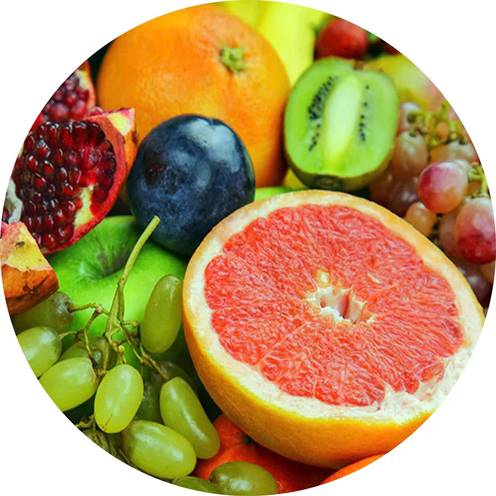<span>Trái Cây</span><svg class="icon" aria-hidden="true"><use href="#icon-chevron"/></svg></summary><div class="category-group__content"><a href="https://menaselect.com/trai-cay" target="_blank" rel="noopener noreferrer" class="category-all">Xem tất cả Trái Cây<span class="sr-only"> (mở thẻ mới)</span></a><ul><li><a href="https://menaselect.com/trai-cay/trai-cay-noi-dia" target="_blank" rel="noopener noreferrer">Trái Cây Nội Địa<span class="sr-only"> (mở thẻ mới)</span></a></li><li><a href="https://menaselect.com/trai-cay/trai-cay-nhap-khau" target="_blank" rel="noopener noreferrer">Trái Cây Nhập Khẩu<span class="sr-only"> (mở thẻ mới)</span></a></li></ul></div></details></li>
            <li><details class="category-group"><summary>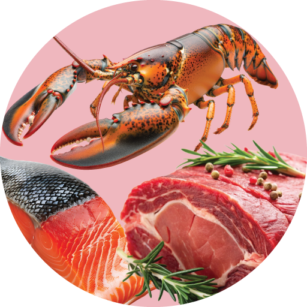<span>Thịt Trứng Hải Sản</span><svg class="icon" aria-hidden="true"><use href="#icon-chevron"/></svg></summary><div class="category-group__content"><a href="https://menaselect.com/thit-trung-hai-san" target="_blank" rel="noopener noreferrer" class="category-all">Xem tất cả Thịt Trứng Hải Sản<span class="sr-only"> (mở thẻ mới)</span></a><ul><li><a href="https://menaselect.com/thit-trung-hai-san/trung-gia-cam" target="_blank" rel="noopener noreferrer">Trứng Gia Cầm<span class="sr-only"> (mở thẻ mới)</span></a></li><li><a href="https://menaselect.com/thit-trung-hai-san/tom-muc-ca-kho" target="_blank" rel="noopener noreferrer">Tôm - Mực - Cá Khô<span class="sr-only"> (mở thẻ mới)</span></a></li><li><a href="https://menaselect.com/thit-trung-hai-san/ca-thuy-hai-san-tuoi" target="_blank" rel="noopener noreferrer">Cá - Thủy Hải Sản Tươi<span class="sr-only"> (mở thẻ mới)</span></a></li><li><a href="https://menaselect.com/thit-trung-hai-san/thit-heo" target="_blank" rel="noopener noreferrer">Thịt Heo<span class="sr-only"> (mở thẻ mới)</span></a></li><li><a href="https://menaselect.com/thit-trung-hai-san/thit-bo" target="_blank" rel="noopener noreferrer">Thịt Bò<span class="sr-only"> (mở thẻ mới)</span></a></li><li><a href="https://menaselect.com/thit-trung-hai-san/thit-gia-cam" target="_blank" rel="noopener noreferrer">Thịt Gia Cầm<span class="sr-only"> (mở thẻ mới)</span></a></li></ul></div></details></li>
            <li><details class="category-group"><summary>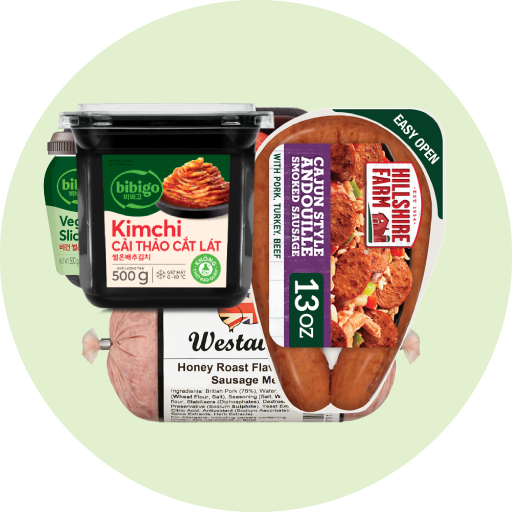<span>Thực Phẩm Đông Mát</span><svg class="icon" aria-hidden="true"><use href="#icon-chevron"/></svg></summary><div class="category-group__content"><a href="https://menaselect.com/thuc-pham-dong-mat" target="_blank" rel="noopener noreferrer" class="category-all">Xem tất cả Thực Phẩm Đông Mát<span class="sr-only"> (mở thẻ mới)</span></a><ul><li><a href="https://menaselect.com/thuc-pham-dong-mat/hai-san-dong-lanh" target="_blank" rel="noopener noreferrer">Hải Sản Đông Lạnh<span class="sr-only"> (mở thẻ mới)</span></a></li><li><a href="https://menaselect.com/thuc-pham-dong-mat/lam-san-an-lien" target="_blank" rel="noopener noreferrer">Làm Sẵn - Ăn Liền<span class="sr-only"> (mở thẻ mới)</span></a></li><li><a href="https://menaselect.com/thuc-pham-dong-mat/banh-dong-ran" target="_blank" rel="noopener noreferrer">Bánh Đông Rán<span class="sr-only"> (mở thẻ mới)</span></a></li><li><a href="https://menaselect.com/thuc-pham-dong-mat/do-nguoi-thit-che-bien" target="_blank" rel="noopener noreferrer">Đồ Nguội - Thịt Chế Biến<span class="sr-only"> (mở thẻ mới)</span></a></li><li><a href="https://menaselect.com/thuc-pham-dong-mat/banh-bao-banh-mi-pizza" target="_blank" rel="noopener noreferrer">Bánh Bao - Bánh Mì - Pizza<span class="sr-only"> (mở thẻ mới)</span></a></li><li><a href="https://menaselect.com/thuc-pham-dong-mat/rau-cu-trai-cay-dong-lanh" target="_blank" rel="noopener noreferrer">Rau - Củ - Trái Cây Đông Lạnh<span class="sr-only"> (mở thẻ mới)</span></a></li><li><a href="https://menaselect.com/thuc-pham-dong-mat/bun-tuoi-dau-hu-dua-chua" target="_blank" rel="noopener noreferrer">Bún Tươi - Đậu Hũ - Dưa Chua<span class="sr-only"> (mở thẻ mới)</span></a></li></ul></div></details></li>
            <li><details class="category-group"><summary><span>Phô Mai Bơ Sữa</span><svg class="icon" aria-hidden="true"><use href="#icon-chevron"/></svg></summary><div class="category-group__content"><a href="https://menaselect.com/pho-mai-bo-sua" target="_blank" rel="noopener noreferrer" class="category-all">Xem tất cả Phô Mai Bơ Sữa<span class="sr-only"> (mở thẻ mới)</span></a><ul><li><a href="https://menaselect.com/pho-mai-bo-sua/bo-pho-mai-san-pham-tu-sua" target="_blank" rel="noopener noreferrer">Bơ - Phô Mai - Sản Phẩm Từ Sữa<span class="sr-only"> (mở thẻ mới)</span></a></li><li><a href="https://menaselect.com/pho-mai-bo-sua/sua-sua-dac" target="_blank" rel="noopener noreferrer">Sữa - Sữa Đặc<span class="sr-only"> (mở thẻ mới)</span></a></li><li><a href="https://menaselect.com/pho-mai-bo-sua/sua-hat-sua-dau" target="_blank" rel="noopener noreferrer">Sữa Hạt - Sữa Đậu<span class="sr-only"> (mở thẻ mới)</span></a></li><li><a href="https://menaselect.com/pho-mai-bo-sua/sua-chua" target="_blank" rel="noopener noreferrer">Sữa Chua<span class="sr-only"> (mở thẻ mới)</span></a></li></ul></div></details></li>
            <li><details class="category-group"><summary>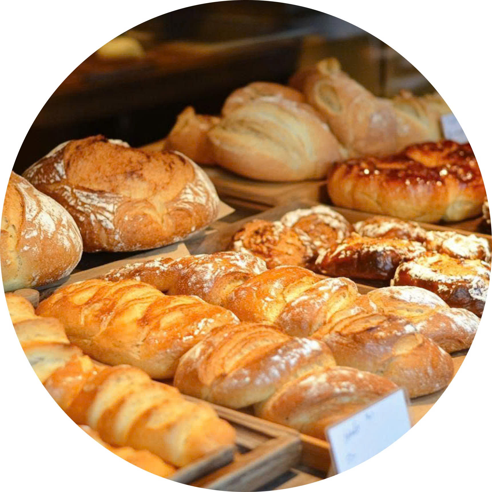<span>Bánh mì &amp; Bánh ngọt</span><svg class="icon" aria-hidden="true"><use href="#icon-chevron"/></svg></summary><div class="category-group__content"><a href="https://menaselect.com/banh-mi-banh-ngot-tuoi" target="_blank" rel="noopener noreferrer" class="category-all">Xem tất cả Bánh mì &amp; Bánh ngọt<span class="sr-only"> (mở thẻ mới)</span></a><ul><li><a href="https://menaselect.com/banh-mi-banh-ngot-tuoi/banh-mi" target="_blank" rel="noopener noreferrer">Bánh mì<span class="sr-only"> (mở thẻ mới)</span></a></li><li><a href="https://menaselect.com/banh-mi-banh-ngot-tuoi/banh-ngot" target="_blank" rel="noopener noreferrer">Bánh ngọt<span class="sr-only"> (mở thẻ mới)</span></a></li></ul></div></details></li>
            <li><details class="category-group"><summary>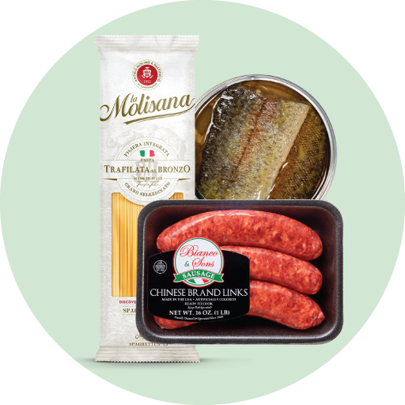<span>Đồ Hộp Mì Xúc Xích</span><svg class="icon" aria-hidden="true"><use href="#icon-chevron"/></svg></summary><div class="category-group__content"><a href="https://menaselect.com/do-hop-mi-xuc-xich" target="_blank" rel="noopener noreferrer" class="category-all">Xem tất cả Đồ Hộp Mì Xúc Xích<span class="sr-only"> (mở thẻ mới)</span></a><ul><li><a href="https://menaselect.com/do-hop-mi-xuc-xich/mi-bun-pho-nui-banh-trang" target="_blank" rel="noopener noreferrer">Mì - Bún - Phở - Nui - Bánh Tráng<span class="sr-only"> (mở thẻ mới)</span></a></li><li><a href="https://menaselect.com/do-hop-mi-xuc-xich/mi-mien-chao-pho-canh-an-lien" target="_blank" rel="noopener noreferrer">Mì - Miến - Cháo - Phở - Canh Ăn Liền<span class="sr-only"> (mở thẻ mới)</span></a></li><li><a href="https://menaselect.com/do-hop-mi-xuc-xich/do-hop" target="_blank" rel="noopener noreferrer">Đồ Hộp<span class="sr-only"> (mở thẻ mới)</span></a></li><li><a href="https://menaselect.com/do-hop-mi-xuc-xich/xuc-xich-lap-xuong-cha-bong" target="_blank" rel="noopener noreferrer">Xúc Xích - Lạp Xưởng - Chà Bông<span class="sr-only"> (mở thẻ mới)</span></a></li></ul></div></details></li>
            <li><details class="category-group"><summary><span>Gia Vị Dầu Ăn</span><svg class="icon" aria-hidden="true"><use href="#icon-chevron"/></svg></summary><div class="category-group__content"><a href="https://menaselect.com/gia-vi-dau-an" target="_blank" rel="noopener noreferrer" class="category-all">Xem tất cả Gia Vị Dầu Ăn<span class="sr-only"> (mở thẻ mới)</span></a><ul><li><a href="https://menaselect.com/gia-vi-dau-an/gia-vi" target="_blank" rel="noopener noreferrer">Gia Vị<span class="sr-only"> (mở thẻ mới)</span></a></li><li><a href="https://menaselect.com/gia-vi-dau-an/muoi-duong-hat-nem-bot-ngot" target="_blank" rel="noopener noreferrer">Muối - Đường - Hạt Nêm - Bột Ngọt<span class="sr-only"> (mở thẻ mới)</span></a></li><li><a href="https://menaselect.com/gia-vi-dau-an/dau-an" target="_blank" rel="noopener noreferrer">Dầu Ăn<span class="sr-only"> (mở thẻ mới)</span></a></li><li><a href="https://menaselect.com/gia-vi-dau-an/dau-hao-giam-bo" target="_blank" rel="noopener noreferrer">Dầu Hào - Giấm - Bơ<span class="sr-only"> (mở thẻ mới)</span></a></li><li><a href="https://menaselect.com/gia-vi-dau-an/duong" target="_blank" rel="noopener noreferrer">Đường<span class="sr-only"> (mở thẻ mới)</span></a></li><li><a href="https://menaselect.com/gia-vi-dau-an/tuong-ot-tuong-ca-sot-tron-cham" target="_blank" rel="noopener noreferrer">Tương Ớt - Tương Cà - Sốt Trộn Chấm<span class="sr-only"> (mở thẻ mới)</span></a></li><li><a href="https://menaselect.com/gia-vi-dau-an/nuoc-mam" target="_blank" rel="noopener noreferrer">Nước Mắm<span class="sr-only"> (mở thẻ mới)</span></a></li><li><a href="https://menaselect.com/gia-vi-dau-an/nuoc-tuong" target="_blank" rel="noopener noreferrer">Nước Tương<span class="sr-only"> (mở thẻ mới)</span></a></li><li><a href="https://menaselect.com/gia-vi-dau-an/tieu-sa-te-ot-bot" target="_blank" rel="noopener noreferrer">Tiêu - Sa Tế - Ớt Bột<span class="sr-only"> (mở thẻ mới)</span></a></li></ul></div></details></li>
            <li><details class="category-group"><summary>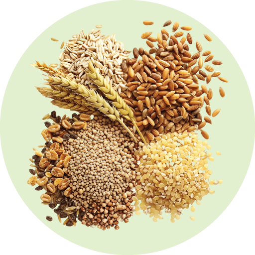<span>Gạo Đậu Đồ Khô</span><svg class="icon" aria-hidden="true"><use href="#icon-chevron"/></svg></summary><div class="category-group__content"><a href="https://menaselect.com/gao-dau-do-kho" target="_blank" rel="noopener noreferrer" class="category-all">Xem tất cả Gạo Đậu Đồ Khô<span class="sr-only"> (mở thẻ mới)</span></a><ul><li><a href="https://menaselect.com/gao-dau-do-kho/bot" target="_blank" rel="noopener noreferrer">Bột<span class="sr-only"> (mở thẻ mới)</span></a></li><li><a href="https://menaselect.com/gao-dau-do-kho/dau-me" target="_blank" rel="noopener noreferrer">Đậu - Mè<span class="sr-only"> (mở thẻ mới)</span></a></li><li><a href="https://menaselect.com/gia-vi-dau-an/yen-mach" target="_blank" rel="noopener noreferrer">Yến Mạch<span class="sr-only"> (mở thẻ mới)</span></a></li><li><a href="https://menaselect.com/gao-dau-do-kho/gao-gao-nep" target="_blank" rel="noopener noreferrer">Gạo - Gạo nếp<span class="sr-only"> (mở thẻ mới)</span></a></li><li><a href="https://menaselect.com/gao-dau-do-kho/gao-tam" target="_blank" rel="noopener noreferrer">Gạo Tấm<span class="sr-only"> (mở thẻ mới)</span></a></li><li><a href="https://menaselect.com/gao-dau-do-kho/rong-bien-nam-mang-kho" target="_blank" rel="noopener noreferrer">Rong Biển - Nấm - Măng Khô<span class="sr-only"> (mở thẻ mới)</span></a></li></ul></div></details></li>
            <li><details class="category-group"><summary>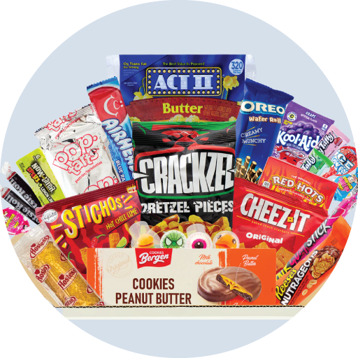<span>Ngũ Cốc Bánh Kẹo</span><svg class="icon" aria-hidden="true"><use href="#icon-chevron"/></svg></summary><div class="category-group__content"><a href="https://menaselect.com/ngu-coc-banh-keo" target="_blank" rel="noopener noreferrer" class="category-all">Xem tất cả Ngũ Cốc Bánh Kẹo<span class="sr-only"> (mở thẻ mới)</span></a><ul><li><a href="https://menaselect.com/ngu-coc-banh-keo/banh-keo" target="_blank" rel="noopener noreferrer">Bánh - Kẹo<span class="sr-only"> (mở thẻ mới)</span></a></li><li><a href="https://menaselect.com/ngu-coc-banh-keo/keo-cac-loai" target="_blank" rel="noopener noreferrer">Kẹo Các Loại<span class="sr-only"> (mở thẻ mới)</span></a></li><li><a href="https://menaselect.com/ngu-coc-banh-keo/snacks-hat" target="_blank" rel="noopener noreferrer">Snacks - Hạt<span class="sr-only"> (mở thẻ mới)</span></a></li><li><a href="https://menaselect.com/ngu-coc-banh-keo/bo-mut" target="_blank" rel="noopener noreferrer">Bơ - Mứt<span class="sr-only"> (mở thẻ mới)</span></a></li><li><a href="https://menaselect.com/ngu-coc-banh-keo/banh-cac-loai" target="_blank" rel="noopener noreferrer">Bánh Các Loại<span class="sr-only"> (mở thẻ mới)</span></a></li><li><a href="https://menaselect.com/ngu-coc-banh-keo/ngu-coc-an-sang" target="_blank" rel="noopener noreferrer">Ngũ Cốc - Ăn Sáng<span class="sr-only"> (mở thẻ mới)</span></a></li></ul></div></details></li>
            <li><details class="category-group"><summary>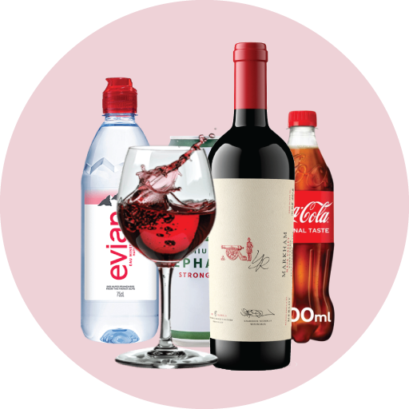<span>Bia Rượu Giải Khát</span><svg class="icon" aria-hidden="true"><use href="#icon-chevron"/></svg></summary><div class="category-group__content"><a href="https://menaselect.com/bia-ruou-giai-khat" target="_blank" rel="noopener noreferrer" class="category-all">Xem tất cả Bia Rượu Giải Khát<span class="sr-only"> (mở thẻ mới)</span></a><ul><li><a href="https://menaselect.com/bia-ruou-giai-khat/bia" target="_blank" rel="noopener noreferrer">Bia<span class="sr-only"> (mở thẻ mới)</span></a></li><li><a href="https://menaselect.com/bia-ruou-giai-khat/nuoc-suoi-nuoc-tinh-khiet" target="_blank" rel="noopener noreferrer">Nước Suối - Nước Tinh Khiết<span class="sr-only"> (mở thẻ mới)</span></a></li><li><a href="https://menaselect.com/bia-ruou-giai-khat/nuoc-giai-khat" target="_blank" rel="noopener noreferrer">Nước Giải Khát<span class="sr-only"> (mở thẻ mới)</span></a></li><li><a href="https://menaselect.com/bia-ruou-giai-khat/nuoc-khong-ga" target="_blank" rel="noopener noreferrer">Nước Không Ga<span class="sr-only"> (mở thẻ mới)</span></a></li><li><a href="https://menaselect.com/bia-ruou-giai-khat/nuoc-co-ga" target="_blank" rel="noopener noreferrer">Nước Có Ga<span class="sr-only"> (mở thẻ mới)</span></a></li><li><a href="https://menaselect.com/bia-ruou-giai-khat/ruou" target="_blank" rel="noopener noreferrer">Rượu<span class="sr-only"> (mở thẻ mới)</span></a></li></ul></div></details></li>
            <li><details class="category-group"><summary><span>Trà Cà Phê</span><svg class="icon" aria-hidden="true"><use href="#icon-chevron"/></svg></summary><div class="category-group__content"><a href="https://menaselect.com/tra-ca-phe" target="_blank" rel="noopener noreferrer" class="category-all">Xem tất cả Trà Cà Phê<span class="sr-only"> (mở thẻ mới)</span></a><ul><li><a href="https://menaselect.com/tra-ca-phe/tra" target="_blank" rel="noopener noreferrer">Trà<span class="sr-only"> (mở thẻ mới)</span></a></li><li><a href="https://menaselect.com/tra-ca-phe/ca-phe" target="_blank" rel="noopener noreferrer">Cà Phê<span class="sr-only"> (mở thẻ mới)</span></a></li><li><a href="https://menaselect.com/tra-ca-phe/thuc-uong-dinh-duong" target="_blank" rel="noopener noreferrer">Thức Uống Dinh Dưỡng<span class="sr-only"> (mở thẻ mới)</span></a></li></ul></div></details></li>
            <li><details class="category-group"><summary>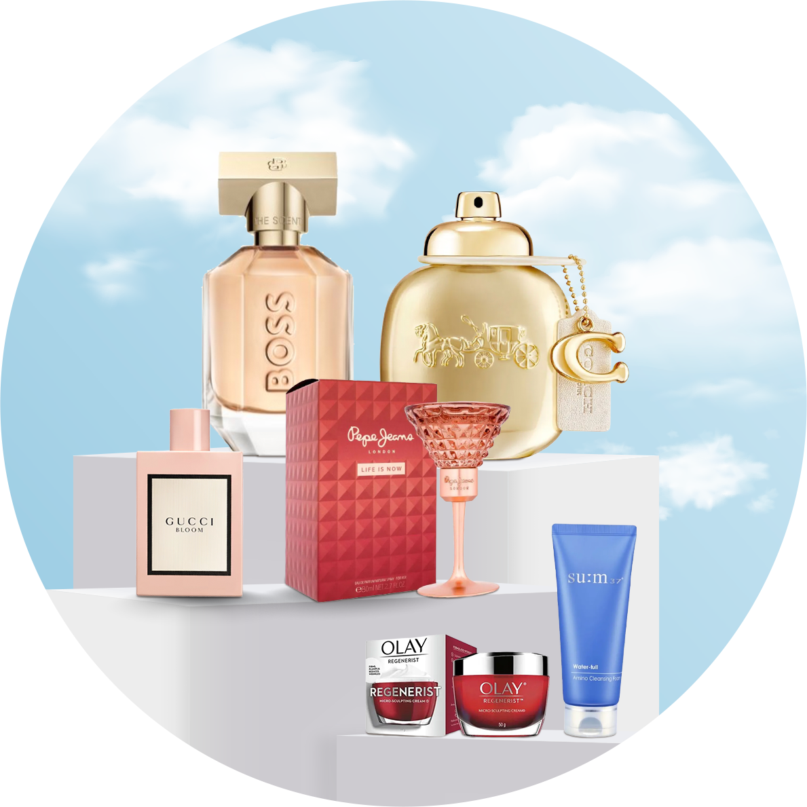<span>Chăm Sóc Cá Nhân &amp; Mỹ Phẩm</span><svg class="icon" aria-hidden="true"><use href="#icon-chevron"/></svg></summary><div class="category-group__content"><a href="https://menaselect.com/cosmetics-perfumes" target="_blank" rel="noopener noreferrer" class="category-all">Xem tất cả Chăm Sóc Cá Nhân &amp; Mỹ Phẩm<span class="sr-only"> (mở thẻ mới)</span></a><ul><li><a href="https://menaselect.com/cosmetics-perfumes/trang-diem" target="_blank" rel="noopener noreferrer">Trang Điểm<span class="sr-only"> (mở thẻ mới)</span></a></li><li><a href="https://menaselect.com/cosmetics-perfumes/cham-soc-toc" target="_blank" rel="noopener noreferrer">Chăm Sóc Tóc<span class="sr-only"> (mở thẻ mới)</span></a></li><li><a href="https://menaselect.com/cosmetics-perfumes/cham-soc-co-the" target="_blank" rel="noopener noreferrer">Chăm Sóc Cơ Thể<span class="sr-only"> (mở thẻ mới)</span></a></li><li><a href="https://menaselect.com/cosmetics-perfumes/cham-soc-rang-mieng" target="_blank" rel="noopener noreferrer">Chăm Sóc Răng Miệng<span class="sr-only"> (mở thẻ mới)</span></a></li></ul></div></details></li>
            <li><details class="category-group"><summary>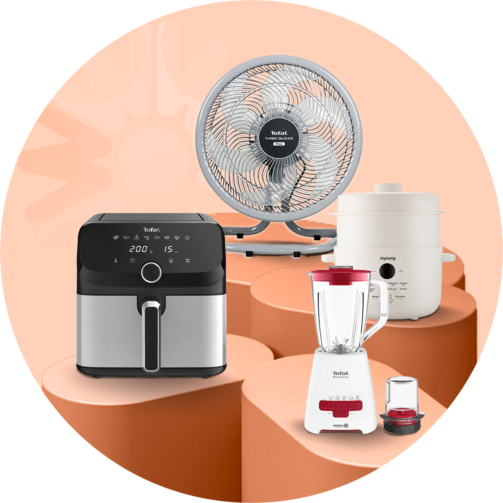<span>Đồ Gia Dụng</span><svg class="icon" aria-hidden="true"><use href="#icon-chevron"/></svg></summary><div class="category-group__content"><a href="https://menaselect.com/do-gia-dung" target="_blank" rel="noopener noreferrer" class="category-all">Xem tất cả Đồ Gia Dụng<span class="sr-only"> (mở thẻ mới)</span></a><ul><li><a href="https://menaselect.com/do-gia-dung/gia-dung-nha-bep" target="_blank" rel="noopener noreferrer">Gia Dụng - Nhà Bếp<span class="sr-only"> (mở thẻ mới)</span></a></li><li><a href="https://menaselect.com/do-gia-dung/giat-xa" target="_blank" rel="noopener noreferrer">Giặt - Xả<span class="sr-only"> (mở thẻ mới)</span></a></li><li><a href="https://menaselect.com/do-gia-dung/ve-sinh-nha-cua" target="_blank" rel="noopener noreferrer">Vệ Sinh Nhà Cửa<span class="sr-only"> (mở thẻ mới)</span></a></li><li><a href="https://menaselect.com/do-gia-dung/khan-giay" target="_blank" rel="noopener noreferrer">Khăn Giấy<span class="sr-only"> (mở thẻ mới)</span></a></li></ul></div></details></li>
          </ul></div>
        </details>
        <div class="navigation-links"><a href="https://menaselect.com/uu-dai" target="_blank" rel="noopener noreferrer" class="nav-pill"><span>Ưu đãi</span><span class="sr-only"> (mở thẻ mới)</span></a>
          <a href="https://menaselect.com/fresh-edit" target="_blank" rel="noopener noreferrer" class="nav-pill"><span>Nấu gì hôm nay</span><span class="sr-only"> (mở thẻ mới)</span></a>
          <a href="https://menaselect.com/mena-bebe" target="_blank" rel="noopener noreferrer" class="nav-pill"><span>Mena Bébé</span><span class="sr-only"> (mở thẻ mới)</span></a>
          <a href="https://menaselect.com/cosmetics-perfumes" target="_blank" rel="noopener noreferrer" class="nav-pill"><span>Cosmetics &amp; Perfumes</span><span class="sr-only"> (mở thẻ mới)</span></a>
          <a href="https://menaselect.com/he-thong-sieu-thi" target="_blank" rel="noopener noreferrer" class="nav-pill"><span>Hệ thống siêu thị</span><span class="sr-only"> (mở thẻ mới)</span></a>
          <a href="https://menaselect.com/blog" target="_blank" rel="noopener noreferrer" class="nav-pill"><span>Blog</span><span class="sr-only"> (mở thẻ mới)</span></a></div>
      </div>
    </nav>
  </header>


  <main id="noi-dung" class="container">
    <nav class="breadcrumbs" aria-label="Đường dẫn danh mục">
      <ol>
        <li><a href="https://menaselect.com/" target="_blank" rel="noopener noreferrer">Trang chủ <span class="sr-only">(mở thẻ mới)</span></a></li>
        <li><a href="https://menaselect.com/thit-trung-hai-san" target="_blank" rel="noopener noreferrer">Thịt Trứng Hải Sản <span class="sr-only">(mở thẻ mới)</span></a></li>
        <li><a href="https://menaselect.com/thit-trung-hai-san/ca-thuy-hai-san-tuoi" target="_blank" rel="noopener noreferrer">Cá - Thủy Hải Sản Tươi <span class="sr-only">(mở thẻ mới)</span></a></li>
        <li aria-current="page">Cá phèn Hải Nam fillet còn da gói 500g</li>
      </ol>
    </nav>

    <article class="product" aria-labelledby="ten-san-pham">
      
      <div class="product-hero">
        <header class="product-heading">
          <h1 id="ten-san-pham">Cá phèn Hải Nam fillet còn da size 20-40 gói 500g</h1>
          <button class="product-share" type="button" popovertarget="chia-se-san-pham" aria-label="Chia sẻ sản phẩm">
            <svg class="icon" aria-hidden="true"><use href="#icon-share"/></svg><span>Chia sẻ</span>
          </button>
        </header>

        <div class="cart-popover share-popover" id="chia-se-san-pham" popover="auto" role="dialog" aria-labelledby="tieu-de-chia-se">
          <button class="popover-close" type="button" popovertarget="chia-se-san-pham" popovertargetaction="hide" aria-label="Đóng chia sẻ"><svg class="icon" aria-hidden="true"><use href="#icon-close"/></svg></button>
          <h2 id="tieu-de-chia-se">Chia sẻ sản phẩm</h2>
          <p>Sao chép liên kết để gửi cho bạn bè hoặc chia sẻ qua các kênh bên dưới.</p>
          <label for="lien-ket-san-pham">Liên kết sản phẩm</label>
          <input id="lien-ket-san-pham" type="url" readonly value="https://menaselect.com/ca-phen-hai-nam-fillet-con-da-size-20-40-goi-500g" spellcheck="false">
          <div class="share-popover__links">
            <a class="button button--primary" href="https://www.facebook.com/sharer/sharer.php?u=https%3A%2F%2Fmenaselect.com%2Fca-phen-hai-nam-fillet-con-da-size-20-40-goi-500g" target="_blank" rel="noopener noreferrer">Facebook<span class="sr-only"> (mở thẻ mới)</span></a>
            <a class="button share-popover__email" href="mailto:?subject=C%C3%A1%20ph%C3%A8n%20H%E1%BA%A3i%20Nam%20500g&amp;body=https%3A%2F%2Fmenaselect.com%2Fca-phen-hai-nam-fillet-con-da-size-20-40-goi-500g">Email</a>
          </div>
        </div>

        <div class="product-gallery">
          <figure class="gallery-slider">
            <input class="gallery-radio sr-only" id="anh-san-pham-1" name="anh-san-pham" type="radio" aria-controls="khung-anh-1" checked>
            <input class="gallery-radio sr-only" id="anh-san-pham-2" name="anh-san-pham" type="radio" aria-controls="khung-anh-2">
            <input class="gallery-radio sr-only" id="anh-san-pham-3" name="anh-san-pham" type="radio" aria-controls="khung-anh-3">
            <div class="gallery-frames">
              <button class="product-gallery__stage gallery-frame gallery-frame--1" id="khung-anh-1" type="button" popovertarget="xem-anh-1" popovertargetaction="show" aria-label="Xem lớn ảnh Bao bì sản phẩm 500g">
                <span class="product-gallery__badge">500g / gói</span>
                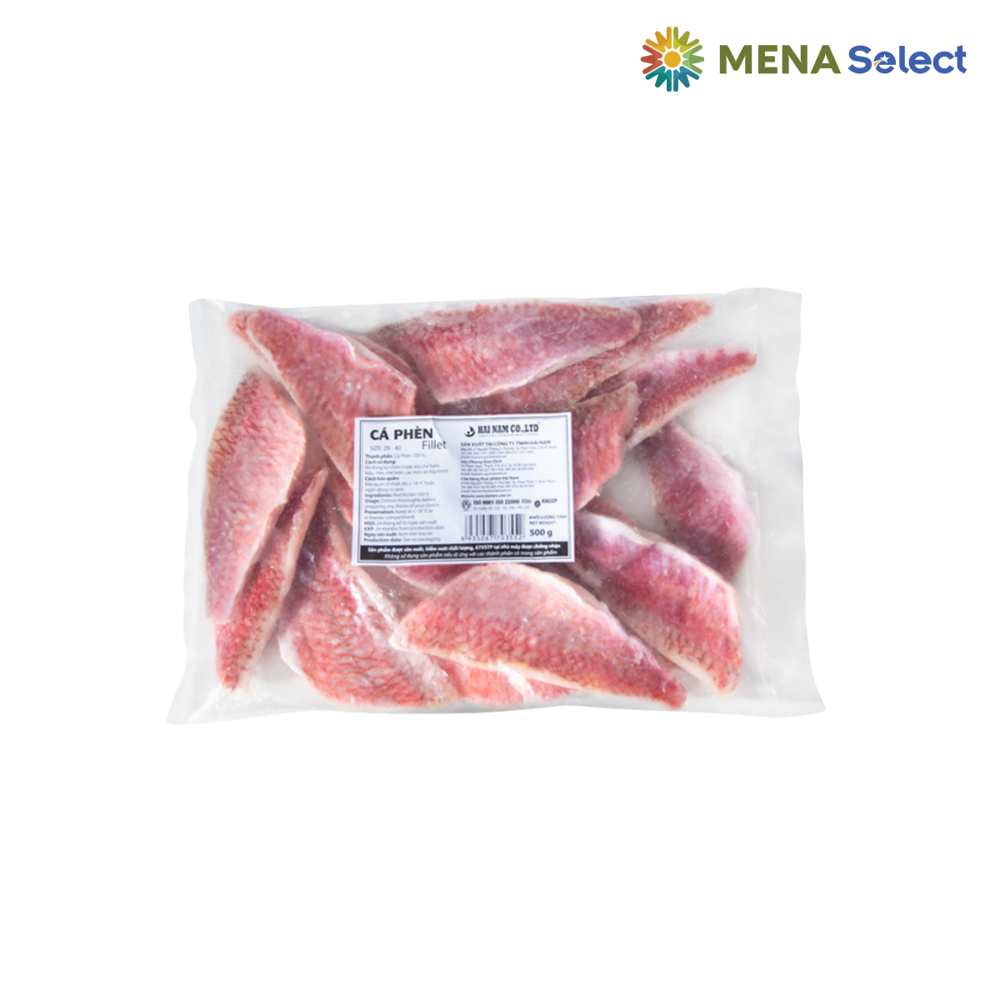
                <span class="product-gallery__expand" aria-hidden="true"><svg class="icon"><use href="#icon-expand"/></svg></span>
              </button>
              <button class="product-gallery__stage gallery-frame gallery-frame--2" id="khung-anh-2" type="button" popovertarget="xem-anh-2" popovertargetaction="show" aria-label="Xem lớn ảnh Cá phèn xiên rau củ">
                <span class="product-gallery__badge">Cá phèn xiên rau củ</span>
                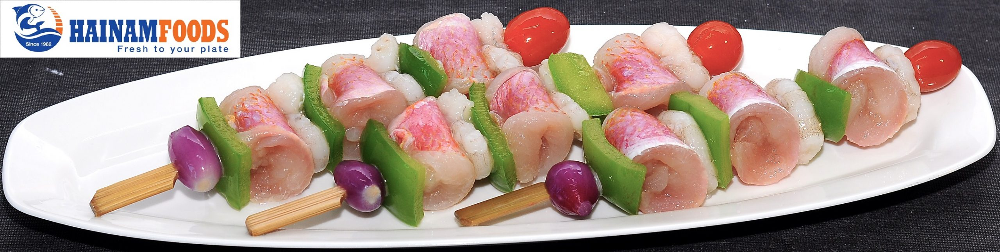
                <span class="product-gallery__expand" aria-hidden="true"><svg class="icon"><use href="#icon-expand"/></svg></span>
              </button>
              <button class="product-gallery__stage gallery-frame gallery-frame--3" id="khung-anh-3" type="button" popovertarget="xem-anh-3" popovertargetaction="show" aria-label="Xem lớn ảnh Cá phèn nướng">
                <span class="product-gallery__badge">Cá phèn nướng</span>
                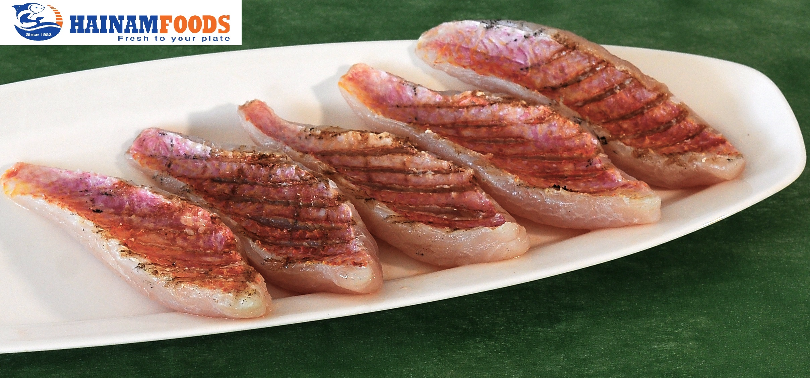
                <span class="product-gallery__expand" aria-hidden="true"><svg class="icon"><use href="#icon-expand"/></svg></span>
              </button>
            </div>
            <div class="gallery-thumbnails" role="group" aria-label="Chọn ảnh sản phẩm hoặc món ăn">
              <label class="gallery-thumbnail" for="anh-san-pham-1" title="Bao bì sản phẩm 500g">
                
                <span class="sr-only">Ảnh 1: Bao bì sản phẩm 500g</span>
              </label>
              <label class="gallery-thumbnail" for="anh-san-pham-2" title="Cá phèn xiên rau củ">
                
                <span class="sr-only">Ảnh 2: Cá phèn xiên rau củ</span>
              </label>
              <label class="gallery-thumbnail" for="anh-san-pham-3" title="Cá phèn nướng">
                
                <span class="sr-only">Ảnh 3: Cá phèn nướng</span>
              </label>
            </div>
            <figcaption class="product-gallery__caption">
              <span class="gallery-caption gallery-caption--1">Ảnh <strong>1 / 3</strong>: Bao bì sản phẩm 500g</span>
              <span class="gallery-caption gallery-caption--2">Ảnh <strong>2 / 3</strong>: Cá phèn xiên rau củ</span>
              <span class="gallery-caption gallery-caption--3">Ảnh <strong>3 / 3</strong>: Cá phèn nướng</span>
              <span>Bấm ảnh để phóng lớn</span>
            </figcaption>
          </figure>
          <section class="image-viewer" id="xem-anh-1" popover="auto" role="dialog" aria-labelledby="tieu-de-xem-anh-1">
            <div class="image-viewer__toolbar">
              <h2 id="tieu-de-xem-anh-1">Bao bì sản phẩm 500g <span>1 / 3</span></h2>
              <button class="image-viewer__close" type="button" popovertarget="xem-anh-1" popovertargetaction="hide" aria-label="Đóng ảnh phóng lớn"><svg class="icon" aria-hidden="true"><use href="#icon-close"/></svg></button>
            </div>
            <figure class="image-viewer__photo">
              
            </figure>
          </section>
          <section class="image-viewer" id="xem-anh-2" popover="auto" role="dialog" aria-labelledby="tieu-de-xem-anh-2">
            <div class="image-viewer__toolbar">
              <h2 id="tieu-de-xem-anh-2">Cá phèn xiên rau củ <span>2 / 3</span></h2>
              <button class="image-viewer__close" type="button" popovertarget="xem-anh-2" popovertargetaction="hide" aria-label="Đóng ảnh phóng lớn"><svg class="icon" aria-hidden="true"><use href="#icon-close"/></svg></button>
            </div>
            <figure class="image-viewer__photo">
              
            </figure>
          </section>
          <section class="image-viewer" id="xem-anh-3" popover="auto" role="dialog" aria-labelledby="tieu-de-xem-anh-3">
            <div class="image-viewer__toolbar">
              <h2 id="tieu-de-xem-anh-3">Cá phèn nướng <span>3 / 3</span></h2>
              <button class="image-viewer__close" type="button" popovertarget="xem-anh-3" popovertargetaction="hide" aria-label="Đóng ảnh phóng lớn"><svg class="icon" aria-hidden="true"><use href="#icon-close"/></svg></button>
            </div>
            <figure class="image-viewer__photo">
              
            </figure>
          </section>
          <div class="product-highlights" aria-label="Thông tin nhanh">
            <span><svg class="icon" aria-hidden="true"><use href="#icon-fish"/></svg>Fillet còn da</span>
            <span><svg class="icon" aria-hidden="true"><use href="#icon-snow"/></svg>Bảo quản −18°C</span>
          </div>
        </div>


        <div class="product-summary">
          <dl class="quick-facts">
            <div><dt>Quy cách</dt><dd>Gói 500g</dd></div>
            <div><dt>Nguồn gốc</dt><dd>Việt Nam</dd></div>
          </dl>

          <div class="price-panel" id="mua-hang" tabindex="-1" aria-label="Khu vực mua hàng">
            <p class="price-panel__label">Giá bán</p>
            <div class="price-row">
              <strong class="current-price">225.000<span>₫</span></strong>
              <span class="discount-badge">Giảm 14%</span>
            </div>
            <p class="old-price"><span>Giá niêm yết</span> <del>262.000 ₫</del></p>
            <p class="tax-note"><strong>Lưu ý:</strong> Giá đã bao gồm VAT và chưa bao gồm phí vận chuyển.</p>
          </div>

          
          <p class="short-description">Cá phèn fillet giữ da, đóng gói 500g. Dễ kết hợp cho các món chiên giòn, kho tiêu hoặc kho nghệ trong bữa ăn gia đình.</p>

          <aside class="offer" aria-labelledby="tieu-de-uu-dai">
            <svg class="icon offer__icon" aria-hidden="true"><use href="#icon-gift"/></svg>
            <div>
              <h2 id="tieu-de-uu-dai">Ưu đãi &amp; quà tặng</h2>
              <p>Tiết kiệm <strong>37.000 ₫</strong> so với giá niêm yết.</p>
              <details class="offer__details">
                <summary>Xem chương trình ưu đãi</summary>
                <p>Xem điều kiện và các chương trình hiện có tại <a href="https://menaselect.com/uu-dai" target="_blank" rel="noopener noreferrer">Mena Select<span class="sr-only"> (mở thẻ mới)</span></a>.</p>
              </details>
            </div>
          </aside>

          <div class="purchase-form" role="group" aria-label="Chọn số lượng và thêm vào giỏ">
            <div class="quantity-field">
              <label for="so-luong">Số lượng</label>
              <input id="so-luong" name="so-luong" type="number" min="1" max="99" step="1" value="1" required inputmode="numeric">
            </div>
            <button class="button button--primary" type="button" popovertarget="thong-bao-gio-hang">
              <svg class="icon" aria-hidden="true"><use href="#icon-bag"/></svg>
              Thêm vào giỏ
            </button>
          </div>

          <div class="policy-links" aria-label="Chính sách liên quan">
            <a href="https://menaselect.com/chinh-sach-thanh-vien" target="_blank" rel="noopener noreferrer">
              <svg class="icon" aria-hidden="true"><use href="#icon-shield"/></svg>
              <span>Chính sách thành viên<span class="sr-only"> (mở thẻ mới)</span></span>
              <svg class="icon icon--small" aria-hidden="true"><use href="#icon-chevron"/></svg>
            </a>
            <a href="https://menaselect.com/return_and_xchange_policy" target="_blank" rel="noopener noreferrer">
              <svg class="icon" aria-hidden="true"><use href="#icon-return"/></svg>
              <span>Chính sách đổi trả<span class="sr-only"> (mở thẻ mới)</span></span>
              <svg class="icon icon--small" aria-hidden="true"><use href="#icon-chevron"/></svg>
            </a>
          </div>
        </div>
      </div>

      
      <section id="mo-ta" class="product-description section-space" aria-labelledby="tieu-de-mo-ta">
        <header class="section-heading">
          <h2 id="tieu-de-mo-ta">Mô tả sản phẩm</h2>
          <a class="text-link" href="#mua-hang">Quay lại mua hàng <svg class="icon" aria-hidden="true"><use href="#icon-arrow"/></svg></a>
        </header>

        <div class="description-card">
          <div class="description-intro">
            <p>Cá phèn Hải Nam fillet còn da được sơ chế và đóng thành gói 500g. Phần thịt cá giữ lại da, phù hợp cho nhiều cách chế biến như chiên giòn, chiên sả ớt, kho nghệ hoặc kho tiêu.</p>
            <p>Phần fillet giúp giảm bớt công sơ chế. Quy cách gói 500g thuận tiện để lựa chọn lượng nguyên liệu cần cho bữa ăn, kết hợp cùng gia vị và rau củ theo thực đơn của gia đình.</p>
          </div>

          <section class="specifications" aria-labelledby="tieu-de-thong-so">
            <h3 id="tieu-de-thong-so">Thông tin sản phẩm</h3>
            <dl class="spec-grid">
              <div><dt>Thương hiệu</dt><dd>HẢI NAM FOODS</dd></div>
              <div><dt>Nguồn gốc</dt><dd>VIỆT NAM</dd></div>
              <div><dt>Khối lượng</dt><dd>500g</dd></div>
              <div><dt>Đơn vị bán</dt><dd>Gói</dd></div>
              <div><dt>Dạng sản phẩm</dt><dd>Fillet còn da</dd></div>
              <div><dt>Size</dt><dd>20-40</dd></div>
            </dl>
          </section>

          <div class="care-grid">
            <section class="care-card" aria-labelledby="tieu-de-su-dung">
              <span class="care-card__icon"><svg class="icon" aria-hidden="true"><use href="#icon-check"/></svg></span>
              <div><h3 id="tieu-de-su-dung">Hướng dẫn sử dụng</h3><p>Làm rã đông, rửa lại cá và chế biến chín kỹ trước khi dùng.</p></div>
            </section>
            <section class="care-card" aria-labelledby="tieu-de-bao-quan">
              <span class="care-card__icon"><svg class="icon" aria-hidden="true"><use href="#icon-snow"/></svg></span>
              <div><h3 id="tieu-de-bao-quan">Bảo quản</h3><p>Giữ trong ngăn đông tủ lạnh ở nhiệt độ −18°C.</p></div>
            </section>
          </div>
          <p class="description-price-note"><strong>Lưu ý:</strong> Giá đã bao gồm VAT và chưa bao gồm phí vận chuyển.</p>
        </div>
      </section>
    </article>

    
    <aside class="inspiration-banner section-space" aria-labelledby="tieu-de-banner">
      <div class="inspiration-banner__copy">
        <h2 id="tieu-de-banner">Thêm cảm hứng<br>cho bữa cơm nhà.</h2>
        <p>Khám phá thêm các lựa chọn hải sản từ Mena Select.</p>
        <a class="button button--light" href="#san-pham-lien-quan">Xem thêm hải sản <svg class="icon" aria-hidden="true"><use href="#icon-arrow"/></svg></a>
      </div>
      <figure class="inspiration-banner__photo">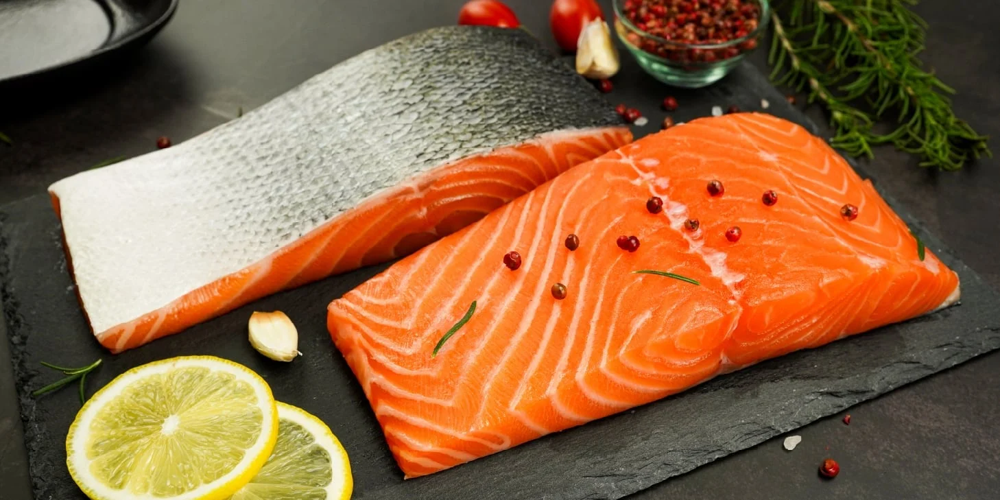</figure>
    </aside>

    <section id="san-pham-lien-quan" class="related-products section-space" aria-labelledby="tieu-de-lien-quan">
      <header class="section-heading">
        <h2 id="tieu-de-lien-quan">Sản phẩm liên quan</h2>
      </header>
      <div class="product-grid">
        <article class="product-card product-card--ca-hoi" aria-labelledby="ten-ca-hoi">
          <a class="product-card__photo" href="https://menaselect.com/phi-le-ca-hoi-tuoi-nauy-kome88-khay-250g" target="_blank" rel="noopener noreferrer" aria-label="Xem Phi Lê Cá Hồi Tươi Nauy Kome88 Khay 250g trên Mena Select, mở thẻ mới">
            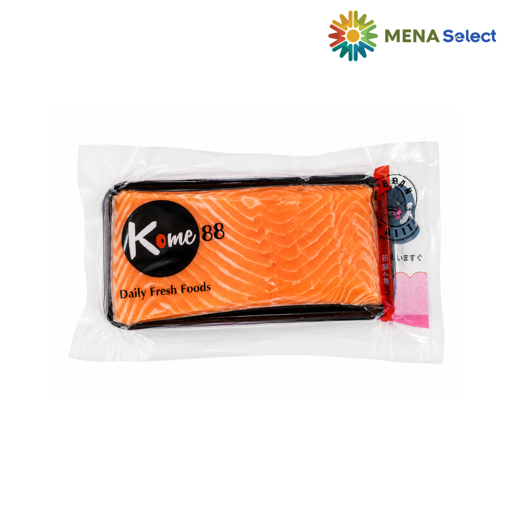
          </a>
          <div class="product-card__body">
            <p class="product-card__category">Kome88 · Khay 250g</p>
            <h3 id="ten-ca-hoi"><a href="https://menaselect.com/phi-le-ca-hoi-tuoi-nauy-kome88-khay-250g" target="_blank" rel="noopener noreferrer">Phi Lê Cá Hồi Tươi Nauy Kome88 Khay 250g<span class="sr-only"> (mở thẻ mới)</span></a></h3>
            <p class="product-card__price">186.000 ₫</p>
            <a class="product-card__action" href="https://menaselect.com/phi-le-ca-hoi-tuoi-nauy-kome88-khay-250g" target="_blank" rel="noopener noreferrer">Xem chi tiết<span class="sr-only"> Phi Lê Cá Hồi Tươi Nauy Kome88 Khay 250g (mở thẻ mới)</span><svg class="icon icon--small" aria-hidden="true"><use href="#icon-external"/></svg></a>
          </div>
        </article>
        <article class="product-card product-card--muc-ong" aria-labelledby="ten-muc-ong">
          <a class="product-card__photo" href="https://menaselect.com/muc-ong-nhoi-thit-hai-nam-khay-500g" target="_blank" rel="noopener noreferrer" aria-label="Xem Mực Ống Nhồi Thịt Hải Nam Khay 500g trên Mena Select, mở thẻ mới">
            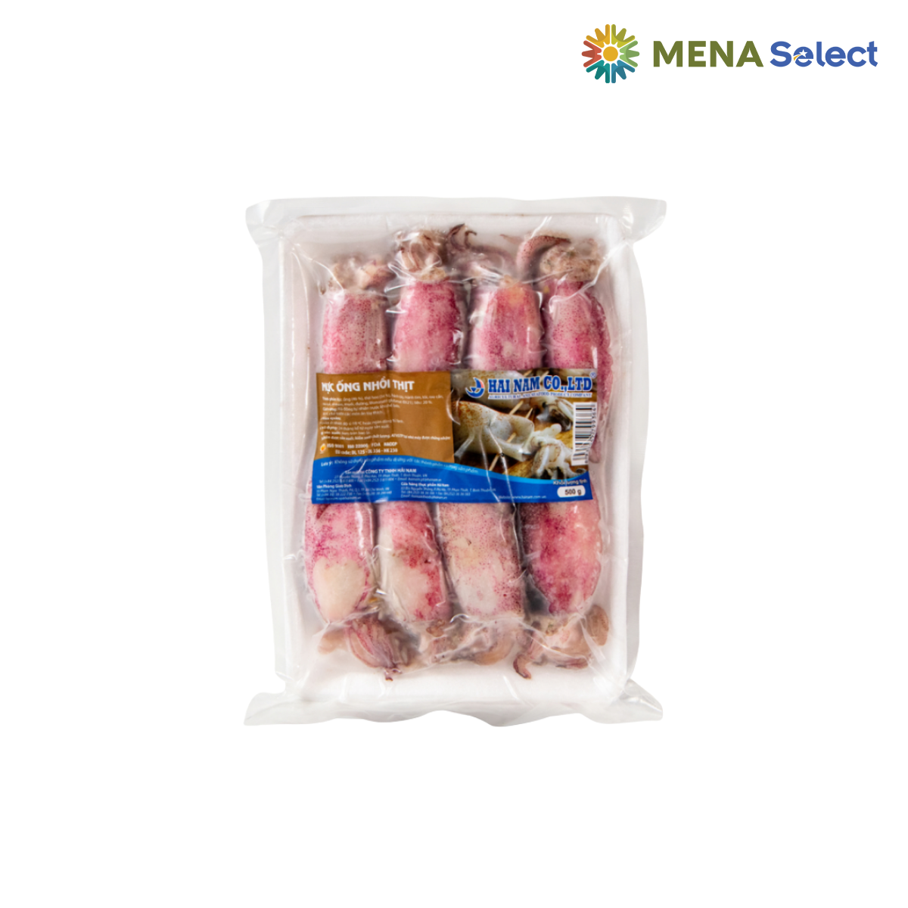
          </a>
          <div class="product-card__body">
            <p class="product-card__category">Hải Nam Foods · 500g</p>
            <h3 id="ten-muc-ong"><a href="https://menaselect.com/muc-ong-nhoi-thit-hai-nam-khay-500g" target="_blank" rel="noopener noreferrer">Mực Ống Nhồi Thịt Hải Nam Khay 500g<span class="sr-only"> (mở thẻ mới)</span></a></h3>
            <p class="product-card__price">229.000 ₫</p>
            <a class="product-card__action" href="https://menaselect.com/muc-ong-nhoi-thit-hai-nam-khay-500g" target="_blank" rel="noopener noreferrer">Xem chi tiết<span class="sr-only"> Mực Ống Nhồi Thịt Hải Nam Khay 500g (mở thẻ mới)</span><svg class="icon icon--small" aria-hidden="true"><use href="#icon-external"/></svg></a>
          </div>
        </article>
        <article class="product-card product-card--ngheu-lua" aria-labelledby="ten-ngheu-lua">
          <a class="product-card__photo" href="https://menaselect.com/ngheu-lua-thit-luoc-size-1000-hai-nam-khay-500g" target="_blank" rel="noopener noreferrer" aria-label="Xem Nghêu Lụa Thịt Luộc Size 1000 Hải Nam Khay 500g trên Mena Select, mở thẻ mới">
            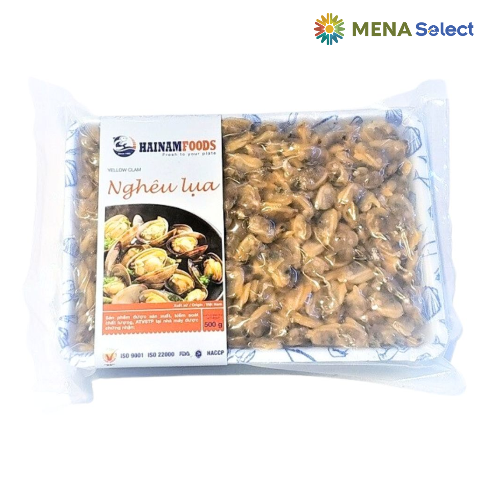
          </a>
          <div class="product-card__body">
            <p class="product-card__category">Hải Nam Foods · 500g</p>
            <h3 id="ten-ngheu-lua"><a href="https://menaselect.com/ngheu-lua-thit-luoc-size-1000-hai-nam-khay-500g" target="_blank" rel="noopener noreferrer">Nghêu Lụa Thịt Luộc Size 1000 Hải Nam Khay 500g<span class="sr-only"> (mở thẻ mới)</span></a></h3>
            <p class="product-card__price">129.000 ₫</p>
            <a class="product-card__action" href="https://menaselect.com/ngheu-lua-thit-luoc-size-1000-hai-nam-khay-500g" target="_blank" rel="noopener noreferrer">Xem chi tiết<span class="sr-only"> Nghêu Lụa Thịt Luộc Size 1000 Hải Nam Khay 500g (mở thẻ mới)</span><svg class="icon icon--small" aria-hidden="true"><use href="#icon-external"/></svg></a>
          </div>
        </article>
        <article class="product-card product-card--muc-lam-sach" aria-labelledby="ten-muc-lam-sach">
          <a class="product-card__photo" href="https://menaselect.com/muc-ong-hai-nam-nguyen-con-lam-sach-dong-lanh-size-6-8cm-khay-500g" target="_blank" rel="noopener noreferrer" aria-label="Xem Mực ống Hải Nam nguyên con làm sạch đông lạnh size 6-8cm khay 500g trên Mena Select, mở thẻ mới">
            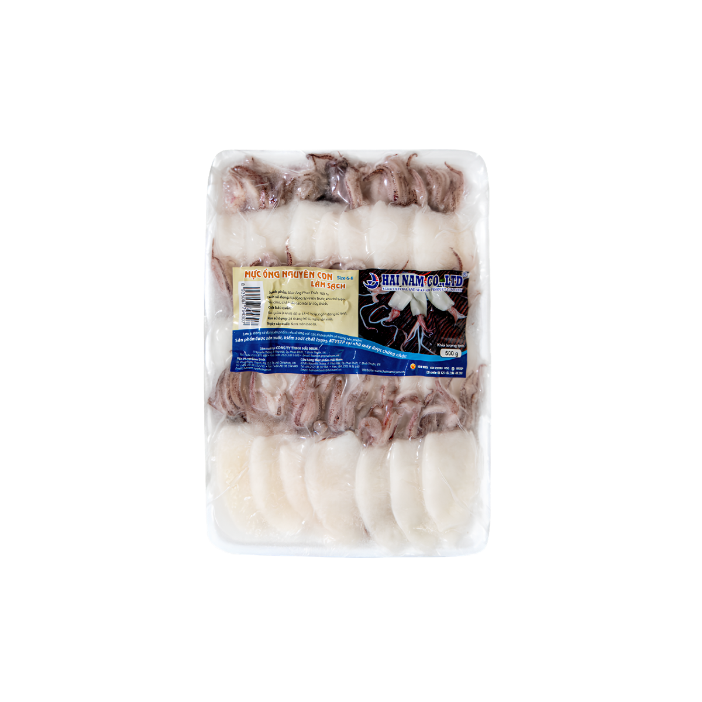
          </a>
          <div class="product-card__body">
            <p class="product-card__category">Hải Nam Foods · 500g</p>
            <h3 id="ten-muc-lam-sach"><a href="https://menaselect.com/muc-ong-hai-nam-nguyen-con-lam-sach-dong-lanh-size-6-8cm-khay-500g" target="_blank" rel="noopener noreferrer">Mực ống Hải Nam nguyên con làm sạch đông lạnh size 6-8cm khay 500g<span class="sr-only"> (mở thẻ mới)</span></a></h3>
            <p class="product-card__price">182.000 ₫</p>
            <a class="product-card__action" href="https://menaselect.com/muc-ong-hai-nam-nguyen-con-lam-sach-dong-lanh-size-6-8cm-khay-500g" target="_blank" rel="noopener noreferrer">Xem chi tiết<span class="sr-only"> Mực ống Hải Nam nguyên con làm sạch đông lạnh size 6-8cm khay 500g (mở thẻ mới)</span><svg class="icon icon--small" aria-hidden="true"><use href="#icon-external"/></svg></a>
          </div>
        </article>
      </div>
    </section>
  </main>

  <div id="thong-bao-gio-hang" class="cart-popover" popover="auto" role="dialog" aria-labelledby="tieu-de-gio-hang" aria-describedby="noi-dung-gio-hang">
    <button class="popover-close" type="button" popovertarget="thong-bao-gio-hang" popovertargetaction="hide" aria-label="Đóng thông báo"><svg class="icon" aria-hidden="true"><use href="#icon-close"/></svg></button>
    <h2 id="tieu-de-gio-hang">Tiếp tục mua sắm</h2>
    <p id="noi-dung-gio-hang">Sản phẩm chưa được thêm vào giỏ. Bạn có thể tiếp tục chọn mua trên Mena Select.</p>
    <a class="button button--primary" href="https://menaselect.com/ca-phen-hai-nam-fillet-con-da-size-20-40-goi-500g" target="_blank" rel="noopener noreferrer">Mua tại Mena Select<span class="sr-only"> (mở thẻ mới)</span><svg class="icon icon--small" aria-hidden="true"><use href="#icon-external"/></svg></a>
  </div>

  <footer class="site-footer section-space">
    <div class="container footer-grid">
      <section class="footer-company" aria-labelledby="ten-cong-ty">
        
        <h2 id="ten-cong-ty">CÔNG TY TNHH MENAS</h2>
        <p><strong>Địa chỉ:</strong> Tầng 7, số 25Bis Nguyễn Thị Minh Khai, Phường Sài Gòn, TP. HCM</p>
        <p><strong>Địa chỉ liên hệ:</strong> Tầng 11, Tòa nhà Abacus, 58 Nguyễn Đình Chiểu, Phường Tân Định, TP.HCM</p>
        <p><strong>Email:</strong> <a href="mailto:customercare@menasvietnam.com">customercare@menasvietnam.com</a><br><strong>Hotline:</strong> <a href="tel:1800255668">1800 255 668</a></p>
        <p class="company-registration">Số GCNĐKDN: 0316333076 do Sở KHĐT TP.HCM cấp ngày 16/06/2020</p>
      </section>
      <section class="footer-column"><h2>Về chúng tôi</h2><ul><li><a href="https://menaselect.com/ve-chung-toi" target="_blank" rel="noopener noreferrer">Giới thiệu<span class="sr-only"> (mở thẻ mới)</span></a></li><li><a href="https://menaselect.com/he-thong-sieu-thi" target="_blank" rel="noopener noreferrer">Hệ thống siêu thị<span class="sr-only"> (mở thẻ mới)</span></a></li><li><a href="https://menaselect.com/blog" target="_blank" rel="noopener noreferrer">Blog<span class="sr-only"> (mở thẻ mới)</span></a></li></ul></section>
      <section class="footer-column"><h2>Chính sách</h2><ul><li><a href="https://menaselect.com/privacy_policies_page" target="_blank" rel="noopener noreferrer">Chính sách bảo mật<span class="sr-only"> (mở thẻ mới)</span></a></li><li><a href="https://menaselect.com/terms-conditions-transaction-page" target="_blank" rel="noopener noreferrer">Điều khoản sử dụng<span class="sr-only"> (mở thẻ mới)</span></a></li><li><a href="https://menaselect.com/purchase_shipping_policy_page" target="_blank" rel="noopener noreferrer">Chính sách mua hàng<span class="sr-only"> (mở thẻ mới)</span></a></li><li><a href="https://menaselect.com/return_and_xchange_policy" target="_blank" rel="noopener noreferrer">Chính sách đổi trả<span class="sr-only"> (mở thẻ mới)</span></a></li><li><a href="https://menaselect.com/payment_policy_page" target="_blank" rel="noopener noreferrer">Chính sách thanh toán<span class="sr-only"> (mở thẻ mới)</span></a></li><li><a href="https://menaselect.com/chinh-sach-thanh-vien" target="_blank" rel="noopener noreferrer">Chính sách thành viên<span class="sr-only"> (mở thẻ mới)</span></a></li><li><a href="https://menaselect.com/dieu-khoan-dieu-kien-chuong-trinh-uu-dai-ra-mat-mena-select" target="_blank" rel="noopener noreferrer">Chính sách chương trình Ưu đãi ra mắt<span class="sr-only"> (mở thẻ mới)</span></a></li></ul></section>
      <section class="footer-column"><h2>Mua sắm</h2><ul><li><a href="https://menaselect.com/huong-dan-mua-hang-online" target="_blank" rel="noopener noreferrer">Hướng dẫn mua hàng<span class="sr-only"> (mở thẻ mới)</span></a></li><li><a href="https://menaselect.com/tai-app" target="_blank" rel="noopener noreferrer">Tải App Mena Select<span class="sr-only"> (mở thẻ mới)</span></a></li></ul></section>
      <section class="footer-connect" aria-labelledby="ket-noi">
        <h2 id="ket-noi">Kết nối với Mena Select</h2>
        <div class="social-links"><a href="https://www.facebook.com/menagourmetmarket" target="_blank" rel="noopener noreferrer"><span class="sr-only"> (mở thẻ mới)</span></a><span></span><span></span><span></span><a href="https://zalo.me/2597945797616688670" target="_blank" rel="noopener noreferrer"><span class="sr-only"> (mở thẻ mới)</span></a><a href="https://www.tiktok.com/@menagourmet" target="_blank" rel="noopener noreferrer"><span class="sr-only"> (mở thẻ mới)</span></a></div>
        <h2 class="payment-heading">Kênh thanh toán</h2>
        <div class="payment-logos"></div>
        <div class="app-badges"><a href="https://apps.apple.com/us/app/mena-select/id6756092888" target="_blank" rel="noopener noreferrer"><span class="sr-only"> (mở thẻ mới)</span></a><a href="https://play.google.com/store/apps/details?id=com.menas.market" target="_blank" rel="noopener noreferrer"><span class="sr-only"> (mở thẻ mới)</span></a></div>
        <div class="certification"><a href="http://online.gov.vn/Home/WebDetails/140649" target="_blank" rel="noopener noreferrer"><span class="sr-only"> (mở thẻ mới)</span></a></div>
      </section>
    </div>
    <div class="container footer-bottom">
      <p>© 2026 Menas Group</p>
      <a class="text-link" href="#dau-trang">Về đầu trang <svg class="icon" aria-hidden="true"><use href="#icon-arrow"/></svg></a>
    </div>
    <p class="author-credit">Thiết kế giao diện: Nguyễn Văn Trường</p>
  </footer>

</body>
</html>

Đây là mã CSS hiện tại nếu có:
@font-face { font-family: "SVN-Omny"; src: url("assets/fonts/SVN-Omny-Regular.otf") format("opentype"); font-weight: 400; font-style: normal; font-display: swap; }
@font-face { font-family: "SVN-Omny"; src: url("assets/fonts/SVN-Omny-SemiBold.otf") format("opentype"); font-weight: 600; font-style: normal; font-display: swap; }
@font-face { font-family: "SVN-Omny"; src: url("assets/fonts/SVN-Omny-Bold.otf") format("opentype"); font-weight: 700; font-style: normal; font-display: swap; }
:root {
  --color-page: #f9faf6;
  --color-surface: #fff;
  --color-ink: #293426;
  --color-muted: #5c685b;
  --color-brand: #47632f;
  --color-brand-dark: #2b452d;
  --color-brand-soft: #edf2e5;
  --color-header: #d3e49f;
  --color-nav: #60792e;
  --color-price: #873d2c;
  --color-border: #dce2d6;
  --radius-card: 14px;
  --content-width: 1320px;
}
*, *::before, *::after { box-sizing: border-box; }
html { scroll-padding-top: 20px; }
body { margin: 0; background: var(--color-page); color: var(--color-ink); font-family: "SVN-Omny", Arial, sans-serif; font-size: 15px; line-height: 1.6; }
img { display: block; max-width: 100%; height: auto; }
a { color: inherit; text-underline-offset: 3px; }
button, input { font: inherit; }
button, summary { cursor: pointer; }
button { border: 0; }
h1, h2, h3, p, figure, dl, dd { margin: 0; }
ul { margin: 0; padding: 0; list-style: none; }
h1, h2, h3 { line-height: 1.35; }
h1 { font-size: clamp(23px, 2.1vw, 28px); font-weight: 700; }
h2 { font-size: clamp(22px, 2vw, 26px); }
h3 { font-size: 18px; }
input { min-width: 0; }
:focus-visible { outline: 3px solid #236caf; outline-offset: 3px; }
[id] { scroll-margin-top: 20px; }
.container { width: min(var(--content-width), calc(100% - 48px)); margin-inline: auto; }
.section-space { margin-top: 34px; }
main .section-space { margin-top: 24px; }
.svg-definitions { position: absolute; width: 0; height: 0; overflow: hidden; }
.icon { width: 22px; height: 22px; flex: 0 0 auto; fill: none; stroke: currentColor; stroke-width: 1.7; stroke-linecap: round; stroke-linejoin: round; }
.icon--small { width: 16px; height: 16px; }
.sr-only { position: absolute; width: 1px; height: 1px; padding: 0; margin: -1px; overflow: hidden; clip-path: inset(50%); white-space: nowrap; border: 0; }
.skip-link { position: absolute; left: 16px; top: -100px; z-index: 50; padding: 12px 18px; background: var(--color-brand-dark); color: #fff; border-radius: 8px; }
.skip-link:focus { top: 12px; }
.eyebrow { margin-bottom: 6px; font-size: 12px; font-weight: 700; letter-spacing: .045em; color: var(--color-brand); text-transform: uppercase; }


.site-header { position: relative; z-index: 10; }
.header-main { background: var(--color-header); }
.header-main__inner { display: flex; align-items: center; gap: 12px; min-height: 80px; padding-block: 12px; }
.brand { flex: 0 0 194px; text-decoration: none; }
.brand img { width: 194px; }
.receiving-pill { display: flex; gap: 8px; align-items: center; flex: 0 0 auto; min-height: 48px; padding: 8px 14px; border-radius: 999px; background: var(--color-nav); color: #fff; text-decoration: none; }
.receiving-pill strong { display: block; font-size: 12px; }
.receiving-pill small { display: block; font-size: 10px; }
.receiving-pill > .icon { width: 14px; height: 14px; }
.header-search { display: flex; align-items: center; flex: 1; min-width: 140px; min-height: 48px; padding: 4px; border-radius: 999px; background: #fff; }
.header-search input { flex: 1; width: 100%; min-height: 40px; padding: 8px 14px; border: 0; background: transparent; border-radius: 999px; color: var(--color-ink); font-size: 13px; }
.header-search input::placeholder { color: #687264; opacity: 1; }
.header-search button { display: grid; place-items: center; flex: 0 0 40px; width: 40px; height: 40px; border-radius: 50%; background: #ffa30c; color: #23301f; }
.header-tools { display: flex; gap: 10px; flex: 0 0 auto; align-items: center; }
.header-tool { display: flex; align-items: center; gap: 9px; min-height: 48px; padding: 7px 12px; border-radius: 999px; background: var(--color-nav); color: #fff; text-decoration: none; }
.header-tool > .icon { width: 27px; height: 27px; color: #e4f1b8; }
.header-tool small { display: block; font-size: 10px; line-height: 1.35; }
.header-tool strong { display: block; font-size: 12px; line-height: 1.5; }
.header-cart { display: grid; place-items: center; flex: 0 0 48px; width: 48px; height: 48px; border-radius: 50%; color: #e7efbd; background: #7c3d2c; }
.site-navigation { background: #f2f5e8; border-bottom: 1px solid #e6eadc; }
.navigation-inner { display: flex; align-items: flex-start; gap: 12px; padding-block: 8px; }
.navigation-links { position: relative; display: flex; align-items: center; flex-wrap: wrap; gap: 9px; min-width: 0; }
.nav-pill { display: inline-flex; align-items: center; gap: 8px; min-height: 34px; padding: 4px 13px; border-radius: 999px; background: #fff; color: var(--color-nav); font-size: 14px; line-height: 1.35; font-weight: 700; text-decoration: none; white-space: nowrap; }
.nav-pill img { width: 21px; height: 21px; object-fit: contain; }
.nav-pill:hover { background: #e8eddb; }
.nav-pill--category { color: #fff; background: var(--color-nav); list-style: none; }
.nav-pill--category:hover { background: #506a27; }
.nav-pill--category::-webkit-details-marker { display: none; }
.nav-pill--category > .icon { width: 14px; height: 14px; }
.category-menu { position: relative; flex: 0 0 auto; }
.category-menu[open] > summary > .icon { transform: rotate(180deg); }
.category-menu__panel { position: absolute; left: 0; top: calc(100% + 8px); z-index: 20; width: min(370px, calc(100vw - 32px)); max-height: min(620px, 72vh); overflow-y: auto; overscroll-behavior: contain; padding: 5px; border: 1px solid #c5d2ab; border-radius: 10px; background: #fff; box-shadow: 0 8px 22px #2136121c; }
.category-group > summary, .category-direct { display: flex; align-items: center; gap: 10px; min-height: 44px; padding: 7px 10px; font-size: 13px; font-weight: 600; border-radius: 7px; text-decoration: none; list-style: none; }
.category-group > summary::-webkit-details-marker { display: none; }
.category-group > summary img, .category-direct img { width: 29px; height: 29px; object-fit: contain; }
.category-group > summary > span, .category-direct > span:not(.sr-only) { flex: 1; }
.category-group > summary > .icon { width: 14px; height: 14px; }
.category-group[open] > summary, .category-group > summary:hover, .category-direct:hover { color: var(--color-brand-dark); background: var(--color-brand-soft); }
.category-group[open] > summary > .icon { transform: rotate(90deg); }
.category-group__content { margin-left: 28px; padding: 2px 12px 8px; border-left: 1px solid var(--color-border); }
.category-group__content a { display: block; padding: 9px 7px; min-height: 40px; font-size: 12px; text-decoration: none; }
.category-group__content a:hover { text-decoration: underline; color: var(--color-brand); }
.category-all { font-weight: 700; color: var(--color-brand); }
.breadcrumbs { padding-block: 18px; font-size: 12px; color: var(--color-muted); }
.breadcrumbs ol { display: flex; flex-wrap: wrap; gap: 4px 9px; align-items: center; padding: 0; margin: 0; list-style: none; }
.breadcrumbs li { display: flex; align-items: center; gap: 9px; }
.breadcrumbs li + li::before { content: "/"; color: #84917c; }
.breadcrumbs a { text-decoration: none; }
.breadcrumbs a:hover { text-decoration: underline; }
.breadcrumbs [aria-current] { color: var(--color-ink); }


.product-hero { display: grid; grid-template-columns: minmax(0, 1fr); grid-template-areas: "heading" "gallery" "summary"; gap: 18px; align-items: start; }
.product-heading { grid-area: heading; min-width: 0; display: flex; align-items: flex-start; gap: 12px; }
.product-heading h1 { flex: 1; min-width: 0; }
.product-share { display: inline-flex; align-items: center; justify-content: center; gap: 7px; flex: 0 0 auto; min-height: 44px; padding: 6px 4px; background: transparent; color: var(--color-ink); font-size: 13px; font-weight: 600; }
.product-share .icon { width: 18px; height: 18px; }
.product-share:hover { color: var(--color-brand); }
.product-gallery { grid-area: gallery; min-width: 0; }
.product-summary { grid-area: summary; min-width: 0; }
.gallery-slider { position: relative; }

.gallery-radio { top: auto; bottom: 64px; left: 12px; }
#anh-san-pham-2 { left: 98px; }
#anh-san-pham-3 { left: 184px; }
.product-gallery__stage { position: relative; display: block; width: 100%; padding: 0; overflow: hidden; isolation: isolate; aspect-ratio: 1.12; border: 1px solid var(--color-border); border-radius: var(--radius-card); background: #fff; color: var(--color-ink); cursor: zoom-in; }

.gallery-photo { position: absolute; max-width: none; }
.gallery-photo--package { top: 50%; left: 50%; width: 135%; height: auto; transform: translate(-50%, -50%); }
.gallery-photo--skewers { inset: 0; width: 100%; height: 100%; object-fit: cover; object-position: center; }
.gallery-photo--grilled { top: -23%; left: 0; width: 100%; height: 123%; object-fit: cover; object-position: center bottom; }
.product-gallery__badge { position: absolute; z-index: 1; top: 14px; left: 14px; padding: 5px 11px; background: var(--color-brand-soft); color: var(--color-brand-dark); border-radius: 999px; font-size: 12px; font-weight: 600; }
.product-gallery__expand { position: absolute; right: 14px; bottom: 14px; display: grid; place-items: center; width: 44px; height: 44px; border: 1px solid var(--color-border); border-radius: 50%; background: #fff; }
.product-gallery__stage:hover .product-gallery__expand { color: var(--color-brand); background: var(--color-brand-soft); }
.gallery-frames > .gallery-frame { display: none; }
.gallery-thumbnails { display: flex; flex-wrap: wrap; gap: 10px; margin-top: 12px; }
.gallery-thumbnail { position: relative; display: block; width: 76px; height: 66px; overflow: hidden; border: 2px solid var(--color-border); border-radius: 8px; background: #fff; cursor: pointer; }
.gallery-thumbnail:hover { border-color: #8da568; }
.gallery-caption { display: none; }
#anh-san-pham-1:checked ~ .gallery-frames .gallery-frame--1,
#anh-san-pham-2:checked ~ .gallery-frames .gallery-frame--2,
#anh-san-pham-3:checked ~ .gallery-frames .gallery-frame--3 { display: block; }
#anh-san-pham-1:checked ~ .gallery-thumbnails label[for="anh-san-pham-1"],
#anh-san-pham-2:checked ~ .gallery-thumbnails label[for="anh-san-pham-2"],
#anh-san-pham-3:checked ~ .gallery-thumbnails label[for="anh-san-pham-3"] { border-color: var(--color-brand); box-shadow: 0 0 0 1px var(--color-brand); }
#anh-san-pham-1:focus-visible ~ .gallery-thumbnails label[for="anh-san-pham-1"],
#anh-san-pham-2:focus-visible ~ .gallery-thumbnails label[for="anh-san-pham-2"],
#anh-san-pham-3:focus-visible ~ .gallery-thumbnails label[for="anh-san-pham-3"] { outline: 3px solid #236caf; outline-offset: 3px; }
#anh-san-pham-1:checked ~ figcaption .gallery-caption--1,
#anh-san-pham-2:checked ~ figcaption .gallery-caption--2,
#anh-san-pham-3:checked ~ figcaption .gallery-caption--3 { display: inline; }
.image-viewer { position: fixed; inset: 0; width: min(1100px, calc(100vw - 24px)); max-height: calc(100dvh - 24px); margin: auto; padding: 14px; border: 1px solid var(--color-border); border-radius: 16px; background: #fff; color: var(--color-ink); box-shadow: 0 18px 80px #15210f42; }
.image-viewer::backdrop { background: #111d0bc4; }
.image-viewer__toolbar { display: flex; align-items: center; justify-content: space-between; gap: 12px; margin-bottom: 10px; }
.image-viewer__toolbar h2 { font-size: 16px; }
.image-viewer__toolbar h2 span { margin-left: 10px; color: var(--color-muted); font-size: 12px; font-weight: 400; }
.image-viewer__close { display: grid; place-items: center; flex: 0 0 44px; width: 44px; height: 44px; border-radius: 50%; background: var(--color-brand-soft); color: var(--color-brand-dark); }
.image-viewer__close:hover { background: #dce8ca; }
.image-viewer__photo { position: relative; width: min(100%, calc(112dvh - 134.4px)); aspect-ratio: 1.12; overflow: hidden; margin-inline: auto; border-radius: 10px; background: #fff; }
.product-gallery__caption { display: flex; justify-content: space-between; flex-wrap: wrap; gap: 4px 12px; padding: 10px 2px; font-size: 11px; color: var(--color-muted); }
.product-gallery__caption strong { color: var(--color-ink); margin-left: 6px; }
.product-highlights { display: flex; flex-wrap: wrap; align-items: center; justify-content: center; gap: 8px 28px; padding: 10px; border: 1px solid var(--color-border); border-radius: 10px; background: #f0f3e9; color: var(--color-brand-dark); font-size: 12px; font-weight: 600; }
.product-highlights span { display: inline-flex; align-items: center; gap: 8px; }
.product-highlights .icon { width: 19px; height: 19px; }
.quick-facts { display: flex; flex-wrap: wrap; gap: 10px 25px; margin-bottom: 12px; padding-bottom: 12px; border-bottom: 1px solid var(--color-border); }
.quick-facts div { display: flex; gap: 7px; font-size: 12px; }
.quick-facts dt { color: var(--color-muted); }
.quick-facts dd { font-weight: 700; }
.price-panel { margin-bottom: 12px; }
.price-panel__label { color: var(--color-muted); font-size: 12px; }
.price-row { display: flex; align-items: center; flex-wrap: wrap; gap: 12px; }
.current-price { font-size: clamp(30px, 2.7vw, 36px); line-height: 1.3; color: var(--color-price); }
.current-price span { margin-left: 4px; font-size: .65em; font-weight: 600; }
.discount-badge { display: inline-block; border-radius: 5px; padding: 4px 9px; color: #8b301e; background: #fbe6d9; font-size: 12px; font-weight: 700; }
.old-price { margin-top: 4px; font-size: 12px; color: var(--color-muted); }
.old-price span { margin-right: 5px; }
.tax-note { margin-top: 9px; padding: 8px 10px; border-left: 3px solid #b4c783; background: #f0f3e8; font-size: 12px; color: #46523e; }
.short-description { margin-bottom: 13px; color: #465341; font-size: 14px; line-height: 1.65; }
.offer { display: flex; gap: 11px; padding: 12px 15px; margin-bottom: 14px; border: 1px solid #d2dfc3; border-radius: 10px; background: var(--color-brand-soft); }
.offer__icon { color: var(--color-brand); margin-top: 1px; }
.offer h2 { font-size: 14px; }
.offer p { margin-top: 4px; font-size: 12px; }
.offer__details { margin-top: 2px; font-size: 12px; }
.offer__details summary { min-height: 36px; width: fit-content; padding-block: 8px; color: var(--color-brand-dark); text-decoration: underline; }
.offer__details p { max-width: 55ch; }
.purchase-form { display: grid; grid-template-columns: 88px minmax(0, 1fr); gap: 12px; align-items: end; }
.quantity-field label { display: block; margin-bottom: 5px; font-size: 12px; font-weight: 600; }
.quantity-field input { width: 100%; min-height: 48px; padding: 9px 12px; border: 1px solid #b8c5ae; border-radius: 8px; background: #fff; color: var(--color-ink); text-align: center; font-size: 16px; }
.button { display: inline-flex; align-items: center; justify-content: center; gap: 9px; min-height: 48px; padding: 12px 20px; border-radius: 8px; font-size: 14px; font-weight: 700; line-height: 1.4; text-align: center; text-decoration: none; }
.button--primary { color: #fff; background: var(--color-brand); }
.button--primary:hover { background: var(--color-brand-dark); }
.policy-links { display: grid; gap: 0; padding-top: 9px; margin-top: 14px; border-top: 1px solid var(--color-border); }
.policy-links a { display: flex; align-items: center; gap: 9px; min-height: 44px; color: var(--color-brand-dark); font-size: 12px; text-decoration: none; }
.policy-links a > span { flex: 1; }
.policy-links a:hover > span { text-decoration: underline; }
.cart-popover { position: fixed; inset: 0; width: min(420px, calc(100% - 32px)); margin: auto; padding: 28px 24px 24px; border: 1px solid var(--color-border); border-radius: 16px; color: var(--color-ink); background: #fff; box-shadow: 0 16px 70px #1d30142e; }
.cart-popover::backdrop { background: #15240d50; }
.cart-popover h2 { margin-right: 24px; font-size: 22px; }
.cart-popover p { margin-block: 12px 20px; font-size: 14px; }
.popover-close { position: absolute; top: 8px; right: 8px; display: grid; place-items: center; width: 40px; height: 40px; border-radius: 50%; background: #f2f5ed; color: var(--color-brand-dark); }
.share-popover { max-height: calc(100dvh - 32px); overflow-y: auto; }
.share-popover .popover-close { width: 44px; height: 44px; }
.share-popover label { display: block; margin-bottom: 6px; font-size: 13px; font-weight: 600; }
.share-popover input { display: block; width: 100%; min-height: 44px; padding: 10px; border: 1px solid var(--color-border); border-radius: 6px; color: var(--color-ink); background: #f8faf4; font-size: 16px; }
.share-popover__links { display: flex; flex-wrap: wrap; gap: 10px; margin-top: 16px; }
.share-popover__email { border: 1px solid var(--color-border); background: #fff; color: var(--color-brand-dark); }
@supports not selector(:popover-open) {
  .cart-popover, .image-viewer { display: none; }
}


.section-heading { display: flex; align-items: center; justify-content: space-between; flex-wrap: wrap; gap: 8px; margin-bottom: 10px; }
.section-heading h2 { font-size: clamp(20px, 1.8vw, 24px); }
.text-link { display: inline-flex; align-items: center; gap: 7px; min-height: 44px; color: var(--color-brand-dark); font-size: 12px; font-weight: 600; text-decoration: none; }
.text-link:hover { text-decoration: underline; }
.section-heading .text-link .icon { transform: rotate(-90deg); }
.description-card { width: 100%; padding: 20px; border: 1px solid var(--color-border); border-radius: var(--radius-card); background: #fff; }
.description-intro { max-width: 100ch; }
.description-intro p { margin-top: 8px; color: #465341; }
.description-intro p:first-child { margin-top: 0; }
.specifications { margin-top: 16px; padding-top: 14px; border-top: 1px solid var(--color-border); }
.specifications h3 { margin-bottom: 10px; }
.spec-grid { display: grid; grid-template-columns: repeat(2, minmax(0, 1fr)); gap: 1px; overflow: hidden; border: 1px solid var(--color-border); border-radius: 10px; background: var(--color-border); }
.spec-grid div { min-width: 0; padding: 10px 12px; background: #f8faf4; }
.spec-grid dt { font-size: 12px; color: var(--color-muted); }
.spec-grid dd { margin-top: 3px; font-size: 13px; font-weight: 600; overflow-wrap: anywhere; }
.care-grid { display: grid; grid-template-columns: minmax(0, 1fr); gap: 12px; margin-top: 14px; }
.care-card { display: flex; gap: 12px; padding: 14px; border: 1px solid var(--color-border); border-radius: 10px; }
.care-card__icon { display: grid; place-items: center; flex: 0 0 36px; width: 36px; height: 36px; border-radius: 50%; background: var(--color-brand-soft); color: var(--color-brand-dark); }
.care-card h3 { font-size: 15px; }
.care-card p { margin-top: 5px; font-size: 13px; color: #465341; }
.description-price-note { margin-top: 14px; padding-top: 12px; border-top: 1px solid var(--color-border); color: #46523e; font-size: 12px; }


.inspiration-banner { overflow: hidden; display: grid; grid-template-columns: minmax(0, 1fr); border-radius: var(--radius-card); background: var(--color-brand-dark); color: #fff; }
.inspiration-banner__copy { padding: 22px 24px; }
.inspiration-banner h2 { font-size: clamp(25px, 2.6vw, 32px); line-height: 1.2; }
.inspiration-banner__copy > p:not(.eyebrow) { margin-top: 10px; color: #e0e9d9; font-size: 13px; }
.button--light { margin-top: 14px; background: #edf2df; color: #293c23; font-size: 12px; min-height: 44px; }
.button--light:hover { background: #fff; }
.inspiration-banner__photo { min-width: 0; min-height: 200px; }
.inspiration-banner__photo img { width: 100%; height: 100%; min-height: 200px; max-height: 290px; object-fit: cover; object-position: center; }
.product-grid { display: grid; grid-template-columns: minmax(0, 1fr); gap: 16px; }
.product-card { display: flex; flex-direction: column; min-width: 0; overflow: hidden; border: 1px solid var(--color-border); border-radius: 12px; background: #fff; }
.product-card__photo { position: relative; display: block; overflow: hidden; aspect-ratio: 1.3; background: #fff; }
.product-card__photo img { width: 100%; height: 100%; object-fit: contain; }
.product-card__body { display: flex; flex: 1; flex-direction: column; padding: 14px 16px 16px; border-top: 1px solid #edf0e8; }
.product-card__category { margin-bottom: 6px; color: var(--color-muted); font-size: 11px; }
.product-card h3 { font-size: 14px; line-height: 1.5; font-weight: 600; overflow-wrap: break-word; }
.product-card h3 a { text-decoration: none; }
.product-card h3 a:hover { text-decoration: underline; }
.product-card__price { margin-top: auto; padding-top: 12px; color: var(--color-price); font-size: 20px; font-weight: 700; }
.product-card__action { display: flex; align-items: center; justify-content: space-between; gap: 8px; min-height: 44px; margin-top: 12px; padding: 9px 12px; background: var(--color-brand-soft); border: 1px solid #d9e2cf; border-radius: 7px; color: var(--color-brand-dark); font-size: 12px; font-weight: 600; text-decoration: none; }
.product-card__action:hover { background: #e0eacb; }


.site-footer { padding-top: 26px; border-top: 1px solid #e0e0d9; background: #fff; }
.footer-grid { display: grid; grid-template-columns: minmax(0, 1fr); gap: 24px; align-items: start; }
.footer-logo { width: 180px; margin-bottom: 12px; }
.site-footer h2 { margin-bottom: 10px; font-size: 13px; font-weight: 700; color: #283222; }
.footer-company p { margin-top: 6px; color: #4e5647; font-size: 11px; line-height: 1.65; overflow-wrap: anywhere; }
.footer-company p.company-registration { margin-top: 12px; }
.footer-company a { text-decoration: none; }
.footer-column li { margin-top: 6px; }
.footer-column a { display: inline-block; color: #4e5647; font-size: 11px; text-decoration: none; }
.footer-column a:hover, .footer-company a:hover { color: var(--color-brand); text-decoration: underline; }
.social-links { display: flex; flex-wrap: wrap; gap: 6px; }
.social-links img { width: 24px; height: 24px; object-fit: contain; }
.site-footer .payment-heading { margin-top: 19px; margin-bottom: 7px; }
.payment-logos { display: flex; gap: 6px; }
.payment-logos img { width: 34px; height: 24px; object-fit: contain; }
.app-badges { display: flex; flex-wrap: wrap; gap: 7px; margin-top: 17px; }
.app-badges img { width: 101px; height: 30px; object-fit: contain; }
.certification { margin-top: 14px; }
.certification img { width: 145px; }
.footer-bottom { display: flex; align-items: center; justify-content: space-between; flex-wrap: wrap; gap: 8px; margin-top: 22px; padding-block: 12px; border-top: 1px solid #ebeee5; color: #626b5b; font-size: 11px; }
.footer-bottom .text-link .icon { transform: rotate(-90deg); }
.author-credit { padding: 9px 16px; border-top: 1px solid #ebeee5; color: #626b5b; text-align: center; font-size: 10px; }


@media (min-width: 600px) {
  .product-grid { grid-template-columns: repeat(2, minmax(0, 1fr)); }
  .care-grid { grid-template-columns: repeat(2, minmax(0, 1fr)); }
  .spec-grid { grid-template-columns: repeat(3, minmax(0, 1fr)); }
  .footer-grid { grid-template-columns: repeat(2, minmax(0, 1fr)); }
  .footer-company { grid-column: 1 / -1; max-width: 620px; }
}
@media (min-width: 760px) {
  .inspiration-banner { grid-template-columns: 1fr 1.1fr; }
  .inspiration-banner__photo { position: relative; }
  .inspiration-banner__photo img { position: absolute; inset: 0; max-height: none; }
}
@media (min-width: 960px) {
  .product-hero { grid-template-columns: minmax(0, 1fr) minmax(0, 1fr); grid-template-areas: "gallery heading" "gallery summary"; column-gap: 28px; row-gap: 13px; grid-template-rows: auto 1fr; }
  .policy-links { grid-template-columns: repeat(2, minmax(0, 1fr)); gap: 14px; }
  .footer-grid { grid-template-columns: 1.65fr 1fr 1.25fr .95fr 1.4fr; gap: 24px; }
  .footer-company { grid-column: auto; }
}
@media (min-width: 1040px) {
  .product-grid { grid-template-columns: repeat(4, minmax(0, 1fr)); }
}
@media (max-width: 1099px) {
  .header-main__inner { flex-wrap: wrap; gap: 10px; }
  .brand { flex-basis: 174px; }
  .brand img { width: 174px; }
  .receiving-pill { margin-right: auto; }
  .header-tools { margin-left: auto; }
  .header-search { order: 4; flex-basis: 100%; }
  .navigation-inner { gap: 9px; }
  .navigation-links { gap: 7px; }
  .nav-pill { padding-inline: 11px; font-size: 12px; }
}
@media (max-width: 959px) {
  .product-gallery { width: 100%; max-width: 620px; margin-inline: auto; }
  .product-heading h1 { max-width: 45ch; }
  .footer-column a { min-height: 30px; }
}
@media (max-width: 699px) {
  .header-tool > span:not(.sr-only) { display: none; }
  .header-tool { width: 44px; min-height: 44px; padding: 9px; justify-content: center; }
  .header-tool > .icon { width: 24px; height: 24px; }
  .header-cart { width: 44px; height: 44px; flex-basis: 44px; }
  .receiving-pill { order: 3; flex: 1 1 100%; justify-content: space-between; padding: 7px 14px; min-height: 44px; }
  .receiving-pill > span:first-child { display: flex; flex-wrap: wrap; gap: 1px 12px; align-items: center; }
  .receiving-pill strong { font-size: 12px; }
  .header-main__inner { padding-block: 10px; }
  .navigation-links { flex-wrap: nowrap; overflow-x: auto; padding-bottom: 3px; }
  .navigation-links .nav-pill { min-height: 36px; flex-shrink: 0; }
  .nav-pill--category { min-height: 36px; }
}
@media (max-width: 599px) {
  body { font-size: 14px; }
  .container { width: calc(100% - 32px); }
  .brand { flex-basis: 154px; }
  .brand img { width: 154px; }
  .header-tools { gap: 6px; }
  .header-search input { font-size: 12px; }
  .breadcrumbs { padding-block: 14px; font-size: 10px; }
  .section-space { margin-top: 26px; }
  main .section-space { margin-top: 20px; }
  .product-hero { gap: 14px; }
  .product-gallery__caption { font-size: 10px; }
  .product-highlights { gap: 8px 16px; font-size: 11px; }
  .purchase-form { grid-template-columns: 80px minmax(0, 1fr); gap: 10px; }
  .button { padding-inline: 13px; font-size: 13px; }
  .section-heading { margin-bottom: 8px; }
  .description-card { padding: 16px; }
  .spec-grid div { padding: 10px; }
  .care-card { padding: 14px; }
  .inspiration-banner__copy { padding: 20px; }
  .inspiration-banner__photo img { max-height: 230px; }
  .footer-grid { grid-template-columns: repeat(2, minmax(0, 1fr)); gap: 22px 18px; }
  .footer-company, .footer-connect { grid-column: 1 / -1; }
  .site-footer h2 { font-size: 12px; }
}
@media (max-width: 359px) {
  .brand { flex-basis: 130px; }
  .brand img { width: 130px; }
  .header-tools { gap: 4px; }
  .header-tool, .header-cart { width: 38px; min-height: 38px; height: 38px; flex-basis: 38px; }
  .header-tool { padding: 7px; }
  .nav-pill { gap: 6px; padding-inline: 10px; }
  .purchase-form { grid-template-columns: minmax(0, 1fr); }
  .quantity-field input { max-width: 96px; }
  .spec-grid { grid-template-columns: minmax(0, 1fr); }
  .product-highlights { justify-content: flex-start; }
}

Hãy giúp tôi:
1. Xác định những thành phần HTML đã có.
2. Chỉ ra các thành phần HTML còn thiếu hoặc chưa hợp lý.
3. Nêu ba vấn đề về cấu trúc HTML hoặc trình bày.
4. Đề xuất cách cải thiện bằng kiến thức HTML5 và CSS3 cơ bản.
5. Giải thích thứ tự nên thực hiện các cải tiến.

Chưa viết lại toàn bộ mã nguồn.
Không tạo website mới.
Hãy giúp tôi hiểu mã hiện tại trước khi sửa.

#### Phản hồi của ChatGPT
Mã hiện tại đã có cấu trúc HTML5 tương đối đầy đủ, cần hiểu rõ các khối và cách hoạt động trước khi sửa từng phần.

Nhận xét dưới đây dựa trên hai tệp anh gửi. Em chưa kiểm tra trực quan ảnh và font trên trình duyệt.

**1. Các thành phần HTML đã có.** Đây là giao diện trang chi tiết sản phẩm cá phèn Hải Nam trên Mena Select.

| Thành phần | Mã đang sử dụng | Vai trò |
|---|---|---|
| Khai báo tài liệu | `<!DOCTYPE html>`, `<html lang="vi">` | Khai báo HTML và ngôn ngữ tiếng Việt |
| Thông tin trang | `<title>`, các thẻ `<meta>`, `<link>` | Đặt tiêu đề, mô tả, cấu hình viewport và liên kết CSS |
| Đầu trang | `<header class="site-header">` | Chứa logo, tìm kiếm, tài khoản, đơn hàng và giỏ hàng |
| Điều hướng | `<nav>`, `<ul>`, `<ol>`, `<details>`, `<summary>` | Tạo menu danh mục và đường dẫn danh mục |
| Nội dung chính | `<main>`, `<article class="product">` | Xác định vùng nội dung và sản phẩm đang xem |
| Tiêu đề nội dung | `<h1>`, `<h2>`, `<h3>` | Phân cấp tên sản phẩm, các phần chính và phần con |
| Thư viện ảnh | `<figure>`, ``, `<figcaption>`, radio và `<label>` | Hiển thị ảnh, chọn ảnh và chú thích |
| Thông tin sản phẩm | `<p>`, `<dl>`, `<dt>`, `<dd>`, `<del>` | Trình bày mô tả, thông số, giá và giá niêm yết |
| Các khối bổ sung | `<section>`, `<aside>`, các thẻ sản phẩm liên quan | Chia mô tả, ưu đãi, banner và gợi ý sản phẩm |
| Nhập liệu và thao tác | `<form>` tìm kiếm, `<input>`, `<button>` | Nhận từ khóa, số lượng và mở các bảng thông báo |
| Chân trang | `<footer>` | Chứa thông tin doanh nghiệp, chính sách và kênh liên hệ |

CSS cũng đã có **Flexbox, Grid, biến màu, media query và trạng thái focus**. Vì vậy, không cần bắt đầu bằng việc bổ sung lại toàn bộ bố cục hoặc responsive.

**2. Các thành phần còn thiếu hoặc chưa hợp lý.** Những điểm cần hoàn thiện chủ yếu nằm trong các khối đã có.

| Vị trí | Điểm cần làm rõ hoặc bổ sung |
|---|---|
| Khu vực mua hàng | `.purchase-form` thực chất là `<div>`, chưa phải biểu mẫu gửi số lượng |
| Liên kết trên đầu trang khi thu nhỏ màn hình | Chưa giữ được tên chức năng cho trình đọc màn hình sau khi ẩn chữ |
| Ảnh bao bì sản phẩm | Chưa có cách hiển thị bảo đảm toàn bộ ảnh nằm trong khung |

**3. Ba vấn đề cụ thể về cấu trúc hoặc trình bày.**

| Vấn đề | Bằng chứng trong mã | Ảnh hưởng |
|---|---|---|
| **Khu vực mua hàng chưa sử dụng dữ liệu nhập** | Ô số lượng nằm trong `<div class="purchase-form">`. Nút có `type="button"` và `popovertarget="thong-bao-gio-hang"` | Bấm nút chỉ mở thông báo. Số lượng không được gửi hoặc dùng để cập nhật giỏ hàng. Thao tác này cũng không kích hoạt kiểm tra biểu mẫu để chặn số lượng không hợp lệ |
| **Tên liên kết bị mất ý nghĩa trên màn hình nhỏ** | Trong media query `max-width: 699px`, `.header-tool > span:not(.sr-only)` bị đặt `display: none`. Biểu tượng lại có `aria-hidden="true"` | Hai liên kết “Đơn hàng” và “Tài khoản” chỉ còn phần chữ dành cho trình đọc màn hình là “(mở thẻ mới)”, không còn nêu rõ chức năng |
| **Ảnh chính phụ thuộc vào phóng và cắt ảnh** | `.gallery-photo--package` có `width: 135%`, còn khung ảnh có `overflow: hidden`. Khung phóng lớn cũng dùng lại lớp ảnh này | Phần ảnh ngoài khung bị che. Có thể mất chi tiết bao bì, nhưng cần xem ảnh gốc để xác định phần bị cắt là sản phẩm hay chỉ nền trắng |

Riêng nút mua hàng, thông báo hiện tại đã ghi đúng rằng **sản phẩm chưa được thêm vào giỏ**. Điểm chưa hợp lý là nhãn “Thêm vào giỏ” khiến người dùng kỳ vọng một thao tác mà bản giao diện này chưa thực hiện.

**4. Cách cải thiện bằng HTML5 và CSS3 cơ bản.**

| Hạng mục | Hướng cải thiện | Kiến thức áp dụng |
|---|---|---|
| Khu vực mua hàng | Với bản minh họa hiện tại, có thể dùng liên kết ghi rõ “Mua tại Mena Select” và bỏ ô số lượng nếu chưa sử dụng. Nếu phát triển thành biểu mẫu, cần tổ chức bằng `<form>` và chọn loại nút phù hợp | Phân biệt liên kết, nút thao tác và nút gửi biểu mẫu. Chỉ đổi sang `<form>` chưa tạo được giỏ hàng thật. [html.spec.whatwg.org](https://html.spec.whatwg.org/multipage/form-elements.html?utm_source=chatgpt.com) |
| Tên liên kết trên mobile | Bổ sung tên đầy đủ bằng `aria-label`, hoặc giữ chữ mô tả chức năng bằng lớp `.sr-only` đang có | Giữ liên kết dễ nhận biết khi chỉ hiển thị biểu tượng. [W3C](https://www.w3.org/WAI/ARIA/apg/practices/names-and-descriptions/?utm_source=chatgpt.com) |
| Ảnh bao bì | Bỏ cách phóng cố định và căn dịch hiện tại, đặt kích thước ảnh vừa khung rồi dùng `object-fit: contain` | Giữ tỉ lệ ảnh và hiển thị toàn bộ nội dung. Mã đã dùng cách này ở ảnh sản phẩm liên quan nên có thể áp dụng nhất quán. [w3.org](https://www.w3.org/TR/css-images-3/?utm_source=chatgpt.com) |

**5. Thứ tự nên thực hiện các cải tiến.**

| Thứ tự | Công việc | Lý do |
|---|---|---|
| Trước tiên | Làm rõ hành vi khu vực mua hàng và sửa nhãn hoặc cấu trúc tương ứng | Người dùng cần hiểu chính xác điều gì xảy ra khi bấm nút |
| Tiếp theo | Bổ sung tên cho các liên kết trên đầu trang | Thay đổi nhỏ, giúp chức năng vẫn được nhận biết khi chữ bị ẩn |
| Sau đó | Điều chỉnh CSS của ảnh chính và ảnh phóng lớn | Cần đối chiếu ảnh gốc để chọn cách hiển thị phù hợp |
| Cuối cùng | Kiểm tra lại trên desktop, mobile và bằng bàn phím | Xác nhận từng thay đổi có tác dụng và không ảnh hưởng các khối còn lại |

Phần này chỉ phân tích và đề xuất, chưa chỉnh sửa mã nguồn.

### Lượt 2 – Yêu cầu bổ sung để xác định đúng phạm vi

#### Prompt đã gửi
Tôi chọn khu vực “Sản phẩm liên quan”, có id="san-pham-lien-quan", làm phạm vi cải tiến trong Buổi 2.

Ba vấn đề bạn vừa nêu thuộc khu vực mua hàng, đầu trang và ảnh sản phẩm chính. Hãy giữ chúng làm nhận xét tham khảo cho toàn trang.

Dựa trên mã HTML và CSS tôi đã gửi, hãy phân tích riêng khu vực “Sản phẩm liên quan”:

1. Xác định những thành phần HTML và cách bố trí CSS đã có.
2. Nêu những vấn đề về cấu trúc hoặc trình bày có căn cứ từ mã.
3. Phân biệt lỗi cần sửa, đề xuất cải thiện và nhận xét cần kiểm tra trên trình duyệt. Nếu chưa tìm thấy đủ ba lỗi, hãy nói rõ, không coi một lựa chọn thiết kế là lỗi.
4. Lập bảng gồm: Vấn đề – Hướng cải thiện – Kết quả mong muốn.
5. Giải thích thứ tự thực hiện bằng kiến thức HTML5 và CSS3 cơ bản.

Chưa sửa mã nguồn.\
Không tạo website mới.\
Không mở rộng sang khu vực khác.

#### Phản hồi của ChatGPT
Phạm vi Buổi 2 là `#san-pham-lien-quan`; từ mã hiện có, em **chưa tìm thấy đủ ba lỗi cần sửa** và sẽ phân biệt rõ lỗi với đề xuất cải thiện.

**1. Các thành phần HTML và bố trí CSS đã có.**

| Thành phần | HTML hiện tại | Cách bố trí CSS |
|---|---|---|
| Toàn bộ khu vực | `<section>` có `id` và `aria-labelledby` | Có khoảng cách phía trên qua lớp `.section-space` |
| Tiêu đề khu vực | `<header>` chứa `<h2>` “Sản phẩm liên quan” | `.section-heading` dùng Flexbox, có khoảng cách với danh sách |
| Danh sách sản phẩm | `<div class="product-grid">` | Dùng CSS Grid, các cột có chiều rộng bằng nhau |
| Thẻ sản phẩm | `<article>` có `aria-labelledby` trỏ tới tên sản phẩm | Dùng Flexbox theo chiều dọc, có viền và bo góc |
| Ảnh sản phẩm | `<a>` bao quanh `` có `alt`, kích thước và `loading="lazy"` | Khung ảnh dùng `aspect-ratio`, ảnh dùng `object-fit: contain` |
| Thông tin sản phẩm | Thương hiệu/quy cách, `<h3>` chứa tên, đoạn văn chứa giá | Phần thân thẻ dùng Flexbox, giá có `margin-top: auto` để đẩy xuống dưới |
| Liên kết chi tiết | `<a>` có chữ “Xem chi tiết”, tên sản phẩm trong `.sr-only` | Có chiều cao tối thiểu, trạng thái hover và quy tắc focus chung |

Các giá trị bố trí đang áp dụng:

| Thuộc tính | Điều kiện | Giá trị trong mã |
|---|---|---|
| Số thẻ sản phẩm | Toàn bộ khu vực | 4 thẻ |
| Số cột | Chiều rộng viewport dưới `600px` | 1 cột |
| Số cột | Từ `600px` đến dưới `1040px` | 2 cột |
| Số cột | Từ `1040px` trở lên | 4 cột |
| Khoảng cách giữa thẻ | Mọi kích thước | `gap: 16px` |
| Khoảng cách phía trên khu vực | Mặc định | `margin-top: 24px` |
| Khoảng cách phía trên khu vực | Viewport không quá `599px` | `margin-top: 20px` |

Lưu ý khi đọc CSS: `main .section-space` có độ ưu tiên cao hơn `.section-space`, nên giá trị khoảng cách đang áp dụng là các giá trị trong bảng.

**2. Những điểm có căn cứ từ mã.**

| Điểm quan sát | Căn cứ | Đánh giá |
|---|---|---|
| Cách viết hoa tên sản phẩm chưa thống nhất | Có tên viết “Phi Lê Cá Hồi Tươi…”, có tên viết “Mực ống Hải Nam…” | Điểm chưa nhất quán về trình bày nội dung |
| Có nhiều liên kết cùng đích trong mỗi thẻ | Ảnh, tên và “Xem chi tiết” cùng trỏ tới trang của sản phẩm | Tạo nhiều điểm dừng khi dùng phím Tab, nhưng đây có thể là lựa chọn thiết kế |
| Viền focus có khả năng bị cắt | Thẻ và khung ảnh có `overflow: hidden`, trong khi focus dùng outline nằm ngoài phần tử | Cần kiểm tra bằng bàn phím trên trình duyệt |
| Tên sản phẩm có độ dài khác nhau | Tên sản phẩm mực nguyên con dài hơn các tên còn lại | Cần kiểm tra xuống dòng và độ dễ đọc. Mã đã có Flexbox và `overflow-wrap` hỗ trợ xử lý |

**3. Phân biệt lỗi, cải thiện và điểm cần kiểm tra.**

- **Lỗi cần sửa:** Chưa xác định được lỗi cấu trúc HTML bắt buộc phải sửa trong phạm vi này. Không phát hiện `id` trùng, các tham chiếu `aria-labelledby` đều có đích, các ảnh đều có thuộc tính `alt`.
- **Đề xuất cải thiện:** Thống nhất cách viết tên sản phẩm và cân nhắc giảm các liên kết trùng đích nếu thao tác bàn phím trở nên dài.
- **Cần kiểm tra trên trình duyệt:** Viền focus, cách xuống dòng của tên dài, kích thước ảnh thực tế và bố cục quanh các breakpoint.

Bố cục một cột trên điện thoại, khung ảnh ngang và việc dùng `<div>` chứa các `<article>` **chưa có căn cứ để coi là lỗi**. Ảnh đang dùng `object-fit: contain`, nên cũng không thể kết luận ảnh bị cắt chỉ vì khung ảnh có `overflow: hidden`.

**4. Bảng hướng cải thiện.**

| Vấn đề | Hướng cải thiện | Kết quả mong muốn |
|---|---|---|
| Cách viết hoa tên chưa thống nhất | Áp dụng cùng một quy tắc viết tên, giữ nguyên thông tin nhận diện sản phẩm | Danh sách có cách trình bày nhất quán |
| Liên kết trùng đích trong mỗi thẻ — đề xuất tùy chọn | Kiểm tra trải nghiệm phím Tab, cân nhắc giảm liên kết trùng nếu cần. Giữ `<a>` cho điều hướng và tránh lồng các thẻ `<a>` | Thao tác bàn phím gọn hơn, vùng bấm vẫn rõ ràng |
| Viền focus có thể bị cắt — chưa xác nhận | Nếu tái hiện được, điều chỉnh `outline-offset` hoặc cách xử lý `overflow` trong khối này | Người dùng luôn nhìn thấy liên kết đang được chọn |
| Tên dài hoặc thẻ khó đọc ở một số kích thước — cần kiểm tra | Giữ cơ chế Flexbox hiện có, chỉ điều chỉnh `line-height`, khoảng đệm hoặc breakpoint khi có bằng chứng | Tên dễ đọc, giá và liên kết chi tiết được bố trí hợp lý |
| Khoảng cách giữa các phần chưa được đánh giá trực quan | Kiểm tra trước, sau đó mới điều chỉnh `margin-top`, `gap` hoặc `padding` nếu cần | Các phần có khoảng cách phù hợp mà không ảnh hưởng khu vực khác |

**5. Thứ tự thực hiện bằng HTML5 và CSS3 cơ bản.**

| Thứ tự | Công việc | Lý do |
|---|---|---|
| Đầu tiên | Kiểm tra giao diện hiện tại trên trình duyệt, gồm thao tác Tab và các kích thước quanh breakpoint | Xác nhận vấn đề thực tế trước khi thay đổi |
| Tiếp theo | Thống nhất cách viết tên sản phẩm | Đây là điểm chưa nhất quán đã nhìn thấy từ mã |
| Sau đó | Sửa những vấn đề đã tái hiện, nếu có | Áp dụng đúng thuộc tính CSS cho từng nguyên nhân |
| Kế tiếp | Cân nhắc các cải thiện tùy chọn về liên kết và khoảng cách | Chỉ thay đổi khi giúp việc đọc hoặc thao tác tốt hơn |
| Cuối cùng | Kiểm tra lại cùng các tình huống ban đầu | Đối chiếu kết quả trước và sau |

Khi chỉnh CSS ở bước sau, nên giới hạn selector trong `#san-pham-lien-quan` để giữ đúng phạm vi. **Mã nguồn hiện vẫn được giữ nguyên.**

### Kiểm tra và đánh giá của sinh viên
- Phản hồi đầu tiên phân tích toàn trang, nên tôi bổ sung yêu cầu giới hạn phạm vi về khu vực “Sản phẩm liên quan”.
- Tôi dùng phím Tab trên Chrome để kiểm tra lần lượt liên kết ảnh, tên sản phẩm và “Xem chi tiết” của thẻ cá hồi.
- Khi focus vào liên kết ảnh, viền xanh chỉ hiển thị ở cạnh dưới.
- Khi focus vào tên sản phẩm và “Xem chi tiết”, viền xanh vẫn nhìn thấy quanh các liên kết.
- Nhận xét của AI về khả năng viền focus bị cắt đã được kiểm chứng. Nguyên nhân CSS và cách sửa sẽ được kiểm tra ở bước thực hiện.